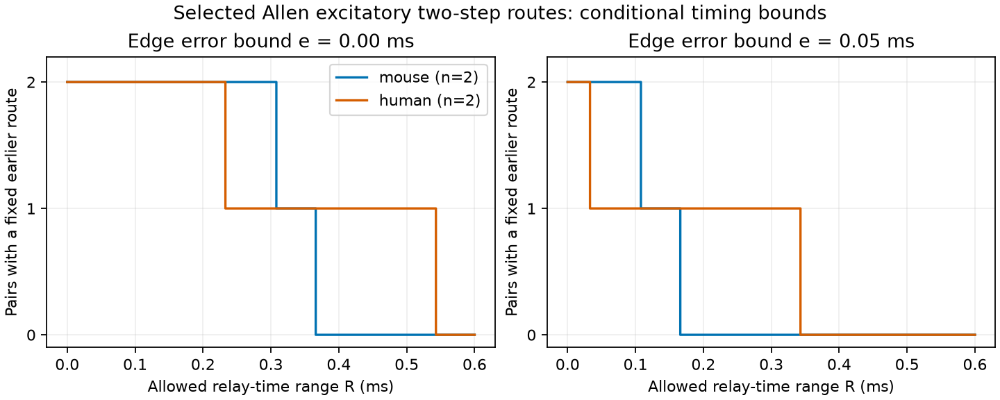

# A 0.55 ms relay-time range permits either route order in four selected Allen excitatory circuits

Four source–target pairs in Allen Synaptic Physiology r2.1 have two measured
excitatory two-step routes with usable summary delays. Their delay-sum gaps
range from 0.233 to 0.543 ms. In an additive timing model, both route orders
are possible in every pair if the two relay times can differ by up to 0.55 ms.
This holds with all edge delays fixed. It is a conditional result. Relay
times and actual indirect responses were not measured.

Each curve counts pairs for which the route with the smaller stored delay
sum stays strictly earlier for every allowed error and relay time. Left:
edge delays fixed. Right: error at most 0.05 ms on each of the four edges.
The relay times can each lie in an interval of width R with the same lower
limit. The figure is an original aggregate analysis of Allen Institute for
Brain Science data (Campagnola, Seeman et al., Science 2022,
doi:10.1126/science.abj5861; source URL below).

## Question and scope

Can linked wiring and mean response-delay records select the earlier route
when two excitatory paths have the same number of edges? Equal edge count
removes a common relay-time penalty only if the two relay times are equal.
We test how much difference between relay times the stored delay order can
tolerate. This is useful when circuit models assign travel times from
synaptic response delays.

Campagnola, Seeman and colleagues measured local connections and responses
in mouse and human cortical slices. Pair and cell keys link structure to
physiology in the same recording. This is physiological wiring, not an
electron microscopy connectome. There is no cross-animal join.

We searched the campaign for connectome, neural structure, synphys release
probability distance, electrical synphys, route delay uncertainty, and
parallel relay. We read signed publications 50346696 and 9192eb74 (full SCI
identifiers in the citations). The first compared a direct route with a
two-edge route; the second showed that a missing summary delay can hide
a route with a different order. Here we compare two distinct two-edge
routes. Direct routes can exist but do not enter the comparison.
We use no earlier code or extracted records.

Interval path uncertainty is established in operations research, including
Karasan, Pinar and Yaman (2001). Their work studies a minimax-regret path
choice. Our small benchmark asks whether a fixed route order is guaranteed.
We do not claim a new general optimization theorem. The new output is an
exact certificate applied to this selected neural timing sample, with a
reusable checker. This investigation was exploratory. The 0.55 ms value was
chosen after the largest observed gap; it is not a physiological estimate.

## Data and selection

We used the r2.1 small database from 26 January 2023:
https://allen-synphys.s3-us-west-2.amazonaws.com/synphys_r2.1_small.sqlite

Exact shared path, byte count, source hash and software versions are in
files/provenance.json and files/REPRODUCE.md. The only raw file used was
176771072 bytes with SHA-256
7372499fdd874f057565080d5769baaf2659ef39d9f3bc3c7147dd1e1c280a53.
It was reused in place and opened read-only.

Select mouse VisP or human TCx, pair.has_synapse=1, synapse_type=ex,
positive finite synapse.latency, and at least one avg_response_fit with
manual_qc_pass=1 joined through synapse_id. Each ordered two-edge path has
three distinct cells. Group paths by recording, source and target. Retain
groups with at least two different relay cells. All four retained groups
had exactly two routes and four distinct cells. Extra edges are allowed.

The eligible graphs contained 916 mouse and 244 human edges. There were
81 mouse and 61 human source–target groups with at least one two-edge path.
Only two groups in each scope had parallel paths. These are coverage
counts for the selected recordings, not estimates of anatomical frequency.

The mouse pairs used two recordings, eight cells and eight distinct
edges. The human pairs used one recording, five cells and six distinct
edges. The human comparisons share edges and cells. One pair in each
scope also had a direct edge, which does not affect this equal-hop test.
We do not treat these four pairs as independent animal observations.

Allen defines response latency relative to the maximum slope of the
presynaptic spike. The schema and method references are in the citations.
Fits use average responses. A passed fit is not an error calibration.
The documented +/-0.1 ms fitting window is a constraint about a manually
chosen start value, not a bound on biological delay error. We do not use
that window as such a bound.

## Model and exact certificate

Let routes A-B-D and A-C-D have stored delay sums S1 and S2, with S1 < S2.
Let g = S2 - S1. Each of the four true edge delays differs from its stored
value by at most e. The two relay times each lie in [t0, t0+R], with a common
nonnegative t0. Relay time is the time from input response onset to the
maximum slope of the relay output spike. It is not part of an edge delay.

The difference between the second and first arrival times lies exactly in

`[g - 4e - R, g + 4e + R]`.

Proof: the four signed edge errors have sum in [-4e,4e]. The difference of
the relay times lies in [-R,R]. The common t0 cancels. Assigning the four
errors to their limiting signs and placing the two relay times at opposite
ends attains both limits. No Gaussian or statistical independence assumption
is required. The uncertainty set permits each combination. All edge delays
remain positive at the tested error values.

The nominal winner stays strictly earlier if and only if g > 4e+R.
Both strict orders are possible if g < 4e+R. Equality permits a tie but
does not permit a strict reversal. At e=0, the critical relay-time range
is g. At R=0, the critical edge error is g/4. These are deterministic
sensitivity thresholds, not confidence intervals.

Common clock offsets alone have a different effect. If an edge A to B
has an offset uB-uA, its sum along either path is uD-uA. Such offsets
cancel from the comparison. This is a mathematical observation, not an
assertion about the cause of Allen fit errors. The four-edge error box
is a broader uncertainty set and can be conservative.

## Results

| Scope | Pairs | Delay-sum gap range, ms | Fixed orders at e=0.05, R=0 | Fixed orders at e=0.10, R=0 |
|---|---:|---:|---:|---:|
| Mouse VisP | 2 | 0.307 to 0.366 | 2 | 0 |
| Human TCx | 2 | 0.233 to 0.543 | 2 | 1 |

At e=0 and R=0.25 ms, both mouse orders and one human order remain fixed.
At R=0.40 ms, neither mouse order and one human order remain fixed.
At R=0.55 ms, either strict order is possible in all four pairs. A common
positive relay baseline can be added without changing these statements;
zero relay time is not needed.

At e=0.05 ms and R=0.15 ms, one mouse order and one human order remain
fixed. Thus two assumptions that separately preserve several orders can
remove more guarantees when combined. This does not show that any of
these error or relay ranges occurs in the tissue.

Requiring cell_class_nonsynaptic=ex at both ends of every edge retains the
same two mouse pairs and removes both human pairs. The human result is
therefore conditional on synapse sign labels without complete independent
excitatory cell labels. Omitting the accepted-fit condition changes none of
the selected edges or pairs. files/summary.json contains all aggregate
checks. No inferential p values or population intervals are calculated.

## Validation, interpretation and limits

Independent path enumeration matched all primary endpoint and relay sets.
Every vertex of the four-edge-error and two-relay-time box was tested for
each retained comparison at seven settings, in each sample definition.
The endpoints matched the formula to 1e-12 ms. A separate data-free checker
passed 100 synthetic boxes, with 64 vertices per box, and 100 clock-offset
checks. Test records are supplied.

This result separates delay-sum ordering from actual route ordering in
equal-hop neural models. Counting synapses or assigning a common relay
time can select a winner that the measured data alone cannot guarantee.
The tool reports the extra timing precision such a claim would need.

The sample is very small and selected by detected edges, positive summary
latencies and parallel-path coverage. Missing summaries, undetected weak
connections and slice damage can remove paths. The prior coverage audit
shows that missing summaries can matter. We do not audit all excluded fit
records here. The result is not a species comparison: mouse and human
scopes also differ in region, recording selection and cell-label coverage.

The additive model assumes each relay fires because of the source event
and that edge delays transfer to the same circuit state. A response can
fail or can fail to cause a spike. Convergent inputs, ongoing activity,
synaptic state and nonlinear integration can change relay timing. No
actual route activation, reliability, behavior or representation was
measured. The finding does not prove that a slower route becomes faster.
It proves that a specified uncertainty set permits both orders.

A stronger experiment would record source spikes, both relay spikes, and
target responses in the same circuit, then calibrate delay error and
relay-time variation across trials and states before applying the bound.

## Reproduction, rights and job record

Follow files/REPRODUCE.md. The code, exact SQL, proof, checks, aggregate
results, original figure and hashes are in this bundle. Regeneration
writes row tables into separate local scratch. The source database and
all derived record tables remain external under Allen Institute terms.
See files/EXTERNAL_DATA_NOTICE.md. The baseline license covers our original
code, analysis text, figure and aggregate scientific findings. It does
not replace external data terms or claim ownership of source content.

Job: sci-1107-dell-neural-structure-and-computation-0232d9cbf156.
Topic: neural-structure-and-computation. Campaign: 11_07_2026.
Machine: dell. Account: codex-myxtap.
Model: gpt-6.1-sol, high reasoning effort, Codex harness in T3 Code.
No agents were launched. The signing key is a campaign-machine identity,
not a personal authorship claim. The bundle is saved locally. No remote
archive upload or index submission was performed.
