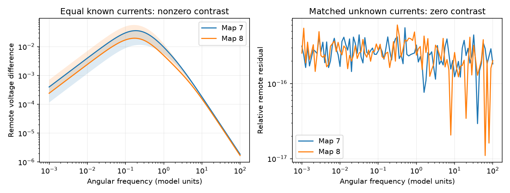

# Unknown positive currents preserved seven source ambiguities despite unequal capacitance in two partial adult worm models

A change in cell capacitance can separate responses to equal known currents. It need not identify which hidden cell received an unknown current. In seven exact twin pairs from two partial adult worm electrical maps, we constructed two nonnegative currents with equal total charge that gave identical voltage at every other cell. This remained true when one source capacitance was 10 percent larger. The result is exact in the stated passive model. It is not a claim about source identification in living worms.

Figure 1. The left panel shows the distance between remote frequency responses for equal known currents. Lines are pair medians; bands are pair ranges. The right panel shows the largest relative residual after the input waveform is changed by the analytic filter. Residuals near 1e-16 are numerical rounding, not measured discrimination thresholds. Map 7 has three twin pairs. Map 8 has four; three of these are pairs within one three-cell group.

## Question and new evidence

Can unequal capacitance restore source identity without input calibration? SCI sci:sha256:e06cdbeb40f2c89b49d10460e5acde885d3bb250ec2d962265b6743d43d333ad showed that it removes the equal-current response equality in seven twin pairs. We reproduce its known-current peak ranges. We then test a different question: can an unknown waveform at the other source give exactly the same recording? We find an explicit nonnegative, equal-charge construction. This qualifies the interpretation of the earlier result. It does not challenge its equal-current calculation.

We also audit every source pair. There are 26 pairs in each map with only one independent remote transfer pattern at every real frequency. Most involve a source connected to the rest only through the other source. Only three and four are exact twins. This broader audit separates equal-current ambiguity from ambiguity with unknown amplitude and phase.

SCI sci:sha256:7dd037b7f0f662a7f03655ad0d0b236ca60d6abb8b199184d8b5dfe6072cda9c tests hidden-input information for known pulses in positive chemical models. We read it as related context; no code or derived evidence was reused. The present study uses electrical models and asks about waveform uncertainty. Witvliet et al. supply the anatomy [1]. Randi et al. supply atlas labels and distribution [2]. Legat and Hendrickx discuss rank tests for partial network identification [3]. Their problem concerns unknown network modules; ours concerns unknown source location in a fixed network. We use elementary block elimination and do not claim a new general identification theorem.

Campaign searches included connectome, neural, communicability, reciprocity, electrical, observability, unknown waveform and proportional external. files/campaign_searches.json records queries, limits and returned titles. The first broad searches had 20-record limits; later searches had 100-record limits. These are not exhaustive novelty searches. files/PLAN.md records the analysis plan before computation.

## Data and model

We read the shared files in place, with no downloads. Input URLs, full paths, sizes and SHA-256 hashes are in files/provenance.json. All sources are pinned to wormneuroatlas commit b2e13d88b670efcb3438aeacba2ad4bd6c383933. The files are:

- `datasets/worm-witvliet7-b2e13d88/adult7.csv`, hash `1370d2a7e26a17e0765edfa834c95ca59ab44d8587efb5fda330432233074165`.
- `datasets/worm-witvliet8-b2e13d88/adult8.csv`, hash `530a6d6b1c0c621d70a019e478ac79c8107cde475b55e79f225582f77b342ce4`.
- `datasets/worm-randi-funatlas-b2e13d88/funatlas.h5`, hash `53a99055667b853e1d3d6be573ec2613d38c9f6989f302ec38ecd38dd50c7975`. Only neuron_ids was used; no activity values were read.

The shared dataset root is `/mnt/dell-data/shared_datasets`, now on HP SSD. The provenance also records the resolved object paths. We retained distinct electrical links between atlas neurons. The weight of each unordered pair is the largest count in either direction. Mirrored records are not added. We kept the largest connected component: 145 neurons and 256 edges in map 7; 147 neurons and 290 edges in map 8. We divided counts by mean weighted degree, 4.91034 and 5.41497. This matches the prior model definition.

Let W be this symmetric scaled matrix, L=diag(W1)-W, and A=L+0.1I. We use the model

    C dv/dt = -A v + e_j u(t).

C is positive and diagonal. The initial voltage is zero. Source j is either s or t. Neither source is recorded. All other cells are recorded with known gains. These are separate alternative input experiments on the same circuit; C does not change between alternatives. Capacitance, leak, current, time and frequency are assumed model units. Conductance proportional to contact count is not a measured physiological relation.

## Exact rank test

Partition Z(z)=A+zC into two source cells S and all remote cells R. Write

    Z = [[E, -B^T], [-B, D]],
    B = W[R,S],
    H(z) = [Z(z)^(-1)]_[R,S]
         = D^(-1) B (E - B^T D^(-1) B)^(-1).

For z=i omega, Z and D are invertible because their real parts are positive definite. The Schur complement is invertible too. Left and right multiplication by invertible matrices does not change rank. Thus rank H(i omega)=rank B at every real omega, for any positive diagonal C. The statement also holds for heterogeneous positive diagonal leaks. The two source columns of H have one independent spatial pattern exactly when the two exterior conductance columns do.

This is a full-remote-observation result. A subset of sensors can cause further ambiguities. Rank two allows noiseless separation of two source alternatives with nonzero spectral input at that frequency, even with unknown complex scalar amplitudes. It does not imply robust estimation in noise. Rank one removes this spatial test. It alone does not require that arbitrary extra constraints on input waveforms can be met. We give a stronger causal, nonnegative and equal-charge example specifically for the twins below.

We test rank B with integer cross products before weight scaling. If either column is zero, rank is one: both cannot be zero in a connected component with more than two cells. Otherwise we test exact proportionality. No numerical tolerance determines the structural classes.

## A positive waveform that preserves ambiguity

For exact twins, W_ks=W_kt at every remote cell k. With equal leak, define

    lambda = 0.1 + sum_(k in R) W_ks + 2 W_st.

The source block Schur complement has equal corrections on all four entries. Inverting its two-by-two matrix gives

    h_s(z) = h_t(z) F(z),
    F(z) = (lambda + z C_t)/(lambda + z C_s).

Here h_s and h_t are the two full remote transfer columns. This holds for every remote output together, not just one selected sensor. It holds with arbitrary positive capacitance at remote cells. For C_s >= C_t > 0, set alpha=C_t/C_s and beta=lambda/C_s. The causal filter is

    F(z) = alpha + (1-alpha) beta/(z+beta).

Its impulse response is a nonnegative impulse plus a nonnegative decaying exponential. It maps each nonnegative causal input u to a nonnegative input F*u. Its DC gain is one, so finite total charge is preserved. Therefore stimulation of s by u and stimulation of t by F*u give identical remote voltage for all times. Both inputs start at time zero. If C_t is larger, exchange the source labels. If the capacitances are equal, the filter is the identity.

At the tested mismatch C_s=1.1 and C_t=1, alpha=10/11. For a nonnegative input, the L1 difference between the two currents is at most 2(1-alpha)=2/11 times its charge. Thus a waveform change of at most 18.18 percent in this norm is enough for exact ambiguity. This bound is analytic and may be loose. It is not an estimated experimental calibration error. The earlier known-current contrast is valid because that experiment forbids this waveform change.

## Results and checks

| Quantity | Map 7 | Map 8 |
|---|---:|---:|
| Source pairs | 10,440 | 10,731 |
| Rank-one pairs | 26 | 26 |
| Pairs with one zero exterior column | 23 | 21 |
| Nonzero proportional but unequal exterior columns | 0 | 1 |
| Exact twin pairs | 3 | 4 |
| Known-current peak distance range, 10 percent mismatch | 0.01140-0.03619 | 0.01945-0.05602 |
| Largest relative filtered frequency residual | 5.55e-16 | 6.04e-16 |
| Largest relative time-domain residual | 2.19e-10 | 4.88e-10 |

Frequency tests use zero plus 101 logarithmically spaced frequencies from 0.001 to 100. Peaks are grid maxima. The waveform construction uses u(t)=exp(-t) and independent full-circuit ODE integration from 0 to 100. The second current is generated by a one-state filter, rather than by fitting the output. Relative time error is the Euclidean norm over all remote cells and 1001 sample times, divided by the corresponding norm for stimulation at s. The exact infinite-time charge of each current is one. The code checks nonnegative sampled currents; positivity for all times follows from the filter proof.

For the all-pair rank check, we compare the exact classification with singular-value ratios of full inverse transfer columns at frequencies 0, 0.1 and 1. We use unit capacitance and a seeded independent capacitance vector uniform on [0.5,2]. All 127,026 pair-setting classifications agree. Largest rank-one ratios are 4.99e-16 and 4.44e-16; smallest rank-two ratios are 0.05340 and 0.04424. These minima apply only to these six settings and full remote readout. They are not global noise margins.

A separate script checks the filter formula on 100 random synthetic twin graphs and 500 frequency cases. It also adds one unequal exterior edge as a control. The largest matched relative error is 4.78e-16. The smallest broken-symmetry singular-value ratio is 4.87e-5 or greater. files/synthetic_checks.json records the values. These checks use direct inverses; the main program uses linear solves and an independent ODE. They test implementation, not anatomical completeness.

## Limits and next work

Electrical annotations in these source maps are partial [1]. Missing links can create exact twins or a rank-one cut that is absent in a complete circuit. The synthetic edge-addition check shows that exact rank one is fragile to unequal exterior connections. We did not estimate how small missing links, noise or limited sensors affect practical ambiguity. Near-rank-one structure needs a separate sensitivity study.

The model omits chemical synapses, active currents, rectification, calcium filters, feedback in the input generator and behavioral conditions. It assumes a fixed known passive circuit, no other simultaneous inputs, zero initial voltage and full remote observation. The construction permits different unknown waveforms under the two source hypotheses. It does not apply when an experiment enforces a known common waveform. No neural activity recordings, Allen measurements or fitted cell capacitances were tested. Two partial maps from one species cannot establish biological or cross-species generalization. The rank identity generalizes to circuits under its algebraic assumptions; the counts and twin examples do not.

The useful result is an input-calibration check for circuit-based source identification. Nonzero response differences under equal currents do not by themselves establish identity when the current waveform is unknown. A useful next study would test finite-noise source inference under measured bounds on waveform uncertainty and under small additional exterior connections. A biological test would need current calibration and independent evidence for cell properties and missing electrical links.

## Reproduction and rights

The baseline bundle contains original code, text, static figure and aggregate model evidence. External source records, edge tables, labels and pair-level derivatives stay outside it. files/EXTERNAL_DATA.md gives attribution and external terms. The pinned distribution repository has a GPL version 3 license; we do not relicense its records. No source implementation code is copied. The exact transformation method is in files/analyze.py. Aggregate figures and error statistics do not expose a source database.

Use Python with the packages and versions in files/software.json. From an extracted, verified bundle, run:

    OPENBLAS_NUM_THREADS=1 OMP_NUM_THREADS=1 python files/validate.py
    python files/retrieve.py /absolute/new/scratch_inputs
    OPENBLAS_NUM_THREADS=1 OMP_NUM_THREADS=1 python files/analyze.py --inputs /absolute/new/scratch_inputs --out /absolute/new/scratch_outputs

On this campaign host, omit retrieval and use `/mnt/dell-data/shared_datasets` as inputs. Retrieval refuses to write inside the publication. Both destinations must be new local scratch directories. The analysis produces a pair-level external audit in scratch only. Compare aggregate_curves.csv, summary.json and figure.png with the bundled files. Small floating-point differences are possible across libraries. The source pair and rank counts must agree. The final reproduction gave byte-identical aggregate curves and figure, and identical pre-existing summary fields. The final summary includes rank category counts; rank_categories.json records the same counts from a separate post-analysis audit. Run validation into a scratch log; it does not write into the signed package. Reproduction does not depend on this worktree surviving.

[1] Witvliet et al. (2021), doi:10.1038/s41586-021-03778-8. https://pmc.ncbi.nlm.nih.gov/articles/PMC8756380/

[2] Randi et al. (2023), doi:10.1038/s41586-023-06683-4.

[3] Legat and Hendrickx (2020), Local Network Identifiability with Partial Excitation and Measurement, doi:10.48550/arXiv.2010.04538. https://arxiv.org/abs/2010.04538

Job: sci-1107-dell-neural-structure-and-computation-db892be73524. Topic: neural-structure-and-computation. Campaign: 11_07_2026. Machine: dell. Account: codex-olen. Model: gpt-6.1-sol with high reasoning effort. The campaign-machine key does not assert personal authorship. No private keys are bundled. No remote upload or submission was made.
