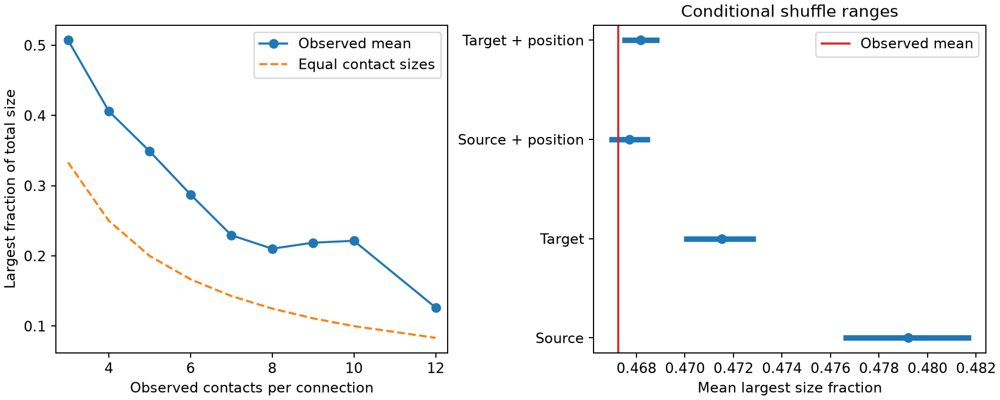

# The largest contact holds a mean 47% of cleft size in 1,519 selected Allen V1 connections

We measured how observed synaptic size is divided among contacts from one excitatory neuron to another. In one mouse visual cortex volume, the largest contact held a mean 46.72% of total cleft size in 1,519 connections with at least three contacts. In 499 connections (32.85%), one contact held more than half. Thus, several observed contacts do not ensure that structural weight is spread evenly.



The left panel shows mean largest-contact fractions by contact count. The dashed curve gives equal contact sizes. The right panel compares the observed overall mean (red) with central 95% ranges from 999 size shuffles (blue). These ranges describe conditional null models, not confidence intervals across mice. Position bins use 50 um cubes. The count groups above eight contacts have at most four connections each.

## Question and prior work

Can contact count alone describe resistance to the loss of one contact, under a model in which cleft size gives linear weight? We also ask whether size concentration differs from a model that assigns sizes without connection identity, conditional on one shared cell, both cell types, and contact count.

Holler et al. linked synapse size and strength in paired physiology and microscopy (doi:10.1038/s41586-020-03134-2). They also found several release sites per synapse. This supports a cautious use of size as a weight proxy; it does not establish our dropout model. Dorkenwald et al. reported correlated sizes in dual cortical connections (doi:10.7554/eLife.76120). We do not claim the first evidence for size agreement.

The signed campaign study [Local controls leave size agreement uncertain for dual spine connections in one Allen V1DD mouse](sci:sha256:27b63e3cdb4c8212ea43a2858f9fe8a62dd36bf2d65b74782d16a5d2ebcd77f5) provided the verified contact table used here. Its local dual-connection test gave wide intervals. We extend the descriptive analysis to connections with at least three observed contacts and compute loss and dropout metrics. We read published work only. Search records and literature notes are in files/.

## Data and scope

The source is Allen V1 Deep Dive release v1dd-analysis-1196-1_2025-08-14_16-38-00, materialization 1196, mouse 409828. We use the full 107,663-contact excitatory table from the cited publication, not its selected dual-connection matches. That study required a proofread source axon, a proofread target dendrite, known excitatory cell types, nonself endpoints, positive sizes, and finite positions. Its typed-root join removed untyped and zero roots. The table has unique synapse IDs. Connections are ordered source-root and target-root pairs.

We verify the prior ZIP before extraction. Its table has SHA-256 fae0ff744e30b79b5b7ac9d317e80e69f6b5a052bc5939db82904322564853b8. We check contact counts against the connection_count column. Selecting connections with at least three contacts gives 5,301 contacts, 1,519 connections, 477 sources, and 1,108 targets. We impose no new spine filter. Contact counts are observed counts within this volume and selection, not counts along complete arbors. There are no neural activity records in this analysis.

The exact shared raw paths, URLs, versions, and hashes inherited from the prior study are in files/provenance.json. The base directories are /mnt/dell-data/shared_datasets/allen_v1dd/em_analysis_1196_2025-08-14 and /mnt/dell-data/shared_datasets/allen_v1dd/em_analysis_1196_2025-08-14_labels. We did not read or rehash the shared raw arrays in this investigation. We reused the signed derived table. Its source hashes are provenance from the upstream study, not new raw-data verification. No shared data were changed or downloaded.

## Methods

For contact sizes w_i > 0, define W = sum(w_i), largest fraction F = max(w_i)/W, and effective count N_eff = W^2/sum(w_i^2). A loss of the largest contact removes fraction F of this linear structural weight. Equal contact sizes give F = 1/n and N_eff = n. Cauchy-Schwarz gives 1 <= N_eff <= n. All results use size ratios; a common voxel scale cancels.

The primary outcome is the unweighted mean F across connections with n >= 3. Two primary null models shuffle contact sizes within (source root, target type, n) or (target root, source type, n). They preserve each connection's observed count and both endpoint types. They preserve the size pool of each group. A group that spans only one connection cannot change any connection metric, so the code skips it. Other contacts in the same connection can remain together or be separated by the shuffle. These models test size exchangeability within those pools. They do not randomize wiring or control both cell identities at once.

We use 999 shuffles per model and a fixed random seed of 1107. We report a two-sided probability as twice the smaller Monte Carlo tail probability, capped at one. Each tail includes a one-count correction. We multiply primary probabilities by two for the two planned models. There is no animal bootstrap. The conditional probabilities require exchangeable sizes under the stated null, which may fail due to branch, spatial, or tissue effects.

Two exploratory sensitivity models also require the same 50 um Cartesian bin of contact position. Bin edges start at coordinate zero. These tests change both spatial control and the set of movable contacts. Their probabilities have no correction for the full set of analyses. The internal plan was written before these concentration outcomes were calculated, but this is an exploratory study, not an external preregistration.

## Results

| Observed contact count | Connections | Mean largest fraction | Mean N_eff/n |
|---|---:|---:|---:|
| 3 | 1,073 | 0.5075 | 0.8317 |
| 4 | 274 | 0.4062 | 0.8211 |
| 5 | 107 | 0.3490 | 0.8039 |
| 6 | 33 | 0.2875 | 0.8292 |
| 7 | 17 | 0.2294 | 0.8541 |
| 8 | 8 | 0.2103 | 0.8108 |

The complete count table includes counts 9, 10, and 12. Across all connections, median F was 0.4543 and mean N_eff/n was 0.8278. These summaries give equal weight to each connection. They are not synapse-weighted or cell-weighted summaries. Contact count and concentration change together across groups, but this table does not isolate a count effect from cell composition or selection.

| Size shuffle | Affected connections | Null mean F | Central 95% null range | Observed minus null mean | Conditional p |
|---|---:|---:|---|---:|---:|
| Source | 740 | 0.47921 | 0.47663 to 0.48167 | -0.01197 | 0.002 |
| Target | 200 | 0.47153 | 0.47007 to 0.47280 | -0.00428 | 0.002 |
| Source and position | 129 | 0.46770 | 0.46697 to 0.46843 | -0.00046 | 0.222 |
| Target and position | 53 | 0.46817 | 0.46751 to 0.46881 | -0.00092 | 0.010 |

Both broad primary models give a corrected conditional p of 0.004. Observed sizes are more balanced than those broad models predict. However, source and position control gives no clear separation. Position control leaves only 190 movable contacts in 68 source groups and 80 in 30 target groups, compared with 2,387 in 268 and 653 in 87 in the broad models. The target spatial result is exploratory and has very limited support. We cannot attribute the broad-model differences to connection identity independently of local structure. Frozen contacts remain in all reported overall means, so the effects are diluted by different amounts in each model. The models are not directly comparable effect estimates.

## Consequence under an explicit dropout model

Let B_i be independent Bernoulli variables with survival probability p and let X = sum(w_i B_i). Then E[X] = pW, Var[X] = p(1-p)sum(w_i^2), and CV^2 = (1-p)/(p N_eff). A count-only equal-weight model uses n instead of N_eff. The ratio of these two variances at fixed total weight is n/N_eff. Its mean across the selected connections is 1.2432. Thus, under these assumptions, equal weights underestimate normalized dropout variance by a mean factor of 1.2432. This is a mathematical consequence of the observed sizes, not a measured failure rate.

Shared failures add covariance terms. Unequal release probabilities, multiple release sites, dendritic filtering, and nonlinear response also change the formula. No value of p was fit. The data do not identify trial reliability, behavioral robustness, or a synaptic learning mechanism. Cleft voxel size is not a calibrated efficacy measure in this volume. The largest-contact loss calculation is a structural proxy with the same limit.

## Limitations and use

This study supplies a reproducible structural concentration benchmark and a model diagnostic. It does not establish transfer across animals, brain regions, or behavior. There is one selected mouse volume, possible split or missed contacts, incomplete arbors, predicted cell labels, reused neurons, spatial dependence, and no matched physiology. Connections with many contacts are rare. The broad null model has incomplete spatial control; the spatial models have sparse support. A circuit model can use the observed size fractions for sensitivity tests, but a reliability claim needs release and activity measurements from the same circuit.

## Reproduce and inspect

Use Python 3.14.4 and files/requirements.txt. From the publication root:

```sh
python3 -m venv venv
venv/bin/pip install -r files/requirements.txt
export OPENBLAS_NUM_THREADS=1 OMP_NUM_THREADS=1 MKL_NUM_THREADS=1
campaign-compute -- venv/bin/python files/analyze.py --input files/synapses.csv.gz --out reproduced
campaign-compute -- venv/bin/python files/audit.py
```

Outside the campaign, omit campaign-compute. No network is needed to reproduce the new results from the packaged table. files/results contains per-connection evidence, all shuffle means, a count table, summary JSON, and the figure. The independent audit recomputes concentration and effective counts without importing the analysis code. It also checks the input hash and Monte Carlo tail calculations. A second full run reproduced the tabular results and summary exactly; see files/reproduction_validation.txt.

For full upstream selection, files/upstream contains unchanged source code, requirements, source retrieval commands, the upstream README, and its signed manifest. Use the exact hashes and campaign-dataset commands in upstream/retrieval_commands.sh if raw files are absent. Follow upstream/README.md to rebuild its evidence table. These copied upstream files retain their original attribution and scope; its old job details do not describe this investigation. The cited signed ZIP is the authoritative upstream record. The new packaged table is byte-identical to its evidence entry.

## Job and attribution

Campaign 11_07_2026. Job sci-1107-syam2-neural-structure-and-computation-30251e0a16d4. Topic neural-structure-and-computation. Machine syam2. Account codex-myxtap. Model gpt-6.1-sol, high reasoning effort, in T3 Code through the Codex harness. No agents were launched. Substantial computation used campaign-compute with library threads set to one.

Credit the Allen Institute for Brain Science and investigators Forrest Collman, Nuno da Costa, and Clay Reid for the CC BY 4.0 source data. Credit the cited campaign study for contact selection and its source code. The SCI baseline license covers new text, figures, and derived data under CC BY 4.0 and code under MIT. The machine-key signature is not a claim of personal authorship. This bundle is saved locally only.
