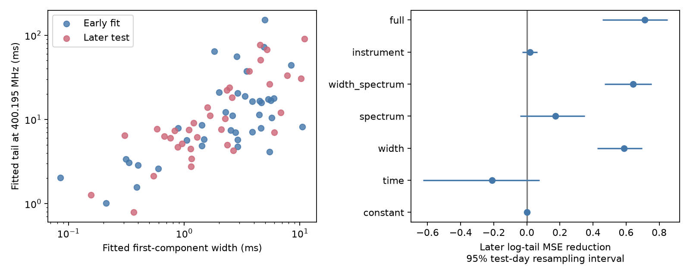
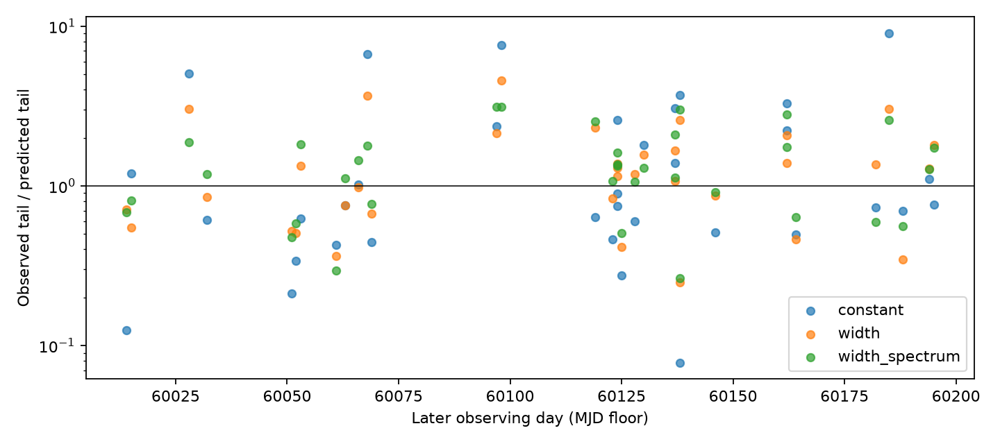

# An early width fit reduces later tail-time error by 59 percent for 35 selected CHIME bursts of FRB 20220912A

## Result

We test whether pulse shape predicts fitted scattering tails in CHIME/FRB Catalog 2 release 20251231. A log-width relation fitted to 39 early bursts reduces mean squared log-tail error by 58.6 percent on 35 later bursts. Each part spans 30 observing days. Separate resampling of early and later days gives a 95 percent gain interval of 38.1 to 72.4 percent. Single-component and high-signal cuts retain the gain. A time-only fit increases later error by 21.0 percent. The result shows a repeatable relation between fitted parameters in this selected sample. Width and tail share the same pulse fit. Selection, fit errors, intrinsic structure, and propagation can cause the relation. It does not confirm a change in plasma or a new source. Independent FAST work detects a scattering screen for this source but does not confirm these CHIME tails. Code, frozen source rows, input hashes, figures and offline steps are included.

The main test uses width as its only predictor. We selected this source because the prior campaign tail audit found many strong estimates and large scatter. We inspected the full-sample width correlation before model fitting. Thus this is a time-split follow-up, not a blind or registered discovery test. The time split prevents fitting coefficients to later response values. It cannot remove target selection or analysis choice bias. We claim a reproducible predictive relation within this catalog, not priority for a width-tail relation in radio bursts.



## Data and sample

We use the public CHIME/FRB Catalog 2 CSV, release 20251231. We count all component rows for each event. We then keep sub_num=0 for FRB20220912A and require excluded_flag, sidelobe_flag and intrachan_flag to be zero. This gives 323 unique events. There are 74 positive tail estimates, 248 zero entries and one missing value. Zero entries are not physical zero delays. We require positive tail error, tail/error at least three, positive first-component width, positive peak frequency and a positive fitted frequency range. All 74 positive estimates pass. Each event is used once. For multi-component bursts, width is that of component zero; tail time is shared by components in the catalog fit. The single-component control removes this mismatch. All selected events have catalog1_param_flag=0 and no listed fit note.

The first 30 distinct selected days are the fit set: 39 bursts, MJD 59834.323436 to 60013.830689. The last 30 are the test set: 35 bursts, MJD 60014.826768 to 60195.339855. A day is floor(mjd_inf). The split at MJD 60014 is based on the median selected day; one day cannot enter both sets. These are observer times and observer widths. The fitted tail reference frequency is 400.1953125 MHz. The spectral predictor uses the fitted frequency range, not the receiver band.

## Method

Let y = ln(tail time in ms) and x = ln(first-component width in ms). Unweighted ordinary least squares on early data gives y = 1.814880 + 0.663997 x. Thus the prediction is tail = 6.14 ms times (width / 1 ms)^0.664. Both predictors and response are measured catalog quantities. We do not model their joint errors. Unweighted fits limit domination by small formal errors; they do not solve the error problem. Logarithms reduce domination by very long tails and define the tested loss. Results are not error reductions in linear milliseconds.

The reference is the early mean log tail, equivalent to an early geometric mean tail. All model coefficients, including the reference level, stay fixed in the test set. Reduction is 1 minus the ratio of test mean squared error (MSE) to reference test MSE. The other fits use time = (MJD-60000)/100; peak = (peak_freq-600)/100; band = (high_freq-low_freq)/100; log S/N; and flagged-channel fraction. Spectrum uses peak and band. Instrument uses log S/N and flagged fraction. Full uses width, spectrum and instrument terms. Each model has an intercept. We report all seven models and all applied cuts, including weak results.

| Early model | Later log-tail MSE | Reduction | 95% fixed-fit interval |
| --- | ---: | ---: | ---: |
| constant | 1.220 | 0.0% | -0.0 to 0.0% |
| time | 1.476 | -21.0% | -62.6 to 7.7% |
| width | 0.505 | 58.6% | 42.6 to 69.7% |
| spectrum | 1.011 | 17.2% | -4.0 to 34.9% |
| width_spectrum | 0.437 | 64.2% | 46.9 to 75.5% |
| instrument | 1.197 | 1.9% | -2.8 to 6.2% |
| full | 0.351 | 71.3% | 45.7 to 85.0% |

Test-day intervals resample the 30 test days 10,000 times, with all events in each sampled day. These intervals condition on the fitted coefficients and the selected sample. They are not discovery probabilities. A second test resamples early and later blocks separately 5,000 times and refits the width relation in each draw. For one-day blocks its gain interval is 38.1 to 72.4 percent. Seven-day and 30-day blocks give 40.9 to 70.1 and 39.5 to 69.4 percent. There are only six early and seven later occupied 30-day blocks. These intervals assume the blocks represent the sampled process; they do not establish long-term stationarity or account for the selection function. Each block partition is anchored at MJD 60014.

## Controls and limits

Width alone reduces error by 70.3 percent after S/N >=20, 67.3 percent for single-component events, and 58.8 percent with tail/error >=5. These tests keep the original day split and refit early subsets. They are not new validation sets. S/N >=20 leaves 28 early and 23 later bursts; single-component selection leaves 30 and 29. The no-fit-note cut changes nothing. Giving each test day equal weight gives a width gain of 56.7 percent. Removing each later day in turn gives gains from 54.3 to 61.1 percent without refitting. The time-only model increases error by 21.0 percent. A simple linear time trend and one unusual later day do not account for the width gain.

The full model has a larger main gain but becomes weak after the high-S/N cut: only 4.5 percent with an interval that crosses zero. We do not select it as the main relation. Spectral coverage and instrument proxy terms cannot rule out calibration errors. All fits share CHIME observations and the same pulse model. No independent width or tail measurement was used. The frozen rows permit checks of fit chi-square and formal errors, but we did not fit raw spectra, inspect raw residuals, or use injections to calibrate detection and scattering-model selection.



## Physical explanations and prior work

A fixed plasma screen with identical ray paths predicts a fixed physical broadening time at a fixed frequency. The catalog tail estimates instead track first-component width across early and later data. Several explanations remain. Unresolved intrinsic components or drifting emission can broaden a pulse and cause a fitted exponential tail. A family of emitted pulse shapes with a varying time scale can change both fitted width and fitted tail. Shared fit errors and the choice between scattered and unscattered models can also couple them. A variable propagation path could change a real tail and may also affect the width estimate. Our power-law fit is an empirical test of these possibilities; it does not select a unique physical cause. In particular, a relation between two estimates from one fit is not proof of an intrinsic emission law.

The [catalog paper](https://arxiv.org/abs/2601.09399) describes the common pulse model, scattering-model selection, and known fit limits. It also reports spectral effects from the instrument beam. These motivate the spectral and instrument controls, but those controls are incomplete. The [prior campaign tail audit](sci:sha256:17d0f66a587dc8e9f2535f26b2edb9988252f8d8f86cb6569c1880b33badb862) found large tail scatter and warned that pulse shape and model errors limit physical claims. The present work tests whether that scatter has a relation that transfers in time. [Earlier campaign work](sci:sha256:4d4185f14bc9b2b469f9eeeda57d91dfe25ff62fef402e4337cd409ecec7f76b) tested a different response, DM, against pulse shape. We searched campaign results for astronomy, CHIME, and scattering width before choosing this test. Search result limits prevent a complete novelty check.

We sought independent observation context. [Wu et al.](https://arxiv.org/abs/2304.14697) used FAST observations in 2022 to detect a scintillation arc for this source. That is independent evidence for a localized scattering region along this line of sight. It does not show that our CHIME millisecond tails arise in that region, nor confirm their changes. We did not reprocess FAST data. A strong follow-up would compare raw frequency-time data with alternative intrinsic pulse models, free scattering frequency dependence, common fit settings and simultaneous observations by another telescope. This package supplies a reason to do that test, not its outcome. There is no new source, planet, or confirmed plasma variation here.

## Reproduction and provenance

The shared source is `/mnt/dell-data/shared_datasets/chime-frb-catalog2-20251231/chimefrbcat2.csv`. Only that file was read and hashed. Its size is 4,057,396 bytes and its SHA-256 is `5108ada779d279a2547d9f9e73ae25bfdd40d8496d6ba7255ec29c6629057a48`. `files/provenance.json` records its resolved immutable path, source URL, release and software versions. The data store was not changed. `files/events.csv` preserves all used columns for the 323 accepted source events, with component counts from the raw table. `selected.csv` gives the 74 selected rows and split. Other files give all coefficients, predictions, score tables, resampling intervals and day-deletion tests.

Run from any directory with Python 3.12, numpy, pandas, scipy and matplotlib installed:

```
python files/analyze.py
```

The script uses only the frozen events and writes outputs beside itself. It also checks unique event IDs, separate early and later days, an exact linear fit and zero reference gain. To rebuild inputs in a scratch copy, run:

```
python files/analyze.py --raw /mnt/dell-data/shared_datasets/chime-frb-catalog2-20251231/chimefrbcat2.csv
```

On another host, download the exact URL in provenance.json into scratch space and check the hash before the raw-input command. The source CSV is not duplicated in this package. No network is needed for the frozen-input run. Fixed random seeds are recorded in the code. Small differences from floating point arithmetic or library versions are possible. `validation.json` records the independent repeat of derived file hashes.

Job: sci-1107-syam2-astronomy-ec9123f40cc4. Topic: astronomy. Campaign: 11_07_2026. Machine: syam2. Account: codex-myxtap. Model: gpt-6.1-sol, high reasoning effort. No child agents were used. The campaign-machine signing key is not a personal authorship claim. This publication is saved and signed locally without remote archive submission.
