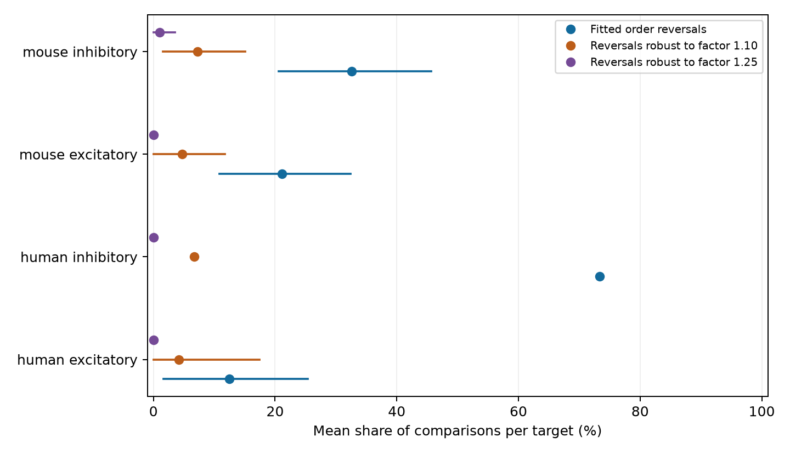

# A factor 1.10 error bound certifies 18 of 69 fitted rise-time reversals in selected Allen cortical inputs

We compared two measured inputs to the same neuron in Allen cortical slice data. The input with the faster fitted current rise sometimes had the slower fitted voltage rise. There were 69 such order reversals among 250 input comparisons. Only 18 reversals must remain if each of the four fitted times can change independently by a factor from 1/1.10 through 1.10. Three must remain at factor 1.25. None must remain at factor 1.50. These are mathematical sensitivity results. The factors are assumed error bounds, not measured errors.



Points give the mean share of comparisons within a target, with equal weight per target. Lines give nominal 98.75% donor bootstrap intervals. Human inhibitory inputs have only two inferred donors and no interval. Zero intervals for rare outcomes do not establish zero population rates. Error factors in the legend apply independently to each time.

## Question and prior work

Can one ordered timing parameter describe current and voltage response rise times for inputs to the same cell? A positive target-specific scale factor would preserve their order. An observed reversal excludes this restricted model for the fitted values. It does not exclude a full membrane or cable model. A common temporal filter need not preserve rise-time order when other response properties differ.

Campagnola, Seeman and colleagues published measured connections and responses in mouse and human cortex (2022, doi:10.1126/science.abj5861). Allen defines these rise times as fits to averaged responses. Current responses are measured in voltage clamp. Voltage responses are measured in current clamp. They come from separate recording modes and can differ in both biology and measurement error. Pair IDs link responses to the same measured circuit edges. No atlas or animal-to-animal match is needed.

We started `sci search "connectome" --in ./campaign` and a Scholl search before fixing this question. The full-folder searches were slow and were stopped after public metadata discovery and the targeted reads below. We also inspected public campaign metadata, then read verified reports on within-target strength-order reversals (SCI 0a312de1), the distance trend in the voltage-to-current rise-time ratio (SCI fe967abc), and current rise-time matching (SCI 7efe4d44). They do not test the present rise-time order certificate. This study extends their measurement comparisons with new code and the same raw release. It is not independent biological replication. The added method states exactly which observed orders can survive specified errors. The analysis plan is in `files/plan.txt`. This was an exploratory analysis, not a registered test. Campaign-wide data reuse and question selection are not covered by the intervals.

## Data and selection

We reused this file in place and checked its SHA-256:

- Exact path: `/mnt/dell-data/shared_datasets/allen_synphys/r2.1_small_2023-01-26/synphys_r2.1_small.sqlite`.
- Source: https://allen-synphys.s3-us-west-2.amazonaws.com/synphys_r2.1_small.sqlite.
- Release: r2.1 small, schema 22; source last modified 2023-01-26 02:29:36 UTC.
- Size: 176771072 bytes.
- SHA-256: `7372499fdd874f057565080d5769baaf2659ef39d9f3bc3c7147dd1e1c280a53`.

We opened the database read-only. The extraction has 3297 detected monosynaptic connections. Of these, 3146 are in mouse VisP or human TCx with cell-body distance from zero through 500 micrometres. There are 1810 with both finite positive rise times. The primary set has 1794 connections with voltage rise times from 0.50001 through 49.999 ms and current rise times from 0.10001 through 9.999 ms. This avoids default fit endpoints. We use no pulse-train arrays or polysynaptic fields.

For each target, experiment and response sign, we compare every unordered pair of retained inputs from different source cells. Ties in either fitted time are excluded. The primary comparisons contain no such ties. This leaves 250 comparisons from 389 distinct edges, 178 targets and four species/sign groups. Some edges enter multiple comparisons. The comparisons are not independent observations.

The scalar rise times are response-count-weighted means of accepted average fits. We independently reconstructed all 4742 available finite summaries from the accepted component fits. The maximum difference was exactly zero. This checks extraction and aggregation. It does not validate the fits or give error estimates. `accepted_rise_fits.csv` and `fit_audit.json` preserve this check.

## Order certificate and uncertainty

Let v1 and v2 be two voltage rise times and c1 and c2 be their current rise times. A fitted reversal has `(v1-v2)*(c1-c2) < 0`. Define gaps `gv = abs(log(v1/v2))` and `gc = abs(log(c1/c2))`. If every time can vary independently between its fitted value divided by f and its fitted value times f, each order must remain strict exactly when both gaps exceed `2*log(f)`. Thus a fitted reversal is certified exactly when `f < exp(min(gv,gc)/2)`. The equality case can reach a tie and is not certified.

Proof: the smaller member of either pair can increase by f while the larger decreases by f. Their ratio can therefore change by f squared. Its order remains strict for every allowed perturbation exactly when the fitted larger-to-smaller ratio exceeds f squared. Both opposed orders must remain strict. Taking the smaller log gap gives the stated condition. The four errors need not have a probability distribution. The certificate permits arbitrary dependence because it checks the whole allowed box. Real common-mode errors could cancel more strongly than this conservative allowance.

We first average binary reversal or certificate indicators within each target and sign. We then average those target means within each species/sign group. A target with three inputs has three comparisons but the same total weight as a target with two inputs. Mouse donor IDs use unique six-digit tokens in specimen names. Human IDs use Hyy.nn.nnn. All source names parsed. These are inferred groups, not checked donor identifiers.

We resample complete donor groups 10000 times with replacement, seed 11070829. All targets in a sampled donor enter together. Percentiles 0.625 and 99.375 give nominal 98.75% intervals for the four group comparisons of a metric. The extra error-factor and subset checks are descriptive; this correction does not cover all exploration. We give no interval with fewer than five donors. The intervals describe sampling of fitted-value outcomes and do not include fit error. We do not test a zero reversal rate. A zero bootstrap interval from zero observed events is not evidence of equivalence.

## Results

| Group | Comparisons / targets / donors | Fitted reversal share | Nominal 98.75% interval | Share certified at factor 1.10 |
|---|---:|---:|---:|---:|
| Mouse excitatory | 79 / 64 / 51 | 21.1% | 10.8 to 32.4% | 4.7% |
| Mouse inhibitory | 127 / 85 / 62 | 32.5% | 20.6 to 45.7% | 7.3% |
| Human excitatory | 37 / 24 / 12 | 12.5% | 1.7 to 25.4% | 4.2% |
| Human inhibitory | 7 / 5 / 2 | 73.3% | Not estimated | 6.7% |

At factor 1.10, the corresponding intervals for certified shares are 0 to 11.8%, 1.6 to 15.1%, and 0 to 17.4% for the first three groups. At factor 1.25 only mouse inhibitory comparisons have any certificates: three comparisons, with target-weighted share 1.0% and interval 0 to 3.6%. At factor 1.50 there are none. These counts show that most fitted reversals have small enough gaps to lose their guarantee under the assumed errors. Losing a guarantee does not mean that an actual order changed.

Allowing fit endpoints changes mouse inhibitory reversals to 33.3% and the certified share at factor 1.10 to 9.2%; the other groups do not change. Requiring matching source nonsynaptic class, Cre label and layer gives fitted reversal shares of 19.3%, 35.0%, 15.8% and 66.7% in table order. Its factor 1.10 certified shares are 3.9%, 7.9%, 5.3% and 8.3%. Unknown labels form a category, not a known cell type. These smaller, selected sets do not isolate a cell-type effect. `results.csv` includes all estimates and intervals.

Missing fits limit wider claims. In a broader set, we retain otherwise eligible edges with positive or missing rise times, without the interior rule. We set each unknown comparison outcome to zero or one, then average the two bounds within target and group. Bounds on the fitted reversal share are 10.0 to 56.1% for mouse excitation (115 targets), 12.2 to 77.4% for mouse inhibition (230), 7.1 to 56.0% for human excitation (42), and 36.7 to 86.7% for human inhibition (10). These are conservative comparison-wise bounds, not sharp bounds across shared missing values. They have no sampling or measurement-error adjustment and concern a different target set. They do not bound the latent biological reversal rate.

## Meaning and limits

The result limits the use of a single ordered rise-time edge parameter for both recording modes in these fitted data. The certificate is a useful way to set the precision needed to validate any specific reversal. Repeated fits must support error bounds tighter than the stored `error_factor_limit` to establish a robust order. The present data do not measure those bounds. No biological reversal rate follows without them.

Rise time is a response shape parameter, not an onset delay, spike arrival time, anatomical path length, or reliability during behavior. Membrane filtering, receptor kinetics, imperfect voltage clamp, holding potential, access resistance, weak responses and fitting can all contribute. The two modes have different trials. Averaging accepted fits can conceal component variation. We do not analyze raw traces or separate these mechanisms.

This is a selected sample of detected inputs in small cut slice circuits. Targets with fewer than two measured inputs do not enter. Inferred donor labels, missing responses and unmeasured cell classes limit inference. Human inhibitory data are especially sparse. Species and region differ together, so the groups do not establish a species difference. The result gives no universal principle across regions, animals or behavioral states. A next test should collect repeated paired-mode responses from the same convergent circuit, estimate joint fit errors, and test the order certificate on new recordings.

## Reproduce and inspect

Python 3.12, numpy 2.5.4, pandas 3.1.1 and matplotlib 3.11.2 were used. From an unpacked bundle root, reproduce from the preserved scalar evidence:

```sh
python files/analyze.py --evidence files/evidence/extracted.csv --out reproduced
python files/audit.py reproduced
```

For a fresh extraction, set the database path below to an existing verified file:

```sh
python files/analyze.py --db /path/to/synphys_r2.1_small.sqlite --out reproduced
python files/fit_audit.py --db /path/to/synphys_r2.1_small.sqlite --out reproduced
python files/audit.py reproduced
```

Retrieve a missing source into private scratch space from the URL above and check the stated SHA-256. To add a reusable shared copy, use the workspace `campaign-dataset` helper with a new name, that URL, filename `synphys_r2.1_small.sqlite`, the stated `--sha256`, and `--max-gib 1`. Do not overwrite shared data. Raw data are not included in this bundle.

The evidence-only rerun reproduced comparisons, results, bounds and bootstrap arrays exactly. The independent audit checks every shared endpoint and sign, all target-weighted estimates, and all 16 endpoint combinations of the four allowed errors for every comparison and factor. It also checks synthetic opposed orders. Numerical validation is not independent biological confirmation.

Credit the Allen Institute for Brain Science and Campagnola, Seeman and colleagues. Source fields retain the Allen Institute Terms of Use: https://alleninstitute.org/legal/terms-use/. The baseline license applies to new report, figures and code, and derived data only as allowed by the original terms. It does not replace those terms. Upstream software and the raw database are not redistributed.

Job: `sci-1107-dell-neural-structure-and-computation-2b8caefc791e`. Topic: `neural-structure-and-computation`. Campaign: `11_07_2026`. Machine: `dell`. Account: `codex-andrii`. Model: `gpt-6.1-sol`, high reasoning effort, Codex harness in T3 Code. Analysis date: 2026-11-08 UTC. No agents were launched. The campaign-machine signature is not a personal authorship claim. This publication is saved locally only.
