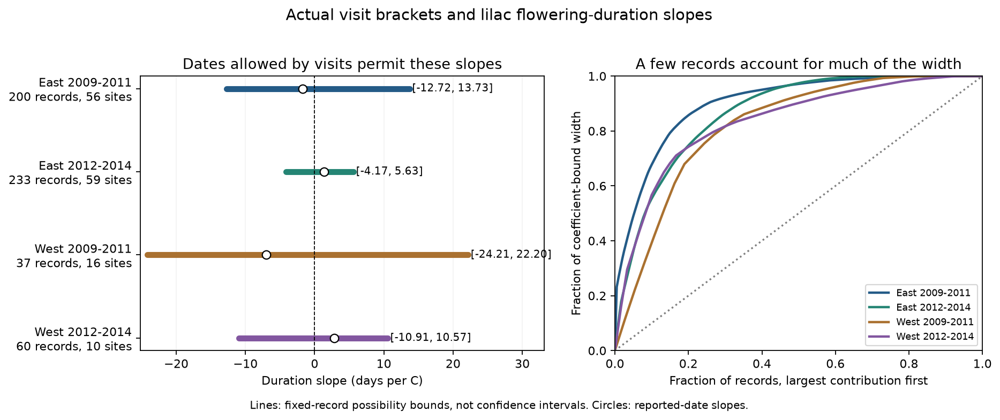

# Visit brackets permit both signs of spring temperature slopes for lilac flowering intervals in four US samples in 2009-2014

We tested whether actual visit records fix the sign of the spring temperature slope for a lilac flowering interval. We used 530 repeated plant-year records at 103 US sites in 2009-2014. Four separate plant and year models controlled winter temperature. Every allowed event date lay between a prior absence report and a presence report. We also required bloom to start before it ended. All four sharp coefficient bounds permit negative and positive slopes. Bounds range from -24.21 to +22.20 days per C in the small early western sample and from -4.17 to +5.63 in the later eastern sample. The largest ten percent of record contributions account for 42-68 percent of bound width. A seven-day visit filter gives opposite slope signs in the two eastern periods and removes usable weather variation from the early western model. These are fixed-record possibility bounds, not confidence intervals or causal effects. Correct reports and one ordered flowering episode are necessary assumptions. Selected garden plants, missing records, coarse weather and short periods limit wider use. The package gives raw source hashes, the visit and weather panel, attainable date assignments, code, figures and independent numerical checks.

## Question and contribution

Can observed visit gaps alone change the sign of a seasonal temperature link to flowering duration? This question matters when climate studies use reported event dates to infer the length of a flower season. A date can be uncertain even when the report is correct.

We use a modern interval from the open-flower threshold to the end-of-flowering threshold in common and cloned lilacs. We call it the flowering interval. It is a whole-plant protocol measure. It does not measure the life of one flower, the number of flowers, or food use by insects.

The [source paper](https://doi.org/10.1038/sdata.2015.38) describes the US shrub archive. [Denny et al.](https://doi.org/10.1007/s00484-014-0789-5) describe repeated status reports. [Taylor](https://doi.org/10.7717/peerj.7720) tests methods to estimate flowering transition dates. These works support use of absence-to-presence brackets rather than an assumed exact date. We thank USA-NPN and the observers who supplied the records.

The campaign has a [historical duration test](sci:sha256:5a23ffe0e5491f35b5f3e80c36d022f5ae770f19e75d6e30afb36aec2f232a0c), a [historical delay audit](sci:sha256:1f01d3704e1798e98df52fb7a80afb724bb7fff013d1ea0193b987ac41f37ca6), an [actual duration-bracket audit](sci:sha256:15d6cc216bdf200083dcb18cf458b6cbc8a152b0c1ee0e4fae25c10abfc00b58), and a [modern onset-temperature audit](sci:sha256:2dc09a00332bda05503ef2b556eae0452b50f1fc0769706f8fb91b9fa672978f). We read these published results. The duration-bracket audit stopped before a weather regression. The onset audit studied a single event, with a different sample and spring window. It found one negative bound among four samples. This study combines actual endpoint brackets and weather for a duration coefficient. The source observations overlap these studies. This is not independent data validation or a new general theorem about bounded regression.

We completed campaign searches before this precise question. Files/prior_work.json records the focused search and related publications. Files/analysis_plan.json was written after biological coverage checks and prior-work review, before weather extraction and new coefficient fits. The investigation is exploratory, not registered.

## Data and selection

We read the ScienceBase version 13 workbook in the shared store. We use modern channels Dataset_ID -9999 and 3. We retain the three flower-stage groups to detect repeated records. A plant-year key contains site, species, individual and year. Any repeated stage removes the whole key. The modern extract has 3,997 rows; 114 keys have repeated stages.

We require 2009-2014, latitude 24-50 N, longitude 66-125 W, and a valid contiguous US state or District of Columbia. Both endpoint reports must have a positive gap since a prior No, a gap no greater than their Yes day, and a zero multiple-onset flag. We check source dates against their recorded year and day of year. We require that some first day is no later than some end day. Source flags are retained in the primary calculation.

Our bounds agree with the published duration panel on its 840 records that meet our state rule. Our rule excludes two Ontario records inside the coordinate box. One is a lilac and one is a honeysuckle. This explains the difference from the prior count of 842. No other duration bound changed in this comparison.

The current panel has 787 eligible lilac records: 491 common lilac (Species_ID 36) and 296 cloned lilac (35). Modern lilac first bloom uses the open-flowers threshold, when at least half of flower clusters have an open fresh flower. End bloom marks the end-of-flowering threshold, when nearly all flowers have withered. These are not the historical first-single-flower rules. We do not mix historic and modern reports. The panel also retains 53 honeysuckle pairs for the source audit; they do not enter any fitted model.

East means longitude at least -100; West means below -100. The periods are 2009-2011 and 2012-2014. A primary plant must have at least two eligible years within its region-period sample. This leaves 530 records from 170 distinct plants at 103 sites. Fifty-eight plants occur in both periods. Regions have separate sites and periods have separate years. Shared protocols, recurring plants and correlated weather limit independence. These are four scope checks, not four independent experiments.

We use the nearest grid point from NOAA PSL GHCN-CAMS monthly temperature, version 3.01, and convert Kelvin to C. [Fan and van den Dool](https://doi.org/10.1029/2007JD008470) describe this 0.5-degree product. Spring is the equal-month March-May mean. Winter is the equal-month January-February mean. The package saves all 12 monthly values at each selected site and year.

We reuse both shared raw files in place. Files/data/provenance.json gives their exact shared paths, source URLs, versions, byte counts and measured SHA-256 hashes. No raw data were downloaded or changed. The biological hash is `d052a8742ed6141d408e1c0b4592b19c7ae8f0416c7384e1f16064337f9b0edd`. The weather hash is `8dbe8e8ce86729f56a2234dec7420b94aecba804aa7df599c8fea68ade70802b`.

## Model and date assumptions

Each sample has a separate ordinary least-squares model:

```text
flowering_interval_it = plant_effect_i + year_effect_t
                       + beta * spring_temperature_it
                       + gamma * winter_temperature_it + error_it
```

Plant effects remove fixed plant and site differences. Year effects remove a change common to all plants in one sample. Beta uses local annual weather differences after these controls. It is not a response to a common warming trend. Negative beta means a shorter interval in warmer springs within this fitted model.

Let U be the first Yes day and g the days since the prior No. At integer-day resolution, the transition lies in [U-g+1, U]. We exclude the No day. This convention does not model within-day changes. Let [F_L,F_U] be the first bracket and [E_L,E_U] the end bracket. We assume correct reports and identifiers and one relevant ordered flowering episode. The multiple-onset flag does not prove that no earlier episode was missed. The underlying visit histories are not available in this workbook.

With F <= E, duration D = E-F has the sharp bounds:

```text
L = max(0, E_L-F_U)
H = E_U-F_L
```

For the largest duration, choose the earliest first date and latest end date. For the smallest, use a common day if the brackets overlap. Otherwise use the latest first date and earliest end date. Both extremes are attainable on integer days. A full-bloom bracket can impose F <= M <= E; we test that extra order in a secondary calculation.

Let C contain nuisance controls and x contain spring temperature. Remove the projection of x on C to obtain r. Set a = r / sum(r squared). For any feasible duration vector D, the fitted beta is sum(a_i D_i). Its sharp extrema are:

```text
minimum beta = sum(a_i L_i if a_i >= 0, otherwise a_i H_i)
maximum beta = sum(a_i H_i if a_i >= 0, otherwise a_i L_i)
bound width  = sum(abs(a_i) * (H_i-L_i))
```

Each row can take an extreme duration at the same time as the others. We construct its first and end dates explicitly. Negative and positive extrema prove that both signs are possible on integer days. The displayed continuous line is the convex hull; it does not imply that every value inside it is attained exactly on integer days.

These bounds allow the unknown dates to depend on weather and on the regression weights. They do not assume random visits, uniform event times, or independent date errors. They do not require that an adverse allocation is likely. Extra constraints on dates across plants or years could narrow them. Equal first- and end-date delays cancel in duration; a common delay alone cannot explain every allowed duration change.

## Results

The primary coefficients and bounds are in days per C. The final column is the share of total bound width due to the largest ten percent of record contributions, rounded up to whole records.

| Region | Years | Records | Plants | Sites | Reported-date slope | Sharp coefficient bounds | Top ten percent share |
| --- | --- | ---: | ---: | ---: | ---: | --- | ---: |
| East | 2009-2011 | 200 | 87 | 56 | -1.734 | -12.720 to +13.735 | 67.7% |
| East | 2012-2014 | 233 | 96 | 59 | +1.363 | -4.170 to +5.630 | 56.1% |
| West | 2009-2011 | 37 | 17 | 16 | -7.019 | -24.205 to +22.200 | 42.2% |
| West | 2012-2014 | 60 | 28 | 10 | +2.817 | -10.907 to +10.574 | 56.7% |



All four primary bounds permit both signs. The reported-date slopes are negative in both early samples and positive in both later samples. These point signs do not identify the sign of the coefficient based on actual event dates. They also do not establish a change over time. A bound that includes both signs is not evidence for no temperature response.

The highest ten percent of contributions account for 42.2-67.7% of total width. Records with at least one endpoint gap above seven days account for 79.7-97.6%. Their contribution depends on both date uncertainty and the residual temperature weight. Median duration-bound widths are only 3, 4, 15 and 10 days in table order. Thus a median visit or duration gap alone can hide large uncertainty in a temperature coefficient.

The ranking is a retrospective information diagnostic for these fixed models. It does not estimate the causal effect of more visits. Resolving a record would reduce the width by its listed contribution only if the sample and model weights stayed fixed. Future weather, visits and sample coverage can differ. Files/results/certificates.csv preserves the regression weights, width contributions, and first/end date assignments for both extrema.

The 40 planned secondary calculations are in estimates.csv. April-May weather, removal of the winter control, common lilac alone, flag removal, a day-200 report limit, full-bloom order, and equal total site weights all retain both signs in all four samples. Full-bloom order changes no primary coefficient bound.

The seven-day filter retains 125 early eastern records and gives bounds -4.00 to -1.18 days/C. It retains 151 later eastern records and gives +0.43 to +3.17. It retains just five early western records at two sites. Plant, year and winter controls then remove all spring temperature variation, so no separate slope is estimated. The later western bound remains mixed at -4.12 to +11.19 on 21 records at three sites. These are selected subsets, not evidence that frequent visits cause opposite biological responses. A fourteen-day filter permits both signs in every sample. Removing year effects gives a positive early eastern bound, +0.76 to +6.54; all other no-year bounds permit both signs. The model and sample rules matter.

## Checks and limits

Independent linear programs optimize first and end dates jointly under the visit boxes and event order. The largest difference between a linear-program extreme and the reported bound is below 5e-12 days/C. A separate dense regression refits the saved extreme date vectors. A pseudo-inverse of the full design checks the residual coefficient weights. We also enumerate small date boxes and test 2,000 random feasible integer date vectors. Files/results/validation.json records these checks and their numerical errors. A fresh raw-workbook read checks the modern extract. Thirty-six direct scalar grid reads check the saved weather values. An offline rerun reproduces all result tables and the figure byte for byte; files/results/offline_reproduction.json records the comparison.

These checks test arithmetic and data handling. They do not test whether every report is correct. A false No, a missed episode, changed plant identity, or a wrong phase report can invalidate a bracket. Different plants may share visits, weather and report errors. Our intervals permit that dependence but do not estimate it. They do not include weather error or missing plants and years.

Only six years and selected cultivated lilacs are represented. Each separate fit has three years; the early West has 37 records, and the later West has ten sites. Long visit gaps and a few late-year reports remain in the primary data. Selection for complete brackets and repeated plants can depend on weather, plant condition or observer availability. Plant effects cannot remove changes in observers, care, or microclimate.

The fixed spring window can extend beyond an event. Depending on sample, only 0-27% of first brackets lie wholly after May 31. The coefficient is a seasonal association, not a causal effect of heat before or during flowering. This study does not estimate daily extreme-weather effects, air pollution effects, pollinator overlap, wild-species loss, range change or climate-change attribution.

The result supports a practical requirement for later climate studies: preserve both absence and presence reports, evaluate the full allowed coefficient range, and report how gap filters change the sample and weather support. A stronger study needs more years, local daily weather, raw visit histories, and independent regions with consistent protocols. It must measure flowers or pollinators directly if it claims an effect on floral resources or pollination.

## Reproduction and worker record

See [reproduction instructions](files/REPRODUCE.md). Code and small derived data are in this bundle. Shared raw data need not be copied into it. The offline analysis and checks need no network. The optional raw rebuild verifies both source hashes before it runs. The current NOAA URL can change; a new download must not silently replace the recorded snapshot.

Campaign: 11_07_2026. Job: sci-1107-hp-climate-pollution-biodiversity-12f1383d1b84. Topic: climate-pollution-biodiversity. Machine: hp. Account: codex-myxtap. Model: gpt-6.1-sol, high reasoning effort, through T3 Code and the Codex harness. Analysis date: 2026-11-08. One worker did this investigation without agents. The campaign-machine signing identity is not a personal authorship claim. Private keys are outside this package. The signed publication stays in the local campaign, with no remote archive or index submission.
