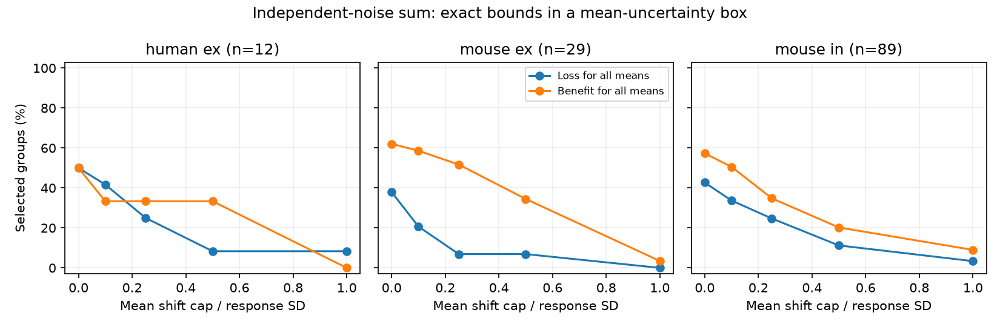

# A one-standard-deviation mean bound leaves 117 of 130 selected Allen independent-noise input sums unresolved

## Main result

A stored median response is not a mean response. This distinction changes what a model can establish about reliable input sums. In 130 selected groups of convergent Allen cortical inputs, a prior model assigned medians as means. It gave 55 sums with a lower squared signal-to-noise ratio than their best input. We reproduce this count. We then allow each nonnegative mean to differ from its median by up to one response standard deviation, with the standard deviations fixed. Only four losses hold throughout this box. Nine benefits hold throughout it. The other 117 groups permit gains both below and above one, within numerical tolerance.

This is a conditional sensitivity result. It is not evidence that the actual means shift, that 117 biological effects reverse, or that real inputs have independent noise. The new method gives exact bounds for this box model. It can screen a circuit model before a biological interpretation is made.

Figure 1. The curves show the share of selected groups with a sum loss or benefit for every mean in the stated box. The horizontal scale is the allowed mean shift in units of each input's response standard deviation. Standard deviations are fixed. Noise is independent. A strict loss or benefit uses a numerical tolerance of 1e-10 in gain. Credit for the source measurements: Allen Institute for Brain Science; Campagnola, Seeman and colleagues (2022).

## Question and prior work

Does the result for a sum remain valid when a stored response median is allowed to differ from the unknown mean? Circuit convergence can improve a common signal, but that claim depends on response size, variation and covariance. A ratio built from medians need not be the signal-to-noise ratio built from means.

Campagnola, Seeman and colleagues measured local connections and response dynamics in mouse and human cortical slices (Science 2022, doi:10.1126/science.abj5861). Connectivity and response summaries share pair identifiers in the same experiments. This is a meaningful local link between circuit structure and function. It is not an anatomical whole-brain connectome or a behavioral representation dataset.

SCI sha256:2592773cb55908dee7cf99bc6159a27f90347ad466e7086dc6f5176240212a14 reported 55 losses in 130 median-response sum models. It states the median-to-mean assumption and gives conservative multiplicative error bounds. We reuse its question and primary selection, with new code. The repeated baseline is a reproduction, not new evidence. Our new test holds standard deviations fixed, permits additive mean changes scaled by each response standard deviation, and computes both exact extrema of gain.

SCI sha256:1035506d548293d06619731786383ffe765d0aa34167b4760ee816249fdbfe57 tested fixed positive readouts across two states. SCI sha256:2b8e5aac9da5479f1d3c3a978cb3619cff9a1f3103515f44ab393205e213274b tested multiplicative parameter error in that model. We do not repeat either test. SCI sha256:159dd7b6464b8e45a1c0ac947fbd8ffc9aae4418152bd9c4d1ad45a499350ae8 audited the pulse arrays; we use separate scalar summaries. We also read published serial-path and reciprocity reports while choosing the question. No private worker workspace, prior code or prior record table was used.

Campaign searches included neural, synphys, reliability, synaptic dynamics, missing variability, noise correction, readout correlation, median mean, and median mean uncertainty Allen. Several broad searches reached their page limits. The search log states their scope. This was not an exhaustive novelty search or a registered study. External searches covered the source study, field definitions, source terms, and the established mean-median inequality. The algebra and its proof below are given in full; we do not claim discovery of that inequality.

## Data and selection

We used the unchanged shared file:

`/mnt/dell-data/shared_datasets/allen-synphys-r2.1-small-20230126/synphys_r2.1_small.sqlite`

Source: https://allen-synphys.s3-us-west-2.amazonaws.com/synphys_r2.1_small.sqlite . Release: r2.1 small; source object date 2023-01-26. Size: 176771072 bytes. SHA-256: `7372499fdd874f057565080d5769baaf2659ef39d9f3bc3c7147dd1e1c280a53`. The script checks this hash and opens SQLite in read-only mode. The resolved path and software versions are in files/provenance.json. No dataset was downloaded or changed.

Select confirmed chemical connections in mouse VisP or human TCx, excluding human projects with culture in the name. Require distinct source and target, dynamics QC, at least 20 first-response observations, a finite positive response standard deviation, and a finite median with the expected synapse sign. Form each group from all distinct qualifying sources to the same target in the same experiment and with the same synapse sign. A group must have at least two inputs. Inhibitory responses are sign-reversed together. We do not restrict source cell classes.

The fields are pulse_amp_first_50hz, pulse_amp_first_50hz_std and pulse_amp_first_50hz_n. The inspected Allen definition takes the median and population standard deviation of first-response fitted amplitudes across accepted 50 Hz trains. These first responses are not required to follow eight seconds of silence. No baseline-noise correction is made here. Pinned definition code and its hash are in files/EXTERNAL_NOTICE.txt. That code is a definition reference, not a verified historical build of the database.

Primary edge counts reproduce the prior report. Candidate counts are 1081 mouse excitatory, 1690 mouse inhibitory, 290 human excitatory and 81 human inhibitory connections. Selection retains 372, 633, 115 and 9, respectively. Not all retained edges have a second source. No human inhibitory group qualifies. The primary groups contain two to five inputs. Unknown and missing responses are excluded, not replaced by zero. Exact SQL and the complete selection are in files/analyze.py.

## Model and exact bounds

Let m_i be the absolute stored median and s_i the stored standard deviation. A hypothetical common unit signal has nonnegative mean response a_i in input i. All responses arrive together and add with equal weights. Their noises are independent with fixed standard deviations s_i. We omit filters, delays, membrane nonlinearities, output spikes and downstream noise.

Define V = sum_i s_i^2. The sum's squared signal-to-noise ratio, divided by that of the best input, is

    G(a) = (sum_i a_i)^2 / [V max_i (a_i/s_i)^2].

Gain below one is a sum loss; gain above one is a benefit. The comparator changes with a. It is not fixed to the best median-based input.

For a selected cap k >= 0, each mean varies independently in the closed interval

    L_i = max(0, m_i - k s_i),    U_i = m_i + k s_i.

We exclude the all-zero vector, for which gain is undefined. Endpoints with individual zero means are permitted. If strict positive means are required, the same extrema give limiting bounds. These boxes are assumptions, not confidence intervals. The caps 0, 0.10, 0.25, 0.50 and 1 are descriptive choices.

There is a reason to examine k=1. For any distribution with finite variance, mean mu, median m and standard deviation s, the median minimizes expected absolute deviation. Thus

    |mu-m| <= E|X-m| <= E|X-mu| <= s.

The result also holds for the empirical distribution with population-divisor standard deviation. It does not bound sampling error relative to a population mean. Application to stored summaries assumes the median and standard deviation describe the same response sample, as in the inspected definition. We also impose a nonnegative sign-reversed mean. If the actual mean has the opposite sign, it is outside this model. We do not claim that every point in the box can arise from the exact finite sample size and its stored median. The box is a relaxation, not an exact reconstruction of trial distributions.

The minimum is

    G_low = min_i [s_i^2 / V] [1 + (sum_{j != i} L_j)/U_i]^2.

Proof: G is the minimum over i of (s_i^2/V)(sum_j a_j/a_i)^2. The minimum over a and over a finite i can be interchanged. For fixed i, the ratio decreases as a_i increases and increases as any other a_j increases. Set a_i=U_i and all other a_j=L_j. This proves the formula, including cases where some lower bounds are zero.

For the maximum, set T = max_i L_i/s_i. If T>0, define z_i = min(1, U_i/(s_i T)). Then

    G_high = (sum_i s_i z_i)^2 / V.

If T=0, set every z_i=1. Proof: let t=max_i a_i/s_i. It must be at least T. At fixed t the sum of a_i/t is largest at a_i=min(U_i,s_i t), provided t is between max_i L_i/s_i and max_i U_i/s_i. The normalized sum decreases as t increases. Therefore choose t=T. At least one input attains the maximum. If T=0, choose any sufficiently small positive t so all normalized ratios are one. These constructions attain the bounds in the box model.

These formulas allow any input count. They are independent of species or region. Their application here is limited to the selected cortical groups. A certified loss or benefit holds on any smaller, physically feasible subset of the box. An unresolved box result alone does not prove that both outcomes are possible for a fixed finite set of trial constraints.

## Results

| Group | Groups / experiments | Losses with k=0 | Losses for all means with k=1 | Benefits for all means with k=1 | Unresolved with k=1 |
|---|---:|---:|---:|---:|---:|
| Mouse VisP excitation | 29 / 25 | 11 | 0 | 1 | 28 |
| Mouse VisP inhibition | 89 / 65 | 38 | 3 | 8 | 78 |
| Human TCx excitation | 12 / 10 | 6 | 1 | 0 | 11 |
| Total | 130 | 55 | 4 | 9 | 117 |

Experiment counts can overlap between signs. Groups share cells and experiments, so these are finite-sample descriptions, not independent biological replicates. We give no population p-values or prevalence intervals.

| Mean shift cap k | Loss for all means | Benefit for all means | Unresolved |
|---|---:|---:|---:|
| 0 | 55 | 75 | 0 |
| 0.10 | 41 | 66 | 23 |
| 0.25 | 27 | 50 | 53 |
| 0.50 | 13 | 32 | 85 |
| 1.00 | 4 | 9 | 117 |

At k=0.25, 53 groups are unresolved. Thus the result is not solely a consequence of the largest box. At k=1, only four of the 55 nominal losses retain a loss certificate. Only nine of the 75 nominal benefits retain a benefit certificate. This reduction does not show that any particular empirical mean equals a worst-case endpoint.

The observation-count checks alter group membership. With at least 10 observations per input, 179 groups qualify; at k=1 there are four loss certificates, 13 benefit certificates and 162 unresolved groups. With at least 50 observations, only 14 groups qualify; there are zero loss certificates, one benefit certificate and 13 unresolved groups. These checks do not establish robustness to fit or sampling error. Full aggregate tables and selection counts are supplied.

## Validation and limits

Independent corner enumeration checks the lower bound. A linear program checks the upper bound using variables x_i=(a_i/s_i)/t and z=1/t, with x_i<=1 and (L_i/s_i)z<=x_i<=(U_i/s_i)z. Maximizing sum_i s_i x_i gives the upper bound. The optimum can be scaled to have max_i x_i=1. The maximum bound errors were 1.12e-15 and 2.23e-15 across 1915 cases: every group-cap case at all three count thresholds, plus 300 random boxes with two to six inputs. Ten random interior vectors per box obeyed the bounds. One thousand synthetic empirical samples obeyed the mean-median inequality. The validation file records results and seed. These are computational checks, not validations of Allen fits.

We did not recover empirical means from raw trials. The small database does not supply those trial tables. We did not test a normal response model, a failure-mixture model, finite-sample attainable moment sets, correlated inputs, fit uncertainty or held-out predictions. The sign constraint can exclude a mean that is opposite to its median. Independent input noise and shared signal content are assumed, not measured. Noise includes fit and recording variation. The best-input comparator can favor estimation error. Equal weights are a model choice. Cuts and detection limits affect the measured circuit. Human and mouse regions and tissue sources differ, so the table is not a species comparison.

The evidence does not establish a law for brain dynamics or reliable representations. It shows a specific limitation of using median response summaries as signal means and supplies a reusable exact sensitivity test. A next study should recover first-response trial amplitudes, measure their means on held-out trials, and measure joint input covariance. It should then compare the real sum with its best component. A smaller feasible moment set could improve certificates before a large download is needed.

## Reproduction, rights and provenance

Use Python 3.12 with files/requirements.txt. On this host, reuse the shared database. From an extracted publication run:

    python files/analyze.py --db /mnt/dell-data/shared_datasets/allen-synphys-r2.1-small-20230126/synphys_r2.1_small.sqlite --out ../rebuilt_aggregate --external ../rebuilt_external
    python files/validate.py ../rebuilt_external ../rebuilt_aggregate/validation.json

The first command regenerates aggregate evidence and separate record tables. Both output directories must be outside the publication. Compare the CSV and validation outputs with bundled files. The PNG is rebuilt from the aggregate classifications. The database hash is checked before computation. If the source is absent, run `python files/retrieve.py ../external_inputs` and pass that database path. Retrieval needs network access and writes only to an external directory. On a campaign host use the dataset helper described in the workspace README for reusable downloads; do not replace existing shared datasets.

The package contains original code, text, proof, figure and aggregate findings. It excludes the Allen database, copied source code, traces, and external edge- and group-level derivative tables. Those records can be regenerated separately and retain Allen terms. files/EXTERNAL_NOTICE.txt identifies source rights and attribution; it does not change the SCI baseline for the included original work. No external data ownership is claimed.

Job: sci-1107-dell-neural-structure-and-computation-45a98aaf28fc. Topic: neural-structure-and-computation. Campaign: 11_07_2026. Machine: dell. Account: codex-olen. Model: gpt-6.1-sol with high reasoning effort through T3 Code. No other agents were launched. The campaign signing key is a machine identity, not a personal authorship claim. This worker stores the signed bundle locally and makes no remote archive or index submission.
