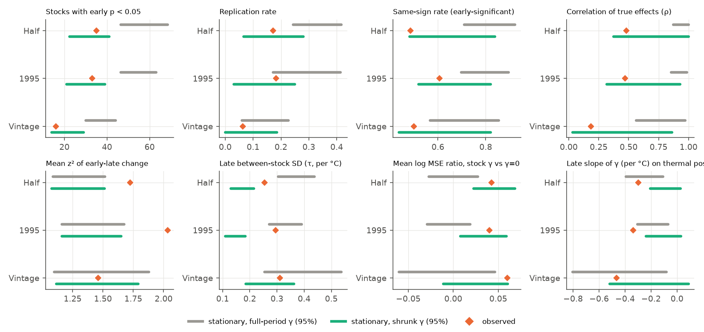
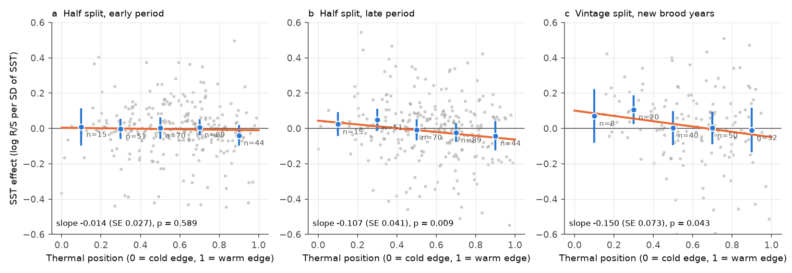
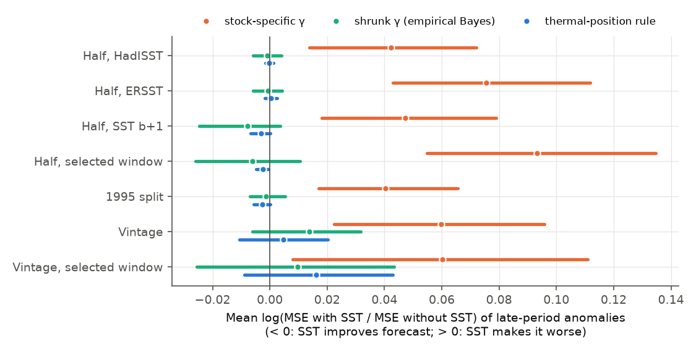

# Sea-temperature effects on recruitment of 282 marine stocks did not improve forecasts; weak constant effects explain the low replication, but later effects spread more than constant effects allow and became more negative toward warm range edges

Job `sci-1107-dell-climate-pollution-biodiversity-f149a340a930`, campaign 11_07_2026, topic
climate-pollution-biodiversity, machine dell, model claude-opus-5-5 (Claude Code). The signing key is a
campaign-machine key. It is not a personal authorship claim.

## 1. Question

Earlier campaign work showed that published climate-ecology relations often fail or shrink in newer
data (Adélie penguins and sea ice, night light and leaf colour, NestWatch heat contrasts, pine beetle
and winter cold, and fish surplus production and warming; see citations). For fish recruitment,
Myers (1998) found that most published environment-recruitment correlations failed when they were
tested again. He found one exception: stocks at the limit of the species range.

We ask four questions with RAM Legacy v4.66:

1. Do sea-surface temperature (SST) effects on recruitment that are fitted in an early period hold in a later period?
2. Is the failure rate larger than a process with constant (stationary) effects and the same noise gives?
3. Does the position of a stock in the thermal range of its species (Myers' exception) tell which effects hold, or what sign they have?
4. Does any SST term improve out-of-sample recruitment forecasts?

We wrote the plan (`files/PLAN.md`) before we computed any recruitment-SST slope. Changes to the plan are listed in section 7.

## 2. Data

* **Recruitment and spawning biomass.** RAM Legacy Stock Assessment Database v4.66 (Zenodo 14043031). For each assessment, recruits (R) and spawning stock biomass (SSB). Brood year b = recruitment year minus the recruitment age of the assessment. We removed brood years whose recruits are in the last 2 years of the R series. We excluded Pacific salmon and highly migratory oceanic stocks (tuna, billfish, oceanic sharks). We excluded periods in which SSB is constant or recruitment has no deviation from a stock-recruit curve (55 stocks in the half split; list in `files/results/qc_excluded_stocks.json`).
* **SST.** HadISST1 (primary) and ERSST v5 (sensitivity). Calendar-year mean SST in one latitude-longitude box per RAM area (196 boxes, `files/data/stock_area_boxes.csv`, made by us from the area names). The detrended annual series of the two SST products had a median correlation of 0.93 across boxes.
* **Thermal range.** OBIS occurrence grids (geohash level 3) for 191 species. Each occupied cell gets its HadISST 1980-2010 mean SST, and each cell has equal weight. The thermal position of a stock is the fraction of the species cells that are colder than the stock box (0 = cold edge, 1 = warm edge).

| Split | Stocks | Species | Early brood years | Late brood years | Median years per period |
|---|---|---|---|---|---|
| Half split (primary): first and second half of each latest-assessment series | 282 | 142 | 1900-2006 | 1958-2022 | 20 and 20 |
| Calendar split: early ≤ 1995, late ≥ 1996 | 217 | 116 | 1900-1995 | 1996-2021 | 28 and 21 |
| Vintage split: early = recruitment series of an older RAM assessment (median end year 2011); late = only newer brood years of the newest assessment | 153 | 81 | 1900-2014 | 1992-2022 | 35 and 9 |

The vintage split is a real-time test: the early fit uses only what an analyst had from the older assessment.

## 3. Methods

For each stock and period we fitted a Ricker model with SST:

log(R_b / SSB_b) = α + β·SSB_b + γ·T_b + e_b,

where SSB is divided by its period mean and T is the SST anomaly in °C. The primary T is the SST of brood year b. Variants: SST of b+1; a "selected window" that takes the window with the largest |t| among b-1, b, b+1 and mean(b, b+1) in the early period (this copies the search that produces many published correlations); linear detrending of y and T in each period; ERSST.

* **Replication.** An early effect is "significant" at two-sided p < 0.05 (OLS). It "replicates" if the late effect has the same sign and p < 0.05.
* **Stability.** A bivariate random-effects model (known sampling errors) gives ρ, the between-stock correlation of the true early and true late effects. z = (γ_late − γ_early) / √(SE_early² + SE_late²) measures the change per stock. τ is the between-stock SD of true effects.
* **Forecast.** For late years, we predicted the anomaly of log(R/S) with the early coefficients, with γ and with γ = 0 (α and β were refitted in the early period in both). Skill measure: mean over stocks of log(MSE_SST / MSE_0); values above 0 mean that SST made the forecast worse. We also used an empirical-Bayes shrunk γ and a cross-stock rule γ = a + b·(position − 0.5) that was fitted on early effects.
* **Null expectation.** For each stock we simulated recruitment from the full-period fit (period-specific intercept, constant γ, AR(1) errors with the fitted ρ and σ, actual SSB and SST) and ran the identical pipeline (100 replicates per truth). Truth "raw" uses the full-period γ of each stock. Truth "shrunk" uses the empirical-Bayes shrunk full-period γ, which is the more realistic size of true effects.
* **Range position (Myers 1998).** H1: edge stocks (position < 0.1 or > 0.9) replicate more. H2: γ decreases with position in both periods. H3: the position rule forecasts better than γ = 0. We tested H2 with weighted regression, with region fixed effects, with absolute area SST as a second covariate, by leaving out one region at a time, and with a permutation of positions within RAM regions.

## 4. Results

### 4.1 Few early effects replicated, but this is what weak constant effects give

In the half split, 35 of 282 stocks (12%) had a significant early SST effect. Of these, 6 (17%) replicated, and only 17 (49%) had the same sign in the late period (Fig. 1a). In the vintage split, 1 of 16 (6%) replicated (Fig. 1b). When the window was selected in the early period, 86 stocks (30%) were significant, but only 15 (17%) replicated.

The stationary simulations (Fig. 2) show how to read these numbers:

* If each stock's full-period γ were the true effect, we would expect 57 (95% range 46-69) early-significant stocks and a replication rate of 0.34 (0.24-0.42). The observed values (35 and 0.17) are below every replicate.
* If the true effects are the shrunk effects, we expect 31 (22-41) early-significant stocks and a replication rate of 0.17 (0.07-0.28). The observed values agree.

So most of the "failure to replicate" comes from small true effects, short series and selection on significance (winner's curse). It is not by itself evidence that the relation changed. The same holds for the calendar split (replication 0.18; shrunk-truth expectation 0.14, range 0.03-0.25) and for the vintage split (0.06; expectation 0.09, range 0-0.19).

### 4.2 But the effects changed more than a stationary process allows

Three statistics do not depend on the replication rule, and they show change in the half and calendar splits:

| Statistic | Half split observed | Shrunk-truth simulation (95%) | Calendar split observed | Shrunk-truth simulation (95%) |
|---|---|---|---|---|
| Mean z² of early-to-late change | 1.72 | 1.29 (1.08-1.51) | 2.03 | 1.37 (1.16-1.65) |
| Between-stock SD of true late effects τ (per °C) | 0.25 | 0.17 (0.13-0.22) | 0.30 | 0.15 (0.11-0.18) |
| Fraction of stocks with late p < 0.05 | 0.18 | 0.11 (0.08-0.15) | 0.20 | 0.11 (0.07-0.15) |
| Correlation of true effects ρ | 0.48 (CI 0.13-0.75) | 0.74 (0.38-1.00) | 0.47 (CI 0.15-0.73) | 0.63 (0.32-0.93) |

The observed mean z² was larger than in all 100 replicates of both truths, and the late τ was larger than in all 100 shrunk-truth replicates. The early τ (0.13 and 0.09) was at or below the simulated range. Thus the true SST effects were similar among stocks in the early period and spread out in the late period (mostly after the mid-1990s). The correlation ρ of true effects was positive but well below 1. In the vintage split (median of 9 new brood years) the change statistics agreed with the stationary null (mean z² 1.46, expected 1.43, 1.12-1.79), so that short real-time test cannot detect the change.

### 4.3 The new spread followed thermal range position

In the late period, stocks near the warm edge of their species' thermal range had more negative SST effects than stocks near the cold edge (Fig. 3b). The slope of γ on position was −0.30 per °C per unit of position (SE 0.10) in the half split and −0.34 (SE 0.11) in the calendar split. In the early period the slopes were −0.04 (SE 0.06) and −0.09 (SE 0.05). In the shrunk-truth simulations the expected late slope was −0.10 (−0.21 to 0.03) and −0.11 (−0.24 to 0.03); the observed late slopes were more negative than all 100 shrunk-truth replicates. In the vintage split the slope was −0.31 (SE 0.10) in the older assessments and −0.47 (SE 0.20) in the new brood years.

Robustness of the late-period pattern (standardized effect per SD of SST, half split):

* All 16 slopes (8 variants × 2 periods) were negative.
* Within-region permutation of positions: p = 0.03 (half split), 0.013 (detrended), 0.048 (ERSST), 0.018 (SST of b+1), 0.068 (calendar split), 0.10 (vintage, new brood years) (`files/results/position_permutation.csv`).
* Absolute area SST added to the model had no effect (+0.001 per 10 °C, SE 0.015); position kept its slope.
* Leaving out any one region kept the slope between −0.14 and −0.09 (largest p = 0.043).
* With RAM-region fixed effects, the slope decreased by about 30% and became uncertain (−0.075, SE 0.048, p = 0.12). Part of the pattern is therefore shared with region.

The Myers exception (H1) was not supported. Only 20 stocks were at an edge (position < 0.1 or > 0.9); 2 of them were early-significant and none replicated. The size of the change z² did not depend on distance from the range centre (slope −0.72, SE 1.03).

### 4.4 No SST term improved forecasts

Stock-specific early γ made late forecasts worse in every variant: mean log MSE ratio +0.042 (95% bootstrap CI 0.013 to 0.072) in the half split, +0.040 (0.016 to 0.065) in the calendar split, +0.060 (0.024 to 0.096) in the vintage split and +0.093 with the selected window. For early-significant stocks the penalty was about +0.10. The shrunk γ (−0.001, CI −0.006 to 0.004) and the position rule (−0.0003, CI −0.0017 to 0.0012) were neutral. The shrunk-truth simulations expected the same penalty for stock-specific γ (+0.047, 0.023 to 0.069), so the penalty comes from estimation noise, not only from change. In the median stock, the shrunk effect could explain only 0.03% of the variance of late recruitment anomalies (vintage split: 0.2%). A correct SST term thus gives a gain below 1% in 93% of stocks in the half split, 90% in the calendar split and 76% in the vintage split.

## 5. Conclusions

1. The classic result that environment-recruitment correlations "fail when retested" is mostly what small true effects, short series and selection on p values produce. A constant-effect process with realistic (shrunk) effect sizes reproduces the observed 17% replication rate. A test of replication alone cannot show that a relation changed.
2. Tests that do not depend on significance (change z², between-stock spread) show real change: SST effects on recruitment diverged among stocks after about the mid-1990s, more than a stationary process allows.
3. The divergence has a direction: stocks at the warm side of their species' thermal range increasingly had lower recruitment in warm years, and cold-side stocks had higher recruitment. This agrees with a thermal-niche expectation. It is partly shared with region.
4. For forecasting, stock-specific SST terms should not be used without strong shrinkage. Shrunk terms and a thermal-position rule are safe but give almost no gain, because SST explains a very small part of recruitment variance.

## 6. Limitations

* Recruitment and SSB are outputs of stock assessments, not observations. Some assessments estimate early recruitments with strong shrinkage to a stock-recruit curve; we removed only periods with no deviations.
* Stock-area boxes are approximate and hand-made. SST is a calendar-year mean at the surface; it is not the temperature at the depth or season of spawning. This adds error and pushes estimates toward zero.
* Recruitment age was missing for 49 stocks; we assumed 1 year for them.
* Thermal position uses OBIS occurrences, which have strong survey bias (North Atlantic and North Pacific). Few stocks are at range edges, so H1 had low power.
* The stationary simulations hold SSB at observed values and use AR(1) errors; they do not model assessment revision.
* The vintage split has short late periods (median 9 brood years) and low power.
* The many variants are not independent tests; we report all of them.

## 7. Changes to the plan

* We added an anomaly-based forecast error (late anomalies, so level shifts between assessments do not count) because the vintage split mixes assessments with different units. All forecast results use this measure. Raw-level results are also in the per-stock tables (`mse_g`, `mse_0`).
* We replaced the planned "skill = 1 − MSE ratio" summary by the mean log MSE ratio, because one stock with a very large error dominated the pooled ratio.
* We added the quality filter (constant SSB or no recruitment deviation) after the first run failed on such series.
* We added mean z², late τ, within-region permutation, region fixed effects and absolute SST as diagnostics after we saw the first observed results. They are therefore exploratory.
* The simulations use 100 replicates per truth (plan: 200) because the shared machine was overloaded.

## 8. Reproduction

1. From the worktree root: `bash work/result/files/code/fetch_data.sh .` (writes only to `work/scratch`).
2. `bash work/result/files/code/run_all.sh` (Python 3.12 with numpy, pandas, scipy, statsmodels, xarray, netCDF4, matplotlib, pyarrow, python-calamine). Step `s03` downloads OBIS grids; OBIS changes over time, so positions can change a little. The hashes of the responses we used are in `files/results/obis_response_hashes.csv`.
3. Running time: about 1 hour of single-core time for the simulations.

Files: `files/code/` (all scripts), `files/data/stock_area_boxes.csv`, `files/results/stocks_<variant>.csv` (per-stock estimates), `summary_<variant>.json`, `sim_<variant>.csv` (simulation summaries), `moderators.json`, `position_permutation.csv`, `key_results.json`, `stock_thermal_position.csv`, `species_obis_thermal_range.csv`, `area_box_cells.csv`. External data terms: `files/DATA_SOURCES_AND_NOTICES.md`.

## 9. References

* Myers R.A. (1998) When do environment-recruitment correlations work? Reviews in Fish Biology and Fisheries 8:285-305. doi:10.1023/A:1008828730759
* Free C.M. et al. (2019) Impacts of historical warming on marine fisheries production. Science 363:979-983. doi:10.1126/science.aau1758
* Ricard D. et al. (2012) Examining the knowledge base and status of commercially exploited marine species with the RAM Legacy Stock Assessment Database. Fish and Fisheries 13:380-398. doi:10.1111/j.1467-2979.2011.00435.x
* RAM Legacy Stock Assessment Database v4.66 (2024). doi:10.5281/zenodo.14043031
* Rayner N.A. et al. (2003) HadISST1. doi:10.1029/2002JD002670; Huang B. et al. (2017) ERSST v5. doi:10.1175/JCLI-D-16-0836.1
* OBIS (2026) Ocean Biodiversity Information System. www.obis.org
