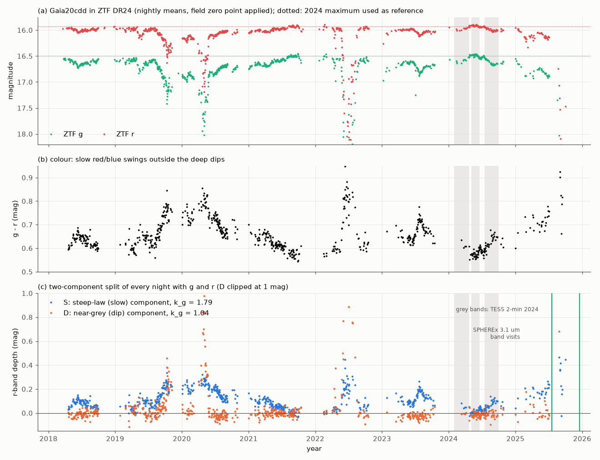
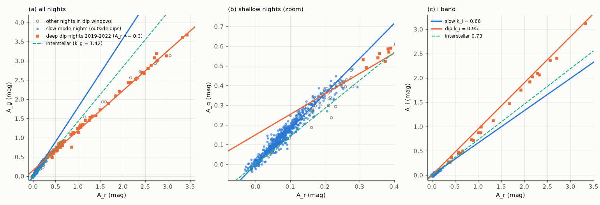
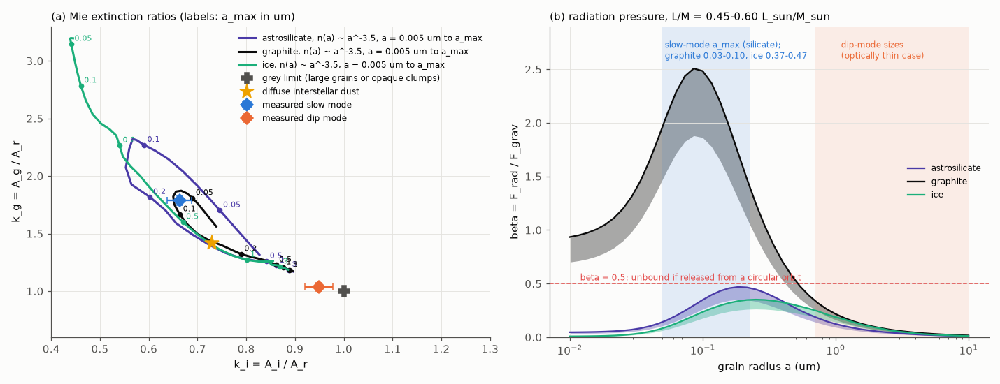

# The old dipper Gaia20cdd dims in two modes in ZTF 2018-2025: a smooth, thin small-grain medium with a steep extinction law covers it on most nights, and opaque clumps make the near-grey dips

**Job:** sci-1107-hp-astronomy-d687a4e37fd0 · **Topic:** astronomy · **Machine:** hp · **Model:** Claude Opus 5.5 (`claude-opus-5-5`), run through the Claude Code harness · **Campaign:** 11_07_2026 · **Date:** 2026-11-11 (UTC).
The signing key is a campaign-machine key. It is not a personal authorship claim.

## Summary

Gaia20cdd (Gaia DR3 1624711296862985472) is a kinematically old K-type star at about 1.6 kpc. It has deep, aperiodic dust dips. Prior campaign studies measured the grain sizes in one deep dip, found a warm infrared excess and reported a possible 3.1 um water-ice band in 2025. They did not agree on what makes the near-grey optical colours of the dips. Also, every prior study used a fixed "quiet" level for the star.

We separated the ZTF DR24 light curve (2018-2025, 1,197 nights, 738 nights with both g and r) into two components by their colour. We used 30 same-field comparison stars to correct the nightly zero point and to test the colour stability.

Main results:

1. **The star is not quiet between the dips.** Outside the deep dips, the star fades and recovers by up to 0.3 mag in g over months to years. Its g - r colour changes from 0.57 to 0.85 (Figure 1). The comparison stars change their seasonal g - r by at most 0.009 mag. The bright neighbour at 16.5 arcsec has a constant colour (0.510-0.514), and its brightness does not correlate with this slow component (r = -0.11).
2. **Two extinction laws.** On 585 nights outside the deep dips, the colour follows k_g = A_g/A_r = 1.79 +- 0.04 and k_i = A_i/A_r = 0.66 +- 0.03. This law is steeper than diffuse interstellar dust (1.42 and 0.73). On 79 nights deeper than 0.3 mag in r in the 2019, 2020 and 2022 dips, the colour follows k_g = 1.04 +- 0.04 and k_i = 0.95 +- 0.03. These are nearly grey (Figure 2). Seven analysis variants change the values by at most 0.09 (Table 3).
3. **A two-component split works.** We give each night with g and r a steep-law depth S and a near-grey depth D. Outside the dips, D has mean -0.007 mag and rms 0.032 mag, which is the measurement noise. Thus the steep law alone explains the slow variations. S is above 0.05 mag on 75 percent of the nights. Its time-averaged value is 0.11 mag in r.
4. **The steep-law medium is smooth.** S does not change above the noise (0.03 mag) on time lags shorter than 6 days. Its rms change increases to 0.11-0.12 mag at lags of 300-800 days (Figure 4). During the 2024 onset of a slow fade, TESS 2-min data show a 12-hour rms of 0.45 percent and no 12-hour dip deeper than 0.9 percent. At the prior occulter-speed limit of 12-18 km/s, the medium is smooth over at least 0.04-0.06 au (6-9 stellar diameters). Its structures are 0.7-3 au long.
5. **Grain sizes of the slow mode.** Mie models with n(a) ~ a^-3.5 match the steep law only if the largest grains are small: astrosilicate a_max = 0.05-0.23 um, graphite a_max = 0.03-0.10 um, or crystalline ice a_max = 0.37-0.47 um (Figure 3). A clumpy screen can only make an extinction law greyer, so these are upper limits on the grain size of this medium.
6. **The deep dips are opaque clumps of small grains, not large grains.** Optically thin screens of large grains give the grey colours, but they predict W1 depths of 1.1-5.8 mag at the 2022 NEOWISE epoch. The observed W1 depth was 0.41 mag. Opaque clumps (r optical depth at least 6 for graphite or 12 for astrosilicate, cover fraction 0.94) of the slow-mode grains, plus the steep-law medium measured on the same nights (S = 0.2 mag), fit the g, r, i, W1 and W2 depths: chi2 = 2.6-4.8 for graphite and 7.8-9.2 for astrosilicate (3 degrees of freedom). Pure-ice clumps fail (chi2 > 240) because the 3 um ice band would deepen W1.
7. **The clumps come with the diffuse medium.** During the 2022 dip, S increased from 0.03 mag before the dip to 0.15-0.25 mag. After 3 of 4 dips, S was higher than before (mean change +0.06 mag). The test that dips start when S is high is not significant (approximate p = 0.10; only 3 of 5 dips have data before the start).
8. **The 2024 maximum is a stable bright level.** The late-2021 and mid-2024 maxima agree within 0.005 mag in g and r. The prior quiet level (g = 16.575, r = 15.983) is 0.08 and 0.06 mag fainter, and the steep-law medium explains the difference. A persistent screen of 0.96 mag or more, which a prior study needs to explain the 2025 ice band with ordinary icy dust, cannot have the slow-mode law: it would make the intrinsic g - r colour -0.19. Such a screen must be nearly grey (k_g <= 1.18 for an intrinsic g - r >= 0.40).

Interpretation: the same kind of small grains (below about 0.2 um) occur in two structures. Dense, opaque clumps make the deep, fast, near-grey dips. A smooth, optically thin medium with at least 30 times less column density covers the star on most nights and makes the slow chromatic changes. This agrees with fragmenting or colliding bodies that release dense dust clouds with diffuse envelopes. Small silicate or ice grains of this size stay bound (beta <= 0.46 and <= 0.35), but on eccentric orbits. Small graphite grains are blown out (beta 0.9-2.5) and need a continuous supply.

Main limitations: ZTF detections only (deep g nights near the limit can be missing); two fixed laws in the split; spherical grains of three pure materials; a two-level clump model at one NEOWISE epoch; the slow law changes between seasons (k_g 1.29-2.03); no spectra.

*Figure 1. (a) ZTF g and r nightly means of Gaia20cdd, 2018-2025, after the same-field zero-point correction. Dotted lines: the 2024 maximum that we use as the reference. (b) g - r colour. (c) The split of every night into a steep-law depth S (blue) and a near-grey depth D (orange), in r-band magnitudes. Grey bands: TESS 2-min sectors in 2024. Green lines: the two 2025 SPHEREx visits that showed the 3.1 um band.*

## Question and scope

Question: Does the colour of Gaia20cdd show one dust population, or different dust in its slow changes and in its deep dips? What does this tell about the structure of the occulting dust?

Scope: ZTF DR24 g, r, i photometry of Gaia20cdd from 2018 March to 2025 October, 30 same-field comparison stars, TESS 2-min data from 2024, and the published 2022 NEOWISE in-dip depths. Assumptions: (1) the dimming comes from dust screens in front of the star; (2) magnitudes of two screens in series add; (3) homogeneous spheres (Mie theory) with three pure materials; (4) the 2024 maximum is the reference level (the slopes do not depend on this choice because every fit has a free intercept).

## Data

| Data | Source and version | Use |
|---|---|---|
| Gaia20cdd ZTF DR24 light curve (g, r, i; 3,933 points) | IRSA ZTF DR24, as archived in campaign bundle 3b1873fb6e59 (`files/data/gaia20cdd_ztf_dr24.csv`, SHA-256 6210ffbb...bcea7) | all photometry |
| Deep-dip list | bundle 3b1873fb6e59, `files/data/dips.csv` (SHA-256 c554424f...cfe) | dip windows |
| 30 comparison stars within 6 arcmin (14.5 < G < 17.8, RUWE < 1.4, not flagged variable) and the bright neighbour Gaia DR3 1624712052777229824 | ESA Gaia TAP (selection only); IRSA ZTF DR24 light curves, retrieved 2026-11-10 | nightly zero points, colour stability, blend test |
| TESS 2-min SPOC light curves, TIC 207463517, sectors 75-79 and 81-83 (2024 January-October) | MAST | short-timescale limits |
| 2022 NEOWISE in-dip depths (g 3.42, r 3.25, i 3.08, W1 0.412 +- 0.034, W2 0.155 +- 0.059 mag; MJD 59749-59752) | bundle 3b1873fb6e59 | clump model |
| Optical constants: astrosilicate and graphite (Draine 2003), crystalline ice (Warren & Brandt 2008); ZTF and TESS filter curves (SVO) | see `files/NOTICE-external-data.md` | Mie models |

The shared campaign dataset store had no copies of these data. We did not add shared datasets. All file hashes of the inputs that we used are in `files/data/input_sha256.txt`.

## Method

1. **Nightly photometry** (`modes.py`). Points with catflags = 0. For each night and band, the inverse-variance mean (0.005 mag floor added) after subtraction of the nightly ensemble zero point. Depths A_g, A_r, A_i are relative to the median of the 2024 maximum (MJD 60430-60500: g = 16.494, r = 15.924, i = 15.753).
2. **Comparison stars** (`fetch_comparison.py`, `comp_check.py`). For each star we use the nights relative to its own median. We keep stars with more than 100 nights and a robust scatter below 0.04 mag. The nightly zero point is the median over at least 3 stars. Its robust scatter is 0.012 (g) and 0.007 (r) mag.
3. **Mode laws** (`decompose.py`, `episodes.py`). The slope of A_g (or A_i) against A_r is the errors-in-variables (method-of-moments) estimate cov(A_g, A_r) / (var(A_r) - noise), with a free intercept. Errors come from a bootstrap of 30-day blocks. Slow-mode nights are all nights outside the windows of the deep dips (dip start - 15 d to dip end + 15 d). Deep nights are nights in the 2019, 2020 and 2022 dip windows with A_r >= 0.3 mag. The 2025 dip has only 9 such nights and is shown separately.
4. **Lag test** (`modes.py`). For all pairs of nights with A_r < 0.3 mag, the same slope for the differences, in bins of time lag.
5. **Split** (`decompose.py`). S = (A_g - k_d A_r)/(k_s - k_d), D = A_r - S, with k_s = 1.788 and k_d = 1.036. Structure functions use the rms of the differences minus the noise. The dip-onset test compares the mean S at 20 days before 5 dip starts with 5,000 circular time shifts.
6. **Robustness** (`robustness.py`). No zero-point correction; g and r within 2 h; dip padding 5 or 40 days; deep nights A_r >= 0.6; no 2025 data; ordinary least squares.
7. **Mie models** (`mie_laws.py`, `mie_fit.py`). Q_ext for 70 radii (0.003-10 um) and 64 wavelengths. Band ratios for a 5000 K photon spectrum through the ZTF filters, for single sizes and for n(a) ~ a^-3.5 from a_min (0.005-0.1 um) to a_max, at A_r = 0.15 mag. A model is allowed if chi2 < 5.99 for (k_g, k_i) with a 0.03 systematic floor.
8. **Radiation pressure** (`beta_all.py`). beta = 3 L <Q_pr> / (16 pi G M c rho a) for a 5200 K star and L/M = 0.45-0.60 L_sun/M_sun, as in bundle 41a8213f7514.
9. **Clump model** (`clumps.py`). For each slow-mode-allowed size distribution, the band ratios in g, i, W1 and W2. Clumps of r optical depth tau_c cover a fraction f of the star; a diffuse steep-law screen S = 0, 0.1 or 0.2 mag lies in front. We fit f and tau_c to the five NEOWISE-epoch depths (0.06 mag error for the optical bands). We also test optically thin full screens of the large grains that the dip-mode colours allow.
10. **TESS** (`tess_limits.py`). PDCSAP flux (crowding-corrected, CROWDSAP 0.11-0.21) in 2-h and 12-h bins, minus a 3-day running median, without the first and last day of each orbit.

## Results

### Comparison stars and blends

| Test | Result |
|---|---|
| Seasonal g - r change of 30 comparison stars, 2018-2025 | median per season -0.009 to +0.004 mag; scatter between stars 0.002-0.008 mag |
| Same for 19 stars with 0.8 < BP-RP < 1.4 | -0.009 to +0.005 mag |
| Bright neighbour (G = 13.6, 16.5 arcsec), seasonal g - r | 0.510-0.514 mag |
| Correlation of S with the neighbour's nightly r | -0.11 (585 nights) |
| Gaia20cdd g - r range | 0.57-0.85 mag outside the deep dips |

### Table 2. Extinction ratios of the two modes

| Mode | Nights | k_g (95 percent range) | k_i (95 percent range) |
|---|---|---|---|
| Slow mode (outside deep-dip windows) | 585 (i: 122) | 1.788 (1.713-1.878) | 0.663 (0.613-0.713) |
| Deep nights, 2019-2022 dips | 79 (i: 23) | 1.036 (1.006-1.097) | 0.949 (0.852-0.982) |
| Diffuse interstellar dust (reference) | | 1.42 | 0.73 |

Per season (slow mode), k_g is 2.03, 1.50, 1.68, 2.01, 1.95, 1.93 and 1.29 for 2018, 2019, 2020, 2021, 2023, 2024 and 2025 (16-84 percent ranges about +-0.06; 2025: 1.17-1.48). The deep parts of the four dips with enough nights give 1.07, 1.07, 1.05 and 0.87 (2025; 9 nights near the g detection limit). The low slow-mode values in 2019 and 2025 can come from small grey events in the slow windows (Figure 1). Inside the dip windows, the nights shallower than 0.3 mag give 1.78 (2019), 1.28 (2022) and 2.22 (2023), which are mixtures of the two modes. The lag test for shallow nights gives k_g = 1.84, 1.71, 1.70, 1.76 and 1.72 for lags of 10-30, 30-100, 100-300, 300-1000 and 1000-3000 days. Shorter lags are noise-dominated.

The deep-night fit has a g-band intercept of 0.13-0.18 mag. Thus the deep dips occur on top of a steep-law offset of about 0.2 mag in r.

### Table 3. Robustness of the mode laws

| Variant | k_g slow | k_i slow | k_g dip | k_i dip |
|---|---|---|---|---|
| Baseline | 1.788 | 0.663 | 1.036 | 0.949 |
| No ensemble zero point | 1.750 | 0.655 | 1.040 | 0.948 |
| g and r within 2 h | 1.796 | 0.661 | 1.039 | 0.944 |
| Dip padding 40 d | 1.783 | 0.659 | 1.036 | 0.949 |
| Dip padding 5 d | 1.775 | 0.666 | 1.036 | 0.949 |
| Deep nights A_r >= 0.6 | 1.788 | 0.663 | 1.032 | 0.963 |
| No 2025 data | 1.824 | 0.663 | 1.036 | 0.949 |
| Ordinary least squares (biased low by noise) | 1.697 | 0.620 | 1.036 | 0.949 |

### Two-component split

| Quantity | Value |
|---|---|
| Median error of S per night | 0.033 mag |
| D outside the dip windows: mean, rms | -0.007, 0.032 mag |
| S: median, mean, 95th percentile (all g+r nights) | 0.096, 0.110, 0.254 mag |
| Nights with S > 0.05 mag; with S < -0.05 mag | 75.5 percent; 0.1 percent |
| S before and after dips (median in 15-75 d windows) | 2019: 0.08 -> 0.22; 2020: 0.20 -> 0.18; 2022: 0.01 -> 0.05; 2023: 0.09 -> 0.17; 2025: 0.21 -> no data |
| S during the 2022 dip core | 0.15-0.25 mag |
| Dip-onset test (mean S 20 d before 3 dip starts with data) | 0.131 against 0.099 +- 0.020 for random shifts; approximate p = 0.10 |
| Late-2021 and mid-2024 maxima (g, r) | 16.505, 15.929 and 16.501, 15.924 |

Structure function of S: below the noise for lags under 6 days; 0.016 mag at 6-12 d, 0.055 at 25-50 d, 0.086 at 100-200 d, 0.111-0.120 at 200-800 d and about 0.10 at 800-2600 d. The structure function of D is 0.09 mag at 1 day and 0.27 mag at 6-12 days.

TESS 2024 (3-day high-pass, Table in `files/data/tess_limits.json`): robust rms 0.8-1.9 percent (2-h bins) and 0.4-2.0 percent (12-h bins) of the star's flux. No 2-h dip is deeper than 7.0 percent and no 12-h dip is deeper than 4.5 percent. In sector 82 (2024 August-September, start of the slow fade in ZTF), the 12-h rms is 0.45 percent and the deepest 12-h excursion is -0.9 percent. TESS does not test changes slower than 3 days.

### Grain models

| Mode | Material | Allowed (chi2 < 5.99) |
|---|---|---|
| Slow | astrosilicate | n(a) ~ a^-3.5, a_max 0.05-0.23 um (a_min <= 0.01 um), or a_max 0.21-0.23 um (a_min 0.03-0.1 um); single size 0.035 um |
| Slow | graphite | a_max 0.03-0.10 um; single size 0.022-0.072 um |
| Slow | crystalline ice | a_max 0.37-0.47 um; single size 0.26-0.29 um |
| Deep, optically thin | astrosilicate | single size >= 0.67 um, or a_min 0.1 um and a_max >= 3.5 um |
| Deep, optically thin | graphite | single size >= 0.15 um, or a_min >= 0.05 um and a_max >= 0.16-0.95 um |
| Deep, optically thin | ice | single size >= 3.1 um |

The optically thin deep-mode solutions predict W1 depths of 1.1-5.8 mag at the NEOWISE epoch (one narrow graphite size, 0.145 um, gives 0.13 mag). The observed value is 0.41 mag. Thus optically thin large grains do not cause the dips.

Clump model with slow-mode grains (best fit per model; S = 0.2 mag in front):

| Grains | chi2 (3 dof) | Clump tau_r, best (lower limit at delta chi2 = 4) | f |
|---|---|---|---|
| graphite, a_max 0.03-0.10 um | 2.6-4.8 | 6.3-15.4 (>= 5.7) | 0.94 |
| astrosilicate, a_max 0.21-0.23 um | 7.8-9.2 | 14-28 (>= 11.9) | 0.94 |
| astrosilicate, a_max 0.05-0.06 um | 189-217 | | |
| crystalline ice, a_max 0.37-0.47 um | 245-478 | | |

Without the diffuse screen (S = 0), the chi2 values are 4.7-18 (graphite) and 22-23 (astrosilicate). The diffuse screen makes the small colour difference between g, r and i in the dip core.

Radiation pressure (L/M = 0.45-0.60): astrosilicate beta peaks at 0.34-0.46 near 0.16-0.25 um; crystalline ice at 0.26-0.35 near 0.25 um; graphite beta is 0.9-2.5 for 0.01-0.25 um.

*Figure 2. A_g against A_r (a, b) and A_i against A_r (c) for every night with both bands. Blue: slow-mode nights; orange squares: deep nights of the 2019-2022 dips; open grey: other nights in the dip windows. Lines: the fitted slow law (k_g = 1.79, k_i = 0.66), the fitted deep law (k_g = 1.04 with a 0.15 mag intercept, k_i = 0.95) and diffuse interstellar dust (dashed).*

*Figure 3. (a) Mie extinction ratios k_g and k_i for n(a) ~ a^-3.5 from 0.005 um to a_max (labels) for astrosilicate, graphite and crystalline ice, with the measured slow and deep modes and diffuse interstellar dust. The deep mode lies near the grey limit. (b) Radiation-pressure ratio beta for the same materials (bands: L/M = 0.45-0.60 L_sun/M_sun), with the slow-mode size range for astrosilicate.*

*Figure 4. (a) Structure functions of the steep-law depth S and the near-grey depth D, with the largest TESS 12-hour rms in 2024. (b) k_g for each season of the slow mode and for the deep part of each dip (16-84 percent bootstrap ranges).*

## Interpretation

- **Two structures, one kind of grain.** The colours alone allow large grains in the dips, but the W1 depth excludes them. Opaque clumps of the same small grains that make the slow mode explain the dips. The clump column density is at least 30 times (graphite: 5.7/0.18 ~ 31; silicate: 11.9/0.18 ~ 65) the column of the diffuse medium (tau_r about 0.18 for S = 0.2 mag). This removes the conflict between the near-grey colours and the small grains in prior studies: the dips are grey because the clumps are opaque and cover most of the star, not because the grains are large. Uniform-screen saturation (tested in bundle 41a8213f7514) is a different model.
- **A long-lived diffuse medium.** The steep-law medium is in front of the star on three quarters of the nights from 2018 to 2025. It is smooth on scales of at least 6-9 stellar diameters and changes over 0.7-3 au (at 12-18 km/s). It became denser during the 2022 dip and was often denser after a dip. Dense clouds with diffuse envelopes agree with fragments or collisional debris that lose dust.
- **Composition.** The law of the slow mode does not identify the material. Pure crystalline ice fits the slow law but not the clumps (its 3 um band would deepen W1 in 2022). Thus, if the 2025 3.1 um feature is ice, the ice is in the diffuse medium or is a minor part of the clump grains. Graphite fits both modes best, which agrees with the carbon solution for the warm excess in bundle ce9d71094bf5. Small graphite grains are blown out (beta > 0.5), so a graphite medium must be resupplied within about one orbit. Bound silicate grains with beta 0.1-0.46 move on eccentric orbits (e up to about 0.85 for release from a circular orbit) and spread along the orbit within one or two orbits. Either case needs ongoing dust production.
- **The quiet level.** Prior studies used a quiet level that contains about 0.06 mag (r) of steep-law extinction. The maxima of 2021 and 2024 agree, so we take them as the unobscured star. A hidden persistent screen is possible only if it is nearly grey, and then the star would be about 2.4 times more luminous than assumed.

## Limitations

- ZTF light curves contain detections only. On the deepest nights g can be below the detection limit, which can bias the deep-mode slope low (2025: 0.87).
- The split uses two fixed laws. The slow law changes between seasons (k_g 1.29-2.03). Mixed nights and partial-cover geometry make S and D approximate, especially inside dips.
- The clump model has two levels, one size distribution and one NEOWISE epoch. Clumps with a range of optical depths can change the lower limits on tau_c.
- Mie theory for spheres of three pure materials; no mixtures, porous grains or amorphous ice. The 5000 K blackbody weighting is approximate.
- The dip-onset test and the before/after comparison use 4-5 dips. They are not significant.
- The speed scale (12-18 km/s) is a prior lower limit from one ingress (bundle 3b1873fb6e59). The lengths scale with the unknown speed.
- TESS PDCSAP has crowding corrections of 5-9 times (CROWDSAP 0.11-0.21) and scattered light; we use only short-timescale statistics.
- No spectra exist.

## Reproduction

1. `CAMPAIGN=/path/to/campaign bash files/code/fetch_inputs.sh SCRATCH` downloads all inputs into `SCRATCH` (about 20 MB; it uses `sci read` for the two files from bundle 3b1873fb6e59). On hosts with a broken IPv6 route, the scripts use `files/code/ipv4/sitecustomize.py`.
2. `bash files/code/run_all.sh SCRATCH` runs all steps (about 10 min on one core; most time is in the Mie grids). Outputs go to `SCRATCH/an` and `SCRATCH/result_figs`.
3. Compare the outputs with `files/data/`. IRSA can add points to ZTF DR24 light curves of the comparison stars, and Gaia TAP row order can change; this changes the nightly zero points only slightly.
4. Software: Python 3.12, numpy, pandas, scipy, astropy, matplotlib. No compiled extensions.

## Files

- `files/code/`: `fetch_inputs.sh`, `run_all.sh`, `fetch_comparison.py`, `comp_check.py`, `modes.py`, `episodes.py`, `decompose.py`, `robustness.py`, `mie.py` and `mie2.py` (BHMIE, from bundles 3b1873fb6e59 and 41a8213f7514), `mie_laws.py`, `mie_fit.py`, `beta_all.py`, `clumps.py`, `tess_limits.py`, `make_figures.py`, `ipv4/sitecustomize.py`.
- `files/data/`: `nightly_corr.csv` (nightly g, r, i of Gaia20cdd with zero-point correction and depths), `decomposition.csv` (S and D for each g+r night), `mode_laws.json`, `episodes.json`, `lag_k.csv`, `robustness.csv`, `components_summary.json`, `structure_functions.csv`, `comp_nightly_offsets.csv`, `comp_seasonal.csv`, `comp_summary.json`, `ref.json`, `mie_laws.csv`, `mie_fit.json`, `beta.csv`, `clumps_S0.00.json`, `clumps_S0.10.json`, `clumps_S0.20.json`, `tess_limits.json`, `input_sha256.txt`.
- `files/figures/`: Figures 1-4.
- `files/NOTICE-external-data.md`: sources, attribution and terms of the external data.

## Citations

Prior campaign studies (SCI identifiers in `sci.json`): 3b1873fb6e59 (ZTF table, dips, NEOWISE depths, speed limit; uses), 41a8213f7514 (ZTF colour trajectories and saturation test; challenges in part), 5fd9182852e1 (cloud-model degeneracy; supports), 5d2cf4dcc469 and ce9d71094bf5 (SPHEREx ice band and warm excess), 40e3eb21fefa (ice band needs at least 0.96 mag persistent obscuration; supports, with the constraint that such a screen must be nearly grey), f2fc68a12d3e and e563871610d2 (dust location), e10c5778e2cd (old host and quiet colour), 9c3193da712c, c8d37a696bf7, ed03c8a2090c, 9bf217755cff, eedc3abba86d, 16c3bf67e195, db7ac2954aa0, 3f5e2bf16176, 8498c6b94945, 222c40fb0bdc, 07b81a2a4c72, 842147d01deb, cc955b57aa2e.

External: ZTF (Bellm et al. 2019; Masci et al. 2019); Gaia DR3 (Gaia Collaboration, Vallenari et al. 2023); TESS (Ricker et al. 2015); WISE/NEOWISE (Wright et al. 2010; Mainzer et al. 2014); Draine 2003; Warren & Brandt 2008; Bohren & Huffman 1983; Tzanidakis et al. 2025 (arXiv:2508.03964).
