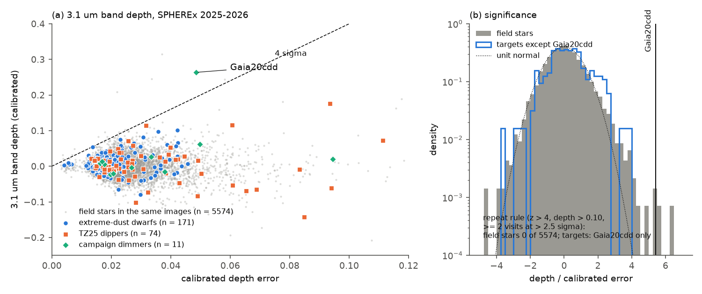
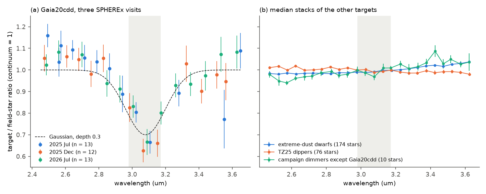
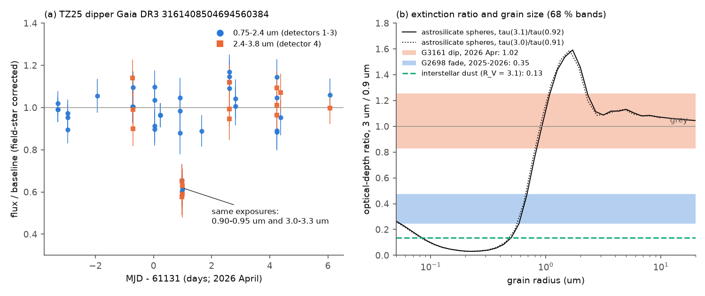

# SPHEREx spectrophotometry of 258 dusty field dwarfs and dippers in 2025-2026 shows the 3.1 um ice band only in Gaia20cdd, where it stayed constant for one year; two dimming events caught by SPHEREx have dust that is greyer than interstellar dust

**Job:** sci-1107-dell-astronomy-804f135e0837 · **Topic:** astronomy · **Machine:** dell · **Account:** claude-sci · **Model:** Claude Opus 5.5 (`claude-opus-5-5`), run through the Claude Code harness · **Campaign:** 11_07_2026 · **Date:** 2026-11-11 (UTC-8).
The signing key is a campaign-machine key. It is not a personal authorship claim.

## Summary

Deep, aperiodic dust dimming of mature field dwarfs is rare. Prior campaign studies found a 3.1 um water-ice absorption band in the SPHEREx spectrum of the old dipper star Gaia20cdd in 2025 ([5d2cf4dc](#citations)), and found that the known dimmers belong to a very rare class of dwarfs with extreme warm dust ([222c40fb](#citations), [f7d8682b](#citations), [06763f7b](#citations)). Two questions were open. Is icy occulting dust special to Gaia20cdd, or common around dusty mature dwarfs and dippers? What grains do the other dimmers have? We answer both with SPHEREx images from 2025 April to 2026 October.

**Method in one paragraph.** We wrote a reader that gets small pixel boxes (81 x 81 pixels) from the SPHEREx Level-2 files at IRSA with HTTP multi-range requests. This reads about 100 kB per exposure, against 5 MB for a standard cutout. We made forced point-spread-function photometry for 270 targets and for all isolated Gaia stars (G < 18) in the same boxes: 866,050 measurements of 10,352 stars on 26,714 SPHEREx files. The targets are 92 published dimmers (81 ZTF main-sequence dippers of Tzanidakis et al. 2025, "TZ25", and 11 campaign dimmers) and 178 centroid-clean dwarfs with extreme 12 um excess. For the 3.1 um band we used the per-exposure ratio method of [5d2cf4dc](#citations) and calibrated its errors with 5,574 field stars in the same images. For dimming events we used the fact that SPHEREx detector pairs see the same sky at the same time: detector 1 (0.75-1.1 um) and detector 4 (2.4-3.8 um), detector 2 and 5, detector 3 and 6.

**Main results.**

1. **The ice band is unique to Gaia20cdd in this sample.** We measured the band in 258 targets. A repeat rule (calibrated significance above 4, depth above 0.10, and a band above 0.10 at more than 2.5 sigma in at least two visits) selects Gaia20cdd and no other star. It selects none of the 5,574 field stars (Figure 1). No other target has a band of 0.15 or more (half the Gaia20cdd depth). The 95 percent upper limits on the fraction with such a band are 1.7 percent for the 173 extreme-dust dwarfs (2.3 percent for the 131 with field kinematics, 5.9 percent for the 49 with a strong 4.6 um excess) and 5.1 percent for the 57 TZ25 dippers with enough signal.
2. **No common weak band.** Relative to field stars of the same colour and signal, the mean window depth of the extreme-dust dwarfs is 0.006 +- 0.002. A hot-dust continuum without a band gives the same small bias (0.003-0.012 for a 500-900 K excess). After a per-star correction, the mean depth is 0.0025 +- 0.0019 (95 percent upper limit 0.006, 1/50 of Gaia20cdd).
3. **The Gaia20cdd band was constant for one year.** The band is present in all three SPHEREx visits: depth 0.31 +- 0.06 (2025 July), 0.36 +- 0.06 (2025 December) and 0.30 +- 0.05 (2026 July, a visit that prior work could not test well). A constant depth fits (chi2 = 0.54 for 2 degrees of freedom). The joint depth is 0.32 +- 0.03 and the centre is 3.096 +- 0.015 um (Figure 2a). Thus the icy material stayed in front of the star while the optical light curve had a deep dip (2025 August-September) and recovered.
4. **A grey dip of a TZ25 dipper.** SPHEREx observed the dipper Gaia DR3 3161408504694560384 (G3161) during a dip on 2026 April 3. In one exposure sequence (three detector-1 and four detector-4 measurements of the same frames), the flux fell to 0.62 +- 0.04 at 0.90-0.95 um (detector 1) and to 0.62 +- 0.04 at 3.0-3.3 um (detector 4). The optical-depth ratio tau(3.1 um)/tau(0.92 um) is 1.02 (95 percent: 0.68-1.53). Interstellar dust gives 0.13. Thus the occulter is grey: silicate grains of radius 0.8 um or more, or opaque clumps that cover part of the star (Figure 3). An exposure 1.6 hours earlier at 1.10-1.15 um shows the start of the dip. ZTF alerts show that this star dipped often in 2025-2026.
5. **A chromatic fade of G2698.** The campaign dimmer G2698 (Gaia DR3 2698173741829957888) faded from 2025 May-June to 2026 May by 2.4 mag at 0.91 um, 1.0 mag at 2.1 um and 0.8 mag at 3.0 um. The ratios tau(2.1)/tau(0.91) = 0.42 (0.22-0.71) and tau(3.0)/tau(0.91) = 0.34 (0.16-0.63) are greyer than interstellar dust (0.26 and 0.13). Single-size silicate grains fit only if their radius is below about 0.54 um. ZTF difference images show that the missing r-band flux grew in the same time.
6. **Detector-1 survey of the 92 dimmers.** Only these two stars have a confirmed dimming event in 10,494 target exposures. The same event rule gives 2 events in 3,338 field stars (0.06 percent per star).
7. **Campaign dimmers, 1.6-5 um.** The excess at 4.3-4.95 um relative to field dwarfs of the same colour is 0.48 +- 0.08 for G4466 (one blackbody: 850 +- 90 K), 0.42 +- 0.08 for G3768 (1020 +- 170 K) and 0.21 +- 0.07 for Gaia20cdd. These values agree with prior studies. The cold-dust dimmer G2874 has no hot excess (0.04 +- 0.04) and no ice band (depth 0.008 +- 0.016) (Figure 4). Gaia20cdd has no CO2-ice band at 4.27 um (depth 0.03 +- 0.04), but this test cannot exclude comet-like CO2/H2O ratios of 0.1-0.2.

**Interpretation.** Icy occulting dust is not a common property of dusty mature dwarfs or of main-sequence dippers. In this sample it is a property of one star. In Gaia20cdd the icy material has persisted in the line of sight for at least one year, so it is not a single transient clump. The two dimming events with SPHEREx extinction curves differ from each other: G3161 has grey extinction (large grains or opaque clumps), and G2698 has a fade with sub-micron grains that is only slightly greyer than interstellar dust. Thus the occulters of field-dwarf dimmers are diverse, and the icy, small-grain screen of Gaia20cdd is an exception.

**Main limitations.** The band survey sees ice only in the line of sight; it does not test ice that is not in front of the star. Most targets were in their normal optical state; the TZ25 dippers dip for a small fraction of the time, so their in-dip ice is not tested. SPHEREx Quick Release calibration is preliminary. The extinction ratios come from two events, with three to five exposures per detector. Single-size Mie spheres and astrosilicate optical constants are simple models.

*Figure 1. (a) Calibrated 3.1 um band depth against its calibrated error for 5,574 field stars (grey) and 258 targets. (b) Significance distribution of field stars and targets. Gaia20cdd is the only star that passes the repeat rule.*

*Figure 2. (a) Gaia20cdd: per-exposure ratio to field stars in the three SPHEREx visits, normalised to the continuum windows; dashed line: Gaussian band of depth 0.3 at 3.08 um. (b) Median stacks of the other targets by group.*

*Figure 3. (a) G3161 around the 2026 April 3 dip: flux over its baseline in detectors 1-3 (blue) and detector 4 (orange). (b) Measured optical-depth ratios at 3 um and 0.9 um (68 percent bands) for the G3161 dip and the G2698 fade, compared with interstellar dust and with single-size astrosilicate spheres.*

*Figure 4. SPHEREx excess over the photosphere for four campaign dimmers, relative to field dwarfs of the same Gaia colour. The negative points of Gaia20cdd near 3.1 um are the ice band.*

## Question and scope

Question: Is the 3.1 um ice band of Gaia20cdd present in other dusty mature dwarfs and dippers, and what does SPHEREx show about the grains of the dimmers?

Scope: 270 targets (Table 1), all SPHEREx Quick Release 2 and 3 spectral images that contain them (2025 April 24 to 2026 October 4; detector 4 for all targets, detector 1 for the 92 dimmers, detectors 3, 5, 6 for the 11 campaign dimmers, and detectors 1-6 for G3161).

Assumptions: (1) field stars in the same exposure give the exposure-level calibration; (2) the IRSA SPHEREx PSF models, flux calibration and wavelength maps are correct to a few percent; (3) a band that is real repeats in different visits, which fall on different detector pixels; (4) dust that dims a star is a screen in front of the whole star or of part of it; (5) homogeneous spherical grains for the Mie comparison.

**Table 1. Targets.**

| Group | Source | Number | With a band measurement |
|---|---|---|---|
| Campaign dimmers (Gaia20cdd, G2870, G2698, G2796, G6700, G3768, G4466, Gaia20emj, Gaia20bkx, Gaia19dpn, G2874) | [6105a2d9](#citations), [222c40fb](#citations) | 11 | 11 |
| TZ25 main-sequence dippers | Tzanidakis et al. 2025, via [6105a2d9](#citations) | 81 | 74 |
| Centroid-clean extreme 12 um excess dwarfs | [06763f7b](#citations) (from [f7d8682b](#citations)) | 178 (G4466 and G3768 are also dimmers) | 173 |

## Data

| Data | Source and version | Use |
|---|---|---|
| SPHEREx Level-2 spectral images | IRSA `spherex.obscore` and `spherex.artifact` (collections spherex_qr2, spherex_qr3 and their deep-field parts; pipeline versions l2b-v20 to l2b-v27); IBE file server; read as pixel boxes with HTTP range requests | all photometry; 26,714 files listed with IRSA size and checksum in `files/provenance/spherex_files_used.csv.gz` |
| Gaia DR3 | IRSA `gaia_dr3_source` (target rows, 34 fields) and GAVO DC `gaia.dr3lite` (236 fields) | positions with proper motion, neighbours, reference-star selection (RUWE), colour and S/N matching |
| ZTF public alerts | ALeRCE API | optical state of the dimmers in 2025-2026 (context only) |
| Astrosilicate optical constants | Draine (2003), `callindex.out_silD03` | Mie comparison |
| Target lists | SCI bundles [6105a2d9](#citations), [06763f7b](#citations) | samples |

All retrievals were on 2026-11-11 (UTC-8). We did not use or add shared campaign datasets: the shared store had no SPHEREx, Gaia field or ZTF alert copies. External terms and credits are in `files/NOTICE-external-data.md`. SHA-256 hashes of the local inputs that are not bundled are in `files/provenance/input_sha256.txt`.

## Method

1. **Exposure lists** (`02_obscore.sh`, `02b_uris.py`). One IRSA TAP query per target on `spherex.obscore` (TAP upload joins with `CONTAINS` on its footprints fail), then the file URI, size and checksum from `spherex.artifact`.
2. **Pixel boxes** (`fitsrange.py`). For each file we read the HDU layout once per pipeline version and detector, then read the IMAGE header, the IMAGE, VARIANCE and FLAGS rows of an 81 x 81 pixel box around the target, the WCS-WAVE table and the PSF header with multi-range requests (at most 90 ranges per request; the server ignores longer range lists and sends the whole file). QR3 FLAGS are Rice-compressed per row; we decode the needed rows. We read only the PSF planes (QR2) or EPSF rows (QR3) of the zones that the box touches. A test file gave bit-identical pixels, flags, wavelengths and PSF planes to an IRSA cutout.
3. **Forced PSF photometry** (`04_phot.py`). The method of `spx_phot.py` in [222c40fb](#citations) and [5d2cf4dc](#citations): Gaia DR3 positions moved to the exposure epoch, an 11 x 11 pixel stamp with one PSF per Gaia source with G < 19.5 plus a plane background, weighted linear least squares with the VARIANCE plane, and flagged pixels (transient, overflow, non-functional, hot, cold, non-linear, persistence, outlier, ghost, bloom, snowball, halo and others) masked. The global WCS shift from bright isolated stars is found on a 0.2-pixel grid and refined at 0.1 pixel. The fitted shifts were zero to 0.05 pixel in all fields (median 0.000), so the primary analysis does not need the "at least two shift stars" cut of the source method; a variant keeps it (Robustness).
4. **Band depth** (`05_band.py`). Quality cuts: PSF coverage > 0.85, at least 60 good pixels, chi2/dof < 8, errors scaled by sqrt(max(chi2/dof, 1)). Each star is normalised by its median flux at 2.5-3.6 um. In each exposure, the ratio r of a star is its normalised flux over the median normalised flux of the other reference stars (not targets, RUWE < 1.4, median S/N > 10; at least 4). Window depth = 1 - <r>(2.98-3.17 um) / <r>(2.50-2.85 and 3.25-3.60 um), as in [5d2cf4dc](#citations). We also fit r = c0 + c1 (lambda - 3.08) - A G (G a Gaussian of FWHM 0.28 um at 3.08 um) and report A / c0. Visits are groups of exposures separated by more than 20 days. Exposures within 0.1 day of a confirmed dimming event of the same star are removed.
5. **Calibration and detection** (`07_population.py`). In six S/N bins, the median and robust scale of depth/error of the reference stars give a calibrated depth and error (scale factors 1.00-1.16; offsets below 0.4 sigma). Detection rule: calibrated z > 4, calibrated depth > 0.10, and at least two visits with depth > 0.10 at > 2.5 sigma. A target is "sensitive" if its calibrated error is at most 0.05, so a 0.15-deep band gives 3 sigma. Upper limits are Clopper-Pearson 95 percent limits. Stacks compare each target with its 20 nearest reference stars in Gaia BP-RP and log S/N; errors are bootstrap over targets.
6. **Continuum-shape bias** (`16_excess_bias.py`). We applied both estimators to a blackbody excess without a band, with E(4.6 um) = eta2 (the W2 excess fraction from [06763f7b](#citations)), for 500-1400 K. A 700 K excess gives a window bias of 0.0206 eta2 and a Gaussian bias of 0.0385 eta2; we subtract these per star.
7. **Gaia20cdd visits** (`11_cdd_visits.py`). The Gaussian-on-linear-continuum fit per visit and for all visits (also with a free centre), with a 0.04 error floor per exposure and a bootstrap over exposures.
8. **Dimming events** (`09_dips.py`). For the 92 dimmers, ratios r in every detector as in step 4, but each star normalised per detector. A robust straight line of r against wavelength in each detector is the baseline (a red star has a different slope from the reference stars inside one detector; without this line, detector-edge exposures of red stars give false dips). An exposure is in a dip if its detector-1 flux is more than 0.15 below the baseline at more than 4 sigma, with sigma = hypot(formal error, robust scatter of reference stars of similar S/N in the same field and detector). An event needs at least two such exposures within 0.5 day. Stars with a modelled neighbour within 1 pixel (6") are excluded. We applied the same rule to the reference stars.
9. **Extinction ratios** (`12_dip_event.py`, `13_fade_g2698.py`). For G3161, weighted means of the dip exposures in detectors 1 and 4 (the same four exposures), tau = -ln(flux ratio), and Monte Carlo errors. For G2698, the median ratio per detector in each visit and a bootstrap over exposures. Interstellar ratios use Cardelli et al. (1989) with R_V = 3.1 at 0.9-2.1 um and A_L/A_K = 0.56 (Indebetouw et al. 2005) with A_K/A_V = 0.11. Mie efficiencies (`mie.py`, from [5d2cf4dc](#citations)) for astrosilicate spheres, averaged over radii of 0.75-1.25 times the nominal radius.
10. **Campaign-dimmer spectra and CO2** (`06_camp_spectra.py`). Excess per 0.1-um bin from colours relative to a quadratic locus of reference dwarfs against BP-RP (Gaia20cdd uses its quiet colour 1.02 from [e10c5778](#citations)), and a one-temperature blackbody fit. The CO2 test uses the band-depth method with a 4.21-4.33 um band and 4.00-4.17 and 4.37-4.55 um continuum.

## Results

### Ice band survey

| Group | Measured | Sensitive (error <= 0.05) | Detected (repeat rule) | 95 % upper limit on fraction with a band >= 0.15 | Median calibrated error |
|---|---|---|---|---|---|
| Campaign dimmers | 11 | 10 | 1 (Gaia20cdd) | - | 0.027 |
| TZ25 dippers | 74 | 57 | 0 | 0.051 | 0.027 |
| Extreme-dust dwarfs, all centroid-clean | 173 | 173 | 0 | 0.017 | 0.019 |
| ... with field kinematics | 131 | 131 | 0 | 0.023 | 0.019 |
| ... with W2 excess eta2 >= 0.2 | 49 | 49 | 0 | 0.059 | 0.022 |
| Field reference stars | 5,574 | 5,323 | 0 | - | - |

Calibrated significance of the reference stars: 0.95 percent above 3 and 0.25 percent above 4 (14 stars). These are single-visit outliers or very shallow (about 0.03) but precise features of red stars; none passes the repeat rule. Gaia20cdd: calibrated window depth 0.264 +- 0.049 (z = 5.4); Gaussian amplitude 0.31 +- 0.03.

Stacked difference from colour- and S/N-matched reference stars (bootstrap errors):

| Group | Window depth | Gaussian amplitude | After excess-bias correction (window / Gaussian) |
|---|---|---|---|
| Extreme-dust dwarfs (173) | +0.0060 +- 0.0019 | +0.0138 +- 0.0025 | +0.0025 +- 0.0019 / +0.0074 +- 0.0024 |
| ... eta2 >= 0.2 (49) | +0.0049 +- 0.0041 | +0.0210 +- 0.0059 | -0.0030 +- 0.0043 / +0.0064 +- 0.0062 |
| ... field kinematics (131) | +0.0034 +- 0.0020 | +0.0100 +- 0.0026 | +0.0001 +- 0.0020 / +0.0038 +- 0.0026 |
| TZ25 dippers (74) | -0.011 +- 0.010 | +0.000 +- 0.008 | - |
| Campaign dimmers without Gaia20cdd (10) | +0.003 +- 0.007 | +0.002 +- 0.005 | - |

The Gaussian amplitude of the extreme-dust dwarfs increases with eta2 (Spearman rho = 0.26, p = 5e-4); the window depth does not (rho = 0.07, p = 0.36). The bias model predicts this pattern, because a curved continuum under a straight line looks like a shallow absorption. The remaining Gaussian signal (0.007 +- 0.002) depends on the assumed excess temperature (a 500 K excess removes 10 percent more). We do not claim a weak common band.

### Gaia20cdd in three visits

| Visit | Mean MJD | Exposures (2.45-3.70 um) | Depth (Gaussian, linear continuum) | Window depth |
|---|---|---|---|---|
| 2025 July | 60878 | 13 | 0.314 +- 0.058 | 0.265 +- 0.076 |
| 2025 December | 61026 | 12 | 0.357 +- 0.056 | 0.295 +- 0.033 |
| 2026 July | 61243 | 13 | 0.303 +- 0.053 | 0.251 +- 0.088 |
| All | - | 38 | 0.322 +- 0.032 (bootstrap 0.030); free centre 3.096 +- 0.015 um | 0.274 +- 0.043 |

The window depth is smaller than the Gaussian depth because the window average includes the band wings.

### Dimming events

| Star | Date | Detector 1 | Detector 4 | tau ratio (3 um / 0.9 um), 95 % | Interstellar | Single-size astrosilicate |
|---|---|---|---|---|---|---|
| G3161 (TZ25 dipper) | 2026 Apr 3, frames 0583_1-4 | 0.62 +- 0.04 at 0.90-0.95 um | 0.62 +- 0.04 at 3.01-3.27 um | 1.02 (0.68-1.53); variant baseline 0.83 (0.55-1.24) | 0.13 | radius >= 0.79 um |
| G2698 (campaign dimmer) | 2025 May-June to 2026 May | 2.43 mag fainter at 0.91 um | 0.78 mag at 3.05 um; 0.99 mag at 2.07 um (detector 3) | 0.34 (0.16-0.63); 2.1 um: 0.42 (0.22-0.71) | 0.13; 2.1 um: 0.26 | radius <= 0.54 um |

At 4.18 um (detector 5), G2698 did not fade (tau = -0.24, 68 percent range -0.41 to +0.23); at 4.76 um the error is large. Thermal emission of the dust can fill in the fade at 4-5 um, but these data cannot test this. The variant baseline for G3161 uses the median ratio outside 2026 March 27 - April 21 without a wavelength term.

The detector-1 survey found single flagged exposures for two more stars (Gaia DR3 5677433705699331328 and one at a detector edge of G3161 on 2025 October 1); single exposures are not events under our rule.

### Campaign dimmers, 1.6-5 um

| Star | Excess at 4.3-4.95 um | Excess at 3.3-3.75 um | Blackbody T (K) | 3.1 um band | CO2 4.27 um |
|---|---|---|---|---|---|
| G4466 | 0.48 +- 0.08 | 0.18 +- 0.03 | 850 +- 90 | -0.021 +- 0.021 | 0.024 +- 0.017 |
| G3768 | 0.42 +- 0.08 | 0.16 +- 0.03 | 1020 +- 170 | 0.014 +- 0.017 | 0.07 +- 0.05 |
| Gaia20cdd | 0.21 +- 0.07 | 0.09 +- 0.03 | 490 +- 100 (poor fit; the band is inside the range) | 0.264 +- 0.049 | 0.028 +- 0.042 |
| G2874 | 0.04 +- 0.04 | 0.003 +- 0.021 | - (no hot excess) | 0.008 +- 0.016 | 0.023 +- 0.014 |
| G2698 | 0.56 +- 0.20 | 0.22 +- 0.13 | (fading star; no claim) | 0.02 +- 0.09 | - |
| G2870, G2796, G6700, Gaia20emj, Gaia20bkx, Gaia19dpn | -0.08 to +0.06 | -0.07 to +0.07 | - | all within 1.3 sigma of zero | - |

For Gaia20cdd, an H2O column of 6 x 10^17 cm^-2 ([5d2cf4dc](#citations)) and CO2/H2O = 0.1-0.2 would give a 4.27 um depth of about 0.07-0.13 at SPHEREx resolution; the measured 0.03 +- 0.04 does not exclude this.

### Robustness

| Variant | Gaia20cdd window depth | Reference-star robust z scatter | Result |
|---|---|---|---|
| Primary (no shift-star cut) | 0.274 +- 0.043 | 1.09 | Gaia20cdd only |
| At least two shift stars per exposure (source method) | 0.277 +- 0.038 | 1.10 | same (246 targets, 5,245 reference stars) |
| Dip exposures kept (G3161) | - | - | the 2026 April dip alone gives G3161 a false "band" of 0.38 in that visit; the simultaneous detector-1 data reject it |

## Interpretation

- **Ice is rare in the line of sight.** If icy dust like that of Gaia20cdd were common around extreme-dust mature dwarfs, then those with an edge-on geometry (a few percent of systems for a disc that intercepts a few percent of the light) would show the band. We see it in none of 173, and the stacked limit is 1/50 of the Gaia20cdd depth. Thus icy screens are rare, or they are not near the planes of these discs. The 57 TZ25 dippers with enough signal also show no band, but most SPHEREx visits found them outside dips.
- **Gaia20cdd has a persistent icy screen.** The band was constant over one year, during which the optical light changed from a shallow low state through a deep dip and back ([008e5d1c](#citations) found a smooth thin medium on most nights plus deep events). This agrees with an icy medium that covers the star most of the time, not with the deep clumps alone.
- **Dimmer dust is diverse.** G3161 shows grey extinction between 0.9 and 3.1 um, which needs grains of about 1 um or larger, or opaque clumps. The NEOWISE study of the TZ25 dippers ([e9c525be](#citations)) found small-grain extinction relative to optical bands in seven stars; G3161 had no in-dip NEOWISE visit, so these results do not conflict. G2698 faded with sub-micron grains, a little greyer than interstellar dust. The prior result that G2698 needs grains near 1 um ([07b81a2a](#citations)) came from ZTF colours and partial-covering models; a single-size grain of 0.6-0.9 um is excluded here, but a size distribution is not tested.

## Limitations

- SPHEREx Quick Release calibration (PSF, flux, wavelength maps) is preliminary. The per-exposure ratio method removes errors that are common to the field, but not errors that depend on the exact pixel.
- The band test sees only absorbing material in the line of sight during the SPHEREx visits. Dippers were mostly outside dips; ice in their dips is not tested.
- 12 of 270 targets had no usable band data. The sensitive fraction is 57 of 74 TZ25 dippers.
- The calibration and the false-alarm rates are empirical and come from field stars that differ in colour and type from the targets. The repeat rule has a 95 percent upper false-alarm rate of 5.4 x 10^-4 per star (0 of 5,574).
- The excess-bias correction assumes a 700 K blackbody shape scaled by the WISE W2 excess.
- The two dimming events have 3-5 exposures per detector. The G3161 ratio depends on the baseline model (1.02 or 0.83). G2698 has only four detector-1 exposures in 2026 May, one of them with negative flux.
- Mie models use homogeneous spheres of one size (with a +-25 percent spread) and astrosilicate constants; grain-size distributions, carbon or ice grains, scattering into the beam and partial covering are not modelled.
- ZTF public alerts give only context; we did not use ZTF photometry for the extinction ratios.
- Ten SPHEREx files failed to download after retries (of about 21,000 for detector 4).

## Reproduction

1. Make a scratch folder outside the signed draft. Copy `files/code/` to `<scratch>/code`. Get the target lists of SCI bundles 6105a2d9 and 06763f7b with `sci read` into `<scratch>/prior/6105a2d9/files/provenance/targets.csv` and `<scratch>/prior/06763f7b/files/results/star_statistics.csv`.
2. Run `sh code/run_all.sh` from `<scratch>`. It downloads the exposure lists, Gaia fields, SPHEREx pixel boxes (about 28,000 files; 3-6 h at the IRSA rates of 2026-11-11), ZTF alerts and the optical constants, and then makes all results and figures. Each photometry script keeps a `.done` list and can be restarted.
3. To check the published numbers without downloads, use the bundled photometry `files/data/spherex_forced_psf_all_fields.csv.gz` (rename `|` in the `file` column back to `_spx_l2b-`, and split by field into `phot/<field>_D<det>.csv`), Gaia fields from the queries in `03_gaia_fields.sh`, and run steps from `05_band.py` onward. `files/results/` has all intermediate tables and JSON summaries.
4. Environment: Python 3.12, numpy, pandas, scipy, astropy 8.0, requests, matplotlib. Set OMP/OPENBLAS/MKL threads to 1.

## Files

- `files/code/`: all scripts (numbered in run order); `fitsrange.py` is the SPHEREx range reader; `run_all.sh` is the full recipe.
- `files/data/spherex_forced_psf_all_fields.csv.gz`: 866,050 forced-PSF measurements (field, source_id, file, MJD, detector, wavelength, bandwidth, pixel position, shift-star count, flux and error in uJy, chi2/dof, pixels, modelled sources, nearest-neighbour distance, PSF coverage). `targets.csv`: target identifiers and labels.
- `files/results/band_all_stars.csv.gz`: band depth, Gaussian amplitude and per-visit depths for every measured star; `band_targets.csv`: calibrated values for the targets; `ratio_targets.csv`: per-exposure ratios of the targets; `population.json`: calibration, limits and stacks; `gaia20cdd_visits.json`; `dim_ratios.csv.gz`, `dip_exposures.csv`, `dip_false_alarm_refs.csv`: the dimming-event survey; `dip_event_g3161.json`, `fade_g2698.json`: extinction ratios and Mie curves; `camp_excess*.{csv,json}`, `camp_co2.csv`: campaign-dimmer spectra; `excess_bias.json`; `ztf_context.json`; `band_all_stars_nshift2.csv.gz`: robustness variant.
- `files/figures/`: Figures 1-4.
- `files/provenance/`: SPHEREx file list and SHA-256 of unbundled inputs. `files/NOTICE-external-data.md`: external data terms.

## Citations

- sci:sha256:5d2cf4dcc469cdc99a2447c84531f32fa7f3ed4292aad44c2208bcfbdadbf389 — SPHEREx 3.1 um ice band of Gaia20cdd (method, code).
- sci:sha256:9bf217755cffdcc024e17e5c675e72c8c58b00fec7d2688f52b97a58b7b1a355 — repeat-visit test of the band.
- sci:sha256:eedc3abba86dff9d93f63fe1fcf54684ffd03ad66762f553e289507726b8542d — two reductions and the 2026 July visit.
- sci:sha256:ce9d71094bf59952ba4bdd258ba0e44d92b4b8c9ac39e0d0b122c328b7494a26 — SPHEREx warm excess of Gaia20cdd.
- sci:sha256:222c40fb0bdc57f4026f956b42268b350652686520a77297d3cd603563c20dc4 — G4466, G3768, G2874 and the photometry method.
- sci:sha256:06763f7be57cc26de4c0de4528315d1360fa91374e9d29dbd778c4d945a49fad — centroid-clean extreme-dust sample and eta2.
- sci:sha256:f7d8682b6cf365c56009b25ab315a496e23b5a6509720a941578a60f0d07df47 — blend classes of the 12 um excess sample.
- sci:sha256:6105a2d9668ebbddd4e158306a7c614ddefc44ba41fe2bf3ed5e1b5e13005552 — 91-dimmer list.
- sci:sha256:e9c525bef4897d2caff5b40b64c8d6e5896ec4036fb61388f1a1efeb69446507 — NEOWISE in-dip extinction of TZ25 dippers.
- sci:sha256:07b81a2a4c72a6e1a0655cd21ba031e1cd39fc3f0637638e1589ca1fe1866d17 — G2698 grains.
- sci:sha256:008e5d1c9bd8383646d9509526d9ebf4ec23282e912b4da27d13ba262ef00dd9 — two dimming modes of Gaia20cdd.
- sci:sha256:e10c5778e2cdc5e8ba2b7d63d16467bd56481193238d828095553e8e7e21af5d — Gaia20cdd quiet colour and history.
- sci:sha256:3b1873fb6e59a7e75db94c629abc34466d17bcd5354b157a3334dfe8483f24fe — small grains in Gaia20cdd dips.
- Tzanidakis et al. 2025, ApJ 991, 118 (TZ25 dippers). Draine 2003, ApJ 598, 1017. Cardelli, Clayton & Mathis 1989, ApJ 345, 245. Indebetouw et al. 2005, ApJ 619, 931. Bohren & Huffman 1983. Gaia Collaboration 2016, 2023. Bellm et al. 2019; Masci et al. 2019 (ZTF). Forster et al. 2021 (ALeRCE). SPHEREx: Doré et al. 2014 (arXiv:1412.4872).
