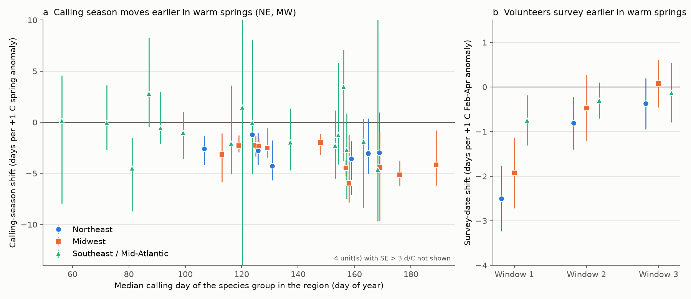
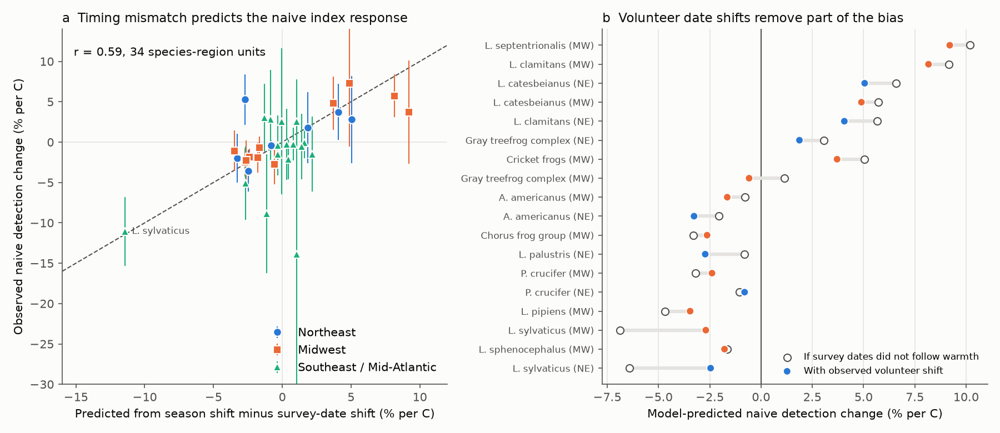
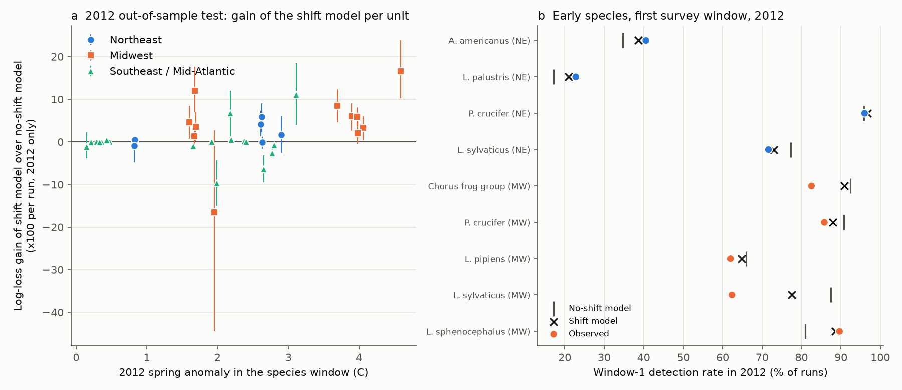

# Warm springs moved frog calling seasons 2-3 days earlier per 1 C on northeastern and midwestern US NAAMP routes in 2001-2015 and biased naive detection indices down for early and up for late species

## Summary

Frogs and toads (anurans) call in a species-specific season. Volunteer calling surveys count them on a few nights per year in fixed survey windows. If a warm spring moves the calling season earlier, a survey on a fixed date hears fewer early-season species and more late-season species. This is a path from climate to an apparent population change that is only an observation effect.

We tested this path with the North American Amphibian Monitoring Program (NAAMP) data (USGS data release doi:10.5066/F7G44NG0, public domain). We used 19,299 unified-protocol survey runs on 1,177 routes in 25 eastern and central US states in 2001-2015, and monthly NOAA GHCN-CAMS temperature anomalies at each route. We studied 38 species-region units in three regions: Northeast (NE), Midwest (MW), and Southeast and Mid-Atlantic (SE). We wrote the analysis plan before the outcome models (`files/code/PLAN.md`).

Main results:

1. **The calling season moved earlier in warm springs in the NE and MW.** The model shifts a seasonal detection curve by delta days per 1 C of spring anomaly, with route x observer fixed effects and survey-night air temperature and wind as controls. All 18 NE and MW units had delta < 0. The 95% year-bootstrap interval was below zero in all 11 MW units and in 4 of 7 NE units. The inverse-variance mean was -3.0 days per C in the MW (SE 0.18) and -2.4 days per C in the NE (SE 0.33). In the SE, 14 of 20 units had delta < 0, but only 1 interval was below zero (wood frog, -4.5 days per C), and the mean was -1.1 (SE 0.51). The NE and MW result held in two separate periods (2001-2008 and 2009-2015: 15 of 16 stable units negative in both), with route fixed effects only, with a one-month earlier temperature window, without 2012, and with an added level term for spring warmth (18 of 18 negative in each check).
2. **Volunteers moved their first survey earlier in warm springs, but less than the frogs.** Per 1 C of February-April anomaly, the window-1 survey date moved -2.5 days in the NE (95% CI -3.2 to -1.8), -1.9 in the MW (-2.7 to -1.1) and -0.7 in the SE (-1.3 to -0.2). Window-3 dates did not move (-0.4, +0.1 and -0.1).
3. **Naive detection indices changed with spring warmth in opposite directions for early and late species.** Without date or air-temperature controls (as an annual index uses the data), the detection rate per 1 C changed by -3.6% (SE 1.3) for NE wood frog, -2.5% (0.9) for MW wood frog, -11.1% (2.2) for SE wood frog, and +5.7% (1.3) and +3.7% (1.8) for MW and NE green frog. In the NE and MW, 8 of 9 early-season units (median calling day < 140) had a negative response and 7 of 8 late-season units (day >= 150) had a positive response.
4. **The timing mismatch predicted these index responses.** The mismatch model (season shift minus the observed survey-date shift) predicted the observed naive responses across 34 units with r = 0.59 (slope 0.72). The air-temperature path was small (below 1% per C in the NE and MW). Without the volunteer date shift, the model gives about 2.6 times larger wood frog bias (-6.4% and -6.9% per C instead of -2.5% and -2.7%).
5. **Out-of-sample test in the record-warm spring of 2012.** Models fitted without 2012 predicted the 2012 runs. The shift model had a lower log loss than a no-shift model in 10 of 11 MW units (interval above zero in 8, below zero in 0; 2012 anomaly in the species windows +3.7 to +4.6 C for the six MW species with median day before 150) and in 5 of 7 NE units (2 above zero, 0 below). In the SE the result was mixed (8 of 20 better, 5 above zero, 4 below zero). For MW wood frog in window 1, 62% of runs detected the species in 2012; the shift model predicted 78% and the no-shift model 88%. Thus the linear shift explained part, but not all, of the 2012 decrease.

Conclusion: in the NE and MW, a warm spring moved anuran calling seasons earlier by about 2-3 days per 1 C. Volunteers partly followed this shift in the first survey window only. The remaining mismatch made naive detection indices lower for early-season species and higher for late-season species after warm springs. With the 1981-2025 spring warming at NE routes (about 0.3 C per decade), this gives a systematic trend bias of about -0.7% per decade for NE wood frog and +1.1% per decade for NE green frog (about -1.8% per decade for wood frog if volunteers did not adjust dates). These biases are small per decade but have opposite signs for early and late species, so they can produce a false difference in trend between breeding guilds. Calling-survey trend models must include a seasonal term that can move with spring temperature. In the SE, where many species call in winter, spring temperature did not give a clear shift.

## Question and hypotheses

Question: do anuran calling seasons in the eastern and central US move earlier in warm springs, do NAAMP survey dates follow this movement, and how much does the remaining mismatch bias naive annual detection indices?

The plan (`files/code/PLAN.md`) was written before any outcome model:

- H1. Calling-season shift delta (days per 1 C) < 0 for early-season species.
- H2. Survey-date shift sigma (days per 1 C). If volunteers follow phenology, sigma is near delta.
- H3. Naive detection index response (% per 1 C), and its prediction from H1 and H2.
- H4. Out-of-sample prediction of 2012 with and without the shift.
- Replication across three regions and two periods (2001-2008, 2009-2015). Sensitivity: route fixed effects only, a temperature window one month earlier, and stop-level detection.

Changes after the plan: (a) the main intervals are 200-draw year-block bootstrap intervals, as planned; we also report year-cluster sandwich standard errors, which our simulation showed to be too small (coverage 76-90%). (b) We added a level term for spring warmth (`07_levelA.py`) after the first fits, to check that a general warm-spring change in calling does not cause the shift estimate. (c) We added the without-2012 refit. (d) We did not do the stop-level sensitivity. (e) The first model code (statsmodels) was too slow; we replaced it with an equivalent fixed-effects logit (`common.felogit`). On test units the two codes gave the same estimates within 0.1 day per C.

## Data

- NAAMP anuran detection data, eastern and central US, 1994-2015. Grant, E.H.C., 2017, USGS data release, doi:10.5066/F7G44NG0 (public domain). Files Runs.csv, Stops.csv, Counts.csv, Coordinates.csv, Species.csv, Protocol.csv and the FGDC metadata. Staged in the campaign dataset store as `naamp-1994-2015-*-usgs-f7g44ng0` (2026-11-11).
- NOAA GHCN-CAMS monthly land surface air temperature, 0.5 degree, version 3.01 (Fan and van den Dool 2008, doi:10.1029/2007JD008470), file `air.mon.mean.nc` from NOAA PSL, campaign store copy `psl-ghcncams-air-mon-mean-20261105` (data to 2026-10).
- Exact source URLs, local paths and SHA-256 of every input file: `files/provenance/input_files_sha256.txt`.

Sample rules: unified protocol only, survey years 2001-2015, runs with at least 5 surveyed stops and route coordinates. Air temperature at each stop was converted to C and averaged per run. Species groups: gray treefrog complex (Hyla versicolor, H. chrysoscelis and their complex labels), chorus frog group (Pseudacris maculata, triseriata, feriarum, kalmi, fouquettei and complexes), cricket frogs (Acris crepitans, gryllus and complex); other labels as given; other complex labels were removed. Regions: NE = ME, NH, VT, MA, NY, PA, NJ; MW = MN, IA, MO, IN, MI; SE = DE, MD, VA, WV, NC, SC, GA, FL, TN, KY, AL, MS, LA, TX. A unit (species group x region) was used if it had at least 60 routes with a detection and at least 1,000 runs on these routes (38 units).

## Methods

Outcome: run-level detection (species heard at one or more stops of the run). For each unit we used all runs on routes where the species was heard at least once.

Spring warmth A: the mean of monthly GHCN-CAMS anomalies (1991-2020 normals) at the route centroid for months M-2, M-1 and M, where M is the month of the unit's median detection day.

H1 model: logit P(detect) = route x observer effect + natural cubic spline (6 df) of (day of year - delta x A) + run air temperature (linear and squared) + start wind class. Route x observer fixed effects remove fixed differences between sites and between observers on a route (observer change is a known bias in volunteer surveys). Groups with no variation in the outcome were removed. delta was estimated by iterated linearisation: the spline derivative times -A is added as a covariate, its coefficient updates delta, and the steps repeat until the update is below 0.01 day. The fixed-effects logit uses Newton steps with a Schur complement for the fixed effects (`files/code/common.py`). Intervals: 200 year-block bootstrap draws (years resampled with replacement).

Estimator check (`05_sim.py`): we simulated detections from fitted models on the real design with delta = 0 and delta = -3, 50 times each, in two units. Mean estimates were -3.03 and 0.00 (NE wood frog design) and -2.82 and +0.01 (SE spring peeper design). The year-cluster sandwich SE gave 76-90% coverage, so we use the bootstrap intervals for inference.

H2: survey day of year on the February-April anomaly with route x observer x run-number fixed effects; year-clustered SE with t(14) intervals. The same model gives the response of survey-night air temperature.

H3: linear probability model of detection on A with route x observer x run-number fixed effects and no day or air-temperature control; slope as percent of the mean detection rate.

Decomposition (`06_decompose.py`): with the fitted H1 model, we predicted each run under counterfactuals: no effect of spring warmth (season not shifted, survey on its normal date day - sigma x A, normal air temperature), the observed mismatch (season shifted by delta x A, survey shifted by sigma x A), no volunteer adaptation (season shifted, survey on its normal date), and air temperature only. sigma and the air-temperature response come from H2 by region and run number.

H4: for each unit, the H1 model with estimated delta and a model with delta fixed at 0 were fitted on all years except 2012 and predicted the 2012 runs of route x observer groups present in training. Gain = mean log loss of the no-shift model minus that of the shift model; 95% interval from 1,000 route bootstrap draws.

## Results

Per-unit table: `files/results/table_units.csv` (delta with bootstrap interval, period estimates, level-term estimate, observed and predicted index responses). Selected rows:

| Region | Species group | Median day | delta (days/C) | 95% bootstrap interval | Naive index % per C (SE) | Mismatch prediction | No-adaptation prediction |
|---|---|---|---|---|---|---|---|
| NE | Lithobates sylvaticus (wood frog) | 108 | -2.6 | -4.2 to -1.3 | -3.6 (1.3) | -2.5 | -6.4 |
| NE | Pseudacris crucifer (spring peeper) | 125 | -1.2 | -2.0 to 0.0 | -0.4 (0.3) | -0.8 | -1.0 |
| NE | Anaxyrus americanus (American toad) | 132 | -4.3 | -5.7 to -1.8 | -2.0 (1.5) | -3.3 | -2.1 |
| NE | Lithobates clamitans (green frog) | 166 | -3.0 | -5.0 to 0.4 | +3.7 (1.8) | +4.1 | +5.7 |
| MW | Lithobates sylvaticus | 119 | -2.3 | -2.9 to -1.3 | -2.5 (0.9) | -2.7 | -6.9 |
| MW | Pseudacris crucifer | 126 | -2.3 | -3.1 to -1.6 | -1.9 (0.5) | -2.4 | -3.2 |
| MW | Chorus frog group | 129 | -2.5 | -3.4 to -0.6 | -2.3 (1.3) | -2.6 | -3.3 |
| MW | Gray treefrog complex | 157 | -4.4 | -5.3 to -3.7 | -2.8 (1.3) | -0.6 | +1.1 |
| MW | Lithobates clamitans | 176 | -5.1 | -6.2 to -3.7 | +5.7 (1.3) | +8.2 | +9.2 |
| SE | Lithobates sylvaticus | 80 | -4.5 | -8.7 to -1.5 | -11.1 (2.2) | -11.4 | -13.2 |
| SE | Chorus frog group | 71 | -0.0 | -2.7 to 3.6 | -2.2 (1.3) | +0.5 | -0.0 |
| SE | Pseudacris crucifer | 90 | -0.6 | -2.1 to 2.9 | -1.5 (0.8) | -0.3 | -0.6 |

Other files: `h1_shift.csv` (all H1 variants: main, p1, p2, routefe, lag1, no2012), `h1_levelA.csv`, `h1_period_replication.csv`, `h2_survey_dates.csv`, `h3_naive_index.csv`, `decomposition.csv`, `h4_2012_units.csv`, `h4_2012_runs.parquet` (run-level 2012 predictions), `sim_recovery.csv`, `spring_warming_trends_1981_2025.csv`, `summary.json`.

Spring warming 1981-2025 at the NAAMP routes (GHCN-CAMS, regional mean of route cells): NE +0.28 to +0.31 C per decade (Feb-Apr, Mar-May, Apr-Jun), SE +0.30 to +0.37, MW -0.09 (Feb-Apr) to +0.10 (Apr-Jun). In the MW, the 45-year spring trend is near zero, so the index bias there is mainly a year-to-year noise term, not a trend term.

## Relation to prior work

- Gibbs and Breisch (2001, doi:10.1046/j.1523-1739.2001.0150041175.x) reported earlier calling of frogs near Ithaca, New York, between 1900-1912 and 1990-1999. Our within-route, year-to-year estimates agree in direction for the NE and MW and give a temperature sensitivity of about 2-3 days per C.
- Todd et al. (2011, doi:10.1098/rspb.2010.1768) reported both delays and advances in breeding dates at a South Carolina wetland. Green (2017, doi:10.1111/gcb.13390) reported that amphibian breeding phenology trends vary much among species and sites. Our SE results (most intervals include zero, and some winter breeders have positive estimates) agree with this variation.
- The March 2012 heat in the eastern US (Dole et al. 2014, doi:10.1175/BAMS-D-12-00069.1) gave record early flowering (Ellwood et al. 2013, doi:10.1371/journal.pone.0053788). Our test shows that the same event moved anuran calling and that a model with a temperature-dependent season predicted 2012 surveys better in the MW and NE.
- Campaign work on the North American Breeding Bird Survey found the same kind of phenology-detection artefact in birds (sci:sha256:314c7ca6aaab0ba7148ed41deca868dc85070cb3d0ec320fc79b7b15c5b40938: about 1.5 days per C, small effect on community indices). Our anuran estimates are larger per C, and the index effects (several percent per C) are larger, because calling seasons are short and NAAMP windows are fixed. We found no earlier campaign study of amphibian calling surveys.

## Limitations

- Temperature is a monthly 0.5 degree gridded anomaly at the route centroid, for a three-month window fixed per unit. It is not a daily degree-day sum at the breeding ponds. This likely makes delta estimates smaller than the true sensitivity (errors in A attenuate the slope).
- The model moves a fixed seasonal curve. It does not allow a shorter or longer season. The 2012 MW wood frog result (observed 62%, predicted 78%) shows that the response to an extreme spring is larger than the linear shift.
- Detection is binary per run; we did not use the calling index (1-3). Run-level detection depends on the number of surveyed stops (at least 5).
- Survey windows, start dates and minimum temperatures differ among states; route x observer x run-number effects in H2 and H3 remove fixed differences only.
- The SE region joins very different climates (Florida to West Virginia). Many SE species call in winter or after rain, which a temperature model does not include.
- NAAMP ended in 2015. We could not test periods after 2015 or new survey data. The 15 years give only 15 bootstrap clusters; sub-period estimates for small units are unstable (for example MW Lithobates septentrionalis 2001-2008).
- Volunteers can choose survey nights by weather. We control air temperature and wind on the survey night, but not rain or moon.
- Correlational design. Many tests were run; the main planned tests are H1-H4 with the region-level summaries.

## What remains open

- A daily degree-day model of calling onset (Daymet or PRISM at each route) to reduce the attenuation of delta and to test a change in season length.
- Occupancy models with a temperature-dependent detection season applied to published NAAMP trend estimates, to measure how much of the reported trends change.
- Tests in other calling surveys (for example Canadian Marsh Monitoring Program, FrogWatch USA) and after 2015.
- The SE: rain-triggered and winter breeders need a rain and temperature model.

## Reproduction

All code is in `files/code/` (Python 3.12 with numpy 2.5, pandas 3.1, xarray 2026.9, patsy 1.0, matplotlib 3.11).

1. Get the inputs: use the campaign dataset store (`DATASETS=<store>`) or run `bash files/code/00_fetch_data.sh ./scratch_data` (writes outside this bundle; checks SHA-256). The GHCN-CAMS file is updated monthly upstream; the analysed copy has the SHA-256 in `files/provenance/input_files_sha256.txt`. Values for 1991-2015 can change slightly in later versions.
2. Run `DATASETS=./scratch_data WORK=./work_out bash files/code/run_all.sh` (about 40 minutes on 1-2 CPUs; use a new WORK folder, because some scripts append to their result files).
3. From this bundle only: the derived panel is in `files/data/` (`runs.parquet`: one row per run with route, observer, date, air temperature, wind, region; `detections.parquet`: run x species group detections; `route_anom.parquet`: monthly anomalies per route 2000-2015). Set `DERIVED=files/data RESULTS=<new folder> FIGURES=<new folder>` and run `02_h1.py`, `03_h2h3.py`, `04_h4_2012.py`, `05_sim.py`, `06_decompose.py`, `07_levelA.py`, then `09_summary.py` (needs the GHCN-CAMS file only for the 1981-2025 trend table) and `08_figures.py`.

## Provenance

- Job: sci-1107-dell-climate-pollution-biodiversity-1d2079277dc0; campaign 11_07_2026; topic climate-pollution-biodiversity; machine dell; model Claude Opus 5.5 (claude-opus-5-5) in Claude Code. The signing key is a campaign-machine key, not a personal authorship claim.
- External data terms and attribution: `files/EXTERNAL_DATA_NOTICE.md`.
