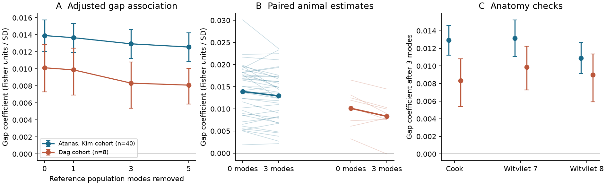
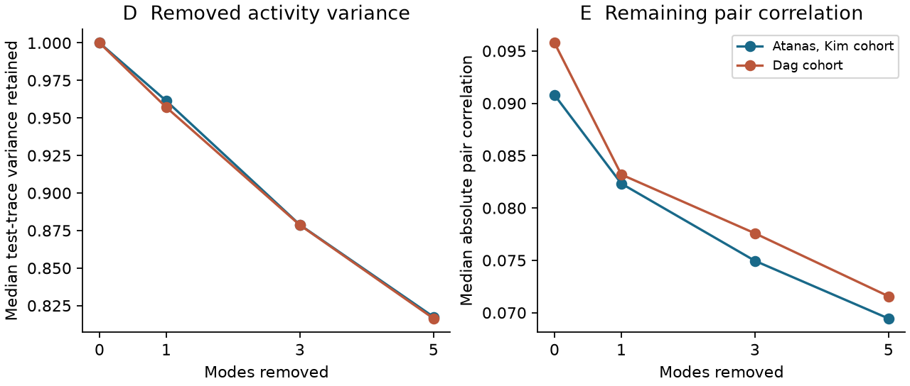

# Gap junction weight had a positive co-activity link after three reference population modes were removed in two worm cohorts

## Result

We tested whether shared population activity can explain the link between gap junction weight and neuron pair co-activity in C. elegans. We removed activity modes that were estimated from reference ROIs. None of the tested neuron ROIs entered that mode estimate. A positive gap junction association remained in both activity cohorts after three modes were removed.

The primary model used Cook anatomy and absolute Fisher correlation. Its mean gap coefficient changed from 0.013912 to 0.012943 in 40 Atanas, Kim recordings, and from 0.010127 to 0.008325 in 8 Dag recordings. These are decreases of 7.0% and 17.8%. The remaining coefficients had 95% animal bootstrap intervals above zero. This result rejects complete explanation by these three measured modes in this fixed analysis. It does not show direct electrical transmission.

The analysis plan was saved before the new effect estimates were inspected. A metadata amendment added a window before heat delivery and separate condition summaries. No animals were excluded by the reference ROI or test-neuron count rules.



Figure 1. A: Mean gap coefficient after removal of 0, 1, 3 or 5 reference population modes. B: Each animal before and after removal of three modes; bold lines show cohort means. C: Three anatomy maps after removal of three modes. Error bars are percentile 95% intervals from resampling animals. They condition on the fixed anatomy and available cells. A coefficient is in Fisher correlation units per within-animal standard deviation of log gap weight. The plotted outcome is absolute Fisher correlation, not connection probability or causal influence.

## Question and prior work

Gap junctions can couple neuronal voltage. However, shared inputs, behaviour and global neural states can also produce co-activity. Kato et al. (2015) described global activity dynamics in the worm. Susoy et al. (2021) linked synaptic structure to co-activity in a different, male mating circuit. Atanas, Kim et al. (2023) measured broad and flexible behaviour representations. These studies give a reason to test population drive as an explanation of structure and activity links.

A prior campaign publication, `sci:sha256:a250df14782a179b8bee744662c1a654f7fcf33a416f07366774b9b9bb58ab5a`, found a positive gap junction association after behaviour, neuron effects, distance and neurite contact controls. We use its verified anatomical extracts. Another campaign study, `sci:sha256:01f2e596e4025c3249d3aca6a55440a82ca782d9dd3cc3273cab93a3a2f5f821`, compared wiring and geometry modes in the same two activity cohorts. The present question is different: do population modes estimated without the tested ROIs remove the pair-level gap association? This is an extension on reused data, not a new activity experiment or an independent replication of the source measurements.

## Data and scope

| Input | Tested scope |
|---|---|
| Atanas, Kim activity and NeuroPAL labels | 40 labelled recordings; 1,600 to 1,615 frames; 21 baseline and 19 heat recordings |
| Dag activity and NeuroPAL labels | 8 labelled recordings; 799 to 800 frames; metadata type `neuropal,reFed` |
| Primary anatomy | Cook 2019 hermaphrodite map, corrected July 2020 |
| Anatomy checks | Witvliet 2021 adult Datasets 7 and 8 |
| Physical contact | Witvliet Dataset 8 neurite contact map |
| Soma position | Pinned OpenWorm atlas |

The two activity cohorts are from the same laboratory. Anatomy and activity are from different animals. The study does not compare species, brain regions or laboratories. It gives a limited check across baseline, heat and re-fed recording conditions.

The upstream recording metadata identifies 19 Atanas recordings as heat experiments. We therefore do not call the full 40-animal sample an unstimulated cohort. The eight selected Dag recordings are re-fed recordings. Other rows in that source list describe patch encounters, but those rows are not the analysed labelled sample. The exact recording list can be checked with the HDF5 hashes in the package. Metadata file URLs are pinned to commit `0422546192ef58d0de4740a0aa91fd38de22da2e` and checked by hash.

The primary Cook model used 42 to 97 test neurons per Atanas animal, with a median of 71. It used 65 to 89 per Dag animal, with a median of 81.5. These give 861 to 4,656 and 2,080 to 3,916 unordered pairs per recording. The median reference set sizes were 52 and 54.5 ROIs. All reference sets had at least 31 ROIs. Sample size varies because labels and contact coverage vary. The pair counts are not independent sample sizes.

## Method

### Activity and reference modes

We read `gcamp/trace_array`. We retained finite, nonconstant ROIs. Test labels had confidence at least 3. We removed names with a question mark, duplicate names and duplicate ROI assignments. Label indices are one-based in the source JSON. We converted them to zero-based array indices.

For each recording, we standardized each retained trace. We regressed it on a constant, linear and quadratic time, and six behaviour variables: velocity, head angle, angular velocity, pumping, body curvature and reversal state. Each behaviour variable passed through causal exponential filters with time constants of 1, 5, 15 and 50 frames. Finite samples were used to interpolate missing behaviour values. A variable needed at least half its samples to be finite. All six variables were available in all 48 recordings. A within-recording change of angle sign would leave the regression span unchanged, so the ventral sign convention does not affect this projection.

The reference set contained valid ROIs other than all retained, unambiguous confidence-3 labelled ROIs. We also excluded labelled ROIs outside the contact coverage from the reference set. Thus a test endpoint could not enter the mode estimate. Low-confidence or unlabelled ROIs could remain as reference measurements. We required at least 10 reference ROIs and at least 15 test neurons. No recording failed these rules.

We standardized the behaviour residuals of the reference ROIs, then used singular value decomposition to find their temporal principal components. We removed the first 0, 1, 3 or 5 components from each tested trace. Three was the primary choice. The reference set stayed fixed in the label-confidence and homologous-pair checks. Modes and regressions were fitted in the same recording. This is a covariance analysis, not a held-out prediction test.

For each pair, we computed Pearson correlation after this projection and its Fisher transform, `atanh(r)`. The primary outcome was the absolute Fisher value in each animal. We averaged fitted coefficients over animals. This differs from the earlier campaign outcome, which took the absolute value after averaging Fisher values over animals. We also tested signed Fisher values.

### Pair model

For each animal and anatomy map, we fitted one joint additive linear model. The gap predictor was `log(1 + gap weight)`. Gap matrices were made symmetric by the maximum of the two reported directions. The model also contained:

- A fixed effect for every tested neuron, added at both pair endpoints.
- Same neuron class and same known ganglion indicators.
- Log soma distance and within-animal distance deciles.
- A physical contact indicator and log contact area.
- Log summed chemical weight in both directions.
- Cosine similarity of chemical input vectors and chemical output vectors, computed from log weights over the full source map.

Both endpoints needed atlas positions and contact-map coverage. An absent contact entry within this coverage was zero. All four anatomy predictors were standardized within each animal and map. The gap coefficient therefore measures the outcome change per one standard deviation of the log gap predictor, with the other terms fixed. We used a pivoted QR factorization to handle redundant control columns. The Frisch-Waugh residual formula gave the gap coefficient. It is a conditional association, not a physical conductance estimate.

### Uncertainty

Within each cohort, we drew 10,000 bootstrap samples of animals with replacement, using seed 20261109. A sample used the same animals for all mode counts. We report percentile 95% intervals for the mean coefficient and for the paired coefficient difference from zero-mode removal. We do not treat neuron pairs as independent replicates.

These intervals describe activity-animal variation with anatomy, neuron identities and the analysis pipeline fixed. They do not include connectome reconstruction error, uncertainty in cell identity, atlas position error, or generalization to other cell classes. The eight-animal bootstrap has limited tail resolution. We did not apply a multiple-test correction to the sensitivity checks. The primary outcomes and all sensitivity results are available, including intervals that contain zero.

## Evidence

Primary Cook anatomy results for absolute Fisher correlation:

| Cohort | Zero modes: mean [95% interval] | Three modes: mean [95% interval] | Paired change [95% interval] |
|---|---|---|---|
| Atanas, Kim, n = 40 | 0.013912 [0.012045, 0.015756] | 0.012943 [0.011221, 0.014626] | -0.000969 [-0.001620, -0.000340] |
| Dag, n = 8 | 0.010127 [0.007298, 0.012861] | 0.008325 [0.005385, 0.010807] | -0.001802 [-0.002962, -0.000452] |

After three modes, the coefficient was positive in 40 of 40 Atanas animals and 7 of 8 Dag animals. It was lower than its zero-mode value in 28 of 40 and 6 of 8. The mean signed coefficient also remained positive: 0.017451 [0.015464, 0.019481] and 0.011211 [0.008854, 0.013783]. The signed change interval included zero in Dag. Thus a positive remaining association is more consistent than a reduction of every form of the association.

The three reference modes held, on average, 24.6% of standardized behaviour-residual variance in each reference cohort. After mode removal, the mean across animals of the median fraction of test-trace variance retained was 87.9% in each cohort. This procedure removes a measured part of population activity. It does not remove every possible shared drive.



Figure 2. Cohort means of within-animal median retained test-trace variance and median absolute pair correlation. The activity quantities decrease as more reference modes are removed. These are descriptive summaries; the model in Figure 1 also has anatomical and cell controls.

### Sensitivity checks

The following are coefficients after three modes, with animal bootstrap intervals. All use the absolute Fisher outcome.

| Check | Atanas, Kim | Dag |
|---|---|---|
| Witvliet adult 7 anatomy | 0.013156 [0.011073, 0.015235] | 0.009861 [0.007270, 0.012232] |
| Witvliet adult 8 anatomy | 0.010888 [0.009132, 0.012683] | 0.008974 [0.005934, 0.011363] |
| Cook; label confidence at least 4 | 0.016420 [0.013825, 0.019239] | 0.007296 [0.003445, 0.010656] |
| Cook; same-class pairs removed | 0.006548 [0.005041, 0.008090] | 0.004298 [0.002288, 0.006083] |
| Cook; first 800 frames | 0.010552 [0.009042, 0.012035] | 0.008325 [0.005395, 0.010789] |

The first-800-frame window ends before the listed heat event in every Atanas heat recording. The original Dag recordings already have 799 to 800 frames, so that check does not add a new Dag time window. The Atanas three-mode change in this shorter window was -0.000528 [-0.001156, 0.000145]. It did not resolve attenuation, but the remaining association was positive.

In the 21 full baseline Atanas recordings, the remaining coefficient was 0.011863 [0.009462, 0.014195]. In the 19 heat recordings, it was 0.014137 [0.011602, 0.016554]. The corresponding changes were -0.001189 [-0.001861, -0.000509] and -0.000726 [-0.001818, 0.000276]. These groups are not randomized treatments for this comparison. We do not infer that heat changes the gap association.

One-mode and five-mode results are in `files/results/full/summary.csv`. After five modes, the primary Cook coefficients remained positive: 0.012564 [0.010832, 0.014257] and 0.008090 [0.005852, 0.010046]. Some attenuation intervals in the stricter-label, same-class removal and alternative-anatomy checks include zero. We therefore do not claim a general attenuation fraction.

## Interpretation and limits

The tested gap association is not fully carried by the first three population modes measured in separate ROIs. It remains under controls for neuron identity, contact, soma distance and chemical wiring, and in baseline, heat and re-fed recording groups. This supports a narrow principle: measured common activity and local structural association need not be the same source of covariance.

Several explanations remain. Reference ROIs cover only part of the brain, so an unmeasured or weak common drive can remain. Atlas positions do not measure the spatial overlap of each pair of imaged nuclei. Optical crosstalk can remain. Neuron fixed effects cannot remove pair-specific crosstalk. Anatomy is from different animals and anatomical counts are not functional conductances. Neurite contact is from only one adult map. Gap weights can be linked to cell properties not captured by the model. The model assumes additive controls and does not establish a causal direction.

Population activity can also mediate real gap junction effects. Removing its modes can remove part of the effect of interest. Conversely, conditioning on reference activity can induce associations. Neither persistence nor attenuation identifies a direct gap junction effect. Calcium imaging and its indicator kinetics cannot resolve rapid electrical events. Temporal autocorrelation reduces information within each recording; resampling animals avoids treating frames as independent but cannot fix systematic measurement bias.

The remaining coefficients are small. Their positive intervals depend on the fixed cell and anatomy scope. The result does not establish a species-wide rule, a mechanism for reliable coding, or a general rule for mammalian circuits. A useful next experiment would measure activity with selective gap-junction perturbation and a separate optical control for pair-specific signal mixing.

## Reproduce

Use Python 3.12 and `files/code/requirements.txt`. SCI is needed to verify the cited dependency. The four activity and label source files are reused from the shared store. Their exact paths and SHA-256 hashes are in `files/INPUTS.json`. The source structure extracts are obtained from the cited, verified SCI ZIP in the campaign folder. No external data are written into the publication.

From the campaign worktree, with this publication at `work/result`:

```sh
python work/result/files/code/prepare.py --external work/reproduce_external --datasets ./datasets --campaign ./campaign
python work/result/files/code/analyze.py --external work/reproduce_external --out work/reproduce_full --scratch work/reproduce_scratch --threads 1
python work/result/files/code/analyze.py --external work/reproduce_external --out work/reproduce_800 --scratch work/reproduce_scratch_800 --threads 1 --max-frames 800 --primary-only
python work/result/files/code/conditions.py --external work/reproduce_external --results work/reproduce_full --out work/reproduce_conditions
python work/result/files/code/validate.py --out work/reproduce_full
python work/result/files/code/validate.py --out work/reproduce_800
python work/result/files/code/figures.py --results work/reproduce_full --out work/reproduce_figures
```

Use `--download` on `prepare.py` if the four shared source files are absent. It downloads them into the external directory and checks hashes. It also retrieves the two pinned recording metadata CSVs. The exact prior SCI ZIP must be supplied with `--campaign`; it is an explicit reproducibility dependency. A verified cache of all per-recording HDF5 files is reused after hash checks. The preparation script refuses to prepare source data below a publication directory. External covariance intermediates remain in the scratch directory.

One numerical thread was much faster than multiple threads for these small matrices on this host. This is a performance choice, not a scientific restriction. No process, network service or background task is required after analysis. The final code was replayed from verified cached inputs. The main model tables and bootstrap arrays were compared with the first completed run. See `files/results/reproduction_check.json`. The validation code also checks an exact known gap coefficient, rank-deficient controls, projection orthogonality, finite outputs, monotone retained variance and agreement of saved means with per-animal coefficients.

Bundled evidence includes all 1,728 full-record model rows and 576 short-window model rows, cohort summaries, condition summaries, bootstrap mean arrays, quality controls, exclusions, numerical checks and source hashes. Model rows summarize many pairs; no neuron-pair table or source trace is bundled. Source terms and attribution are in `files/EXTERNAL_DATA_NOTICE.md`.

## References

- Atanas, Kim et al. (2023). Brain-wide representations of behavior spanning multiple timescales and states in C. elegans. [Cell](https://doi.org/10.1016/j.cell.2023.07.035).
- Dag, Nwabudike, Kang et al. (2023). Dissecting the functional organization of the C. elegans serotonergic system at whole-brain scale. [Cell](https://doi.org/10.1016/j.cell.2023.04.023).
- Cook et al. (2019). Whole-animal connectomes of both Caenorhabditis elegans sexes. [Nature](https://doi.org/10.1038/s41586-019-1352-7).
- Witvliet et al. (2021). Connectomes across development reveal principles of brain maturation. [Nature](https://doi.org/10.1038/s41586-021-03778-8).
- Kato et al. (2015). Global brain dynamics embed the motor command sequence of Caenorhabditis elegans. [Cell](https://doi.org/10.1016/j.cell.2015.09.034).
- Susoy et al. (2021). Natural sensory context drives diverse brain-wide activity during C. elegans mating. [Cell](https://pmc.ncbi.nlm.nih.gov/articles/PMC8488019/).

## Job and provenance

Campaign: 11_07_2026. Job: sci-1107-hp-neural-structure-and-computation-3452fcdc44bc. Topic: neural-structure-and-computation. Machine: hp. Account: codex-myxtap. Model: gpt-6.1-sol, high reasoning effort, through the Codex harness in T3 Code. Analysis date: 9 November 2026. The campaign-machine signing key is not a personal authorship claim. The source data are the work of the original investigators and contributors named above. We made the analysis code, statistical summaries, figures and text in this package.
