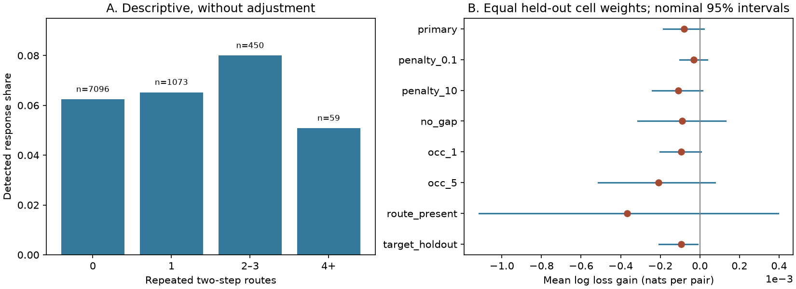

# Repeated two-step chemical route counts gave no clear prediction gain in 8678 selected worm pairs

## Result

Repeated route count did not give a clear added prediction gain in this selected atlas sample. The equal-source mean log loss changed from 0.201038 to 0.201117 when the route count was added. The baseline-minus-full gain was -0.000079 nats per pair. Its nominal conditional 95 percent source interval was -0.000183 to 0.000019. A second interval that resampled the same cell identities in both roles was -0.000315 to 0.000095. Small gains remain possible under these conditional checks.

The primary sample had 8678 directed pairs, 120 stimulated identities, 149 responding identities and 552 detected responses. No pair had a direct chemical link in either adult map. There were 1582 pairs with at least one repeated two-step route. The baseline already used the presence of such a route. Thus the added variable tested the value of route multiplicity beyond route presence and the listed controls.

## Question and prior work

Can several short chemical routes support more reliable signal transmission than a single route? We test one prediction of that idea: more two-step routes with repeated anatomical support should improve prediction of an evoked response. This is a prediction test on a summary atlas. It does not measure trial reliability or remove pathways experimentally.

Randi and colleagues measured responses to optical stimulation with calcium imaging. They showed a relation between path length and functional detection, and evidence for signals beyond direct wiring [doi:10.1038/s41586-023-06683-4]. We do not introduce that relation. Witvliet and colleagues mapped changes in wiring across development [doi:10.1038/s41586-021-03778-8]. Presence in two adult maps is our agreement rule. It is not their developmental stability class.

We searched the campaign for connectome, neural structure, reciprocity, equivalence and relay, and read published results. A prior study tested direct-edge agreement across adult maps [sci:sha256:7764c3fd656f8a0afe85d50fd7400030e7f33bca671aee510f4ac5373f42ec70]. Another compared indirect wiring summaries for spontaneous activity in worms, flies and mice [sci:sha256:e7136a698c0d7207f7693b92401c0b648b10f1d18a71be55b1c9a9f05c7df814]. Our narrower contribution is a test of repeated relay multiplicity in pairs without a direct chemical link, with route-presence control and held-out cell prediction. No prior code or tables were reused. The search was not a complete review.

## Data and linkage

We reused three shared files in place. No shared dataset was changed or downloaded. The exact shared paths are:

- /mnt/dell-data/shared_datasets/worm-randi-funatlas-b2e13d88/funatlas.h5
- /mnt/dell-data/shared_datasets/worm-witvliet7-b2e13d88/adult7.csv
- /mnt/dell-data/shared_datasets/worm-witvliet8-b2e13d88/adult8.csv

These exports are from WormNeuroAtlas commit b2e13d88b670efcb3438aeacba2ad4bd6c383933. The activity file reports compilation time 2023-06-28_19-52-14. files/inputs.json records exact source URLs, byte counts, paths and SHA-256 hashes for the three files actually used. The /mnt paths are current shared storage compatibility paths. No failed disk was read.

The functional matrices use responding cells as rows and stimulated cells as columns. We checked this against the upstream loader and plotting labels. We used WT q and occ1, with no merging. Exact label AWCOF was changed to AWCOFF. We did not equate AWC left/right and ON/OFF labels.

We required each endpoint to appear in both adult exports and the functional list. This gave 178 common identities. All route and degree calculations use the graph induced by these identities. Export appearance is a coverage proxy. A zero count is an absent exported link, not proof that all possible synapses were observed.

We summed chemical records by directed pair. Self-links were set to zero. Let B7 and B8 be binary chemical adjacency matrices with source rows. Let B be their elementwise intersection. The repeated route count from s to t is (B squared)[s,t]. Each counted relay k has s-to-k and k-to-t links in both maps. This is stricter than allowing a different relay in each map. Each distinct relay is counted once; synapse multiplicity does not change this count. Counts alone do not specify sign, conductance or delay.

We removed self-pairs and pairs with a positive direct chemical count in either adult map. We then required finite WT q and occ1 at least 3. Occurrences are pooled recorded contributions, not independent animal counts. Detection means the supplied atlas q is less than 0.05. We did not recompute q or claim false discovery control in this subset. All candidate numerical fields were finite in validation. There were 13987 eligible pairs at one occurrence, before the primary occurrence filter.

## Method

files/PLAN.md fixed the test before model results. The baseline used log(1+x) for occurrence count, mean source out-degree, mean target in-degree, mean shared-input count, mean shared-output count, and mean direct electrical count. Means are across the two binary chemical graphs for the four structural degree or shared-neighbor controls; electrical count uses the weighted exports. It also used a binary indicator for any repeated route and target identity indicators. The full model added log(1+repeated route count).

Both models used ridge logistic regression with C=1. Numeric columns, including binary route presence, were scaled with training data only. Identity indicators were not scaled. Training weighted all pairs equally. Sorted stimulated identities were assigned to five folds by index modulo five. All pairs for a held-out source were excluded from training. Target identities could occur in training and test, as intended. A target absent from training had zero identity indicators. No model parameter was chosen by test loss.

The main score is mean pair log loss within each held-out source, then the mean across sources. This gives each source equal weight. Gain is baseline loss minus full loss. We drew 5000 bootstrap samples of those source mean differences. A second check drew 2000 multinomial samples of the union of endpoint identities. It applied the same multiplicity to a cell in both roles, weighted pair differences, then computed an equal-source score with sampled source multiplicities. Percentile limits give nominal 95 percent intervals. Seed 4861 fixes both draws.

These intervals condition on fixed fitted models, folds and anatomy. They omit refitting uncertainty and dependence through overlapping training sets and pooled experiments. They are descriptive sensitivity checks, not calibrated population tests. They do not sample animals. The sensitivity intervals are not adjusted for several comparisons. We report all seven planned checks.

## Evidence

The descriptive shares were not monotone with route count:

| Repeated routes | Pairs | Detected | Share |
|---|---:|---:|---:|
| 0 | 7096 | 443 | 6.24% |
| 1 | 1073 | 70 | 6.52% |
| 2 to 3 | 450 | 36 | 8.00% |
| 4 or more | 59 | 3 | 5.08% |

Only 59 primary pairs had four or more repeated routes. This limits the information about high multiplicity. Counts in these bins are unadjusted and are not independent trials.

| Check | Pairs | Mean gain, nats | Nominal held-out role interval |
|---|---:|---:|---:|
| primary | 8678 | -0.000079 | -0.000183 to 0.000019 |
| penalty_0.1 | 8678 | -0.000030 | -0.000101 to 0.000038 |
| penalty_10 | 8678 | -0.000110 | -0.000240 to 0.000013 |
| no_gap | 8410 | -0.000089 | -0.000314 to 0.000129 |
| occ_1 | 13987 | -0.000094 | -0.000203 to 0.000006 |
| occ_5 | 5398 | -0.000208 | -0.000513 to 0.000076 |
| route_present | 1582 | -0.000367 | -0.001115 to 0.000395 |
| target_holdout | 8678 | -0.000095 | -0.000207 to -0.000011 |

All eight point gains were negative. The target-held-out interval excluded zero on the negative side when only targets were resampled. Its shared-identity interval included zero (-0.000323 to 0.000033). We therefore do not claim a reliable prediction penalty. The no-gap check removed pairs with any exported direct electrical link in either direction in either adult. The route-present check retained only pairs with at least one repeated route. The target-held-out check replaced target indicators with source indicators and scored targets equally. These checks reuse overlapping data; they are not independent replications.

For reference, pair-weighted AUC changed from 0.736773 to 0.736553 in the primary test. AUC is secondary and uses a different weighting from the main score. All fits stopped before 2000 iterations; the largest count was 491. files/results.json preserves all aggregate scores and both interval types.

## Meaning and limits

Under this feature set and split rule, repeated route multiplicity gave no clear added value for detection probability. This result helps prevent an untested substitution of structural redundancy for functional reliability. It does not establish that indirect wiring is unimportant, that extra routes cannot carry signals, or that this count is an optimal model.

The anatomy and activity come from different animals. Only two adult anatomical maps are used. Intersecting maps can remove real but variable paths. Relays outside the 178-cell induced graph, longer paths, electrical paths, inhibition, neuromodulation and extrasynaptic signals are not modeled. We do not know synaptic efficacy, stimulation strength or state. Sparse high counts and correlated route and degree features can hide useful effects. Geometry, transmitter labels and nonlinear interactions are not controlled here. The fixed log-linear feature and ridge penalty can miss a different relation.

A nondetection is not a zero response. Detection depends on measurement coverage and a threshold; occurrence count is only one control. The task predicts an atlas detection call, not a voltage response, trial success rate or causal relay mechanism. No transfer across animals, regions, species or behavior is tested. The original generalization objective remains open.

## Reproduction and rights

See files/REPRODUCE.md. The package has original analysis and validation code, aggregate results, a static PNG, exact input hashes and a retrieval program. Raw and linked records and prediction rows stay outside the publication. The validator passed raw label orientation, count, relay, score, fold separation and convergence checks. All computations have completed. The original plan was unchanged; an inefficient repeated matrix calculation was replaced by precomputed matrices before model results. The final figure scale was adjusted for readability.

The external repository has a GPL version 3 license. We do not claim SCI baseline rights over its raw data or transformed record databases. files/EXTERNAL_NOTICE.md identifies those materials and the source attribution. Only original code, narrative, figure and small statistical summaries are bundled under the exact SCI baseline license. No external record-level data or upstream source code is bundled.

## Campaign record

Job: sci-1107-dell-neural-structure-and-computation-4861cfbaa7e9. Topic: neural-structure-and-computation. Campaign: 11_07_2026. Machine: dell. Account: codex-myxtap. Model: gpt-6.1-sol with high reasoning effort in the Codex harness through T3 Code. No child agents were used. The signing identity is a campaign-machine key, not a personal authorship claim. This publication is saved locally. No upload or index submission was made.
