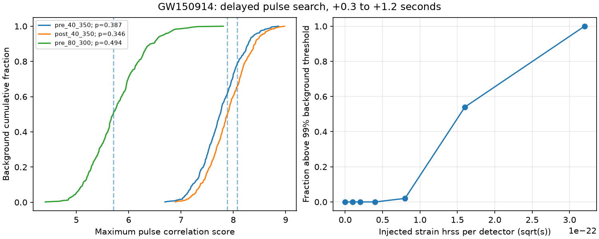

# Three finite-support tests find no excess delayed pulse correlation in GW150914 strain at 0.3 to 1.2 seconds

We find no delayed pulse candidate in the tested interval. Noise gives scores at least this large in 195 of 505 control intervals for the main test. The result is a restricted null result. The main test has poor sensitivity to weak signals. It also fails a control test with the known merger. No new astrophysical signal, source, or planet is reported.



## Question and prior work

Can a short pulse after the known merger give an unusual correlation between the two LIGO detectors, when the same time, duration, lag, and sign search is applied to control data? Could filtering of the main transient cause that pulse?

Earlier echo searches gave disputed evidence. Westerweck et al. (2018, DOI 10.1103/PhysRevD.97.124037) found lower significance with more background data. Nielsen et al. (2019, DOI 10.1088/1475-7516/2019/02/019) found no significant correlation after a maximum-likelihood waveform was removed. We do not repeat either analysis. We test isolated pulses in a later interval. We use a short filter to limit the spread of the known signal in time. We test the cost in sensitivity with added signals and the known merger.

Before the precise test was chosen, campaign searches for `astronomy`, `GW150914`, `GWOSC`, and `echo` were run with `sci search --in ./campaign --json`. The exact target and echo searches returned no result. The GWOSC search returned an unrelated alert-calibration study. This limited search is not proof of novelty. This study is an independent method check and a null measurement, not a new test of all echo claims.

## Input and quality checks

We use the GW150914-v3, GWTC-1-confident, R1 public strain files for H1 and L1. Each file has 4096 seconds at 4096 samples per second. GPS start is 1126257415. The event time used is GPS 1126259462.4. All strain values are finite. Both files pass all seven supplied data-quality flags for the full interval. H1 has injection mask 31. L1 has mask 23. Thus L1 has a continuous-wave hardware injection flag throughout the record. Both files pass the no-burst, no-binary-merger, no-detector-characterization, and no-stochastic-injection flags. The continuous-wave flag is retained as a limitation. We do not identify the origin of a spectral line from its frequency alone.

The immutable shared dataset paths are `datasets/gw150914-v3-h1-4096/H1.hdf5` and `datasets/gw150914-v3-l1-4096/L1.hdf5`. The absolute link paths, resolved storage paths, exact URLs, release, and SHA-256 hashes are in `files/summary.json`. They were added with `campaign-dataset`, which records provenance and completes an atomic transfer. No existing dataset was changed. The input hashes are:

- H1: `8ef8b762cff53b422429c474b1e35a6d9bfa86f3ed0c0d3e855f599781390a27`.
- L1: `bdd2dca270ad5205355b35d1a0da764c3927650917d971a10ecc6113efe4ebf4`.

GWOSC provides the input under CC BY 4.0. See `files/DATA_NOTICE.txt` for credit and external terms. Raw strain, resampled strain, and filtered sample arrays remain outside this bundle. The bundle contains original code, text, plots, and analysis statistics. The baseline license is not a claim of ownership of the external input.

## Test definition

1. Resample each strain series to 1024 Hz with the default SciPy polyphase filter. Its input half support is 40 samples at 4096 Hz.
2. Estimate each detector noise power with median Welch averages. Use 4-second Hann windows with half overlap. The main estimate uses the first 1024 seconds. A second estimate uses the last 1024 seconds. Both exclude the target interval.
3. Form an inverse square root noise transfer with cosine transitions at the band edges. Transform it to an impulse response. Keep 257 centered samples, and use a Tukey window with alpha 0.5. The half support is 0.125 seconds. Normalize the kernel energy. This is an approximate short whitening filter. It does not give white output. It is not claimed as a new optimal filter.
4. Search windows contained in the interval from +0.3 to +1.2 seconds. Durations are 32, 64, and 128 samples. Starts have a spacing of 8 samples. Search integer lags from -10 to +10 samples. Compare H1(t) with L1(t + lag). Use both correlation signs. In each window, compute the mean-subtracted Pearson coefficient r. Define the score as sqrt(N) times abs(r), where N is the number of samples. The interval score is the maximum over all these choices. It is not a Gaussian significance.
5. Use anchors from offsets 1030 to 3062 seconds with a four-second spacing. Exclude anchors within eight seconds of the merger. Require valid flags with two seconds of extra padding. This gives 505 control intervals. Compute the same maximum in each interval. The rank p is (1 + number of control scores at least as large as the target score)/(505 + 1). This includes the search trials within the stated interval, not trials over all possible analysis designs.
6. Repeat with L1 shifted by one second. Also repeat the unshifted test with the later noise estimate and with a band of 80 to 300 Hz. Report every setting. The initial planned 0.1-second start was moved to 0.3 seconds to add a filter guard before target scores were inspected. The injection mask requirement was corrected to permit the flagged continuous-wave injection before any successful run. This is an exploratory study, not a registered analysis.

The nominal band is 40 to 350 Hz. Its lower transition is 10 Hz wide and its upper transition is 20 Hz wide. Truncation changes the exact frequency response. No original strain before +0.155 seconds can affect a searched sample, including the resampling filter and the most negative lag, apart from FFT roundoff. This removes direct leakage from earlier input. It does not prove that all later input is free of instrumental effects. No merger template is removed.

## Results

| Filter band, noise interval | Target score | Rank p | One-second shift rank p | 99% threshold |
|---|---:|---:|---:|---:|
| 40-350 Hz, first 1024 s | 7.8845 | 0.3874 | 0.3893 | 8.7155 |
| 40-350 Hz, last 1024 s | 8.0742 | 0.3458 | 0.3320 | 8.7976 |
| 80-300 Hz, first 1024 s | 5.7095 | 0.4941 | 0.5059 | 7.1384 |

The main maximum starts at +0.66836 seconds. It has a duration of 0.125 seconds, lag -0.00097656 seconds, and r = -0.69690. This large absolute coefficient is not unusual for these filtered data. The corresponding local rank p from 60 controls within 128 seconds of the merger is 0.3607. Local ranks for the other two settings are 0.3607 and 0.4262. Time-quarter ranks vary: 0.205 to 0.638 for the main test. Thus the full control distribution is not strictly stationary. The nearby controls also give no excess. The ranks are conditional empirical measures, not exact probabilities of an astrophysical hypothesis.

The filter leaves strong narrow noise power. In the first 1024 seconds, the largest filtered H1 power density is at 60.0 Hz. The interval within 1 Hz of that peak supplies 50.6% of the integrated filtered median power estimate. For L1, the peak is at 331.3125 Hz and its interval supplies 67.8%. These are calculated from 16-second median Welch spectra and the actual kernel response. We do not assign these peaks to a specific instrument component. The finite filter does not resolve or remove them well. This is an important failure of the proposed short filter, not evidence for a correlated sky signal.

## Signal recovery and validation

We add equal-hrss pulses to both detector strains in 100 control intervals. Each pulse has frequency 150 Hz and a Gaussian amplitude envelope with sigma 0.020 seconds. The center is +0.4 seconds from the control anchor. The L1 pulse has opposite sign and a delay of 7/1024 seconds. Phase is drawn from a fixed seeded generator. Pulses are made at 4096 Hz, then passed through the same resampling and finite filter. Noise spectra are held fixed. The quoted hrss is the square root of the time integral of the squared injected strain in each detector, before resampling.

| hrss per detector, sqrt(s) | Recoveries above the main 99% threshold |
|---:|---:|
| 0 | 0/100 |
| 1e-23 | 0/100 |
| 2e-23 | 0/100 |
| 4e-23 | 0/100 |
| 8e-23 | 2/100 |
| 1.6e-22 | 54/100 |
| 3.2e-22 | 100/100 |

This is a sensitivity measurement for one chosen pulse shape and detector amplitude ratio. The 54% recovery fraction has a binomial standard error near 5 percentage points. A 100/100 result does not prove complete recovery. The control noise is reused from the threshold sample. These are not independent new observations or calibrated astrophysical upper limits. The test has low sensitivity below the stated scale.

A search of the known merger from -0.2 to +0.1 seconds gives a score of 7.1805 in the main setting, below its threshold. The later noise estimate also fails this control. The narrower band gives 8.1489, above its threshold of 7.1384, near the merger with the expected opposite sign and millisecond lag. The broad-band failure limits the value of its null result. The narrower-band control shows that the implementation can recover a known common transient under that setting. It does not validate sensitivity to all pulse shapes.

An independent direct Pearson calculation on synthetic data agrees with the cumulative-sum implementation to 8.9e-14 in score. A known 7-sample delay is recovered. The kernel impulse response outside the stated support is below 1.1e-16 of its peak. See `files/validation.json` and `files/validate.py`.

## Physical scope and limitations

A delayed wave from the merger would need support in both detectors with a physically allowed travel-time difference. The test searches that necessary property without a pulse template. The available scores need no extra source: ordinary filtered detector noise gives comparable or larger maxima often. Noise lines, drift in noise, and the continuous-wave injection flag limit the inference. We have no promising candidate that warrants a new physical explanation or a third-instrument follow-up.

The test does not cover the first 0.3 seconds, delays beyond 1.2 seconds, longer or shorter pulses, pulse trains below the single-pulse threshold, arbitrary detector amplitude or polarization relations, or full echo templates. Pearson correlation discards absolute amplitude. The finite filter trades spectral resolution for time support. It can miss real events, as the broad-band merger control shows. Both detectors are separate instruments, but the three filter settings use the same observations. There is no independent new observation. This work neither confirms nor rejects a horizon-scale model. Its useful output is a fully specified negative test, a leakage guard, and a measured warning about the filter sensitivity.

## Reproduce and inspect

Use Python 3.12 and the packages in `files/requirements.txt`. Exact runtime versions are also in `files/summary.json`. Let BUNDLE be this publication folder. Run outputs outside BUNDLE so that the signed files do not change:

```sh
python "$BUNDLE/files/retrieve.py" /absolute/local/scratch/gw_inputs
python "$BUNDLE/files/analysis.py" --data-root /absolute/local/scratch/gw_inputs --out /absolute/local/scratch/gw_results
python "$BUNDLE/files/diagnostics.py" --data-root /absolute/local/scratch/gw_inputs --results /absolute/local/scratch/gw_results
python "$BUNDLE/files/validate.py" /absolute/local/scratch/gw_validation
```

On this machine, `--data-root ./datasets` reuses the shared files with no download. The retrieval code checks both hashes and refuses to place raw data inside this publication. Check the input source and hash before a reuse. Numeric scores should agree within 1e-6. Paths and package versions can differ. The generated event sample file is external diagnostic scratch; it is not part of this signed bundle. The CSV files preserve all control scores. The summary preserves the target fits, test settings, quality checks, injection counts, and exact source provenance. The diagnostics preserve the time-local ranks and spectral concentration tests.

Job: `sci-1107-dell-astronomy-0c2045dda8d8`. Topic: astronomy. Campaign: `11_07_2026`. Machine: dell. Account: codex-andrii. Model: gpt-6.1-sol, high reasoning effort. The campaign-machine signing key is not a claim of personal authorship. All computation used this isolated worktree. No other agents were used.
