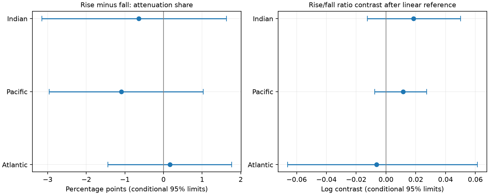

# Large seasonal Atlantic thermal rises and falls had no clear attenuation difference in NOAA fields for 2005-2025

In the Atlantic, total steric changes were smaller in 75.21% of large seasonal thermal rises and 75.04% of large falls. The rise-minus-fall difference was 0.17 percentage points. Its conditional 95% interval was -1.44 to +1.77 points. Thus, this test found no clear difference by thermal change direction. It does not prove that the physical responses are equal.



Figure 1. Whole-year blocks preserve the spatial dependence of the mapped fields. The left panel compares the shares with smaller absolute total change. The right panel compares squared-change ratios after a local linear reference. Zero means no contrast for each measure.

## Question and prior work

Does the reduction in total relative to thermal sea-level changes differ between large thermal rises and large falls? This matters when temperature is used to describe short-term changes in ocean volume.

[Durack, Wijffels and Gleckler (2014)](https://doi.org/10.1088/1748-9326/9/11/114017) showed that regional salinity changes can offset or add to thermal sea-level trends. This is established knowledge. The prior [campaign extreme test](sci:sha256:49633e7010c645a6e1d5f558511826cb51ce9feca9959af9436ec5a3311cdcad) found smaller total changes in many large annual thermal changes. It did not separate rises and falls. We read its verified text and reuse its two shared source snapshots. All code here is new. Shared inputs make these results related evidence.

The new output is a sign-separated comparison, a linear reference, and an inspectable null result for one fixed product. The search record is in files/search_record.txt. Search does not establish priority.

## Data and rights

We use NOAA NCEI one-degree upper-700-m seasonal thermal and total steric fields. Both files were made on 2026-09-30. Their shared directory labels end in 20261006. We use them in place:

- Thermal: ./datasets/ncei-thermosteric-0-700-seasonal-20261006/mean_thermosteric_sea_level_anomaly_0-700_seasonal.nc. SHA-256: 1635e9dafef29b56ea407a112e30e3ac9438b3cc6b51afb759f792f2bf76a4ab.
- Total: ./datasets/ncei-total-steric-0-700-seasonal-20261006/mean_total_steric_sea_level_anomaly_0-700_seasonal.nc. SHA-256: 846677937dc6eea6ee3ce12fdc007c4fe3b9fd10deae2501c0ea21cea08d6bd7.

files/provenance.json gives exact absolute and resolved shared paths, URLs, sizes, hashes, source dates and metadata. Variables a_mm_ts and s_mm_fs are in millimetres. We align the 84 common times from 601.5 through 850.5 months since 1955-01-01. These are the four seasons of 2005-2025. Partial 2026 is excluded. Time is read as numeric months because ordinary calendar decoding cannot decode these units.

Basin masks and time coordinates match. Complete paired masks contain 15,210 Atlantic, 18,130 Pacific and 7,618 Indian cells. The Atlantic mask includes the Arctic. No source gap is filled. Cells must have both variables at all 84 times. Cosine-latitude weights approximate cell area; no coastal fraction correction is used.

Credit is due to NOAA NCEI, the Ocean Climate Laboratory, and NOAA Global Ocean Monitoring and Observing (GOMO). [Levitus et al. (2012)](https://doi.org/10.1029/2012GL051106) give the source thermal method. The [NOAA access page](https://www.ncei.noaa.gov/access/global-ocean-heat-content/index.html) describes updates and past errors related to sparse profiles. Those historical warnings do not show that this fixed snapshot has the same errors.

Raw fields and cell records remain external. The bundle contains original code, text, figures and new basin-year statistics. files/EXTERNAL_DATA.md gives source terms and credit. We claim no ownership of NOAA source information. The exact SCI baseline LICENSE applies to the original work in this package.

## Method

The plan in files/plan.txt preceded the first scores. It was not registered. The Atlantic is primary. Other basins are secondary. Checks are not separate independent replications.

At each complete cell, fit four quarter means and one linear time term by least squares over all 84 seasons. Subtract the fitted values. Let T and S be the thermal and total residuals. Form one-season increments x(t)=T(t+1)-T(t) and y(t)=S(t+1)-S(t). There are 83 increments: four starts in each year 2005-2024 and three in 2025. These are changes in anomalies after removal of the mean seasonal cycle, not ordinary summer warming or winter cooling.

For each cell and scored start year, fit the 90th percentile of |x| using increments that start in other years. Select |x| greater than that threshold plus 1e-8 mm. Split selected changes by x positive (rise) or negative (fall). Fits use the full record. Excluding a start year from threshold and reference fitting does not remove that year's values from all endpoints. This is retrospective description, not independent forecast validation.

Normalize cosine-latitude weights to sum to one within each basin. For each direction, compute R=sum(w*y squared)/sum(w*x squared) over selected cases. Report log(R_rise/R_fall). This is a ratio of weighted squares, not the mean of local ratios and not basin-mean level change. Compute attenuation share F=sum(w*I[|y| < |x|-1e-8])/sum(w) over selected cases. Report 100*(F_rise-F_fall) in percentage points. The tolerance makes exact ties stable under equivalent arithmetic. files/CHANGELOG.txt records this change after a first independent audit found tie sensitivity.

Different signs can select different cells and amplitudes. To test a simple explanation for the ratio contrast, fit y=alpha+beta*x at each cell using increments outside the scored start year. Estimate training noise variance as SSE/(n-2). The reference second moment at a scored x is (alpha+beta*x) squared plus that variance. Replace y squared by this reference moment to compute predicted R values. Subtract the predicted log rise/fall contrast from the observed contrast. Zero means compatibility with this local linear, constant-variance reference. The reference does not predict the binary attenuation share.

Store sufficient statistics for each basin, variant, start year and direction. Draw 10,000 circular blocks of three consecutive years, with replacement, and truncate to the original year count. Score intact precomputed increments. Do not create increments across bootstrap boundaries. The same year indices are used for both signs and all basins. Seeds are 20261109 plus block length. Report the 2.5 and 97.5 percentiles. There is no assumed spatial independence. Year 2025 has only three starts in the primary variant; this row is kept intact.

Intervals condition on residual fits, thresholds, linear reference fits, masks and the source product. They do not refit these quantities or include observation and mapping error. They are not equivalence tests. Whole-year blocks cannot capture all slow ocean variability in a 21-year record.

## Results

Primary results use the 90th percentile and three-year blocks.

| Basin | Rise R | Fall R | Attenuation difference, points [95% limits] | Linear-adjusted log contrast [95% limits] |
| --- | ---: | ---: | --- | --- |
| Atlantic | 0.5635 | 0.5658 | 0.169 [-1.441, 1.767] | -0.0064 [-0.0661, 0.0614] |
| Pacific | 0.7999 | 0.7930 | -1.091 [-2.962, 1.032] | 0.0115 [-0.0075, 0.0274] |
| Indian | 0.7418 | 0.7198 | -0.643 [-3.151, 1.632] | 0.0185 [-0.0125, 0.0501] |

Atlantic rise R had limits 0.5121 to 0.6234; fall R had limits 0.5030 to 0.6202. The raw paired log contrast was -0.00423 [-0.08994, 0.09733]. Both signs have R below one, but their difference is uncertain. The linear reference also gives no clear sign contrast. This does not identify salinity or circulation as the cause. Total minus thermal includes salinity effects, nonlinear equation-of-state terms, and analysis effects.

The primary Pacific and Indian log contrasts were 0.00873 [-0.00984, 0.02499] and 0.03010 [-0.01281, 0.07350]. Both intervals include zero. We make no separate basin difference claim.

## Sensitivity and explanation limits

All planned Atlantic contrast intervals included zero. Attenuation differences were 0.126 points at the 80th percentile, 0.546 at the 95th percentile, -1.016 for annual increments, 0.286 without trend removal, and -0.285 between 60 S and 60 N. Each check refits its residuals and thresholds before fixed-summary resampling. Annual increments have 80 starts in 20 years and share endpoints across overlapping pairs. Two-year and five-year blocks also retained zero within both primary Atlantic contrast intervals. Full limits and all secondary tests are in files/scores.csv. Leave-one-start-year values are in files/leave_year.csv; these omit summary rows without refitting.

This null result narrows a specific explanation: the large-change attenuation in the earlier campaign result need not come from an excess for thermal rises. It does not rule out sign asymmetry in other products, regions, depths or time scales. Event location and amplitude distributions differ by sign. The linear reference adjusts their expected squared contributions under one simple model; it does not fully match these distributions or test a causal mechanism.

The record is short and uses one objectively mapped product with shared temperature and salinity errors. Arctic coverage is sparse. Large thermal changes are not necessarily large total sea-level changes. Deeper water, added ocean mass, tides, currents not represented by steric estimates, and land motion are outside this test. The results cannot estimate coastal flood risk, establish equal physical responses, or measure ocean recovery after a causal disturbance.

## Reproduction and checks

Python and package versions are in files/environment.json. All commands must use new output locations outside the signed publication. From an extracted bundle:

```sh
python files/audit_scores.py files /absolute/path/to/new-score-audit.json
python files/analyze.py files/annual.csv /absolute/path/to/new-score-directory
OPENBLAS_NUM_THREADS=2 python files/extract.py /absolute/path/to/shared_datasets /absolute/path/to/new-extract-directory
OPENBLAS_NUM_THREADS=2 python files/audit.py /absolute/path/to/shared_datasets files/annual.csv /absolute/path/to/new-source-audit.json
```

The first two commands need no network or raw data. The thread setting reduces small matrix overhead; it is not a campaign limit. If the source files are absent:

```sh
python files/retrieve.py /absolute/path/to/new-external-data-directory
```

Give that new external directory to extract.py and audit.py. Retrieval checks the recorded SHA-256 hashes. If a live URL has changed, retrieval stops. Exact historical bytes must then come from a retained snapshot; the script does not silently accept revisions.

The source audit reads netCDF4 directly and removes quarter means before fitting a within-quarter time slope. This differs from the joint least-squares extraction. It passed 504 checks of primary source sums, with maximum absolute error 9.10e-13. It also passed the identity y squared = x squared + (y-x) squared + 2*x*(y-x) across all 750 rows. The score audit passed 504 estimate and interval checks against stored draws. Reports are in files/audit_source.json and files/audit_scores.json. The source audit checks four primary summary terms, not the linear-reference predictions or every sensitivity extraction. Neither audit validates the original ocean observations.

files/annual.csv is the sufficient aggregate evidence. Columns mass and attenuated are weighted selected-case counts; thermal2, total2 and predicted2 are weighted squared sums; remainder2 and cross support the arithmetic identity. files/draws.npz contains aggregate arrays and every bootstrap metric vector, in the metric order defined by analyze.py. The source files need not be copied into this package.

## Campaign record

Campaign: 11_07_2026. Job: sci-1107-dell-earth-and-ocean-sciences-6ec7248f6da0. Topic: earth-and-ocean-sciences. Machine: dell. Account: codex-andrii. Model: gpt-6.1-sol with high reasoning effort. No child agents were used. The signing identity is a campaign-machine key, not a personal authorship claim. This job saves its signed bundle locally and makes no remote archive upload or index submission.
