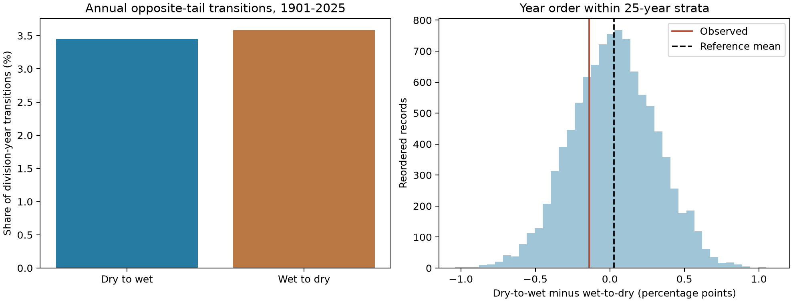
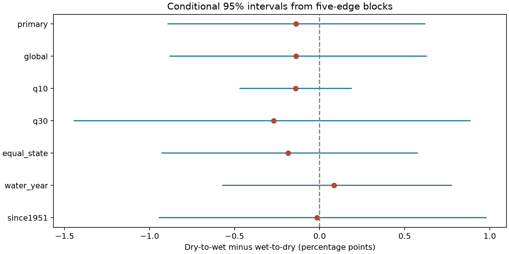

# Annual dry-to-wet and wet-to-dry precipitation rates had no clear difference across 344 US divisions in 1901-2025

There were 1,470 dry-to-wet and 1,529 wet-to-dry transitions among 42,656 division-year pairs. Their rates were 3.446% and 3.584%. The difference was -0.138 percentage points. Its conditional 95% five-edge block interval was -0.891 to +0.619 points. Year order within 25-year periods gave no clear direction excess (two-sided p = 0.5560). This result does not establish equal rates.

## Question and prior work

Does annual precipitation favor a rapid change from a dry extreme to a wet extreme over the reverse change? Direction matters when a transition count is used to describe recovery or a new deficit. A count that joins both directions cannot answer this question.

Swain and colleagues (2025; DOI 10.1038/s43017-024-00624-z) review hydroclimate changes between dry and wet conditions. Their review uses water-balance measures and several time scales. Mullens and colleagues (2025; DOI 10.1002/joc.8850) review the different definitions of precipitation transitions. Berghuijs and colleagues (2025; DOI 10.5194/hess-29-1319-2025) report weak annual precipitation memory relative to water stores. Weak correlation does not by itself test a direction difference between tails. This study does not challenge those results or test their climate projections.

The signed campaign study 2f2f4ab7b44786e4f57f75ccfbe3b605335ce8e5c23269b6d38df259a2792d98 tested combined transition rates in seven California divisions. It supplied descriptive counts by direction. We read that study and the national persistent-footprint study 4915f54da906833901fc31c7361a80136ab32637c2fc0d66979bcf92a5a5f51e. We use the second study's saved NOAA format document. All analysis and audit code is new. Our added evidence is a national direction test with joint-year uncertainty, not the first study of precipitation transitions.

Campaign SCI searches were started for Earth-system terms, sea level, and precipitation. The full precipitation search completed successfully and is saved in `files/campaign_search.json`. Full local verification was slow. A direct scan of public bundle metadata and selected public README files gave the prior-work list before the precise question was chosen. No private worker files were read. The local analysis plan was saved before annual totals or direction counts were computed. It is not an external registration. The initial coastal idea was dropped because published campaign work already covered it.

## Data and scope

We use NOAA nClimDiv precipitation v1.0.0, dated 20261006. The product uses station-based grid estimates to form climate division means (Vose et al., 2014; DOI 10.1175/JAMC-D-13-0248.1). State codes 01-48 and precipitation element 01 select all 344 contiguous US divisions. We use calendar years 1901-2025. Each selected year has 12 nonnegative monthly amounts in each division. We sum integer hundredths of an inch. No division is dropped. Precipitation includes the water equivalent of snow.

The shared source is `/mnt/dell-data/shared_datasets/noaa-nclimdiv-precip-divisions-v1-20261006/climdiv-pcpndv-v1.0.0-20261006.txt`. Its full SHA-256 is `1389b59ba1f6a238fde82383cc9aee600f9b458308a32d17e78415fc24a68460`. It has 4,622,268 bytes. It was read in place and was not changed. The package includes this small source snapshot for an offline repeat. The exact shared and resolved paths, source URL, version, original transfer record, and format-document hash are in `files/provenance.json`.

## Method

For each division, a dry year has a total at or below the full-record 20th percentile. A wet year has a total at or above the 80th percentile. We use linear sample quantiles. Ties stay together. Other years are neutral. These are retrospective relative precipitation tails. They are not a fitted drought index, flood events, or forecasts.

Let D(t,i) and W(t,i) be dry and wet indicators in year t and division i. With division weights w(i) that sum to one, define the score for an adjacent pair:

`S(t) = sum_i w(i) [D(t,i) W(t+1,i) - W(t,i) D(t+1,i)]`.

The main statistic T is the mean of S(t) over 124 edges. It compares two unconditional event rates with the same denominator. It is not a difference between probabilities conditional on a dry or wet starting year. Equal division weights give each division weight 1/344. They do not measure land area or water volume. The 42,656 division-year pairs are dependent observations, not independent trials.

For the primary reference, split the 125 national year fields into five 25-year periods, starting in 1901. Reorder fields independently within each period. All 344 division values in a year move together. This keeps the annual spatial patterns and each period's local tail counts. It removes year order within periods. There is no wrap at the record ends. We use 9,999 draws and seed 638969. Configuration k uses seed 638969+k, with k starting at zero.

An exact reference mean avoids simulation error in the center. Let A(i,j) be the signed score if national year field i is followed by field j. Then A(i,j) = -A(j,i). Thus, each within-period edge has zero expected signed score under uniform reordering. At a boundary between periods g and h, its expected score is the mean A(i,j) over all i in g and j in h. Sum the four boundary means and divide by 124. This gives E(T) = +0.02894 percentage points. Slow changes in tail counts can therefore give a small nonzero reference direction. The two-sided p value is `(1 + count(|T_draw-E| >= |T_observed-E|)) / 10000`. Its Monte Carlo standard error is about 0.005.

The reference requires exchangeable years within each 25-year period under its null. It is a statistical reference, not a physical climate model. Slow trends and ocean states can violate this condition. A null result does not prove independence, equal direction rates, or time reversibility of the full precipitation process. With a neutral state, a direction imbalance between extreme states can be balanced by transitions through neutral years; this statistic tests only one aspect of a three-state sequence.

For uncertainty, resample circular blocks of five consecutive national edge scores. Concatenate sampled blocks and trim to 124 scores. Take the 2.5th and 97.5th percentiles of 9,999 bootstrap means. We also use blocks of three and ten edges. This samples existing scores, so no artificial transition between sampled blocks is counted. Intervals keep the estimated thresholds fixed. They assume that short blocks give useful samples of dependence. They omit threshold estimation error, source error, and long climate cycles. They are not reference intervals from the year permutations.

## Results and checks

Dry and wet flags numbered 8,614 and 8,617 among 43,000 division-years. Slightly different tail counts arise from ties. The observed T minus its reference mean was -0.16726 percentage points. The central 95% reordered-record range for T was -0.532 to +0.577 points. This is a null reference range, not a confidence interval. The observed T was inside this range.

All planned checks follow. Difference and reference mean are in percentage points. Intervals are conditional five-edge block intervals for the observed direction difference. The global check changes only the permutation scope; its slightly different bootstrap limits result from another random seed.

| Setting | Observed difference | Reference mean | 95% block interval | Two-sided p |
| --- | ---: | ---: | --- | ---: |
| primary | -0.138 | +0.029 | -0.891 to +0.619 | 0.5560 |
| global | -0.138 | +0.000 | -0.879 to +0.628 | 0.6418 |
| q10 | -0.141 | +0.011 | -0.469 to +0.185 | 0.3639 |
| q30 | -0.270 | +0.055 | -1.444 to +0.884 | 0.2928 |
| equal_state | -0.184 | +0.032 | -0.926 to +0.575 | 0.4720 |
| water_year | +0.084 | +0.027 | -0.570 to +0.776 | 0.8478 |
| since1951 | -0.016 | +0.044 | -0.943 to +0.978 | 0.8792 |

The three-edge primary interval was -0.926 to +0.673 points. The ten-edge interval was -0.844 to +0.556 points. Both include zero. The 10/90 and 30/70 checks change the tail thresholds. Equal-state weights give each of the 48 states weight 1/48, split equally among its divisions. The water-year check sums October of the prior year through September of the named year. It uses 1901-2025 and refits the tail thresholds. Its direction sign is positive, unlike the calendar-year result. The since-1951 check refits thresholds over 1951-2025 and uses three 25-year periods. All seven reported permutation p values exceed 0.29. These checks are related and do not form separate discoveries. No division-level significance claim is made.

## Limits and use

This test found no clear national direction preference for the chosen annual precipitation tails. The intervals still allow differences that could matter for water planning. A national mean can hide regional effects with opposite signs. Equal division and equal state weights are not area weights. Annual totals hide rapid transitions within seasons. Results depend on the year boundary and the tail definition. This is not a trend test and gives no evidence for or against a change in whiplash frequency over time.

Precipitation is one input to water supply. The test does not include evaporation, heat, snow storage, runoff, groundwater, reservoirs, water use, or damage. A wet year after a dry year does not by itself show that a water store recovered. The retrospective source can change with station coverage, interpolation, and source revisions. The use of one product provides no independent data replication. A useful next study would fix this protocol in advance and test direction in runoff or water-storage records with independent precipitation data.

## Reproduction and audit

Use a writable copy of the package. From its root, run `OPENBLAS_NUM_THREADS=1 OMP_NUM_THREADS=1 python files/analyze.py --out repeat`. This reads the bundled source without network access and writes all results and figures. Package versions are in `files/results/environment.json`. Instructions and retrieval details are in `files/REPRODUCE.md`.

The separate audit parses fixed-width monthly fields with decimal arithmetic. It checks all 43,000 calendar and water-year totals and all 43,000 primary flags. Integer bit sets reconstruct the ordered pair score matrix and all 9,999 primary null draws. The audit also checks the exact expectation, counts, p value, and all saved bootstrap interval limits. It passed. This checks arithmetic and data flow; it does not validate the scientific null assumptions. The saved repeat check compares a second complete run with the stored outputs.

## Worker and license

Campaign: 11_07_2026. Job: sci-1107-dell-earth-and-ocean-sciences-63896936748d. Topic: earth-and-ocean-sciences. Machine: dell. Account: codex-andrii. Model: gpt-6.1-sol, high reasoning effort, in T3 Code through the Codex harness. No agents were launched. Computation used this isolated worktree. One numerical library thread was selected for the final runs to reduce overhead. The campaign-machine key is not a personal authorship claim. Private keys are outside the package. The signed ZIP is saved only in the local campaign folder. The SCI baseline license covers this report, figures, derived data, and code. NOAA remains the source of the public input data.
