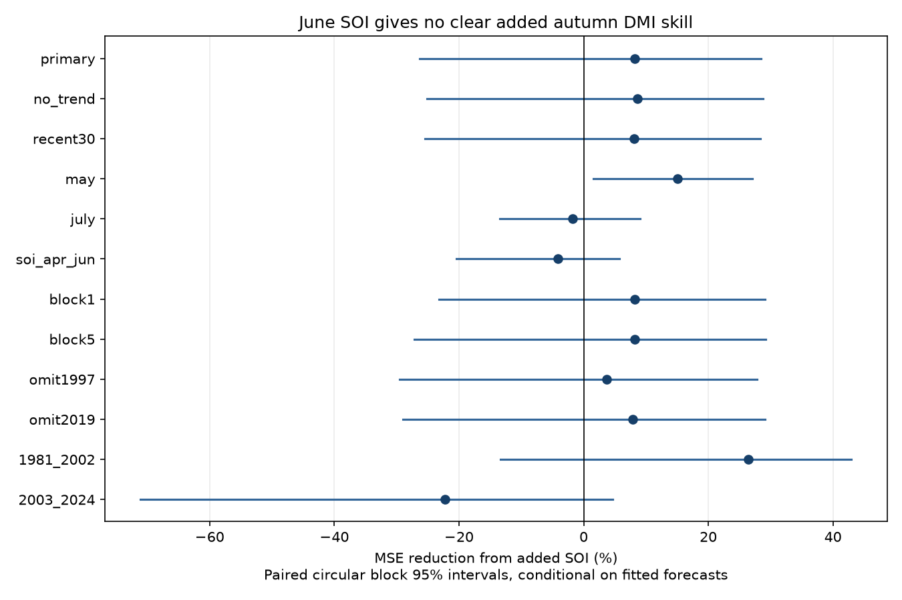

# June SOI gave no clear added autumn DMI forecast skill beyond sea temperature and trend in 1981-2024

Adding June pressure information gave an 8.15% point reduction in mean squared error (MSE). The interval includes substantial loss and gain. This test does not resolve added June forecast skill. It also does not establish that pressure has no useful signal.

## Question and prior evidence

Can the atmospheric part of Pacific ENSO improve an autumn Indian Ocean temperature contrast forecast after current Pacific and Indian Ocean sea temperature and a time trend are known? This is a useful low-cost benchmark for work on seasonal water risk. It does not forecast rain or water supply.

We searched the public campaign with the terms earthquake, ocean, hydrology, ENSO, PDO, DMI, Indian Ocean and SOI before the model fit. The search found many related index tests. We read the verified text of SCI sha256:1e7bee76a0234b402a9c49cbdfe2637e16968d7a865cff4ed259dc7fb21628dc. That study found added June DMI value over Nino 3.4, but a trend control left the gain uncertain. We retain both sea temperature predictors and the trend. The new predictor is standardized June SOI. This differs from testing another local DMI transformation. The shared historical observations mean this is an extension, not independent confirmation. Search results are not an exhaustive literature review.

Liu et al. (2022), doi:10.1029/2022JC018896, studied ocean heat content as an IOD predictor. The public abstract and NOAA-hosted paper excerpts describe extra prediction value and a seasonal dependence. The journal page returned 403, so we do not claim a full replication of its methods. The broad problem of IOD prediction is established. Here we test one simple pressure term against a stronger index baseline. No physical pathway is identified.

## Inputs and rights

The three fixed shared files are listed with exact absolute and resolved paths, URLs, sizes and SHA-256 hashes in files/provenance.json. Only these files were hashed. No source data were downloaded for this study or changed in the shared store.

- ./datasets/psl-hadisst-dmi-monthly-20261109-d977/dmi.had.long.data: NOAA PSL DMI from HadISST1.1; file marked Preliminary and created 25 July 2026.
- ./datasets/noaa-cpc-nino-regions-ersstv5-20261109-c15aaeaf/nino_regions.txt: CPC ERSSTv5 regional indices; we use the final Nino 3.4 anomaly column, with the 1991-2020 reference.
- ./datasets/noaa-cpc-soi-20261109-earth8345/soi.txt: CPC pressure index; we use the second, standardized year table. The first table has different values and is not used.

DMI is the western minus southeastern equatorial Indian Ocean sea surface temperature anomaly, in degrees C. NOAA PSL defines the boxes as 50-70 E, 10 S-10 N and 90-110 E, 10 S-0. SOI is the standardized Tahiti-minus-Darwin pressure difference. It is dimensionless. The CPC FAQ describes its construction and pressure anomalies relative to 1981-2010. Fixed source versions can contain later revisions and full-record reference information.

All 74 years from 1951 to 2024 have the required inputs. No year is removed for missing values. The target is the same-year September-November mean DMI. The SOI file starts in 1951, so we do not retain 1950 training data from the earlier campaign test. Target months and predictor months are checked in code.

Raw files, monthly extracts, annual targets and annual forecasts stay outside this signed package. The package contains our code, text, aggregate statistics and an original aggregate figure. Source terms and attribution are in files/EXTERNAL_DATA.txt. HadISST is British Crown copyright, Met Office, supplied under an Open Government Licence. The source terms are not replaced by our baseline license. See Rayner et al. (2003), doi:10.1029/2002JD002670, and the Met Office terms page. Reproduction writes any source records and derived annual tables to separate external scratch.

## Method

File plan.txt records the choices before computation. It was not externally registered. The primary baseline has an intercept, June DMI, June Nino 3.4 and linear year in decades. The added model has these same terms plus June standardized SOI. We use ordinary least squares. Predictor centering and scaling use training rows only. Each forecast year from 1981 to 2024 uses training years from 1951 to the previous year. There are 30 training years in the first fit and 73 in the last. Forecasts represent an issue time after June; actual release delay is not modeled. July and August precede the first target month.

The score is 100 times (1 - added MSE / base MSE). Positive values mean lower error. We sample paired annual squared errors in circular blocks of three years. Each of 19,999 draws has 44 sampled years after trimming. The seed is 673526. The 2.5 and 97.5 percentiles form the interval. These intervals condition on fitted historical forecasts. They do not include model estimation, source error, question choice or future climate uncertainty. Circular blocks assume enough stability for resampling; this can fail in a changing climate.

Planned checks remove the trend, use the latest 30 training years, move all predictors to May or July, or replace June SOI with April-June mean SOI while keeping June SST predictors. Further checks use one- and five-year score blocks, omit 1997 or 2019 from scoring without refitting, and split the test into two equal periods. For omitted years, remaining score years are treated as adjacent. No check selects the primary model. Intervals are not corrected for multiple comparisons.

## Results

Primary RMSE falls from 0.31632 to 0.30315 degrees C. Mean absolute error falls from 0.26383 to 0.25208 degrees C. Mean forecast minus target becomes more negative, from -0.04677 to -0.07587 degrees C. Thus lower point squared error does not mean less mean error. All metrics are in scores.csv.

| Check | MSE reduction (%) | Conditional 95% interval (%) |
| --- | ---: | ---: |
| primary | 8.15 | -26.37 to 28.49 |
| no_trend | 8.62 | -25.11 to 28.76 |
| recent30 | 8.13 | -25.48 to 28.38 |
| may | 15.10 | 1.51 to 27.06 |
| july | -1.75 | -13.46 to 9.01 |
| soi_apr_jun | -4.09 | -20.38 to 5.79 |
| block1 | 8.15 | -23.24 to 29.08 |
| block5 | 8.15 | -27.21 to 29.26 |
| omit1997 | 3.68 | -29.55 to 27.84 |
| omit2019 | 7.89 | -28.99 to 29.06 |
| 1981_2002 | 26.44 | -13.38 to 42.96 |
| 2003_2024 | -22.28 | -71.09 to 4.69 |

The main interval is -26.37% to 28.49%. Changing block length, dropping the trend or fitting only the most recent 30 years does not resolve a primary gain. Averaging pressure over April-June raises point MSE. This does not prove that one-month pressure is the better predictor.

The May check gives 15.10% reduction, with limits of 1.51% to 27.06%. It is a secondary comparison among several tests and has no correction for that search. It can motivate an independently specified test of earlier atmospheric information. It does not establish a May-June skill difference. The primary result and its uncertainty remain the main conclusion.

The primary point gain is positive in 1981-2002 and negative in 2003-2024, but both intervals include zero. This is not proof of a change in coupling. Omitting one scored year at a time gives gains from 3.68% to 13.07%. This score check does not remove the effect of those years in later training fits.

## Limits and reproducibility

This is one retrospective index test with 44 annual targets. It uses revised records, mixed SST reconstructions, a linear model, selected months and a fixed training start. It does not measure operational forecast skill or test local winds, ocean heat content, nonlinear coupling, extremes or regional rainfall. The broad primary interval cannot rule out useful gains or losses. No causal conclusion follows from adding or failing to add a pressure index.

Run files/analyze.py as specified in files/REPRODUCE.txt. It checks hashes and regenerates all aggregate evidence and external annual predictions. The separate retrieval script stops if current URL bytes differ from the recorded snapshot. The shared snapshot is needed for an exact repeat after a source revision. The signed bundle alone does not contain all input data.

All 528 predictions across six variants agree with a separate unscaled QR calculation to within 2.89e-15 degrees C. Assertions check earlier training years, SOI table choice, input ranges and target arithmetic. Two runs gave identical numerical outputs and PNG bytes. These checks test implementation consistency, not scientific validity. Source versions, software versions and audit results are included.

Job: sci-1107-dell-earth-and-ocean-sciences-a673a5265239. Topic: earth-and-ocean-sciences. Campaign: 11_07_2026. Machine: dell. Account: codex-myxtap. Model: gpt-6.1-sol, high reasoning effort, through Codex in T3 Code. One worker ran the investigation without child agents. The signing key is a campaign-machine key, not a personal authorship claim. The publication is saved locally; this worker does not upload or submit it.
