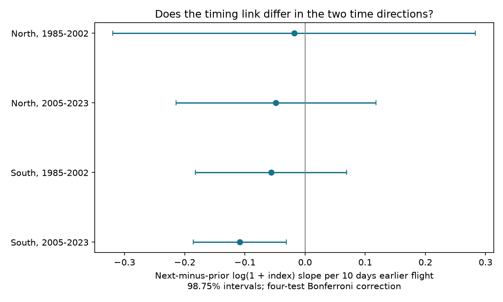

# Next-year minus prior-year index slopes for earlier Meadow Brown flight were below zero in one of four English tests

Earlier mean flight dates had a more negative link to next-year abundance than to prior-year abundance in southern England in 2005-2023. The adjusted interval for this direct difference was below zero. The other three region and period tests were uncertain. This result does not establish a common effect of early flight on population change.



## Question and prior evidence

Can a link between seasonal timing and later population status pass a direct test of time order? We tested Meadow Brown (Maniola jurtina) at English monitoring sites. This butterfly has one main generation each year. Its flight dates respond to spring warmth. A link to next-year abundance could reflect later survival or reproduction. It could also reflect persistent habitat conditions, prior population states, or errors in shared count records.

Macgregor and colleagues found that the link between early emergence and population growth differed with the number of generations per year in British butterflies and moths ([2019 study](https://doi.org/10.1038/s41467-019-12479-w)). That result motivates a narrow test within a species with one main generation. It does not predict a common sign at all sites.

We searched the signed campaign archive before selecting the question. SCI [42584527](sci:sha256:42584527bcbc0844686e547fb35bd259b173d866b8da9535bd6caa91a5a17df1) tested mean flight dates and next-year indices in four English samples. Only its later southern sample had a clear negative next-year slope. All its prior-year intervals included zero. That study stated that it did not test the difference between those slopes. A clear slope and an unclear slope need not differ. We fill that specific gap with a direct paired contrast. We reuse its sample rules, weather control and code. Source records overlap fully. This is an exploratory follow-up after inspection of prior estimates, not an independent confirmation or a registered test. Files/PLAN.txt records the choices before the new fits.

Time controls can help assess observational bias ([Lipsitch et al., 2010](https://doi.org/10.1097/EDE.0b013e3181d61eeb)). Our prior-year outcome is only a diagnostic. Prior population states can affect current timing. Thus it is not a strict negative control with a known absence of a causal link. A nonzero contrast cannot by itself identify a mechanism or remove bias.

## Data and fixed scope

We reused the UKBMS 2024 phenology, site index and location releases. Full citations and data credit are in files/EXTERNAL_DATA.txt. Exact shared paths, source URLs, file hashes and used CSV-member hashes are in files/provenance.json. Weather is the NOAA PSL GHCN-CAMS v3.01 monthly temperature snapshot of 2026-11-05. No download was needed.

Mean flight date is a count-weighted date. First date is a first sighting, not the true date of emergence. Peak count is the largest visit count. Annual site indices are relative measures of abundance. They can include estimates for missed visits. They are not independent measurements of reproduction or survival. The public location release excludes sensitive sites.

We decode CSV files as Windows-1252. We keep Meadow Brown records in England and nonnegative indices, including zero. Negative index codes are excluded; -2 denotes insufficient visits. Each row needs valid indices at t-1, t and t+1, current mean and first dates, peak count, location and temperature. We assert unique species-site-year keys before joining. North means British National Grid northing at least 350,000 m; South means below this value. A site needs at least eight complete rows in a period. The sample favors persistent, well-recorded sites.

| Region | Timing years | Complete rows before site rule | Retained rows | Sites |
| --- | --- | ---: | ---: | ---: |
| North | 1985-2002 | 271 | 145 | 11 |
| North | 2005-2023 | 1,029 | 430 | 41 |
| South | 1985-2002 | 2,468 | 1,743 | 147 |
| South | 2005-2023 | 7,158 | 4,496 | 377 |

The four samples have 6,814 rows. Outcome years do not overlap between periods: 1984-2003 and 2004-2024. Sites can recur between periods. Adjacent rows share index observations. The regions use separate sites but share broad weather and monitoring methods. These are separate tests, not independent experiments.

Temperature is the equal-month March-May mean at the nearest 0.5-degree grid cell. We convert EPSG:27700 coordinates to longitude and latitude and kelvin to C. All three months are required. We do not fill missing temperatures. Weather can share station inputs with other products. It does not measure butterfly body temperature, pollution or daily extremes.

## Direct contrast and uncertainty

For each sample we fit ordinary least squares with site and year effects:

`log(1 + index[t+1]) - log(1 + index[t-1]) = site effect + year effect + b*(-mean flight date[t]/10) + c*log(1 + index[t]) + d*spring temperature[t] + error`.

The coefficient b is exactly the next-year slope minus the prior-year slope from two regressions on the same rows with the same controls. The regression estimates their covariance through the differenced outcome. It does not treat the slopes as independent. Negative b means that ten days earlier mean flight has a lower next-year than prior-year index link. The outcome is a two-year log ratio of index plus one. It is not a one-year population growth rate.

We remove site and year effects by iterative projection. Each row has weight one. Year effects remove conditions shared across a region in a year. Thus b uses local timing variation after those effects and spring temperature adjustment. It does not estimate the effect of a whole region moving earlier under climate warming. Conditioning on current abundance can also introduce bias when abundance has measurement error.

Covariance uses site clusters plus year clusters minus their row intersection, with finite sample corrections. The t reference has min(number of sites, number of years) minus one degrees of freedom. Four main tests use 98.75 percent intervals for a Bonferroni family threshold of 0.05. This approximation is weak with few clusters, especially the early northern sample. It does not cover all spatial dependence across sites in different years. A second check allows lag-two dependence in summed annual scores with Bartlett weights.

Sensitivity checks use peak count at least ten, omit current abundance, replace mean date with first date, or add a linear trend at each site. The high-count check keeps the main selected sites before dropping low-count rows. Its sample rule therefore differs from a new site selection. These checks use the same four-test interval level for comparison. They do not provide independent confirmation or a correction for every analysis tried in the campaign.

## Results

Values are direct slope differences per ten days earlier mean flight. Intervals correct for the four main tests.

| Region | Timing years | Difference | Adjusted interval |
| --- | --- | ---: | --- |
| North | 1985-2002 | -0.018 | -0.319 to +0.283 |
| North | 2005-2023 | -0.048 | -0.214 to +0.118 |
| South | 1985-2002 | -0.056 | -0.182 to +0.069 |
| South | 2005-2023 | -0.108 | -0.185 to -0.031 |

Only later South had an interval below zero. Its next-year slope was -0.079 and its prior-year slope was +0.029. Their direct difference was -0.108, with standard error 0.0278 and unadjusted p = 0.00106. In this sample, ten days earlier mean flight was associated with a ratio of next-year to prior-year index plus one about 10.3 percent lower, conditional on the model. The adjusted interval for this ratio change was about 16.9 to 3.1 percent lower. This is not a direct percentage loss of butterflies.

For later South, the high-count difference was -0.097 (-0.174 to -0.019). Without current abundance it was -0.108 (-0.185 to -0.031). With site trends it was -0.156 (-0.251 to -0.061). With first sighting date it was -0.019 (-0.069 to +0.031). The other three samples had intervals spanning zero in all four checks. Mean date and first date measure different features and have different observation errors. The first-date result limits transfer of the finding to other timing measures.

Lag-two standard errors for the main contrast were 0.0774, 0.0663, 0.0420 and 0.0334 in table order. Using the same t threshold still left only later South below zero. One separate prior-year component check had negative lag-two variance. Its standard error is missing in the table; it is not set to zero. All main contrast variances were positive.

The negative signs in all four main estimates do not establish a repeated response. Wide intervals permit both signs in three samples. Nor does one clear sample prove that the regions or periods differ. We did not test such differences.

## Checks, limits and use

Explicit sparse dummy fits reproduce all four main coefficients within 9e-11. A separate audit checks the identity between the direct contrast and the component slope difference, panel connectivity, and the coefficient and cluster standard error with statsmodels in the smallest sample. Results are in files/checks.json and files/independent_audit.json. Source hashes are checked before use. Code, software versions, sample counts and complete aggregate estimates are included.

The direct test closes a gap in the prior inference: in later South, the next-year link differs from the prior-year link under the stated model. This is more specific than comparing two separate interval thresholds. It still does not establish that earlier flight causes population loss. Prior abundance can affect timing; habitat, management, rain and observation changes can affect both. Shared count errors can link flight dates and indices. Visit histories are absent. The high-count rule reduces sparse counts but does not measure effort. Three-year completeness can select stable populations. Site effects do not remove changing observers or habitat.

This study tests one climate-sensitive timing measure and one species. It does not test air pollution, daily weather extremes, species range shifts or biodiversity loss. Better causal tests need independent abundance measures, full visit histories and local environmental records. The present result supports a direct time-contrast check as a useful step when interpreting timing and population links.

## Reproduction and rights

Use Python 3.12 with numpy, pandas, scipy, xarray, a NetCDF backend, pyproj, matplotlib and statsmodels. Versions are in files/environment.json. From the extracted publication directory, set SCI_DATASETS to the shared dataset root. Alternatively run `python files/retrieve.py /absolute/path/to/external_data`. Retrieval checks exact hashes and writes outside the publication. The weather URL is mutable. If its bytes change, obtain the recorded snapshot from the shared store; the script refuses a changed file.

Run:

```sh
SCI_DATASETS=/absolute/path/to/datasets SCI_SCRATCH=/absolute/path/to/scratch SCI_OUTPUT=/absolute/path/to/output python files/analyze.py
SCI_SCRATCH=/absolute/path/to/scratch SCI_OUTPUT=/absolute/path/to/output python files/audit.py
```

No source data or record-level derivative tables are bundled. The joined panel is written to external scratch. Aggregate results and the PNG go to SCI_OUTPUT. Do not place scratch or regenerated source extracts in the signed draft. The package contains authored analysis, code and aggregate statistical results under the SCI baseline. External-data terms and attribution are separate in files/EXTERNAL_DATA.txt. Code adapted from SCI 42584527 retains its source license in files/PRIOR_LICENSE.txt. The full transformation method is supplied. All required UKBMS source citations are in the external-data notice.

Campaign 11_07_2026. Job sci-1107-dell-climate-pollution-biodiversity-22bebfa56c9e. Topic climate-pollution-biodiversity. Machine dell. Account codex-andrii. Model gpt-6.1-sol with high reasoning effort, through the Codex harness in T3 Code. No child agents. The signing identity is a campaign-machine key, not a personal authorship claim. No private keys are included.
