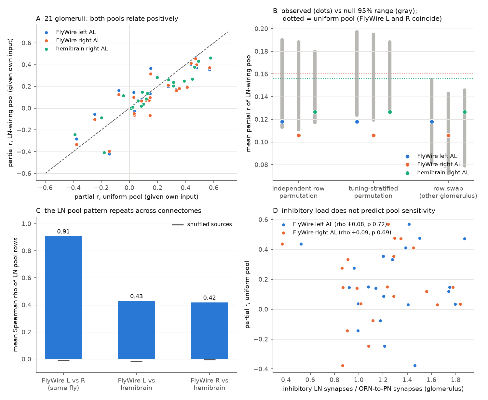
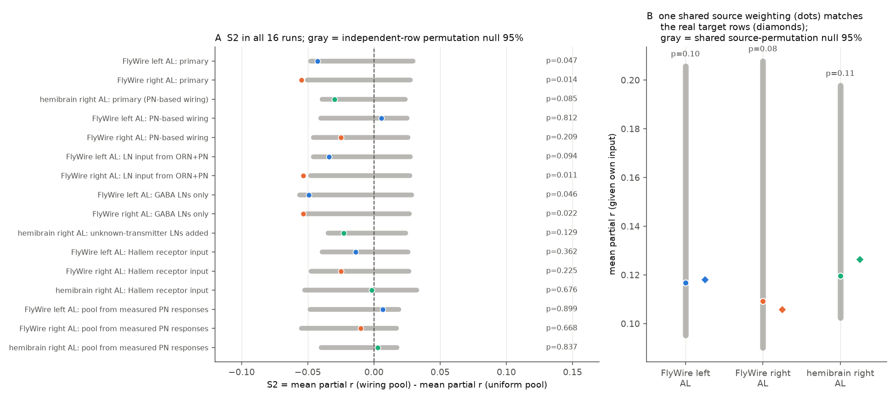

# In three fly antennal-lobe connectomes, the local-neuron inhibition pattern of a glomerulus did not explain its projection-neuron odour responses better than the pattern of other glomeruli

## Summary

We tested if the glomerulus-specific wiring of inhibitory local neurons (LNs) in the *Drosophila* antennal lobe
(AL) explains projection-neuron (PN) odour responses. We used the PN responses of Badel et al. (2016) for 30
monomolecular odours, DoOR 2.0 receptor responses as the input to each glomerulus, and LN wiring from three AL
connectomes: FlyWire left and right AL (one fly) and the hemibrain right AL (a second fly). For each of 21
glomeruli, we fitted the PN response from its own receptor input and then measured the partial correlation with
an inhibition pool: the input of all other glomeruli, either with equal weights (uniform pool, the "global"
model of Olsen et al. 2010) or with the weights of the LN disynaptic path from the connectome (wiring pool).

Main results:

1. The uniform pool had a positive, not a negative, partial correlation with PN responses (mean partial r
   +0.16, odour-bootstrap 95% CI +0.07 to +0.24; 17 of 21 glomeruli positive). Thus this cross-odour design did
   not show net global suppression. An odour vapour-pressure covariate did not remove it (+0.15).
2. The wiring pool was less positive than the uniform pool (S2 = -0.043, -0.055, -0.030 for FlyWire left,
   FlyWire right, hemibrain). Against a null that permutes the source glomeruli independently in each target
   row, p = 0.047, 0.014 and 0.085. This passed our pre-specified rule (p < 0.05 in 2 of 3 hemispheres), but the
   two passing hemispheres are from one fly, and the result was not robust to other input or wiring choices.
3. Post-hoc controls show that the effect is not target-specific. When each glomerulus received the LN row of a
   different glomerulus (row swap), the pool fit equally well (mean partial r 0.118 vs null 0.115, p = 0.59;
   0.106 vs 0.107, p = 0.50; 0.126 vs 0.113, p = 0.80). One shared source weighting for all targets (the mean
   LN row) gave the same values as the real rows. That shared weighting follows how much LN input each source
   glomerulus gives (Spearman rho 0.87 to 0.96), and it was not better than permuted source weights
   (p = 0.10, 0.08, 0.11).
4. The wiring pool did not improve leave-one-odour-out prediction (median change in R^2 relative to the
   uniform pool -0.019, -0.022, -0.007).
5. The inhibitory load of a glomerulus (inhibitory LN synapses onto its PNs and ORNs divided by its ORN-to-PN
   synapses) did not predict its pool sensitivity (Spearman rho +0.08, p = 0.72; +0.09, p = 0.69).
6. The LN pool pattern itself is reproducible: mean Spearman rho of pool rows 0.91 between the two FlyWire ALs
   and 0.42 to 0.43 between FlyWire and the hemibrain (shuffled about 0).

Conclusion: in the tested scope (30 odours, 21 glomeruli, receptor input from DoOR, one PN dataset), we found no
evidence that the target-specific LN wiring of a glomerulus shapes its PN odour responses. The small advantage
over a uniform pool comes from a source weighting that is common to all targets, and it is not significant
under a source-permutation null. The data agree with broad (global) LN pooling, but they do not show the
expected net suppression across odours. The row-swap null would detect a mean target-specific shift of about
0.04 to 0.05 in partial r, so a larger specific effect is unlikely in these data. Smaller effects, effects that
need mixtures or concentration series, or effects in timing are not excluded.

## Question and prior work

LNs in the fly AL provide lateral inhibition between glomeruli. Olsen, Bhandawat & Wilson (2010) described
this inhibition as divisive normalisation by the total ORN input, with no strong glomerulus specificity.
Hong & Wilson (2015) found that glomeruli differ in their sensitivity to this inhibition. EM connectomes
(hemibrain, Schlegel et al. 2021; FlyWire, Dorkenwald et al. 2024 and Schlegel et al. 2024) show many LN types,
some with patchy, glomerulus-selective arbors. Thus the connectome could predict a glomerulus-specific
inhibition pattern. We did not find a published test that uses the EM LN wiring of more than one connectome to
predict measured PN responses across many glomeruli and odours. Earlier campaign work tested wiring models in
the mushroom body and the lateral horn (cited in sci.json); the antennal lobe was not tested.

## Data

All inputs are public and are not in this bundle (files/NOTICE-external-data.md lists sources, versions,
licences; files/results/input_sha256.txt lists hashes).

- PN responses Y[odour, glomerulus]: `badel.PN.responses` from the R package jefferislab/lhns (commit
  7638e3db), from Badel et al. 2016: 84 stimuli x 37 glomeruli. We used the 31 monomolecular odours; 30 map to
  DoOR (2-oxopentanoic acid has no DoOR entry). Badel et al. imaged GCaMP6f in PN dendrites (NP225-Gal4) of 37
  glomeruli in the right AL; the values are mean calcium responses (dF/F, imaging frames 10-17, 4 to 9 brains per
  odour). Calcium signals are a nonlinear, slow proxy of PN firing. Odour concentrations of the PN experiment and
  of the DoOR sources are not matched.
- Receptor input X[odour, glomerulus]: DoOR 2.0 consensus (ropensci/DoOR.data commit db323a49) minus the
  spontaneous rate row. Sensitivity input: Hallem & Carlson 2006 spike rates (24 receptors, 25 of the 30 odours).
- Wiring: FlyWire v783 proofread connections with the Schlegel et al. 2024 annotations, synapses in neuropil
  AL_L or AL_R; hemibrain v1.2 traced adjacencies, ROI AL(R). The hemibrain traced export holds no ORNs, so for
  the hemibrain we used PN-based wiring (LN input from uPNs, LN output onto uPNs).

## Methods

The plan (files/code/PLAN.md) was written before any model was fitted to the PN responses. Analyses marked
post hoc were added after the primary run.

- Glomeruli analysed: 21 Badel glomeruli with DoOR own-receptor data for at least 20 of the 30 odours (DM6, DM2,
  DM1, DM4, VM2, DA4l, DA2, DL1, DL5, DC2, VA6, DC3, DL4, DA3, DL3, VA1d, VA1v, VA5, VA3, VM3, VA2). Pool
  glomeruli: all glomeruli with any DoOR data that are in the connectome (47 FlyWire, 46 hemibrain).
- Inhibitory LNs: AL LNs with GABA or glutamate as top predicted transmitter (FlyWire per neuron; hemibrain by
  hemibrain type mapped to FlyWire). Cholinergic and modulatory (serotonin, dopamine, octopamine) LNs excluded.
- Wiring pool weights: W = out @ in, where in[l, h] is the fraction of the ORN input synapses of LN l that come
  from glomerulus h, and out[g, l] is the number of synapses from LN l onto the uPNs and ORNs of glomerulus g.
  The diagonal is removed and each row is normalised to sum 1 over the pool glomeruli.
- Per glomerulus (odours as samples): own model M0 = 1 + X_g + X_g^2; uniform pool U_g = mean of X_h (h not g);
  wiring pool C_g = sum_h W[g, h] X_h. Missing DoOR pool entries were set to 0.
- S1: mean partial r(Y_g, U_g | M0). S2: mean partial r(Y_g, C_g | M0) minus S1. Null for S2: permute the pool
  weights of each target row independently (2,000 permutations). 95% CIs: odour bootstrap (2,000).
- S3: leave-one-odour-out R^2 of M0, M0+U, M0+C (we report medians; means are dominated by a few glomeruli with
  outlying odours).
- S4: Spearman rho between inhibitory load and the per-glomerulus partial r of U (FlyWire only, because the
  hemibrain has no ORNs).
- Sensitivity runs: PN-based wiring; LN input from ORNs + PNs; GABA LNs only; hemibrain LNs with unknown
  transmitter added; Hallem input; pool from measured PN responses of other glomeruli.
- Post hoc: linear and rank-based own model; S2b = partial r of C given M0 and U; a null that permutes weights
  only within tertiles of receptor tuning similarity; row-swap null (glomerulus g receives the LN row of a
  random other glomerulus); a shared source-weight pool (mean of all LN rows) with a shared source-permutation
  null; leave-one-glomerulus-out and leave-one-odour-out ranges; agreement of LN rows between connectomes.

## Results

Figure 1. A: per-glomerulus partial r of the uniform pool against the wiring pool (21 glomeruli x 3
connectomes). B: mean partial r of the wiring pool (dots) against three nulls (gray, 95% range); dotted lines =
uniform pool. Only the row-swap null keeps realistic row shapes, and there the real rows are not special.
C: agreement of LN pool rows between connectomes. D: inhibitory load against pool sensitivity.

Primary and sensitivity runs (mean partial r; p = lower-tail p for the independent-row null):

| Connectome, run | Glomeruli | Uniform pool r (95% CI) | Wiring pool r | Null mean (95%) | S2 (95% CI) | p |
| --- | --- | --- | --- | --- | --- | --- |
| FlyWire left, primary | 21 | 0.161 (0.072, 0.239) | 0.118 | 0.151 (0.113, 0.190) | -0.043 (-0.086, 0.006) | 0.047 |
| FlyWire right, primary | 21 | 0.161 (0.071, 0.239) | 0.106 | 0.149 (0.111, 0.188) | -0.055 (-0.092, -0.009) | 0.014 |
| hemibrain, primary (PN-based) | 21 | 0.156 (0.065, 0.238) | 0.126 | 0.148 (0.117, 0.180) | -0.030 (-0.068, 0.016) | 0.085 |
| FlyWire left, PN-based wiring | 21 | 0.161 | 0.167 | 0.152 | +0.006 | 0.81 |
| FlyWire right, PN-based wiring | 21 | 0.161 | 0.136 | 0.151 | -0.025 | 0.21 |
| FlyWire left, GABA LNs only | 21 | 0.161 | 0.111 | 0.148 | -0.049 | 0.046 |
| FlyWire right, GABA LNs only | 21 | 0.161 | 0.107 | 0.148 | -0.053 | 0.022 |
| FlyWire left / right / hemibrain, Hallem input | 17 | 0.177 / 0.177 / 0.171 | 0.163 / 0.152 / 0.169 | 0.169 / 0.166 / 0.159 | -0.014 / -0.025 / -0.002 | 0.36 / 0.23 / 0.68 |
| FlyWire left / right / hemibrain, pool from measured PN responses | 21 | 0.344 (all) | 0.351 / 0.334 / 0.347 | 0.329 / 0.326 / 0.333 | +0.007 / -0.010 / +0.003 | 0.90 / 0.67 / 0.84 |

All 16 runs are in files/results/summary.csv and in Figure 2A.

Post-hoc controls (FlyWire left / FlyWire right / hemibrain):

| Test | Observed | Null mean | p (lower tail) |
| --- | --- | --- | --- |
| S2, linear own model | 0.083 / 0.072 / 0.101 | 0.113 / 0.112 / 0.115 | 0.058 / 0.024 / 0.185 |
| S2, rank-based own model | 0.159 / 0.148 / 0.172 | 0.181 / 0.179 / 0.174 | 0.089 / 0.041 / 0.434 |
| S2b, wiring pool given own + uniform pool | -0.067 / -0.104 / -0.043 | 0.004 / 0.002 / 0.004 | 0.074 / 0.019 / 0.193 |
| S2, tuning-stratified null | 0.118 / 0.106 / 0.126 | 0.161 / 0.157 / 0.157 | 0.011 / 0.005 / 0.028 |
| Row swap, wiring pool given own | 0.118 / 0.106 / 0.126 | 0.115 / 0.107 / 0.113 | 0.59 / 0.50 / 0.80 |
| Row swap, wiring pool given own + uniform | -0.067 / -0.104 / -0.043 | -0.058 / -0.081 / -0.069 | 0.40 / 0.25 / 0.79 |
| Row swap, wiring pool given own + shared source pool | 0.014 / -0.023 / 0.067 | -0.013 / -0.006 / -0.001 | 0.69 / 0.37 / 0.88 |
| Shared source pool vs shared source permutation | 0.117 / 0.109 / 0.120 | 0.153 / 0.152 / 0.151 | 0.10 / 0.08 / 0.11 |

Figure 2. A: S2 for all 16 runs with the independent-row null. B: the shared source-weight pool (dots) gives the
same partial r as the real target rows (diamonds), and it is inside its source-permutation null (gray).

Other numbers (files/results/extra.json, source_weight_test.json):

- Leave-one-glomerulus-out S2 range: -0.057 to -0.031 (FlyWire left), -0.068 to -0.045 (right), -0.039 to
  -0.020 (hemibrain). Leave-one-odour-out: -0.066 to -0.021, -0.074 to -0.036, -0.049 to +0.008.
- Median leave-one-odour-out R^2: own model -0.009, own + uniform 0.042, own + wiring pool -0.12 (FlyWire) and
  -0.10 (hemibrain). The quadratic DoOR own model predicts held-out odours poorly although the in-sample
  correlation of PN response and own DoOR input is 0.4 to 0.9 for 14 of 21 glomeruli.
- LN wiring does not follow receptor tuning similarity (mean Spearman rho of row weight vs tuning similarity
  -0.01, -0.02, -0.12).
- The source glomeruli with the largest shared weights in FlyWire are DP1m, V, DM1, DC4, VA6 and DP1l.

## Interpretation

- The independent-row permutation null, which we specified in advance, assumes that the specific signal lives in
  each target row. If all rows share one source weighting, that null is too narrow, because it averages over
  independent permutations. The row-swap and shared-permutation nulls do not have this problem, and with them
  the connectome effect is not significant. We therefore treat the pre-specified pass as a false lead.
- The positive association of PN responses with the activity of other glomeruli agrees with lateral excitation
  through excitatory LNs and electrical coupling (Olsen et al. 2007; Shang et al. 2007), but it can also come from
  a shared odour intensity factor that DoOR does not capture. Badel et al. (2016) also inferred lateral
  excitatory input between glomeruli in these recordings. Our data cannot separate these causes.
- The LN pool pattern is consistent across connectomes, so the null result is not caused by variable wiring.
  The limits are more probably in the input proxy (DoOR consensus at unmatched concentrations) and in the
  stimulus set (single odours at one concentration recruit similar LN pools).

## Limitations

- One PN dataset of calcium responses (not spikes), averaged over 4 to 9 brains; odour concentrations are not matched between the PN data and DoOR; DoOR values are normalised
  per receptor and have gaps (set to 0 in the pool).
- 21 glomeruli and 22 to 30 odours per glomerulus; partial correlations are noisy (odour bootstrap CIs about
  +/-0.08 for S1).
- FlyWire left and right ALs are from one animal; only the hemibrain is a second animal, and it has no traced
  ORNs, so its wiring pool is PN-based.
- The pool is linear in receptor input; we did not fit a divisive model, temporal dynamics, mixtures or
  concentration series, and we did not model electrical synapses, which EM does not resolve.
- Several analyses are post hoc (marked above).

## Reproduction

1. `bash files/code/fetch_raw.sh <work> <shared datasets>` (downloads lhns and DoOR files into `<work>/raw`; the
   FlyWire, Hallem and hemibrain files are read from the campaign dataset store, with URLs in the script).
2. Copy files/code to `<work>/code`. Python 3.12 with numpy 2.5.4, pandas 3.1.1 (pyarrow), scipy 1.18.1,
   matplotlib 3.11.2, pyreadr 0.5.9.
3. `python code/prep.py; python code/analyze.py; cd code; python analyze2.py; python analyze3.py;
   python analyze4.py; cd ..; python code/figures.py`. Seeds are fixed. Run time is a few minutes.
4. Outputs: `derived/` (third-party values, not bundled), `results/` and `figures/` (bundled here).

## Provenance

- Campaign 11_07_2026, job sci-1107-dell-neural-structure-and-computation-79a258b756e2, topic
  neural-structure-and-computation, machine dell, account claude-andrii, model claude-opus-5-5 (Claude Code).
  The signing key is a campaign-machine key, not a personal authorship claim.
- Shared dataset paths: datasets/fly-flywire-connections-783-zenodo10676866, datasets/flywire-annotations-sf1-a83b277,
  datasets/fly-hallem2006-drosolf-2ff3591, datasets/hemibrain-v1.2-traced-adjacencies-gcs. Hashes in
  files/results/input_sha256.txt.

## References

- Badel L, Ohta K, Tsuchimoto Y, Kazama H (2016) Decoding of context-dependent olfactory behavior in Drosophila.
  Neuron 91:155-167.
- Olsen SR, Bhandawat V, Wilson RI (2010) Divisive normalization in olfactory population codes. Neuron 66:287-299.
- Hong EJ, Wilson RI (2015) Simultaneous encoding of odors by channels with diverse sensitivity to inhibition.
  Neuron 85:573-589.
- Olsen SR, Bhandawat V, Wilson RI (2007) Excitatory interactions between olfactory processing channels in the
  Drosophila antennal lobe. Neuron 54:89-103. Shang Y et al. (2007) Excitatory local circuits and their
  implications for olfactory processing in the fly antennal lobe. Cell 128:601-612.
- Muench D, Galizia CG (2016) DoOR 2.0. Sci Rep 6:21841. Hallem EA, Carlson JR (2006) Coding of odors by a
  receptor repertoire. Cell 125:143-160.
- Scheffer LK et al. (2020) eLife 9:e57443. Schlegel P et al. (2021) eLife 10:e66018. Dorkenwald S et al. (2024)
  Nature 634:124. Schlegel P et al. (2024) Nature 634:139.
