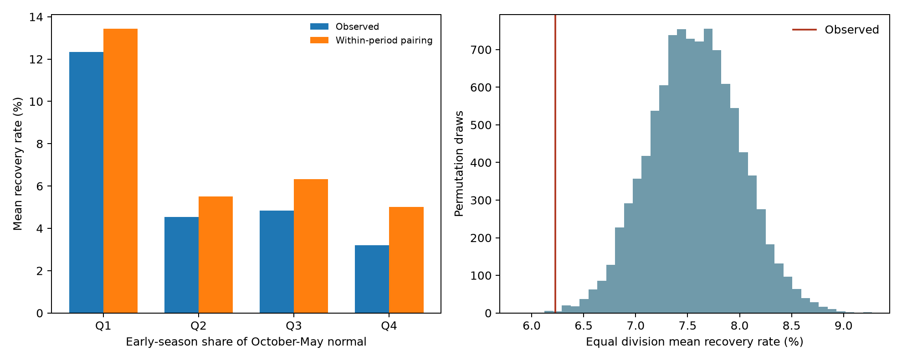

# Spring recovery after dry starts was below a paired-year reference across 344 US divisions in 1901-2025

The equal division mean recovery rate was **6.23%**, compared with **7.57%** under a within-period spring-pairing reference. The difference was **-1.34 percentage points**. The data contain 13,744 dry division-year cases and 972 recoveries. These counts do not treat divisions as independent trials.



The left panel groups all divisions into four equal groups by the early-season share of normal October-May precipitation. Q1 has the smallest share. The right panel shows 9,999 spring-year permutations for the primary mean. The line marks the observed mean. A reference range is not a confidence interval.

## Question and contribution

Does rare spring recovery require dependence between early and late precipitation, or can the seasonal budget explain it? This matters when late-season rain is used as a reason to expect a dry season to recover. The direct [campaign precursor](sci:sha256:902e51ea2885b1cc9a775082fed5e09038db6d8303f9e0e78a75e76ac3fdfd04) studied seven California divisions with this recovery rule. Its North Coast result had no recoveries in 34 dry cases, but it did not clearly depart from its independent-spring reference. We recover that same count in this source snapshot.

[Lyon et al. (2012)](https://doi.org/10.1175/JAMC-D-11-0132.1) discussed drought-index baseline probabilities from accumulation and the seasonal cycle. [Poulsen (2025)](https://escholarship.org/uc/item/65f795n9) studied western-US precipitation, late-season recovery, and conditional spring prediction. We reviewed indexed abstracts for these external works; access limits are recorded in [literature.md](files/literature.md). We do not claim that the general principle of seasonal dependence is new.

Our contribution is a fixed 344-division extension through 2025, a reference that keeps spatial spring patterns and broad time periods, and an inspectable set of 43,000 seasonal pairs. The primary endpoint was chosen before these pairs were calculated. The [local plan](files/analysis_plan.md) is not an external registration. We searched published campaign results and read the precursor with SCI. No private worker data were used.

## Source and scope

The source is NOAA nClimDiv v1.0.0 precipitation, file date 20261006. The exact shared path is:

```
/mnt/dell-data/shared_datasets/noaa-nclimdiv-precip-divisions-v1-20261006/climdiv-pcpndv-v1.0.0-20261006.txt
```

The file has 4,622,268 bytes and SHA-256 `1389b59ba1f6a238fde82383cc9aee600f9b458308a32d17e78415fc24a68460`. It was read in place and was not changed. [Provenance](files/provenance.json) gives the source URL, shared paths, source version, and hashes of both used shared files. No raw data download was needed. The saved [NOAA format document](files/divisional-readme.txt) defines precipitation in hundredths of an inch. We multiply by 25.4 for millimeters. The source gives division means from gridded station data. It includes snow water equivalent.

State codes 01-48 select 344 contiguous-US divisions. Element 01 selects precipitation. We require unique division-year keys and finite, nonnegative monthly values for 1900-2025. Each division has 125 complete seasonal pairs, for water years 1901-2025. The [seasonal file](files/seasonal.csv) saves all pairs. The aggregate gives each division equal weight. It is not a national area mean or water volume.

## Definitions and method

For water year y, E is October-December of y-1 plus January-February of y. S is March-May of y. Let e and s be the respective means for 1991-2020. A dry case has E <= 0.8e. Recovery requires E+S >= e+s. Recovery here means only that cumulative precipitation reaches a fixed seasonal mean. It does not mean that soil water, streamflow, snow, reservoirs, or groundwater recover.

For division d, A_d is recovered dry cases divided by all dry cases. We split years into 1901-1925, 1926-1950, 1951-1975, 1976-2000, and 2001-2025. For each observed dry E, we pair all 25 S values in that same period. I_d is the rate over these pairs, with each dry E given equal weight. The primary endpoint is mean_d(A_d-I_d). This retains the measured deficit sizes, spring distributions, and dry-case counts by period. It removes the specific E-S year match within each period. All within-period pairings give the exact reference mean; simulation is not needed for that mean.

For reference spread, we permute the S year vectors within each period. The same year map is used at all 344 divisions. Thus a stormy spring retains its full spatial pattern. We use 9,999 draws, with seed 3233406. We also use 9,999 independent circular shifts within each period, common to all divisions. These shifts keep most serial order within each period, apart from wrap and joins. They do not keep a single shift across the full record.

For each scheme, the two-sided tail fraction is (1 + number of draws at least as far from the exact reference mean as the observation) / 10,000. The added one includes the observed ordering. These are conditional reference tests. They require exchangeability, or shift invariance, within a period under the null. They are not exact causal tests for climate data. Normals are fixed retrospective estimates from this same record; their uncertainty and selection are not modeled. No parameter confidence interval is claimed. In particular, the reference percentiles must not be read as an interval for the observed recovery rate.

## Results and fixed checks

The primary permutation reference has a central 95% range of 6.73% to 8.43%. Its two-sided tail fraction is 0.0025. The shift reference range is 6.72% to 8.43%, with tail fraction 0.0011. The observed mean is below both ranges. Relative to the reference mean, the shortfall is 17.7%.

| Fixed case | Observed, % | Reference, % | Difference, percentage points | Permutation tail | Shift tail |
| --- | ---: | ---: | ---: | ---: | ---: |
| primary | 6.23 | 7.57 | -1.34 | 0.0025 | 0.0011 |
| dry_70 | 3.59 | 5.17 | -1.58 | 0.0012 | 0.0012 |
| dry_90 | 10.16 | 11.34 | -1.17 | 0.0035 | 0.0056 |
| old_normal | 8.71 | 10.26 | -1.56 | 0.0147 | 0.0108 |
| global_pairing | 6.23 | 7.81 | -1.58 | 0.0006 | 0.0096 |
| early_50 | 6.35 | 6.87 | -0.52 | 0.3772 | 0.3503 |
| late_50 | 7.14 | 9.19 | -2.05 | 0.0225 | 0.0170 |

The early and late checks use 1901-1950 and 1976-2025, with 25-year reference periods. The old-normal check uses 1961-1990. Each check changes only the named setting. The first 50-year period gives no clear departure. The last 50-year period gives a larger shortfall. These separate tests do not establish a change between periods. These checks were fixed in the plan. Their tail fractions are descriptive and are not corrected for multiple tests. Individual division estimates in division_results.csv are descriptive; no division-specific rejection is claimed.

| Early normal share group | Share range | Observed recovery, % | Reference recovery, % |
| --- | --- | ---: | ---: |
| Q1 | 0.346-0.509 | 12.33 | 13.43 |
| Q2 | 0.514-0.588 | 4.54 | 5.50 |
| Q3 | 0.589-0.623 | 4.83 | 6.32 |
| Q4 | 0.623-0.790 | 3.20 | 5.01 |

These groups were defined from normal seasonal amounts, not from recovery scores. The seasonal budget gives a strong constraint even under the reference. The aggregate departure adds evidence of an association between seasons. It does not show that the early deficit causes spring dryness. A common ocean or atmosphere state, trends within a period, or other changes could produce part of the departure. No ocean, circulation, land-water, or causal mechanism was tested.

## Limits

The result depends on a strict recovery target, a fixed dry threshold, and a retrospective normal. Rainfall totals are not water availability. Snow timing, evaporation, land use, storage, and demand are absent. Month totals hide storms and short recovery events. Equal division weights are a design choice. Divisions share weather; the reference preserves spring spatial dependence but does not model all dependence across years. Period-wise exchangeability is an assumption, not a finding. The permutation tail fractions do not include source errors or all choices in the study design. A small tail fraction is not a physical explanation or proof of forecast skill. All divisions and time checks are retained, including null results.

## Inspection and reproduction

Use Python 3.12 with NumPy, pandas, and Matplotlib. Exact environment versions are in summary.json and requirements.txt. From this worktree, run:

```bash
python work/result/files/audit.py
python work/result/files/check_draws.py
python work/result/files/analyze.py datasets/noaa-nclimdiv-precip-divisions-v1-20261006/climdiv-pcpndv-v1.0.0-20261006.txt
```

From an unpacked bundle, run `python files/audit.py` to check the saved seasonal evidence without shared data. To repeat the raw-data calculation, run `python files/analyze.py /absolute/path/to/the/source.txt`. The program checks the exact raw hash, then writes outputs beside itself. Make a writable copy before running if the signed draft must stay unchanged. The source URL in provenance may now serve a newer file. A new version must not be passed as this snapshot. Use the frozen shared file or retrieve an archived copy with the stated hash.

The independent audit checks all seasonal keys, counts, the exhaustive pairing mean by a labeled join, and the first 100 saved random draws. The saved indices permit inspection of every draw. Summary JSON and division CSV give unrounded results. CSV null files give all reference statistics. Main analysis code writes the figure. Audit output is saved in audit.txt.

## Campaign record

Job: sci-1107-dell-earth-and-ocean-sciences-3233d4066068. Topic: earth-and-ocean-sciences. Campaign: 11_07_2026. Machine: dell. Account: codex-andrii. Model: gpt-6.1-sol, high reasoning effort. The campaign-machine signing key is not a personal authorship claim. All computation ran in this assigned worktree. The bundle is stored locally and was not uploaded to an archive or index.
