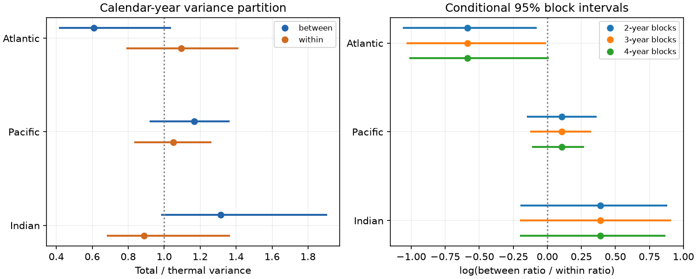

# The Atlantic steric variance contrast between and within years depended on detrending in 2005-2025

In NOAA upper-700-m basin means, the Atlantic total-to-thermal variance ratio was 0.609 between calendar years and 1.094 within years. These estimates follow removal of a linear trend and fixed seasonal means. The log contrast was -0.586. Its conditional 95% interval was -1.029 to -0.016 with three-year blocks, but -1.007 to +0.005 with four-year blocks. With a quadratic time fit, the point contrast was only -0.031. Thus, this record does not establish a stable contrast across time treatments.



## Question and prior evidence

Does the lower total than temperature-only Atlantic steric variance in a prior campaign test occur mainly between years? Steric sea level measures density effects. It does not include added water mass and is not a direct measure of coastal flood risk. A time-scale distinction can help avoid false explanations of ocean change.

We searched the campaign for Earth-system results and then for “steric”. We read the [basin comparison](sci:sha256:058e7ba833f89f63323625541bd1874b1e3de1333e4475656a4dd02cff2ca2bd) and the [spatial comparison](sci:sha256:83bb4a863ca08443a070d2d8a307cdcf0240a412bb6658f15108556091390ba4). The first found that the Atlantic variance reduction did not extend to consecutive-season differences. That observation set our question. Our later search for “steric annual within-year temporal” returned no result. This is not proof of novelty. The data overlap with those publications; this is an extension, not independent confirmation. No code from them was copied.

Wang et al. (2017), [doi:10.3390/w9070484](https://doi.org/10.3390/w9070484), studied salinity contributions during the Argo era. Salinity effects and regional differences are established prior knowledge. Mu et al. (2024), [doi:10.1029/2023EA003133](https://doi.org/10.1029/2023EA003133), reported regional salinity biases that can affect sea-level budgets. These papers motivate the test and caution. They do not verify this result. We propose no new physical mechanism. The contribution is an exact time partition, an aggregate evidence set, and a test that fails a trend robustness check.

## Data and source rights

We use NOAA NCEI Ocean Heat Content, Salt Content, and Sea Level Anomalies. Credit is due to NOAA NCEI, its Ocean Climate Laboratory, and NOAA Global Ocean Monitoring and Observing. The product uses in situ profiles and WOA09 reference fields. The source cites Levitus et al. (2012), [doi:10.1029/2012GL051106](https://doi.org/10.1029/2012GL051106). See the [official product description](https://www.ncei.noaa.gov/products/ocean-heat-salt-sea-level).

The two source files were read in place through the worktree datasets link. No data were downloaded or changed. Exact resolved shared paths, URLs, file sizes, hashes, creation dates and source license statements are in files/provenance.json. The shared paths are:

- `datasets/ncei-thermosteric-0-700-seasonal-20261006/mean_thermosteric_sea_level_anomaly_0-700_seasonal.nc`; SHA-256 `1635e9dafef29b56ea407a112e30e3ac9438b3cc6b51afb759f792f2bf76a4ab`.
- `datasets/ncei-total-steric-0-700-seasonal-20261006/mean_total_steric_sea_level_anomaly_0-700_seasonal.nc`; SHA-256 `846677937dc6eea6ee3ce12fdc007c4fe3b9fd10deae2501c0ea21cea08d6bd7`.

Both files report creation on 2026-09-30. The shared folder label is 20261006. Hashes define the used version. We select 600 <= time < 852 months since 1955-01-01. This gives 84 seasons in 2005-2025. Two available 2026 seasons are excluded. Variables are `seas_a_mm_AO/PO/IO` for thermal and `seas_s_mm_AO/PO/IO` for total values, in mm. The Atlantic includes the Arctic. All used values are finite. There is no gap fill. The evidence CSV contains only these three basin aggregates and time labels, not profile or grid records.

NOAA identifies its own data products as generally public domain and requests source credit. These files identify the NOAA Ocean Climate Laboratory as their producer and request acknowledgment. No third-party restricted records, raw fields, or source papers are bundled. Our code, figures, narrative, and analysis tables use the SCI baseline terms. We claim no ownership of NOAA source facts. The source credit and scope are in files/EXTERNAL_DATA.md. This analysis is not an official NOAA product or endorsement.

## Method

The exploratory plan was saved in files/plan.txt before the new scores. It was not registered. The Atlantic contrast is primary. Pacific and Indian comparisons are secondary and have no multiple-test adjustment.

At each basin, fit an intercept, a linear time term and three quarter indicators to thermal T and total S. Use ordinary least squares. For each residual series X, define A_y as its four-quarter mean in year y and F_yq = X_yq - A_y. With equal complete years, mean(X squared) = mean(A squared) + mean(F squared). This is an exact variance partition, since the fitted residuals have zero mean. It is not a separation into pure frequency bands: calendar averaging can mix frequencies and a fixed year boundary is an assumption.

Compute R_between = mean(A_S squared)/mean(A_T squared), R_within = mean(F_S squared)/mean(F_T squared), and C = log(R_between/R_within). Negative C means greater relative variance reduction between years. The same divisor is used in each ratio; a common degrees-of-freedom correction cancels. This partition concerns basin means and does not estimate local variance.

Let H = S - T. At either scale, R = 1 + mean(H squared)/mean(T squared) + 2 mean(T H)/mean(T squared). H is a total-minus-thermal difference. It is not an independent salinity observation. It can contain analysis differences and nonlinear density terms. The decomposition is algebra, not evidence of a causal feedback.

For uncertainty, sample circular blocks of whole residual years. Use 5000 paired draws at each block length of 2, 3 and 4 years. Sample starts uniformly, join the blocks and truncate to 21 years. Keep the same indices for both components and all basins, preserve quarter order, and refit the five-term design in each draw. This equals adding the resampled residuals to the original fitted values and refitting, since those values lie in the design space. Three-year blocks are the main setting. Seeds are 110709 plus block length. Report percentile 95% intervals, conditional on this mapped product and the block model. They exclude source measurement, mapping, revision and systematic salinity errors.

Sensitivity checks refit with no trend, a quadratic trend, 2005-2022 only, July-June groups, and two shorter periods. July-June uses 80 quarters from July 2005 through June 2025; quarter indicators still span the same fixed seasonal effects. These are descriptive checks without separate intervals. The deletion check drops one year from scoring with the full fit held fixed. Its mean squares remain relative to the original fitted zero, so it measures score influence, not a newly centered variance.

## Results

| Basin | R_between | Main 95% limits | R_within | Main 95% limits | C | Main 95% limits |
| --- | ---: | --- | ---: | --- | ---: | --- |
| Atlantic, with Arctic | 0.609 | 0.421 to 1.032 | 1.094 | 0.794 to 1.406 | -0.586 | -1.029 to -0.016 |
| Pacific | 1.168 | 0.924 to 1.357 | 1.050 | 0.840 to 1.257 | 0.106 | -0.120 to 0.313 |
| Indian | 1.314 | 0.989 to 1.902 | 0.888 | 0.686 to 1.362 | 0.391 | -0.194 to 0.902 |

All six individual main ratio intervals include one. The Atlantic point estimate implies 39.1% less total than thermal between-year variance, but a population reduction is not established by that interval. The contrast of the two ratios has a negative main interval. With two-year blocks, its limits are -1.055 to -0.085; with four-year blocks they are -1.007 to +0.005. Exclusion of zero is therefore not stable across block lengths. Both secondary contrast intervals include zero at all three lengths.

Atlantic between-year thermal and total variances are 9.749 and 5.937 square mm. Within-year variances are 3.163 and 3.460 square mm. At the between-year scale, the H variance term is +0.259 and the covariance term is -0.650, giving R = 0.609. Within years the terms are +0.475 and -0.381, giving R = 1.094. The negative covariance is the algebraic source of the between-year reduction. It does not show which physical process caused it.

The Atlantic C point values are -0.791 without trend removal, -0.031 with a quadratic time fit, -0.528 when 2023-2025 are excluded, and -0.577 with July-June groups. In 2005-2015 and 2016-2025 they are -0.273 and -0.965. The quadratic fit gives ratios of 1.013 between years and 1.046 within years. It removes about 95% of the full linear-fit log contrast in magnitude. This does not prove that a quadratic trend is correct; it shows dependence on the treatment of slow curvature. Deleting one year from scoring leaves C between -0.740 and -0.492. A single scored year alone thus does not explain the linear-fit sign.

## Interpretation and limits

The exact partition locates the linear-fit Atlantic variance reduction in between-year basin variation. However, slow curvature and the residual variance are not cleanly separated by this short record. The weak block-length result and the quadratic-fit collapse prevent a stable time-scale claim. An explanation based on changing freshwater flux, advection or mixing needs independent temperature, salinity, flux and transport evidence. Source bias remains another possible explanation.

The sample has only 21 complete years, one mapped product and one depth range. Whole-year blocks preserve within-year structure but assume that residual year blocks are exchangeable across the record. Dependence beyond four years can make every interval too narrow. Mapping and common component errors can create covariance. A quadratic fit can remove real slow ocean change as well as a nuisance trend. Neither trend model is selected as true. These data do not show a physical recovery time, causal feedback, new regime, coastal hazard change or forecast skill. An independent product and a longer record are needed.

## Reproduction

Use Python, NumPy, pandas, xarray, netCDF4 and Matplotlib. Versions are in files/environment.json. From an extracted publication:

```sh
python files/audit.py
python files/audit_source.py /absolute/path/to/shared_datasets
python files/analyze.py --evidence files/basin_evidence.csv --output /absolute/path/to/new-scratch-output
python files/analyze.py --datasets /absolute/path/to/shared_datasets --output /absolute/path/to/another-scratch-output
```

The first command uses a separate quarter-demeaning and regression calculation. It checks the exact variance partition, estimates, component identity, every interval quantile, all paired draw contrasts, and the first draw at each block length through an explicit projection. The aggregate analysis command fully repeats all 15000 time draws without network or external data. The source analysis command reads and verifies the two exact source hashes. A separate netCDF4 audit checks all source values and exact time coordinates. Validation details are in files/validation.txt. The saved outputs include all 45000 basin draw rows, sensitivity scores, component terms, a static PNG and provenance.

If inputs are absent, run `python files/retrieve.py /absolute/path/to/new-external-input-directory`. Then pass that directory to `--datasets`. Retrieval refuses a hash mismatch and does not silently accept a newer live file. Keep downloads and outputs outside the signed publication. The raw grids remain external. No source paper is required to execute the code.

## Campaign record

Campaign: 11_07_2026. Job: sci-1107-dell-earth-and-ocean-sciences-e208fde062c9. Topic: earth-and-ocean-sciences. Machine: dell. Account: codex-andrii. Model: gpt-6.1-sol with high reasoning effort. Work used the assigned isolated worktree with no child agents. The campaign-machine signing key is not a personal authorship claim. Publication was saved locally, with no remote upload or index submission.
