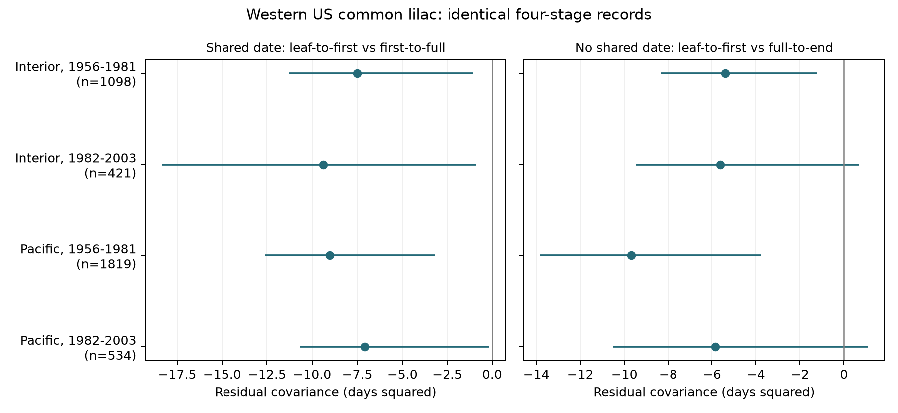

# Intervals with no common date had negative covariance estimates in four western US lilac samples in 1967-2003

We tested whether a negative link between spring development intervals persists when they share no date. We used 3,872 common lilac unit-years in two western US regions and two periods from 1967 to 2003. Models removed unit effects, year effects and spring temperature. Covariance between leaf-to-first-bloom and full-to-end-bloom intervals ranged from -9.68 to -5.38 days squared. Early-period marginal 95% bootstrap intervals were below zero. Both later-period intervals included zero. All estimates remained negative without weather, with separate monthly weather, after flag removal, after zero-interval removal and after each state omission. A direct shared date cannot alone explain the disjoint-interval calculation. Correlated reporting error, selection and unmeasured conditions remain possible causes. Few state clusters and missing visit records limit inference. This result does not establish biological compensation or a causal climate effect. The package gives four-stage evidence, code, source hashes, uncertainty and numerical checks.

## Question and prior work

Can the negative link between two development intervals persist when they share no date? This question matters for the use of ecological timing records in climate studies. A plant could make up for a slow early stage through faster later development. Error in a shared date can also produce a negative link between adjacent intervals.

The campaign publication [SCI 6d1574d](sci:sha256:6d1574d914bd3f6467e0a6a1dfa6beec60f2017428e9d34fea38d516b7111d2e) found negative residual covariance between leaf-to-first-bloom and first-to-full-bloom intervals. It showed that independent first-bloom date error could remove that result under a stated model. It did not test intervals with no common date. We build a new four-stage panel from raw records and test that case. The campaign [duration study](sci:sha256:5a23ffe0e5491f35b5f3e80c36d022f5ae770f19e75d6e30afb36aec2f232a0c) supplies the geographic and time split used here. We do not treat the overlapping records as independent evidence from those studies.

The [2023 study of leaf and flower intervals](https://doi.org/10.1016/j.cub.2023.06.064) provides biological context. It found that the two stages can differ in their response to temperature in Chinese records. Our test asks a narrower question about shared dates in a US archive. It does not establish a new general rule for plant development.

We searched the local campaign for climate, pollution, biodiversity and phenology, then for lilac. The complete lilac search is in files/campaign_search.json. It returned several previous temperature and interval tests. We chose this follow-up before the four-stage panel and its estimates were available. This is an exploratory investigation, not a registered study. The design note is in files/design.txt.

## Data and selection

We use the USA National Phenology Network lilac and honeysuckle version 13 workbook and its version 14 field dictionary. [Rosemartin and colleagues](https://doi.org/10.1038/sdata.2015.38) describe the archive. We select common lilac, Species_ID 36, from legacy Dataset_ID 8, in 1956-2003, at US coordinates 24-50 N and 66-125 W. The field dictionary reverses the legacy network names. We follow the source paper, event definitions, coordinates and campaign audit: Dataset_ID 8 is the western common lilac program.

A reporting unit is Site_ID plus Individual_ID. It may not always be a single shrub. We require one record for each of four events in a unit-year: first leaf L, first bloom F, full bloom U, and end bloom E. We reject duplicate event keys and dates outside day 1-250. All retained date fields agree with their day-of-year values. We retain A=F-L from 0 to 90 days, B=U-F from 0 to 60 days and C=E-U from 0 to 60 days. These are whole-unit event intervals, not the life of a single flower. Complete reporting and these limits select the sample.

Pacific sites are west of 110 W. Interior sites are at least 110 W. Both groups belong to the historic western network. The periods are 1956-1981 and 1982-2003. We require at least five complete unit-years within each sample. Regions have distinct sites and periods have distinct years. Some units occur in both periods. Shared climate and program rules prevent a claim of four fully independent experiments.

Data from NOAA PSL, Boulder, Colorado, USA, supply the GHCN-CAMS version 3.01 monthly temperature field. [Fan and van den Dool](https://doi.org/10.1029/2007JD008470) describe this product. We take the nearest 0.5-degree grid cell, convert Kelvin to Celsius and use the equal-month March-May mean. The grid is an adjustment for broad seasonal weather. It can contain weather after the recorded events. It is not a forecast input or a measured thermal exposure during an interval.

The raw workbook has 116,662 rows. There are 4,899 complete four-stage unit-years before interval limits, with no duplicate selected event keys. Limits remove four unit-years and leave 4,895. The five-year rule leaves 3,872 rows in the four main fits. The four-stage dates span 1967-2003; the early design window starts in 1956 but has no eligible records before 1967. Early samples each represent 15 years; later samples each represent 18 years. files/coverage.csv gives the state counts before the five-year rule.

## Analysis

We remove unit indicators, year indicators and a linear spring-temperature term from A, B and C in each sample. All intervals use exactly the same rows and design. Let rA, rB and rC be the residuals. We report mean(rA*rB) and mean(rA*rC), with denominator n, and the corresponding residual correlations. Unit effects remove fixed differences among reporting units. Year effects remove annual changes common to the sample. These controls do not remove all observation bias.

For fixed rows and design, independent date errors enter the adjacent intervals as eF-eL and eU-eF. The shared eF term can produce negative error covariance. The disjoint intervals have errors eF-eL and eE-eU. Under mutually independent date errors that are independent of true timing, the expected error contribution to their covariance is zero. This result permits different date-error variances. It does not hold in general for correlated errors, errors linked to true dates, or samples selected using the recorded errors. The absence of a common date removes direct shared-boundary algebra. It does not identify biological compensation.

Uncertainty uses 399 bootstrap refits. In each refit, we independently resample states and years with replacement and use the product of their counts as row weights. We refit all effects and temperature terms. The seed is 11072026. The figure and table give marginal 95% percentile intervals. These exploratory intervals do not control family error across samples. Few state clusters, cross-state weather, uneven coverage and short later records can make the intervals inaccurate. The bootstrap distribution need not be centred on the original estimate.

We repeat the analysis without weather, with separate March, April and May terms, without any early or late source quality flag, and with all intervals positive. The last two checks apply the five-year rule again. Untested quality flags remain eligible. These checks reuse the data and do not supply independent confirmation.

## Results

| Region | Period | Unit-years | Units | States | Adjacent covariance | Disjoint covariance | Disjoint 95% interval | Disjoint correlation |
| --- | --- | ---: | ---: | ---: | ---: | ---: | --- | ---: |
| Interior | 1956-1981 | 1098 | 123 | 6 | -7.49 | -5.38 | -8.34 to -1.24 | -0.142 |
| Interior | 1982-2003 | 421 | 52 | 5 | -9.37 | -5.62 | -9.47 to 0.66 | -0.182 |
| Pacific | 1956-1981 | 1819 | 214 | 9 | -9.03 | -9.68 | -13.83 to -3.78 | -0.193 |
| Pacific | 1982-2003 | 534 | 67 | 7 | -7.09 | -5.84 | -10.51 to 1.11 | -0.132 |

Covariances are in days squared. All four adjacent and disjoint point estimates are negative. For disjoint intervals, the early Interior interval is -8.34 to -1.24 and the early Pacific interval is -13.83 to -3.78 days squared. Both later intervals include zero. The later samples thus do not establish a negative population covariance. The correlation magnitudes are modest, from 0.132 to 0.193 for the disjoint intervals. The table does not show independent, family-adjusted confirmation across four samples.

All 16 planned sensitivity estimates of disjoint covariance are negative. The leave-one-state-out check was added after the main estimates were seen. All 27 state-omission estimates are negative, from -10.80 to -3.80 days squared. These checks have no bootstrap intervals and do not establish significance. The exact estimates are in files/results.csv and files/leave_state_out.csv.

The negative point pattern therefore persists in intervals without a common endpoint. Direct shared-date algebra alone is insufficient to describe that calculation. However, the adjacent and disjoint intervals are different biological stages. This comparison does not measure how much of the adjacent association was due to its shared date. It does not distinguish real developmental compensation from correlated reports, sample selection, residual weather or their combination.

## Limits and next test

The records cover cultivated indicator shrubs at selected western US sites. They do not measure wild biodiversity, species ranges, pollinator activity, flower abundance or reproductive success. We do not test air pollution, drought, daily extremes or causal effects of human-caused climate change.

Missing visit schedules and observer identifiers prevent an explicit observation model. Reports for all stages can share recall, visits or plant care. Date-order and interval limits can induce dependence after selection. Stage definitions and observer practice can change. Unit effects do not remove observer changes, plant replacement or ageing. Monthly gridded temperature misses local conditions and daily heat and frost. Residual weather, pruning, irrigation and incomplete reporting can also create covariance.

A negative disjoint covariance would exclude a direct shared date as its sole algebraic source, under a fixed sample. It would not exclude correlated observation error or prove a biological cause. An uncertain covariance would not prove that developmental rates are independent. A stronger test needs independent regions, repeated visits that bracket each stage, local daily weather, and a joint model for true dates and reporting. The four dates and the total leaf-to-end interval should be tested together.

## Checks and reproduction

We preserve selected source events, monthly grid values, the full four-stage panel, exact main samples and residuals, all estimates, all bootstrap draws, code and file hashes. The builder checks the hashes of the three used shared files. It does not scan the store or change raw data. The raw data remain in place at the exact paths in files/provenance.json. Source URLs there provide the retrieval recipe. The NOAA file can change; the recorded hash identifies this snapshot.

We check source dates, event pairing, interval identities and the weather mean. Sparse least squares provides a separate numerical check of the residual projection. A finite-sample date perturbation checks the adjacent covariance identity and the disjoint cross term. These checks verify code and algebra, not the field-error assumptions. See files/validation.json and files/numerical_checks.json.

From this publication root, run `python files/analyze.py --draws 399`, then `python files/validate.py`. To rebuild the inputs, first run `python files/build.py --raw-root /mnt/dell-data/shared_datasets`. Full instructions and package versions are in files/REPRODUCE.md and files/environment.json.

Campaign: 11_07_2026. Job: sci-1107-dell-climate-pollution-biodiversity-7bce75d734e2. Topic: climate-pollution-biodiversity. Machine: dell. Account: codex-andrii. Model: gpt-6.1-sol with high reasoning effort, through T3 Code and the Codex harness. Date: 2026-11-08 UTC. The campaign-machine signature is not a personal authorship claim. This publication is stored in the local campaign only.
