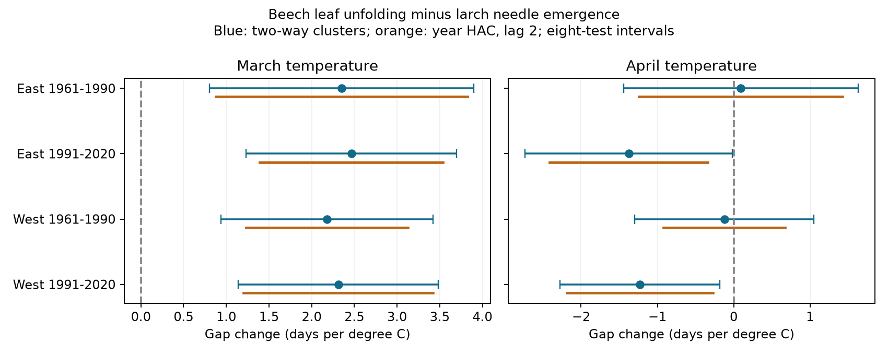

# March warmth had positive links to the beech-minus-larch emergence gap in four Swiss samples in 1961-2020

## Result

March warmth had positive links to the time from larch needle emergence to beech leaf unfolding in four Swiss samples. The study used 4,450 matched station-years at 94 stations. The slopes were +2.18 to +2.46 days per degree C. All four intervals stayed above zero after correction for eight tests. April slopes were near zero in 1961-1990 and negative in 1991-2020. The later eastern April result was sensitive to station trends and the region boundary. This is a test of selected records and seasonal associations. It does not show a causal climate effect or damage to biodiversity.



| Region | Period | Pairs | Stations | March slope [adjusted interval] | April slope [adjusted interval] |
|---|---|---:|---:|---|---|
| East | 1961-1990 | 1,126 | 54 | +2.35 [0.80, 3.90] | +0.09 [-1.44, 1.63] |
| East | 1991-2020 | 1,427 | 54 | +2.46 [1.23, 3.70] | -1.38 [-2.74, -0.02] |
| West | 1961-1990 | 876 | 40 | +2.18 [0.94, 3.42] | -0.12 [-1.30, 1.05] |
| West | 1991-2020 | 1,021 | 40 | +2.31 [1.14, 3.48] | -1.23 [-2.28, -0.18] |

Slopes are days per degree C. Positive means that beech unfolds later relative to larch. The intervals use two-way station and year clusters and a Bonferroni correction for eight month slopes. The figure also shows intervals based on year scores with two serial lags. Both methods give the same signs of clear main results. No formal test of a change between periods is made.

## Question and prior work

A single spring date may not describe a whole tree community. The relative timing of leaves and needles can change the seasonal light environment and the period of exposure to weather. We ask whether March warmth has the same link to two emergence events at the same station. This is a limited test of community timing. It does not measure competition or frost injury.

Bigler and Bugmann (2019, doi:10.3389/fpls.2019.00398) already found different temperature-response patterns for early and late tree species in Swiss records. Their study separates larch, an early species, from beech, a later species with a day-length response. Our result does not discover that general species difference. It tests its relative-date expression with matched stations, separate March and April terms, two non-overlapping periods and two regions. This is not a direct test of day-length or chilling mechanisms.

The prior campaign publication sha256:9e4d9a374151cd91d41042e03cfe7a4aed4fadafe10deff3384df2b770de454a tested hazel flowering versus beech leaves. We use larch needles versus beech leaves, which are more comparable events, and separate March from April. The source archive and some beech records overlap. The prior campaign leaf-out study sha256:423c44cb2c725c9b8b27bc357201aab928313efb449fa8e132701bb85bd3292f tests temperature sensitivity and thermal-time models. We do not claim independent biological confirmation of those source records. We wrote files/plan.txt before the first model fit for this investigation.

## Sources and sample

Source: MeteoSwiss. The previous-year phenology file was retrieved on 2026-11-09. We select 1961-2020 from that snapshot. Parameter 606 is European beech (Fagus sylvatica), leaf unfolding at 50 percent. Parameter 634 is European larch (Larix decidua), needle emergence at 50 percent. We join on station and year. The source has no duplicate keys for these events and years. We require both dates to be between day 1 and day 220. No complete pair fails this filter.

There are 7,027 station-years with at least one event and 5,482 with both. We require at least ten complete paired years in each period at the same station. This leaves 4,450 pairs at 94 stations. The same 54 eastern and 40 western stations enter both periods. West means longitude below 8.3 E. East means longitude at least 8.3 E. We retain 435 negative gaps and 161 zero gaps. We do not force larch to emerge first. Station elevations range from 200 to 1,440 m. We do not assume that the two events refer to the same habitat patch or individual plants.

Temperature is from GHCN-CAMS version 3.01, a monthly 0.5-degree land temperature product (Fan and van den Dool, 2008, doi:10.1029/2007JD008470). Each station uses its nearest grid cell. There are 24 cells in the main panel. January-February is an equal-month mean. March and April enter separately. The evidence table stores the source temperature in kelvin. A change of one kelvin equals a change of one degree C; constant unit offsets do not change these slopes because the models include station intercepts. Constant local elevation offsets are absorbed by station intercepts. Annual local weather errors are not removed. Data provided by NOAA/OAR/PSL, Boulder, Colorado, USA, from https://psl.noaa.gov/ .

Exact shared paths, resolved paths, source URLs, byte counts and SHA-256 hashes are in files/source_hashes.json. Dataset names and source versions are in files/retrieval_manifest.json. We reused shared files in place. No new download was needed.

## Method and observation bias

The outcome is beech day minus larch day. Each separate region-period model includes station intercepts, a linear year term, January-February mean temperature, March temperature and April temperature. Weighted least squares gives each year total weight one. A record has weight one divided by the number of retained pairs in its year. This prevents large survey years from dominating the fit. It does not make missing records random.

The main covariance clusters by both station and year, with finite-sample corrections and a reference t distribution with 29 degrees of freedom. The eight-test intervals use t(1-0.05/16). Regions have no shared stations, and periods have no shared years. Shared regional climate and a common observation system limit their independence. These are four replication tests, not four independent experiments.

We also use year-summed regression scores with a lag-two Bartlett covariance and a 30/29 correction. This allows shared annual variation and short serial dependence. Longer dependence and only 30 years per fit remain concerns. Sensitivity checks require 20 pairs in each period, allow a separate trend at each station, shift the region boundary to 8.0 or 8.6 E, and remove leap day. Their intervals use the same eight-test threshold; no correction covers the full collection of sensitivity analyses.

Matching removes shared site and year offsets from the date difference. Stable station sets and equal annual weights reduce changes in observation coverage. They do not control species-specific visits, observer changes, plant replacement or selective missing dates. The source lacks visit brackets and observer identities. We therefore also calculate exact date-error bounds, rather than assume perfect reported dates.

If each event date can change by up to two days in either direction, each gap can change by up to four days. With the design held fixed, let r be a temperature column after weighted projection on all other regressors. The slope can change by at most 4 sum(abs(w r))/sum(w r squared). This is a sharp fixed-record possibility bound. The errors may align arbitrarily with temperature. It is not a confidence interval and does not cover missing records or uncertain weather.

## Checks and limits on explanation

All four March slopes and adjusted lower limits remain positive with stricter coverage, station trends, both alternative region boundaries and the year-score covariance. Removing leap day has no effect on gap slopes. The later eastern April interval includes zero with station trends and with the 8.6 E boundary. We therefore give more weight to the repeated March association than to the April pattern. A clear interval in one period and an unclear interval in another does not prove that the slopes changed.

The March endpoint slopes show how the gap result arises. Larch slopes range from -3.06 to -2.63 days per degree C. Beech slopes range from -0.71 to -0.17. Their difference equals the gap slope on the same design and weights. This agrees with different seasonal responses, but it is an algebraic decomposition, not an independent test of a biological mechanism.

The two-day error bounds for March slopes are [0.05, 4.66] in early East, [0.24, 4.69] in late East, [-0.11, 4.46] in early West and [0.03, 4.59] in late West. Thus one sample permits either sign even with this small assumed error. The smallest per-event error that can reduce a March point slope to zero ranges from 1.91 to 2.22 days. Three-day errors permit either sign in all four samples. We have no visit logs to choose the true error bound. Sampling intervals and date-error bounds answer different questions and are not combined here.

files/validate.py independently removes weighted station means and solves the resulting regression. It reconstructs all main gap and endpoint slopes within 1e-7. The main code checks full matrix rank, positive primary variance estimates, endpoint subtraction and explicit perturbations that attain both date-error bounds in all 24 fits. files/validation.json and files/independent_validation.json give the checks. A full rebuild from shared source files also reproduced the main evidence and estimates.

Fixed calendar windows avoid choosing exposure windows from the outcome dates. They can overlap or follow emergence, so these fits are retrospective and cannot be used as pre-event forecasts. Monthly weather cannot test daily heat, freezing, drought or pollution. Day length, chilling, precipitation and tree identity are not measured. Only one weather product is used. Stable stations may be a selected subset of Switzerland. No slope establishes a long-term gap trend, a causal climate-change effect, species range change or ecological harm. A useful next test would join visit brackets and daily local weather to the same paired events.

## Rights and reproduction

The publication includes original code, text, figures, aggregate estimates and a transformed MeteoSwiss/NOAA evidence table. MeteoSwiss releases these open data under CC BY 4.0 with attribution. Source: MeteoSwiss. NOAA weather columns are public domain and are not claimed as our property. These terms are compatible with the SCI baseline. files/EXTERNAL_DATA.md gives attribution, transformations and external source terms. No third-party paper text or image is bundled. Raw files remain external.

To inspect estimates without raw sources, extract the verified bundle and run:

```
OPENBLAS_NUM_THREADS=1 python files/validate.py
OPENBLAS_NUM_THREADS=1 python files/analyze.py --panel files/all_pairs.csv --out /path/to/new_output
```

To rebuild from the exact shared snapshots:

```
OPENBLAS_NUM_THREADS=1 python files/analyze.py --datasets /path/to/shared_datasets --out /path/to/new_output
```

To retrieve sources elsewhere, first run `python files/retrieve.py /path/to/external_data`, then pass that directory as --datasets. The script requires the recorded hashes and stops if a live source changed. It writes raw files outside the publication. Do not write output into the signed publication. files/versions.json records the Python environment. Dependencies are NumPy, pandas, SciPy, statsmodels, xarray, matplotlib and a NetCDF backend. One BLAS thread avoids overhead for these small matrix fits. Internet access is not needed for validation or fits with shared snapshots.

## Job record

Job: sci-1107-dell-climate-pollution-biodiversity-2dc3e010148d. Topic: climate-pollution-biodiversity. Campaign: 11_07_2026. Machine: dell. Account: codex-andrii. Model: gpt-6.1-sol, high reasoning effort. This worker ran the analysis in the assigned isolated worktree and used no other agents. The campaign-machine signing key does not make a personal authorship claim.
