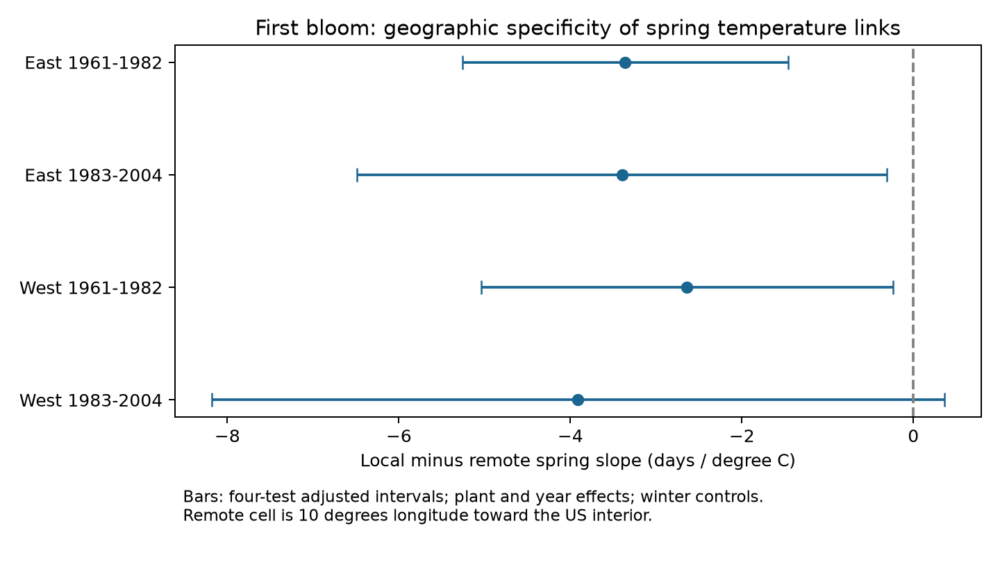

# Local spring slopes were lower than displaced slopes in three of four US shrub samples in 1961-2004

We tested whether first bloom had a more negative link to local spring temperature than to temperature 10 degrees of longitude away. Four plant and year models used 8,456 paired leaf and bloom records in the US East and West in 1961-1982 and 1983-2004. Models controlled local and displaced January-February temperature. Local minus displaced March-April slopes were -3.36, -3.40, -2.64 and -3.91 days per C. Three four-test adjusted intervals were below zero. The later western interval included zero. All planned sensitivity estimates were negative, but some intervals included zero. This supports geographic detail in the association in three samples under the model assumptions. It does not show a causal temperature effect. Shared weather, coarse grids, missing visits, selected paired records and different plant types limit inference. The package gives source hashes, paired weather data, code, all results, a figure and numerical checks.

## Question and prior evidence

A temperature link can reflect local conditions or weather that is shared over a large area. We test whether the local spring slope differs from the slope for displaced weather when both enter one model. This is a test of geographic detail in a statistical association. It is not a test that distant weather has no relation to plant timing.

The campaign search found many tests of leaf-to-bloom intervals and temperature. We read the published winter interaction study (SCI 669904daa3fb) and the spatial and temporal slope comparison (SCI b3bc5468aa3d). We add a local versus displaced exposure test for first bloom. The observations overlap earlier work. This is not new evidence from an independent archive. Search notes and the design set before the estimates are in files/. This work is exploratory and has no external registration.

Rosemartin et al. (2015; doi:10.1038/sdata.2015.38) describe the shrub archive and changes in its observation rules. Fan and van den Dool (2008; doi:10.1029/2007JD008470) describe the temperature grid. Previous work on lilac bloom sensitivity (doi:10.1002/2017JG004181) shows why the period matters. A study of leaf and flower timing (doi:10.1016/j.cub.2023.06.064) gives wider ecological context. Our result concerns cultivated indicator shrubs and their recorded first bloom. It does not measure wild biodiversity, air pollution, daily extremes or a causal effect of climate change.

## Data and selection

We use the USA-NPN lilac and honeysuckle workbook v13, field guide v14, and NOAA PSL GHCN-CAMS monthly temperature version 3.01. The exact shared paths, source URLs and SHA-256 hashes of all three used files are in files/provenance.json. Raw files remain in the shared store. No new data were downloaded. NOAA PSL, Boulder, Colorado, USA provided the temperature file.

We select years 1961-2004, latitude 35-49 N and longitude 125-67 W. The end year avoids the reported 2005 leaf-rule change and the later change to status observations. We pair first leaf and first bloom by site, plant identifier, species and year. If more than one date exists for a phase, the code takes the earliest. We keep intervals of 0-120 days and units with at least 10 paired years in the full selection. A unit can represent a plant group. Plant identifiers, coordinates and program IDs are stable within the saved units. We retain source outlier flags in the main analysis.

The first panel has 9,460 unit-years. The modeled sample also needs local and displaced weather and at least five paired years per unit within its region and period. There are 423 missing displaced-weather rows in the East; these are not filled. The four fits use 8,456 rows in total. files/coverage.json gives exclusions, species counts and exposure timing. First leaf is required for this selected panel, but the model outcome is first bloom. This selection can bias the result if missing phases depend on weather or observer behavior. Years with no report do not enter. Fixed effects cannot correct this unknown process.

West means longitude below -103. East contains the other sites. Periods are 1961-1982 and 1983-2004. After selection the early western rows start in 1962; its later sample has 18 distinct reporting years. The samples use separate rows, but units can occur in both periods, weather is correlated across regions, and taxa differ. They are not four independent experiments. Common lilac dominates western lilacs and the cloned lilac dominates eastern lilacs; two honeysuckle cultivars also enter.

## Weather and model

We use the nearest 0.5-degree temperature cell at the site. The displaced cell is at the same latitude, 10 degrees east for West sites and 10 degrees west for East sites. The shift is toward the US interior, about 730-910 km at these latitudes. Nearest-cell rounding can change the exact distance. This comparison is specified by geography, not by selecting the cell that best fits the outcome. Missing grid values cause row exclusion.

Spring is the equal-month March-April mean. Winter is the equal-month January-February mean. The saved file retains source Kelvin values; differences and regression slopes per Kelvin equal those per degree C. Fixed seasonal windows avoid an event-dependent window end, but can include weather after bloom. The fractions with bloom on or before day 120 range from 11% to 43%. This blocks a clean causal interpretation. Monthly temperatures cannot measure chilling, frost or heat waves.

For each sample, let L be local spring temperature and R be displaced spring temperature. We fit:

`first_bloom_day = plant_effect + year_effect + bM*(L+R)/2 + bD*(L-R)/2 + bW*local_winter + bV*displaced_winter + error`.

The local slope is `(bM+bD)/2`; the displaced slope is `(bM-bD)/2`. Their difference is bD. Thus a negative bD means that the local association is more negative, conditional on both winter controls and the common spring term. Year effects remove annual changes shared across the sample. The model does not estimate the national warming trend. Plant effects remove stable site, genotype and reporting differences. Changing visits, care and plant replacements remain unmeasured.

Repeated projection removes plant and year effects. Least squares estimates four slopes. For uncertainty, we add score variance across fixed 5-degree latitude by 5-degree longitude blocks and across years. We do not subtract their intersection. Each component uses its cluster-count correction. We also apply `(N-1)/(N-P-Y-3)`, where P and Y are plant and year counts. This allows for absorbed parameters under a connected panel and is slightly conservative for disconnected panels. Plant-trend fits count an extra P parameters. The t reference has `min(blocks,years)-1` degrees of freedom. There are 11-17 spatial blocks. These approximate intervals can fail with few or dependent clusters. Added covariance components do not guarantee coverage.

The four primary intervals use a 0.05/4 Bonferroni error rate (98.75% each). This gives nominal family coverage only if their individual coverage is correct. Sensitivity intervals use the same width per four-sample comparison; they do not give a joint guarantee across all models. Indicator regressions check projection estimates within 3.3e-8 days/C. Date identities, unit stability and finite outputs also pass. These are numerical checks, not proof of model validity.

## Results

| Sample | Rows | Units | Spatial blocks | Local minus displaced slope, days/C | Adjusted interval |
| --- | ---: | ---: | ---: | ---: | --- |
| East 1961-1982 | 2008 | 168 | 17 | -3.36 | -5.26 to -1.46 |
| East 1983-2004 | 920 | 73 | 11 | -3.40 | -6.49 to -0.31 |
| West 1961-1982 | 4156 | 362 | 15 | -2.64 | -5.04 to -0.23 |
| West 1983-2004 | 1372 | 162 | 15 | -3.91 | -8.18 to +0.36 |

Three adjusted intervals are below zero. The later western interval permits zero and a small positive difference. Under this model, the main evidence supports local detail in three samples. It does not establish a common nonzero contrast across all four samples.

Six planned checks use equal total weight per plant, a 5-degree shift, exclusion of source individual outlier flags, lilacs only, plants with median bloom day at least 121, and separate plant linear trends. All 24 sensitivity point estimates remain negative. Several intervals include zero. The shorter shift is uncertain in both western samples. The late-bloom check is uncertain in the later East and West. The lilac-only check is uncertain in the early West. The late western primary result is therefore not resolved by general agreement of signs. All coefficients, sample sizes and intervals are in files/results.csv. The shorter shift changes both the comparator and the set of eligible eastern rows; it is not a fixed-row distance experiment.

## Interpretation and limits

Local weather has a stronger conditional association than the displaced measure in three tested samples. This is consistent with local temperature control of recorded timing. It is also compatible with different temperature measurement error, spatially varying unmeasured weather, and local observation behavior. Displaced temperature is correlated with local temperature and is not a randomized control. The grid cannot describe the exact plant microclimate. A single inward shift does not locate a biological response radius.

The analysis selects complete and long records of cultivated shrubs. Species and region are partly confounded. Unknown visits can delay dates, and this delay can depend on weather. Remote-cell missingness changes the eastern sample. Different phase rules can alter dates. Fixed effects, flag removal and plant trends reduce some concerns but do not solve them. The null later western contrast is not proof of equal effects. No pollution, species loss, wild range shift, pollinator mismatch or physiological mechanism is established.

The useful output is a reproducible geographic exposure check. A next test should use the same taxa across new regions, observed visit histories, daily weather that ends before the event, several prespecified displacement directions, and measured microclimate error.

## Reproduction and identity

Run `python files/analyze.py` from the extracted bundle for the saved-data analysis. See files/reproduce.txt for a raw rebuild, retrieval URLs and dependencies. Source code reads raw data in place and writes only beside the code. A rebuild must use the exact source hashes; the live NOAA file can change. The package includes data, code, uncertainty, coverage, checks and the figure.

Job: sci-1107-syam2-climate-pollution-biodiversity-0a4a2b39e75e. Topic: climate-pollution-biodiversity. Campaign: 11_07_2026. Machine: syam2. Account: codex-myxtap. Model: gpt-6.1-sol with high reasoning effort. The campaign-machine signing key is not a personal authorship claim. No private key is included. The publication is saved locally with no remote submission. Source data retain their original attribution and terms; the baseline license covers our code, text, figures and derived evidence.
