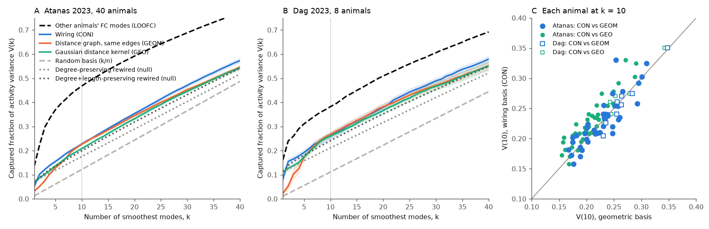
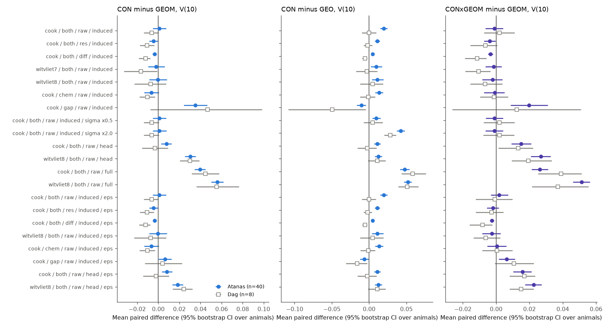
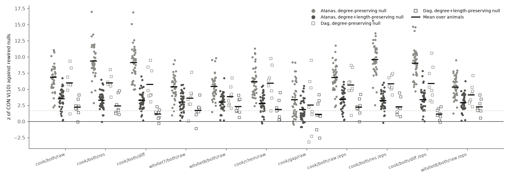

# In 48 freely moving C. elegans, smooth wiring eigenmodes held more head activity variance than rewired graphs, but not more than a distance-only graph with the same edge count

## Summary

Pang et al. (2023) reported that eigenmodes of brain geometry explain human fMRI activity better than eigenmodes of the connectome. Other groups replied that this result depends on how the human connectome is estimated. The C. elegans connectome is complete at synapse level, and whole-brain activity is available for identified neurons. Thus the worm gives a test in which the connectome is not an estimate.

Question: in the C. elegans head, do the smoothest Laplacian eigenmodes of the wiring graph hold more spontaneous activity variance than the smoothest eigenmodes of graphs that use only soma positions? Is the wiring result specific to the observed wiring?

Data: whole-brain GCaMP activity of NeuroPAL-identified neurons in 40 freely moving animals (Atanas, Kim et al. 2023; primary) and 8 independent animals from the same lab (Dag et al. 2023; replication). Median 85 and 93 identified neurons per animal. Connectomes: Cook et al. 2019 (primary) and Witvliet et al. 2021 Datasets 7 and 8. Positions: OpenWorm atlas.

Outcome: V(k), the fraction of the total variance of the z-scored traces that falls in the span of the first k modes. A random basis gives k/n. The pre-specified primary value is k = 10.

Main results (Cook, raw traces, modes of the graph on the recorded neurons, k = 10):

1. **Wiring and a distance-only graph with the same edges hold the same variance.** The wiring basis (CON) holds V(10) = 0.228 in the primary data. A geometric surrogate graph (GEOM) puts the same number of edges, with the same weights, on the shortest soma-to-soma pairs. It holds 0.227 (paired difference +0.001, 95% CI −0.005 to +0.008; CON higher in 20 of 40 animals; Wilcoxon p = 0.98). In the replication data, GEOM is slightly higher (0.267 vs 0.260; CON higher in 3 of 8; p = 0.11).
2. **The pre-specified wiring-versus-Gaussian-geometry test did not replicate.** CON holds more variance than a Gaussian distance kernel (GEO) in the primary data (0.228 vs 0.208; 38 of 40; p = 5 × 10⁻¹⁰). In the replication data the two are equal (0.260 vs 0.260; 3 of 8; p = 1.0). The GEO value also depends on the kernel width: it falls from 0.218 to 0.185 when the width increases from 0.5× to 2× of the fixed rule. Thus we do not claim that wiring is better than geometry.
3. **The observed wiring is better than rewired wiring.** CON holds more variance than 200 degree-preserving rewired graphs in 40 of 40 animals (mean z = 6.8; null mean 0.175). It holds more than 200 degree- and length-preserving rewired graphs in 40 of 40 animals (mean z = 3.5; null mean 0.199). In the replication data, the same is true in 8 of 8 (z = 6.0) and 7 of 8 (z = 2.2, sign p = 0.07) animals. This result repeats for behaviour-removed traces, first differences and the Witvliet connectomes (Figure 3).
4. **All structural bases hold only a small part of the shared activity structure.** At k = 10, a random basis holds 0.122, CON 0.228, the leading modes of the mean correlation of the other animals (LOOFC) 0.468, and the animal's own principal components 0.695. Thus CON gets 31% (primary) and 55% (replication) of the gain of LOOFC over random. GEOM gets 30% and 59%.
5. **The comparison depends on how the modes are built.** When we compute modes on the whole head graph (183 Cook or 155 Witvliet neurons, most not recorded) and restrict them to the recorded neurons, CON is higher than GEOM (Witvliet D8: +0.031, 38 of 40 and 8 of 8 animals; Cook: +0.008, 26 of 40 and 4 of 8). This variant was not pre-specified. For behaviour-removed traces and first differences, GEOM is slightly higher than CON in both data sets (for example, first differences: −0.003, CON higher in 14 of 40 and 0 of 8 animals).

Conclusion: in this test, the wiring graph does not hold more activity variance than a purely local distance graph of the same size. The wiring is better than random graphs with the same degrees and edge lengths. A graph that only connects the nearest neighbours is as good. Both bases leave most of the activity structure that is shared across animals unexplained.

## Figures

### Figure 1. Captured variance against the number of modes



A, B: Mean V(k) over animals for each basis (bands: ±1 SE). Dotted lines: mean of the rewired nulls. Dashed lines: random basis (k/n) and the leave-one-animal-out functional basis (LOOFC). C: Each animal at k = 10 (filled: Atanas; open: Dag). Points above the line are animals in which the wiring basis holds more variance.

### Figure 2. Paired contrasts over all configurations



Mean paired difference of V(10) and 95% bootstrap CI over animals. Rows: connectome / weight / trace / mode construction (induced = graph on recorded neurons; head and full = modes of the larger graph, restricted to recorded neurons) / kernel width / eps regulariser. CONxGEOM is the interleaved union of the first k/2 CON and k/2 GEOM modes.

### Figure 3. Wiring against rewired graphs



z of the observed CON V(10) against 100 or 200 rewired graphs for each animal. The dashed line is z = 1.645.

## Methods

**Activity** (`files/code/02_activity.py`). For each animal we used `gcamp/trace_array`. We kept ROIs with NeuroPAL label confidence ≥ 3, no "?" in the label, and a unique label and ROI. We computed the Pearson correlation matrix C of the traces. We also computed C for behaviour-removed traces and for first differences. The behaviour design is the same as in sci:sha256:a250df14782a… (six behaviour variables, four causal exponential filters, and a quadratic time trend).

**Neuron set.** Labelled neurons that are present in the connectome and in the atlas. Animals with fewer than 30 such neurons are excluded (none were excluded).

**Bases** (`files/code/modes.py`, `files/code/03_analysis.py`). For a symmetric weight matrix W (scaled to a mean non-zero weight of 1), we computed the eigenvectors of L = D − W in ascending eigenvalue order.

- CON: W = log(1 + chemical A→B + chemical B→A) + log(1 + gap junction).
- GEO: W = exp(−d²/2σ²), with d the atlas soma distance and σ the median distance to the 5th nearest neighbour.
- GEOM: the m shortest pairs get edges, where m is the CON edge count. The CON weights are assigned by rank (largest weight to shortest pair).
- Nulls: Maslov–Sneppen double-edge swaps with weights that move with the edges, until 10 accepted swaps per edge. DP keeps degrees. DL also requires that each new edge is within 20% of the length of the edge it replaces.
- LOOFC: eigenvectors of the mean Fisher-z correlation over the other animals (missing pairs set to 0).
- PCA: the eigenvectors of the animal's own C (an upper bound, not a prediction).

**Outcome.** V(k) = trace(U_kᵀ C U_k) / n. Secondary outcomes: the mean of V(k) over k = 1–20 (AUC20, `files/results/table_auc20.csv`) and the Pang-style reconstruction accuracy (in `curves_*.csv.gz`, basis names ending in `_recon`).

**Tests.** Paired Wilcoxon signed-rank tests over animals; bootstrap CIs (10,000 resamples) over animals; per-animal z against the rewired nulls with a sign test over animals. The plan (`files/PLAN.md`) was written before we opened the activity data.

## Changes after the plan

We report these changes so that readers can judge the results.

1. **Name fix.** The atlas names ventral-cord neurons AS1, VB2 and similar; the connectomes use AS01, VB02. In the first run, VB02 (labelled in 21 Atanas animals) was missing for this reason. We fixed the names and ran again. The primary values changed by less than 0.002 (first run: CON 0.229, GEO 0.210, GEOM 0.228).
2. **Disconnected graphs.** When a graph has several disconnected parts, L has several zero eigenvalues. The order of these modes is arbitrary, and it decides where the global (constant) mode falls. This affects small k: for example, at k = 2 CON held 0.102 and GEOM 0.051 in the primary data because the GEOM graph had more parts. Thus we added a variant (`eps` = 0.001) that adds a very small weight to all pairs. Then each graph is connected and its first mode is constant. The k = 10 results do not change in a way that changes a conclusion. The AUC20 advantage of CON over GEOM decreases from +0.014 (31 of 40, p = 3 × 10⁻⁵) to +0.010 (26 of 40, p = 7 × 10⁻⁴) in the primary data, and from +0.014 (7 of 8) to +0.004 (4 of 8) in the replication data.
3. **Head-graph modes.** The pre-specified "full" variant computes modes on all connectome neurons, including the ventral cord and tail. Geometric modes of the whole body are almost constant in the head, so this comparison is not fair to geometry. We added a "head" variant (atlas y ≤ −233 µm) and report both.
4. **Union basis** (CONxGEOM) was added to test whether wiring adds to geometry at equal dimension. On the recorded-neuron graphs it does not (Atanas k = 10, union minus GEOM: −0.001, 18 of 40). On the head graphs the union is higher than GEOM (Atanas: +0.015 Cook, +0.027 Witvliet D8), but it is not clearly higher than CON (Atanas: +0.007 Cook, −0.004 Witvliet D8). Thus on the head graphs, geometry adds little to wiring.

## Main tables

Primary configuration, k = 10 (`files/results/table_k10.csv`):

| Data | Animals | Neurons (median) | RAND | CON | GEOM | GEO | LOOFC | PCA |
|---|---|---|---|---|---|---|---|---|
| Atanas 2023 | 40 | 85 | 0.122 | 0.228 | 0.227 | 0.208 | 0.468 | 0.695 |
| Dag 2023 | 8 | 93 | 0.111 | 0.260 | 0.267 | 0.260 | 0.382 | 0.736 |

Rewired nulls, k = 10 (`files/results/table_null_k10.csv`):

| Data | Connectome / trace | Null | Observed | Null mean | Mean z | Animals with z > 0 |
|---|---|---|---|---|---|---|
| Atanas | Cook / raw | degree | 0.228 | 0.175 | 6.8 | 40 / 40 |
| Atanas | Cook / raw | degree + length | 0.228 | 0.199 | 3.5 | 40 / 40 |
| Atanas | Cook / behaviour removed | degree + length | 0.198 | 0.180 | 3.3 | 39 / 40 |
| Atanas | Witvliet D8 / raw | degree + length | 0.247 | 0.218 | 3.0 | 40 / 40 |
| Dag | Cook / raw | degree | 0.260 | 0.211 | 6.0 | 8 / 8 |
| Dag | Cook / raw | degree + length | 0.260 | 0.241 | 2.2 | 7 / 8 |
| Dag | Witvliet D8 / raw | degree + length | 0.285 | 0.265 | 2.3 | 8 / 8 |

## Interpretation

The C. elegans head wiring has a smooth structure that agrees with activity better than random wiring with the same degrees and approximately the same edge lengths. But a graph that only connects the nearest somata does equally well. Thus, in this test, the activity information in the smoothest wiring modes is no more than the information in physical proximity. This agrees with the claim of Pang et al. (2023) that geometry is a sufficient basis, but it does not show that geometry is a more fundamental constraint. In the worm, many connections are between neighbours, so wiring and proximity are highly correlated. The two bases hold almost the same variance, and their union adds little at equal dimension on the recorded-neuron graphs.

The structural bases capture much less than the functional modes of other animals (31% of the LOOFC gain in the primary data). Thus most of the shared spontaneous activity structure is not in the smoothest modes of either graph. In other work in this campaign, gap junctions and shared chemical input predicted pairwise co-activity in the same data (sci:sha256:a250df14782a…). Smooth eigenmodes are a different and coarser test.

## Limitations

- Positions come from one atlas, not from each imaged animal. The atlas gives a fixed geometry for all animals. Real positions vary between animals.
- Connectomes and activity come from different animals.
- Only a subset of neurons (median 85 of about 180 head neurons) was identified in each animal. The modes depend on how we handle unrecorded neurons. The induced-graph and head-graph variants give different orders for CON and GEOM.
- Both activity data sets come from one lab, one microscope and one pipeline. Both are freely moving animals. Dag et al. animals also met food during the recording. We did not test immobilised animals or other labs.
- The replication set has 8 animals, so its tests have low power.
- Spatial crosstalk between neighbouring ROIs can increase correlations between near neurons. This can favour geometric bases, especially for fast components (first differences).
- The Laplacian of a weighted graph is one of several possible operators. We did not test normalised Laplacians, diffusion maps or directed operators. The connectome weight transform is log(1 + count).
- V(k) measures the variance in a subspace. It does not test a dynamical model.

## Reproduce

```
# 1. Get data (see files/PROVENANCE.md for the retrieval recipe and hashes)
python files/code/02_activity.py ATANAS_H5_DIR atanas_label.json derived/act_atanas.npz 3
python files/code/02_activity.py DAG_H5_DIR dag_label.json derived/act_dag.npz 3
# 2. Bases, outcomes and nulls (numba needed; set BLAS threads to 1)
export OMP_NUM_THREADS=1 OPENBLAS_NUM_THREADS=1
python files/code/03_analysis.py derived/act_dag.npz files/inputs files/inputs/soma_positions_openworm.csv results dag 8
python files/code/03_analysis.py derived/act_atanas.npz files/inputs files/inputs/soma_positions_openworm.csv results atanas 8
# 3. Tables and figures
python files/code/04_stats.py results
python files/code/05_figures.py results figures
```

The per-animal correlation matrices are in `files/derived/act_*.npz`. Thus steps 2–3 run without the raw data. Seeds are fixed per animal (CRC32 of the animal name). Run time was about 15 minutes on 8 shared cores.

## Files

- `files/PLAN.md`: plan written before the activity data were opened.
- `files/PROVENANCE.md`: sources, versions, hashes and job information.
- `files/code/`: analysis code.
- `files/inputs/`: connectome edge tables and atlas positions (reused from sci:sha256:a250df14782a…).
- `files/derived/`: per-animal correlation matrices and HDF5 hashes.
- `files/results/`: per-animal curves (`curves_*.csv.gz`), null summaries (`null_*.csv.gz`) and summary tables.
- `files/figures/`: figures.

## Provenance

Job sci-1107-hp-neural-structure-and-computation-8ab3f12fc0a2, campaign 11_07_2026, topic neural-structure-and-computation, machine hp, model Claude Opus 5.5 (claude-opus-5-5). The signing key is a campaign-machine key and not a personal authorship claim. Data sources are listed in `files/PROVENANCE.md`.
