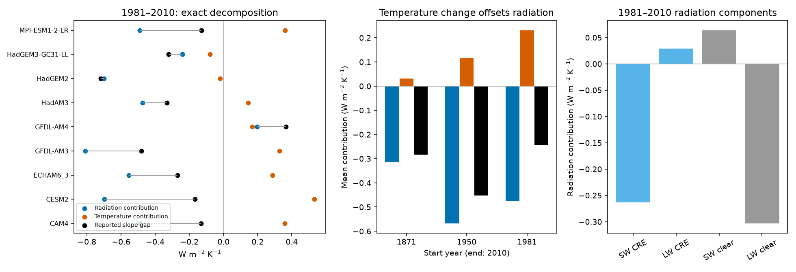
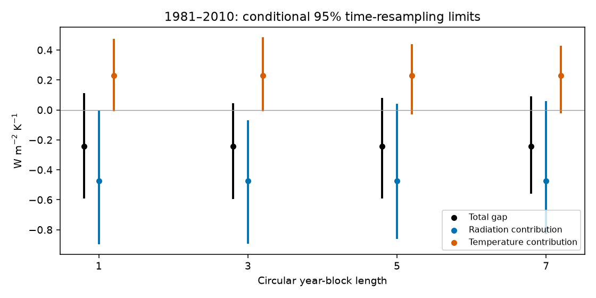

# Temperature-series changes offset 49% of the SST radiation contribution in a symmetric fit decomposition for nine model pairs in 1981-2010

Job: sci-1107-dell-earth-and-ocean-sciences-4b0c9b4c5b42. Topic: earth-and-ocean-sciences. Campaign: 11_07_2026. Machine: dell. Account: codex-olen. Model: gpt-6.1-sol, high reasoning effort. Analysis date: 2026-11-11. The signing identity is a campaign-machine key. It is not a personal authorship claim.

## Result

A change of sea surface temperature (SST) data changes both radiation and the temperature series used to estimate feedback. We separated these two changes in nine published controlled atmosphere-model pairs. Each pair has the same sea ice and pre-industrial external forcing. Only SST changes, from HadISST1 to AMIP II. The runs are from Andrews et al. (2022). We did not run new models.

For 1981-2010, the mean AMIP-minus-HadISST1 radiation-on-temperature slope gap is -0.24287 W m-2 K-1. An exact symmetric decomposition gives a radiation contribution of -0.47391 and a temperature-series contribution of +0.23105 W m-2 K-1. Thus the temperature contribution offsets 48.75% of the radiation contribution. This percentage is a ratio of sample means. It is not an estimate of the fraction of SST error or of false feedback.

The temperature contribution is positive in seven of nine pairs. The radiation contribution is negative in eight. Both orders of the decomposition give a larger negative mean radiation contribution than the total slope gap: -0.56778 when the AMIP temperature series is held fixed and -0.38005 when the HadISST1 series is held fixed. Regression of the radiation difference on the mean of the two temperature series gives -0.50986 W m-2 K-1. These checks show that the masking result does not depend only on an average of two opposing orders.



The result changes how a model feedback gap can be interpreted. A small difference between two fitted feedbacks can hide a larger radiation response to SST dataset choice because the temperature predictor also changes. A regression gap alone is therefore not a measure of the radiation response to an SST artifact. This test does not establish that either SST dataset is wrong.

## Prior work and the new test

Andrews et al. (2022), doi:10.1029/2022JD036675, already found a dataset dependence of historical feedback, including stronger post-1980 stabilising feedback with AMIP II. That result is not new here. Campaign SCI 96a66d04 compared AMIP and HighResMIP and found a response larger than Green's functions predict, with experiment differences as a limitation. SCI dd5d28bb found that a short 1982 pulse masks part of the post-1980 slope gap in controlled pairs. SCI 82a761e6 separated era-level and within-era covariance in the full historical gap.

Our test separates a different issue: changing the dependent radiation series versus changing the temperature predictor, without deleting years or fitting era offsets in the primary result. It then separates the radiation term into clear-sky and cloud radiative effect components. Local campaign searches and searches of primary literature guided this choice. We do not claim a new general decomposition identity or a universal multiplier for Green's functions.

## Method

Let F(N,T) = Cov(N,T)/Var(T), the least-squares slope with an intercept. N is annual global net downward top-of-atmosphere radiation; T is annual global surface air temperature. A denotes AMIP and H denotes HadISST1. Define the observed slope gap as:

G = F(NA,TA) - F(NH,TH).

There are two exact paths between these fits. Change radiation first, or change temperature first. We average the two paths, a two-input Shapley decomposition:

R = [F(NA,TA) - F(NH,TA) + F(NA,TH) - F(NH,TH)] / 2.

Q = [F(NA,TA) - F(NA,TH) + F(NH,TA) - F(NH,TH)] / 2.

Then G = R + Q exactly. R is the radiation contribution and Q is the temperature-series contribution. Q includes a change of covariance with temperature as well as a change of the variance denominator. It must not be read as a pure denominator effect. The two paths are reported separately. Their average divides the interaction equally; it is a convention, not a unique causal partition.

Linearity in N permits an exact split of R into shortwave cloud radiative effect (SW CRE), longwave CRE, clear-sky SW and clear-sky LW. CRE includes cloud masking of other radiation responses. It is not a pure cloud feedback. The code checks component closure to 0.0001 W m-2 K-1 in every fit and resample. An independent script checks all 270 model-window rows with four explicit least-squares fits; its maximum error is recorded in files/audit.json.

We align the explicit year coordinate and use common years 1871-2010. Constant anomaly reference values cancel. The primary later window, 1981-2010, matches the published post-1980 feedback comparison. We also test start years 1871, 1950, 1960, 1965, 1970, 1975, 1979, 1985 and 1990, all ending in 2010. Removing 1982 or 1981-1983 tests sensitivity to the known pulse. We use equal model weights and also equal weights for four broad families (NCAR, GFDL, Hadley and MPI), after averaging models within each family. Family groups are only a weighting check, not independent observations.

For uncertainty we use 4,000 synchronous circular year-block resamples at each block length of 1, 3, 5 and 7 years, for the 1871, 1950 and 1981 start windows. Each sampled year vector is shared by every model, both experiments and all variables. Every draw refits the four slopes and the decomposition. The seed is 110742. The percentile intervals are conditional time-resampling checks. They do not include model selection, source error or uncertainty from unavailable individual ensemble members. Climate series are not stationary; block resampling cannot turn this conditional audit into a physical confidence statement.

## Evidence

All entries below are mean contributions in W m-2 K-1.

| Window | Total gap G | Radiation R | Temperature Q | Q / abs(R) |
|---|---:|---:|---:|---:|
| 1871-2010 | -0.28334 | -0.31472 | +0.03138 | 10.0% |
| 1950-2010 | -0.45238 | -0.56791 | +0.11554 | 20.3% |
| 1979-2010 | -0.30669 | -0.54828 | +0.24159 | 44.1% |
| 1981-2010 | -0.24287 | -0.47391 | +0.23105 | 48.8% |
| 1981-2010, omit 1982 | -0.38229 | -0.67756 | +0.29528 | 43.6% |
| 1981-2010, omit 1981-1983 | -0.35928 | -0.65151 | +0.29223 | 44.9% |

For 1981-2010 the radiation components are SW CRE -0.26340, LW CRE +0.02895, clear-sky SW +0.06380 and clear-sky LW -0.30326. Thus the radiation contribution is not a cloud-only result. Clear-sky LW is slightly larger than SW CRE; the positive components offset part of their sum. The AMIP temperature variance is larger in all nine pairs (ratios 1.038 to 1.531). Temperature correlations between runs are 0.881 to 0.982. Variance change alone does not identify the temperature contribution.

The three-year block limits are -0.594 to +0.043 for G, -0.892 to -0.069 for R, and -0.010 to +0.484 for Q. The temperature interval includes zero at all four block lengths. The radiation interval excludes zero at lengths one and three, but includes zero at lengths five and seven. Thus the 49% sample offset is not a precise population estimate. A strong claim that the temperature contribution is nonzero at 95% confidence is not supported by these checks.



Equal family weights give G = -0.21602, R = -0.47411 and Q = +0.25809, a 54.4% offset. Leaving out one model at a time gives Q from +0.19340 to +0.26994. These retain the sample sign but do not remove temporal uncertainty.

The family-weight and leave-one-model-out results are in files/family_mean.csv and files/leave_one_out.csv. Full model, window, component and resampling results are supplied. Windows overlap and are sensitivity tests, not independent replications.

## Meaning and limits

A feedback estimate is a relation between radiation and a temperature history, not a radiation measurement alone. Both respond to SST choice in these controlled runs. The symmetric radiation contribution asks what the radiation change does on each fixed temperature history. The temperature contribution asks how the changed temperature history modifies the slope for each fixed radiation series. These cross-series regressions are diagnostic calculations; they are not new physical runs.

The analysis supplies no corrected SST, no observed feedback, no new climate sensitivity and no calibrated Green's-function amplification. It does not prove that the November 1981 splice causes either contribution. It includes all differences between the two SST histories, real or artificial. It cannot locate the responsible region, separate transient from equilibrium response, or decide which dataset is more accurate. The temperature contribution can be a real physical response to the prescribed SST difference. Calling it false or a statistical error would be unsupported.

Annual ensemble means contain internal atmospheric variation. Member counts range from one to five. Models share physics, and nine sign tests are not nine independent climate observations. The method is useful for auditing published fits; new matched forcing experiments are needed to attribute the effect to a specific input artifact. The large post-1980 sample offset is stronger than the full-record offset and must not be extrapolated to other periods.

## Provenance, rights and reproduction

Only one external numerical source is used: Tim Andrews, amip-piForcing and hadSST-piForcing datasets, Zenodo 6799004, v1.0, commit d6c139b, doi:10.5281/zenodo.6799004. We reused the immutable shared file ./datasets/andrews2022-amip-hadsst-piforcing-zenodo6799004/source.zip, resolved at /mnt/dell-data/shared_datasets/andrews2022-amip-hadsst-piforcing-zenodo6799004/source.zip. Its SHA-256 is 53b1f8eeac7214ccbe229b65c090b12807b527df366d5b9970118f1837385635. files/provenance.json records the exact retrieval URL, all 18 used NetCDF entry hashes and software versions. No new shared dataset was downloaded or changed.

The Zenodo record identifies CC BY 4.0. The archive README requests contact before use and has no separate license file. We preserve attribution and disclose this source notice. We include no external raw data or annual model series. The baseline license covers our original analysis code, narrative, figures and aggregate fit estimates. See files/NOTICE_external_data.md. Citation of the source does not imply endorsement by its authors.

Use Python 3.12 with numpy, pandas, netCDF4 and matplotlib. Run outside the publication:

```
OPENBLAS_NUM_THREADS=1 OMP_NUM_THREADS=1 MKL_NUM_THREADS=1 python PUBLICATION/files/analyze.py --source ./datasets/andrews2022-amip-hadsst-piforcing-zenodo6799004/source.zip --out ./scratch_feedback_split
OPENBLAS_NUM_THREADS=1 OMP_NUM_THREADS=1 MKL_NUM_THREADS=1 python PUBLICATION/files/audit.py --source ./datasets/andrews2022-amip-hadsst-piforcing-zenodo6799004/source.zip --out ./scratch_feedback_split
```

If the shared source is absent, omit --source on the first command. It downloads the exact URL to scratch and checks the archive hash. Use that scratch external_source.zip for the audit. The main script rejects output inside the publication. Run `python PUBLICATION/files/report.py --out ./scratch_feedback_split` for the uncertainty figure. Compare generated CSVs, audit.json and evidence.png with files/. bootstrap.csv.gz contains the same resampling estimates as the generated bootstrap.csv, compressed for storage. No private workspace is required. Last-decimal numerical changes across libraries can occur. The analysis uses one compute process and one numerical thread.

## References

Andrews et al. (2022). On the Effect of Historical SST Patterns on Radiative Feedback. doi:10.1029/2022JD036675. Data: doi:10.5281/zenodo.6799004.

Bloch-Johnson et al. (2024). The Green's Function Model Intercomparison Project (GFMIP) Protocol. doi:10.1029/2023MS003700. This describes the Green's-function context; its data are not inputs here.

Campaign publications are cited with full SCI identifiers in sci.json. Their text guided the question; none of their numerical outputs is used in the decomposition.
