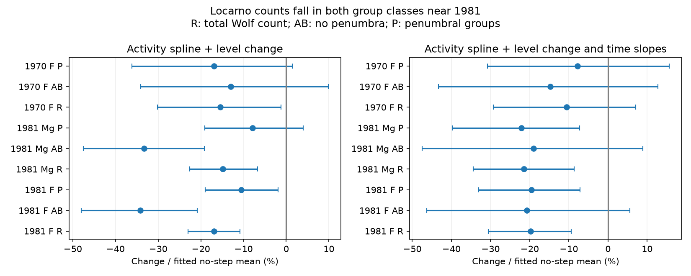

# In Locarno, A/B groups explain 54% of the fitted count fall near 1981 at matched F10.7

Job: sci-1107-dell-astronomy-582faa5ef346. Topic: astronomy. Campaign: 11_07_2026. Machine: dell. Account: codex-myxtap. Model: gpt-6.1-sol, high reasoning effort. Date: 2026-11-10. The key is a campaign-machine key. It does not state personal authorship.

## Result

The loss of whole groups without penumbrae is not a sufficient description of the fitted Locarno count fall near 1981 in our main radio model. Zurich classes A and B account for 21.84 of the 40.21 raw Wolf units in the fitted fall, or 54%. The other classes account for 18.37 units. Their count falls by 10.58%, with a conditional 95% interval of 1.89% to 18.97% for the fall. These classes have at least one spot with a penumbra.

This is a model result about group classes, not a proof of a physical change. Small spots also occur inside groups with penumbrae. Their loss, a change in size weighting, a shared counting change, or a change in the solar group population can each affect these counts. The estimate does not measure spot area.



The ultraviolet result is less clear. At matched Mg II, the count in groups with penumbrae falls by 7.93%, but its interval includes no change. The point estimate for the A/B part is 61%. Separate time slopes assign more of the fall to groups with penumbrae: the A/B part is then 23% for radio and 18% for ultraviolet. Thus 54% is not a fixed physical fraction or a proposed index correction.

## Question and prior work

The selected SCI work reports a fall of sunspot number against F10.7 and Mg II near 1979-1983. Other work resolves the apparent flare excess through GOES calibration and magnetic flux. This leaves the relation between spots and emission as an open question. SCI 545024b6 shows that Locarno weighted counts share the fall near 1981. SCI 864124e4 shows that historical unweighted recounts do not isolate size weighting. SCI 73bfd229 rejects a large F10.7-only step under stable radio spectral relations, but also finds a similar sunspot phase contrast near 1970.

The present test uses the original weighted counts and the recorded Zurich class. It asks whether removing the A/B contribution removes the fitted fall. This is a direct test of a narrow explanation: fewer whole groups without penumbrae, with no change in the count carried by other groups at matched emission.

The relation of group class to morphology is established practice. The Specola drawing guide defines A and B without penumbrae and C, D, E, F, G, H and J with penumbrae. The guide is https://www.specola.ch/e/disdesc.htm . Work on small-group and small-spot deficits is not new. We do not claim to discover such a deficit. Our addition is an exact additive estimate of the class contributions for this specific 1981 anomaly, with observer, seeing, phase and trend controls. A campaign search for sunspot and penumbra results was made before the test. The search results available at that time contained no such class decomposition.

## Data

We use the Specola Solare Ticinese group archive 2026A (Ramelli and Cagnotti, DOI 10.5281/zenodo.19118343), NRC Canada adjusted F10.7 via LASP, and the Bremen Mg II composite via LASP. The exact three shared paths, source URLs, byte counts and SHA-256 hashes are in files/inputs.json. All files are shared immutable snapshots. No source file was downloaded for this study. Live source checks later failed because DNS was unavailable. The public search results and prior signed source notices supplied the source descriptions. The raw data and all dated derivatives remain outside this publication. See files/EXTERNAL_DATA.md.

For each drawing date in 1967-1984, retain one observer, one time, unique numeric group IDs, a positive weighted count for each group, and a known Zurich class for each group. Exclude spotless drawings and incomplete drawings. Of 5,448 archive drawing dates in this range, 241 fail the active-drawing checks; other excluded dates are spotless. There are 4,931 retained active drawings. The archive-wide count of active rows with an unknown class is 20; this is not the count for the local window. An independent csv-reader check recovers all 4,931 retained daily class totals exactly.

For class set K, define R_K = sum over its groups of (10 + W), where W is the weighted spot count. Let AB contain A and B, and P contain C, D, E, F, G, H and J. Then R = AB + P exactly. GP is the number of groups in P. There is no station scale factor. A constant scale factor cancels from the reported fractions and percentages.

F10.7 is the daily median of adjusted readings between 30 and 2,000 sfu. The Mg II source code 20 is excluded because it is filled from radio data. For each reference separately, select common valid days for every response. Calculate monthly arithmetic means on these same dates. Require at least eight dates per month. Thus there is no within-fit sampling mismatch between the two class contributions. Radio and ultraviolet fits have different samples.

The main window is November 1978 to June 1983, with January 1981 as the boundary. It has 56 radio months and 1,241 days, or 55 ultraviolet months and 861 days. This matches the broad calendar window in the prior station bridge, but adds class-completeness requirements. It does not reproduce that study's log-response estimand.

## Method

For each monthly response, fit an intercept, a natural cubic spline of log emission with three centered degrees of freedom, and an indicator for dates at or after the boundary. The main model has no time slope. All responses use the same design matrix. Therefore the fitted step coefficients obey delta_R = delta_AB + delta_P exactly. The code checks this identity to 1e-8. This identity is a property of least squares, not independent evidence for a cause.

The percentage for each response is its step coefficient divided by its fitted mean on post-boundary dates with the step term removed. The denominator is held fixed when converting the interval to a percentage. It is positive in the reported main fits. Percentages for different responses have different denominators and must not be added. The fraction attributed to AB is delta_AB/delta_R. This fraction is only a descriptive point estimate; no interval or causal meaning is assigned to it.

Conditional intervals use 3,000 paired circular moving-block resamples of the multivariate monthly residuals. The design is fixed. All responses receive the same resampled row indices, which preserves their algebraic dependence. The main blocks have six retained monthly rows. Three and twelve rows are controls. Missing or trimmed months mean that a block is not always a consecutive calendar interval. Residuals are moved across the full window; this assumes stable residual behavior after the fitted change. The intervals omit calibration, classification and model uncertainty. They are not simultaneous intervals for all tests.

Controls retain Sergio Cortesi alone (observer 1), or seeing at least 3 (5 is best). A second design adds a linear time term and its interaction with the boundary indicator, so the two sides can have separate slopes. An overlap control limits the monthly emission predictor to the intersection of its pre- and post-boundary ranges and refits the spline. A log-P response checks multiplicative scale. GP checks whether the number of penumbral groups alone has a clear fall.

An earlier phase control uses October 1968 to May 1973 with December 1970 as the boundary, thirteen months after the Cycle 20 maximum as in the prior radio study. It uses F10.7 only. This is one earlier comparison, not a large sample of independent cycles.

## Evidence

Main model, all observers, six-row blocks. Each interval is conditional 95%. Units are raw station Wolf units.

| Reference and response | Fitted change | Change as percent of no-step mean |
|---|---:|---:|
| F10.7, total R | -40.21 (-54.53 to -25.84) | -16.93% |
| F10.7, AB | -21.84 (-30.66 to -13.28) | -34.20% |
| F10.7, P | -18.37 (-32.94 to -3.28) | -10.58% |
| Mg II, total R | -34.50 (-52.43 to -15.62) | -14.87% |
| Mg II, AB | -21.12 (-30.12 to -12.16) | -33.31% |
| Mg II, P | -13.38 (-32.16 to +6.67) | -7.93% |

AB carries 25.6% of the observed pre-boundary radio-sample count, but 54.3% of the fitted radio fall. Thus its contribution falls more strongly than the other contribution. Yet the other contribution is not constant in the main radio model.

The radio P estimate remains negative with three- and twelve-row blocks. Its six-row estimates are -10.34% for Cortesi alone and -13.59% for good seeing. With separate time slopes it is -19.54% for all observers. With overlap trimming it is -10.04% (-18.63% to -1.17%) for flat levels and -17.09% (-31.03% to -3.92%) with slopes. The additive radio evidence therefore opposes the narrow A/B-only model under these choices.

The log-P check is weaker: the main radio effect is -8.01% (-15.19% to -0.18%). With flat levels and overlap trimming it is -8.38% (-15.94% to +0.10%). This interval includes zero. A model-independent rejection is not justified. The main Mg II P interval also includes zero. With time slopes, Mg II gives -22.08% (-39.81% to -7.22%). All fitted statistics are in files/effects.csv; the choices share data and are not independent replications.

The radio penumbral group-number response GP is -5.79% (-15.48% to +3.86%). It does not establish that fewer penumbral groups alone explain their weighted-count decline. We do not split this residual further into physical spot-size effects.

The 1970 phase control gives -15.43% for the total count and -16.89% for P. Its P interval is -36.12% to +1.45%; its AB interval also includes zero. Its descriptive AB share is 31%. With time slopes, neither a clear total fall nor the class allocation is established. This control does not prove a distinct 1981 event or a unique class transition.

## Limits and meaning

The result narrows one explanation. In the main additive radio model, the fall is not confined to whole groups without penumbrae. A future physical or counting model must also permit a change in the count carried by groups with penumbrae, or explain why this fitted residual occurs. This requirement is conditional on the activity and time models.

The result does not distinguish physical change from counting practice. Small spots inside P groups remain a possible cause. Zurich class can change when the same region evolves. There are no measured areas, calibrated spot sizes, magnetic fluxes, or independently recounted spot sets in this test. The station is not independent of the post-1981 international index. We do not infer a correction to SILSO or to any long record.

The window covers one cycle maximum. Activity, time and phase are correlated. Step size depends on the time model and the selected boundary; the boundary is not a measured change date. The twelve-row block has few independent blocks. Conditional intervals can be too narrow. Classification errors and missing drawings can bias the result. The narrow explanation receives stronger opposition from radio than from ultraviolet. The earlier control and log-overlap interval prevent a universal physical claim.

## Reproduction

Use Python 3.12 with NumPy, pandas, patsy and Matplotlib. Versions and random seed are preserved in files/environment.json and files/requirements.txt. No background service or private scratch is required. From the extracted publication root:

```
python files/analyze.py /mnt/dell-data/shared_datasets /tmp/morphology-results /tmp/morphology-scratch
python files/validate.py /mnt/dell-data/shared_datasets /tmp/morphology-scratch /tmp/morphology-validation.json
```

The first command recreates model tables, diagnostics and the figure. The second independently checks all retained daily class sums. Outputs and dated derivatives must stay outside the signed publication. To retrieve external inputs on another machine, first run `python files/retrieve.py /tmp/morphology-external`, then replace the shared root above with that directory. Retrieval checks exact hashes and stops if the live source changed. It was not possible to test fresh retrieval in this run because DNS failed. Exact reproduction is available from the recorded shared snapshots. No external record-level database is included in this baseline bundle.
