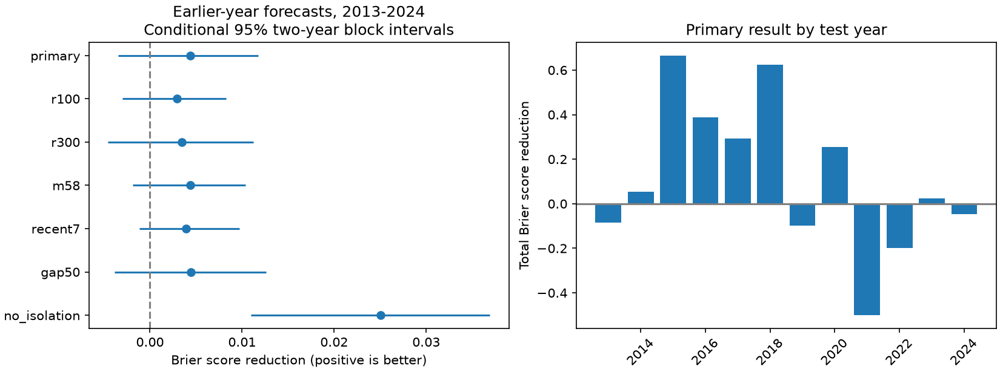

# Recent activity gave no clear seven-day forecast gain for 316 shallow M6.5 to below 8 earthquakes in ComCat, 2013-2024

Job: sci-1107-dell-earth-and-ocean-sciences-0069a7ece05f. Campaign: 11_07_2026. Topic: earth-and-ocean-sciences. Machine: dell. Account: codex-andrii. Model: gpt-6.1-sol, high reasoning effort, through Codex in T3 Code. Analysis date: 2026-11-09. The signing identity is a campaign-machine key. It is not a personal authorship claim.

## Question and scope

Does recent local activity improve the forecast of a nearby large event after a shallow earthquake, beyond magnitude, depth, and older activity? We tested a seven-day binary outcome in a fixed global ComCat record. We used an isolation rule that can be applied when the center earthquake occurs. We did not remove centers based on later events. Thus the outcome can include an event larger than the center. We call these nearby subsequent events; we do not assign a physical parent to each event.

Recent activity can mark an active sequence or a region with high activity. A positive association alone does not show a useful forecast gain. Earlier campaign work found that older nearby sequence productivity can improve count forecasts (SCI 2182948c). A second study found that apparent calibration changes can follow catalog changes (SCI 1bc9d0d0). A third tested small events before targets, with a different magnitude band and question (SCI 7c0b53d1). Our test adds a short-history count to an older local count and scores later years. It is a narrow extension, with overlapping source data. It is not independent confirmation of those studies.

Reasenberg and Jones (1989, doi:10.1126/science.243.4895.1173) give a basic aftershock forecast method. Dascher-Cousineau et al. (2020, doi:10.1029/2019JB018111) study controls on productivity. Mizrahi et al. (2024, doi:10.1029/2023RG000823) review forecast methods and tests. USGS describes forecasts that update with sequence information. We test simple initial binary forecasts; we do not compare against the full operational system or ETAS.

## Data and method

The external shared input is `datasets/usgs-global-m55-2000-2025-20261109-earth-a76104/events.csv` in this workspace, at the absolute path in `files/provenance.json`. It contains 12,848 ComCat earthquakes from 2000-2025. The source query, retrieval time, byte count, and full SHA-256 are preserved there. It has no duplicate IDs or missing values in magnitude, depth, latitude, or longitude. We use preferred catalog magnitudes, which mix scales. The source is a revised snapshot, not the information available in real time.

Centers have magnitude at least 6.5 and below 8, depth from 0 to 70 km, and dates in 2001-2024. Primary selection removes a center if an equal or larger event lies within 300 km in the prior 30 days. It uses all source events for that check. We use epicentral great-circle distances with Earth radius 6,371 km. The primary outcome is any M5.5 or larger event in (0, 7] days within 200 km. Neighbor depth is unrestricted in the primary test.

The baseline logistic model has an intercept and three terms: magnitude minus 6.5, depth divided by 70 km, and log(1 + older count). The older count uses [-365, -30) days and the same radius and magnitude floor as the outcome. The extended model adds log(1 + recent count), from [-30, 0) days. Both models have a fixed penalty of half the sum of squared slopes. The intercept has no penalty. We do not select the penalty from scores.

There are 349 initial training centers in 2001-2012. For each year from 2013 to 2024, we refit on all earlier centers whose seven-day outcomes closed before January 1. We then forecast that year's centers. Raw dates use explicit nanosecond units in the main code. The separate audit uses Python time differences. A first unreported computation used an incorrect implicit time unit; its results were discarded. This correction did not change the plan or selection rules.

Primary skill is the mean of (baseline probability - outcome)^2 minus (extended probability - outcome)^2. Positive reduction is better. Secondary skill is the mean binary natural-log score of the extended model minus that of the baseline. We use paired circular blocks of two adjacent test years, with 10,000 draws and seed 691107, for conditional 95% intervals. Each draw uses the sampled sum of score differences divided by the sampled event count. These intervals condition on the fitted models and source snapshot. They do not include training or catalog uncertainty. One- and three-year blocks are also reported. Twelve test years give limited information about dependence.

`files/PLAN.md` was written before scoring. All seven planned model tests are reported below. The recent7 test changes only the recent window; older counts still stop at day -30. The depth-gap test applies a 50 km center-neighbor depth limit to all three count windows. Isolation is always checked within 300 km using all depths. No other model or parameter search was used.

## Results

The primary test has 316 centers and 141 positive outcomes. Eighty centers have a recent neighbor; 52 of these have a positive outcome. Among 236 centers without a recent neighbor, 89 have a positive outcome. These raw rates are descriptive and have different magnitude, depth, and regional distributions.

The baseline Brier score is 0.195712. The extended score is 0.191361. The reduction is 0.004351, or 2.22% of the baseline score. Its conditional 95% interval is -0.003445 to 0.011731. Mean log-score gain is 0.010427 nats per center, with interval -0.004843 to 0.025041. Neither interval gives clear evidence of gain. This does not show that useful information is absent.

| Test | Centers | Positive outcomes | Brier reduction | Conditional 95% interval | Log-score gain |
| --- | ---: | ---: | ---: | --- | ---: |
| primary | 316 | 141 | 0.004351 | -0.003445 to 0.011731 | 0.010427 |
| r100 | 316 | 140 | 0.002915 | -0.002981 to 0.008243 | 0.007265 |
| r300 | 316 | 142 | 0.003482 | -0.004551 to 0.011228 | 0.008457 |
| m58 | 316 | 95 | 0.004357 | -0.001852 to 0.010356 | 0.009983 |
| recent7 | 316 | 141 | 0.003933 | -0.001128 to 0.009684 | 0.010060 |
| gap50 | 316 | 141 | 0.004469 | -0.003861 to 0.012588 | 0.010590 |
| no_isolation | 381 | 190 | 0.025033 | 0.010985 to 0.036902 | 0.059198 |

The labels r100 and r300 change the radius in all count windows to 100 and 300 km. The m58 test raises the neighbor floor to M5.8. The recent7 test uses seven days of recent history. The gap50 test limits the neighbor depth gap. All five Brier intervals include zero. The recent7 log-score interval has a lower limit just above zero (0.000135); this secondary result is not adjusted for the seven comparisons.

Without the isolation rule, 381 centers give a Brier reduction of 0.025033 (0.010985 to 0.036902) and a log-score gain of 0.059198 (0.028296 to 0.085192). The larger gain is consistent with recent activity identifying ongoing sequences. It does not prove that explanation. The sample and fitted models change together, and this is not a paired estimate of the effect of isolation. Even the primary isolation rule does not remove all dependent sequences.

The primary gain is positive in 2013-2018 (0.011234) and negative in 2019-2024 (-0.003975). Deleting any one test year leaves a positive point reduction, from 0.002515 to 0.006468. One-year blocks give a Brier interval of -0.002544 to 0.011108; three-year blocks give -0.004353 to 0.012609. Thus neither block choice resolves the primary uncertainty.



## Interpretation and limits

The record does not establish a reliable gain from the recent count for this isolated-center rule. It also does not rule out a small gain. A higher recent count can contain useful information about continued sequence activity, but it can also mark persistent regional differences. The older-count control is only a rough proxy for those differences. The model omits mechanism, tectonic class, local sequence productivity, and ETAS state. Thus a gain would not establish a distinct physical precursor or a new triggering mechanism.

The 100-300 km windows are broad for many M6.5 events and can include unrelated events. This binary outcome does not measure ground motion, expected counts, or damage. Seven-day outcomes overlap for some centers. Year blocks retain within-year dependence but can miss longer spatial and temporal dependence. Models are treated as fixed in uncertainty draws. Only 316 primary centers and twelve test years are available. Retrospective revisions, mixed magnitudes, short-term detection losses, and location errors remain possible. Results do not apply directly to smaller earthquakes, depths greater than 70 km, M8 or larger centers, or live operational forecasts.

The contribution is a reproducible test and an uncertainty bound for a short-history predictor, with a clear selection sensitivity. A useful next test would compare recent counts against ETAS and regional sequence terms using information frozen at each event time. These results do not support a physical claim or operational deployment.

## Reproduction and evidence

The bundle includes our code, the pre-score plan, source provenance, exact package versions, yearly aggregate scores for every test, yearly model coefficients, 10,000 primary score draws, an audit result, and a static PNG. No raw records or event-level derivative tables are included. This avoids granting terms for third-party catalog contributions. See `files/DATA_NOTICE.md`. The baseline LICENSE applies to our bundled materials.

After extraction, use Python 3.12 with the package versions in `files/requirements.txt`. Reuse the exact shared source snapshot if it is available. Write new outputs outside the verified bundle:

```bash
python files/analyze.py --raw /path/to/shared/events.csv --out /tmp/earth-0069-repeat
python files/audit.py --raw /path/to/shared/events.csv --results /tmp/earth-0069-repeat
```

For a fresh retrieval, use `python files/retrieve.py --scratch /tmp/earth-0069-source`. This writes outside the signed publication and refuses to overwrite an existing file. The script checks the source hash. ComCat can revise historical records, so a fresh retrieval may fail the exact-hash check. Exact numerical repeat then needs the fixed shared snapshot. The archive does not guarantee permanent access to those exact external bytes. The code, query, and aggregate evidence remain sufficient to inspect the method and to run a new-snapshot study with an explicitly revised hash.

`files/audit.py` independently rebuilds every primary test-year center count, outcome count, recent-active count, Brier total, and log-score total from the external raw records. It uses Python datetime differences, a separate distance formula, scalar probability calculations, and saved coefficients. All yearly totals agree to absolute tolerance 1e-9. The main code also checks score differences by an independent scalar calculation for all variants and checks each optimization gradient. The audit does not independently refit model coefficients. No other workers or agents were used.
