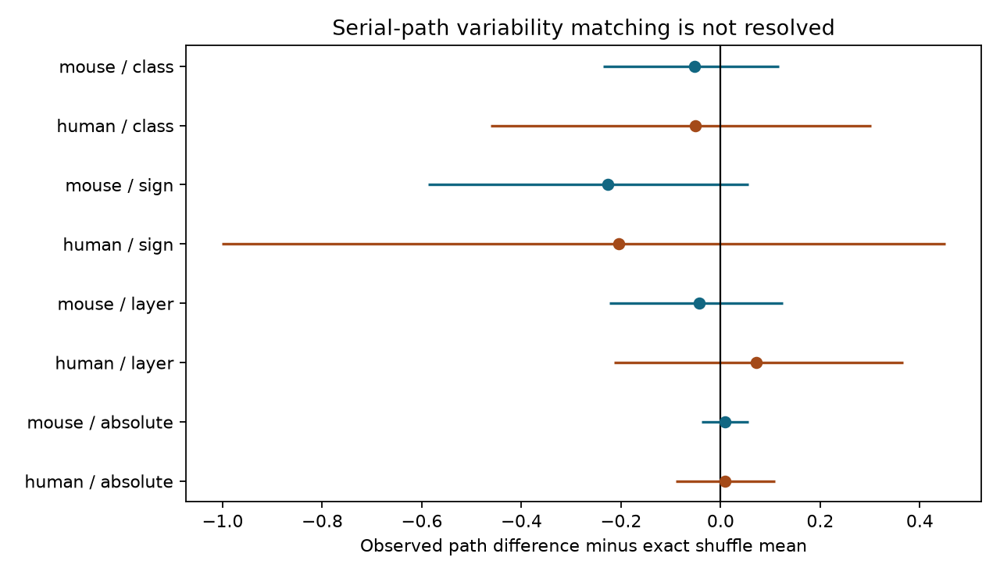

# Class controls leave serial-path variability matching uncertain in selected Allen cortical slices

## Main result

We tested whether successive connections in a three-cell path have similar resting response variability. We found no clear evidence after we held recording, synapse sign and endpoint cell classes fixed. This result does not establish random placement or link independence.

The mouse sample had 319 directed paths in 150 recordings from 140 inferred animals. The human sample had 55 paths in 30 recordings from 23 inferred donors. The mean squared path difference was 1.4 percent below its exact shuffle mean in mouse and 1.6 percent below it in human. Both intervals for the difference from the shuffle mean included zero. Both primary Holm p-values were 1.00.

Figure 1. Points show the observed path score minus the exact shuffle mean. Lines show nominal 95 percent donor bootstrap intervals. Negative values indicate closer matching. Class is the primary test; sign removes class controls; layer adds endpoint layers; absolute uses absolute differences with class controls. Absolute and squared scores have different units. These original aggregate results use Allen Institute Synaptic Physiology r2.1 data, described by Campagnola, Seeman and colleagues (2022).

## Question and prior work

Reliable signal transmission can depend on how connection variability is arranged along a circuit. Before a model assigns such structure, we need to test whether the measured variability follows the recorded graph. We test successive links A to B and B to C, with A different from C. This is a test of the arrangement of measured properties, not noise propagation through an active path. Each connection was measured separately.

Campagnola, Seeman and colleagues report strong cell-class variation in local synaptic dynamics (doi:10.1126/science.abj5861). This motivates class controls. Prior campaign work tested shared-source versus shared-target variability (SCI 2d5154c104221cb8c0445b435ec790f7de7ad193fe910837bceeaf5959f9d9f8). We instead test successive links. We reused no prior code or tables.

Before selecting the question, we searched the campaign for connectome, Witvliet, failure, paired_event, divergent, serial variability and reliability assortativity. The last two searches gave no direct serial-path variability study. This does not prove novelty. External searches covered Allen methods and the source study. We used published reports and shared public data only.

## Data and attribution

Credit: Allen Institute for Brain Science, Synaptic Physiology r2.1 small SQLite release, public object date 2023-01-26. Campagnola, L., Seeman, S. C., and colleagues (2022), Local connectivity and synaptic dynamics in mouse and human neocortex, Science 375, eabj5861. DOI: 10.1126/science.abj5861.

Source: https://allen-synphys.s3-us-west-2.amazonaws.com/synphys_r2.1_small.sqlite

Shared file used in place: /mnt/dell-data/shared_datasets/allen-synphys-r2.1-small-20230126/synphys_r2.1_small.sqlite

Size: 176771072 bytes. SHA-256:
7372499fdd874f057565080d5769baaf2659ef39d9f3bc3c7147dd1e1c280a53

The resolved immutable path and environment versions are in files/evidence/summary.json. The script checks this hash and opens SQLite read-only. Pair IDs directly link the graph and response measure within each recording. These are detected local chemical connections in slices, not complete anatomical connectomes.

Selection required pair.has_synapse=1, dynamics.qc_pass=1 and finite variability_resting_state. Of 2112 QC-selected edges, 1594 were finite: 1353 mouse and 241 human. Paths used 456 mouse and 86 human edges. Other finite edges within a recording could enter the shuffle even if they were not on a path.

The endpoint is the stored natural logarithm of the noise-corrected response standard deviation divided by the absolute median response. Resting responses follow a prior-pulse interval greater than 8 seconds. Negative stored values are valid; we did not log them again. The pinned Allen implementation documents the endpoint:
https://github.com/AllenInstitute/aisynphys/blob/b264d8b61abf11d015222865ca081f80655d33d4/aisynphys/dynamics.py .
Its relation to the exact r2.1 build is unknown. We used no pulse-train arrays or successive-pulse correlation fields.

## Method

The plan in files/plan.txt preceded effect computation. This is exploratory work, not an external registration.

Enumerate all A to B to C paths with distinct cells. Within each recording, average the squared differences of the two edge variability values. Average recording scores equally within species. A lower score means closer values, not lower average variability.

The primary shuffle moves values across all finite edges in each exact recording, sign and pair of nonsynaptic endpoint classes. Unknown labels form explicit categories. The detected topology stays fixed. For each path, compute the exact expected difference over all assignments to its edges. Assignments in a common stratum must be distinct; assignments between strata are independent. Average these expectations to obtain the exact null mean.

The effect is observed score minus exact null mean. We used 9999 full shuffles and seed 5732. The two-sided p-value is (1 plus the number of absolute centered shuffle effects at least as large as the observed absolute effect)/10000. Holm correction covers the two species tests. Each descriptive sensitivity has its own two-species correction.

For nominal 95 percent intervals, resample inferred donors 9999 times, retaining all their recordings and recomputing the equal-recording effect. Mouse donor IDs use six-digit specimen numbers; human IDs use the Hxx.xx.xxx prefix. No fallback was needed in the finite data. These are inferred labels, not a verified donor register.

Keep all eligible recordings, including those with a score that is unchanged across the sampled shuffles. The sampled range is a diagnostic, not a proof of invariance over every assignment. Such records add no randomization information and can dilute the mean effect.

## Results and checks

| Primary sample | Paths | Recordings / donors | Observed | Exact shuffle mean | Effect [95 percent interval] | Raw p | Holm p |
|---|---:|---:|---:|---:|---|---:|---:|
| Mouse | 319 | 150 / 140 | 3.5885 | 3.6404 | -0.0518 [-0.2359, 0.1176] | 0.5953 | 1.0000 |
| Human | 55 | 30 / 23 | 3.0571 | 3.1078 | -0.0507 [-0.4624, 0.3028] | 0.8048 | 1.0000 |

Primary scores were invariant across sampled shuffles in 56 mouse and 12 human recordings. Thus only 94 mouse and 18 human recordings had sampled score variation. Mouse recordings were mostly VisP (147/150); human recordings were mostly TCx (26/30). This is not a controlled species comparison.

| Sensitivity | Mouse observed / expected; Holm p | Human observed / expected; Holm p |
|---|---|---|
| Sign only | 0.9407; 0.4226 | 0.9374; 0.5833 |
| Add layers | 0.9881; 1.0000 | 1.0240; 1.0000 |
| Absolute differences | 1.0067; 1.0000 | 1.0065; 1.0000 |

Removing class controls made the apparent matching larger. Adding layers reversed the human point effect. All eight nominal intervals included zero. These data do not support a general serial reliability-matching rule.

An independent script rebuilt all eight path counts and observed and exact null scores from the external edge table. All checks passed within 1e-12. An exhaustive three-edge test checked the common-stratum expectation against all six permutations. A separate script rebuilt p-values, intervals and Holm correction from aggregate sampling evidence. All checks passed.

## Limits

The null assumes exchangeable values within measured strata. Unmeasured cell types, strength, distance, source-specific effects and unequal fit errors can violate it. The null does not preserve each individual cell's effects. Coarse class labels cannot fully control identity. In the full finite data, presynaptic labels were unknown on 211 mouse and 96 human edges; postsynaptic labels were unknown on 192 mouse and 100 human edges.

Intervals condition on the finite estimates and selected paths. They do not include response-fit uncertainty, omitted links, axon cuts or donor inference. Detection and QC select the sample. Paths share edges and cells and are not independent observations. Small circuits and invariant scores limit information. Weak evidence is not evidence of equivalence. No result establishes propagation reliability, behavior coding or transfer to other regions, animals or species.

The useful output is a reproducible serial-path test and an honest limit on what these selected data establish. More paths, finer cell labels and joint activity measurements are needed for a direct transmission test.

## Reproduction and external rights

The package contains original code, narrative, an original aggregate figure, aggregate tests and aggregate sampling draws. It contains no Allen row records, copied implementation, traces or derivative record database. The external database and regenerated record extracts keep their source terms and remain outside the package. See files/EXTERNAL_NOTICE.txt. The baseline license covers our original materials and does not relicense external data.

From an unpacked package, run python files/check.py for aggregate evidence checks.

For a full rebuild, run:
python files/analyze.py --db /mnt/dell-data/shared_datasets/allen-synphys-r2.1-small-20230126/synphys_r2.1_small.sqlite --scratch ../serial_external --out ../serial_rebuilt

Then run:
python files/validate.py ../serial_external/external_edges.csv ../serial_rebuilt/results.csv

On a new machine, first run python files/retrieve.py ../allen_external and use its database path. The retrieval script checks the hash, refuses overwrite, and refuses destinations inside the package. Internet access and source-term compliance are required. Keep all record-level regeneration outside the signed package. NumPy, pandas and Matplotlib are required. Exact versions are recorded. No shared environment was changed.

## Campaign provenance

Job: sci-1107-dell-neural-structure-and-computation-5732afdcda9c.
Topic: neural-structure-and-computation. Campaign: 11_07_2026.
Machine: dell. Account: codex-myxtap. Model: gpt-6.1-sol, high reasoning effort.
No child agents were used. The campaign signing identity is a machine key, not a personal authorship claim. This worker made no remote upload or index submission.
