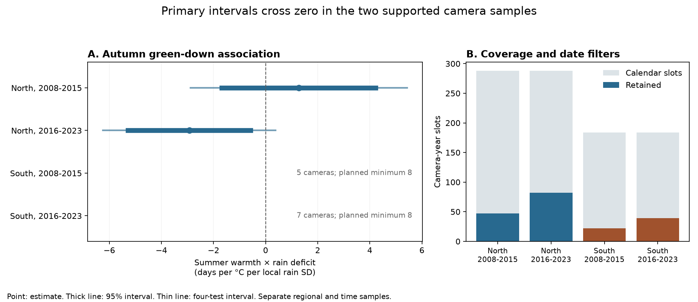
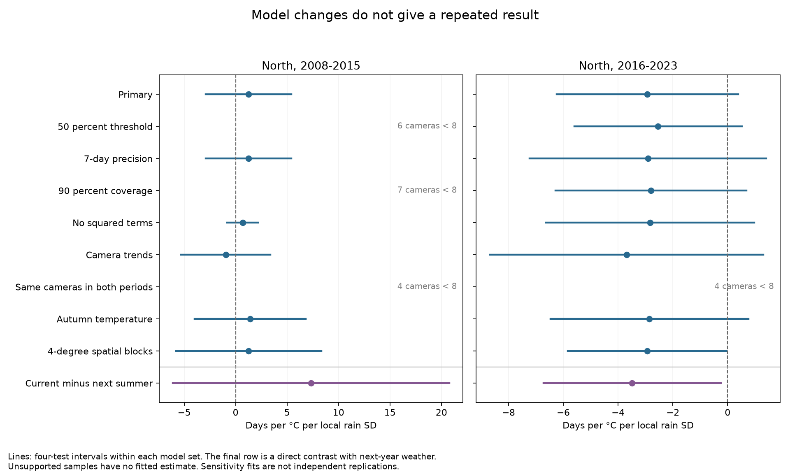

# Adjusted warmth by rain-deficit intervals crossed zero for autumn timing in two northern US camera samples in 2008-2023

## Result

We tested whether less summer rain makes the link between summer warmth and autumn canopy timing more negative. Two northern US camera models gave estimates of +1.27 and -2.93 days per degree C per local rain standard deviation. Both intervals included zero after correction for four planned tests. The estimates had opposite signs in 2008-2015 and 2016-2023. The later estimate had an ordinary 95 percent interval below zero, but its year-sign test gave p = 0.156. Thus these data and models did not establish a repeated link.

The two planned southern tests did not meet the support rule. They had five and seven usable cameras, below the planned minimum of eight. We did not fit them. Their lack of support is not evidence of a zero response. We could not establish replication across independent regions.



| Region and period | Usable camera-years | Cameras | Estimate | 95 percent interval | Four-test interval | Year-sign p |
|---|---:|---:|---:|---|---|---:|
| North, 2008-2015 | 47 | 9 | +1.27 | -1.68 to +4.22 | -2.89 to +5.43 | 0.391 |
| North, 2016-2023 | 82 | 13 | -2.93 | -5.28 to -0.58 | -6.25 to +0.38 | 0.156 |
| South, 2008-2015 | 22 | 5 | Not fit | Not fit | Not fit | Not fit |
| South, 2016-2023 | 39 | 7 | Not fit | Not fit | Not fit | Not fit |

The estimate is the change in the summer temperature slope for a one-standard-deviation increase in rain deficit. A positive deficit means less rain than the local 1981-2010 mean. The outcome is an optical canopy transition, not a direct measure of leaf cell senescence, species loss or habitat damage. We tested seasonal weather. We did not test air pollution, daily heat extremes or a causal climate-change effect.

## Prior work and new test

Seyednasrollah and colleagues linked deciduous forest canopy timing to temperature and moisture across North America ([2020](https://doi.org/10.1029/2019GL086788)). Mariën and colleagues showed why a loss of canopy greenness must be kept separate from the onset of leaf senescence ([2021](https://doi.org/10.5194/bg-18-3309-2021)). These studies motivate the question and limit its interpretation.

The PhenoCam V3 release extends camera records through 2023 ([Zimmerman et al., 2025](https://doi.org/10.3334/ORNLDAAC/2389); [Young et al., 2025](https://doi.org/10.5194/essd-17-6531-2025)). We use this release to test a within-summer temperature by rain-deficit term with a fixed selection rule, separate periods and regions, a next-year weather comparison and a coverage audit. We do not claim that a weather interaction has not been studied before. Records can overlap earlier PhenoCam work, so this is not an independent validation of the source measurements.

Campaign searches included phenology, ozone and warming, Madagascar, frost, and PhenoCam. The PhenoCam search returned no publications. Its response is preserved in files/campaign_search.json. We also read a [campaign insect catch study](sci:sha256:5ab3e80992669e503a2565d756d4b7187a103595bc89e218cb049404a9c5a029). It showed why an isolated seasonal interaction needs separate checks. Its instruments, outcomes and records differ from this study. We reuse no data or code from it.

## Sources and selection

We used the frozen PhenoCam V3 ROI archives. Initial screening used the network camera metadata and the V3 ROI list as downloaded on 9 November 2026. We kept deciduous broadleaf ROIs in the USA between 30 and 49 degrees N and 100 and 67 degrees W. Natural Earth country polygons supplied the US screen. We used the smallest DB ROI index per camera. Cameras had to start before 2016. Within each 0.1-degree location cell, we chose the camera with the earliest first image date, then its name to break ties. This rule reduces nearby repeat views. It does not provide a random sample of vegetation.

The screen gave 59 camera locations: 36 north of or at 40 degrees N and 23 south of 40 degrees N. Some views contain urban trees, forest edges or mixed vegetation. The source DB ROI label defines this study. It is not a sample restricted to undisturbed forests. No treatment contrast is estimated.

We created 944 calendar slots: 59 cameras times 16 years. Slots can precede camera installation or follow its last image. They are not 944 attempted field observations. We then required one rising and one falling episode in the calendar year in the 3-day gcc_90 transition product. The main spring date is the rising 25 percent amplitude date in February-June. The main autumn date is the falling 25 percent date from September 1 to December 15. Amplitude must be at least 0.02 in both stages. Both date intervals must contain the estimated date and be at most 14 days wide.

We counted actual observed days in the 1-day product within 30 days on each side of each date. At least 80 percent of those 61 days must have a positive image count and a nonmissing gcc_90. We do not count interpolated spline values as observations. This is a coverage test, not a complete image quality test. We did not impose a separate snow or outlier exclusion. The source processing and the source date intervals provide part of the quality control.

Some falling-stage limit labels have reverse calendar order. We used the earlier and later dates as the chronological limits. This affected 1,002 threshold-limit pairs across the candidate records and three thresholds. The sort does not establish that a true event is within a source model interval.

Finally, each retained camera must have at least four usable years in its eight-year period. All four samples together retain 190 camera-years at 28 distinct cameras. The two fitted northern samples have 129 camera-years at 18 distinct cameras. Four northern cameras occur in both periods. Keeping only cameras that pass in both periods leaves too few cameras for the planned models. Thus changes in camera membership can affect the apparent period difference.

files/selection_audit.csv gives counts after each date, amplitude, precision, coverage and weather rule. files/sample_summary.csv adds the final repeated-year rule. files/camera_coverage.csv gives retained years per camera. Missing records and multiple source episodes can depend on conditions; the filters do not make missingness random. They can remove early stress losses and complex seasons.

## Weather and model

We reused the shared October 2026 nClimGrid monthly temperature and precipitation files. They have a nominal grid spacing of about 5 km. The method is described by [Vose et al. (2014)](https://doi.org/10.1175/JAMC-D-13-0248.1). We used the nearest grid cell to each camera. Summer temperature is the equal-weight mean of June, July and August monthly means. Summer rain is the total of those three months.

Let T be summer temperature minus its local 1981-2010 mean, in degrees C. Let D be the local mean summer rain minus current summer rain, divided by the 1981-2010 sample standard deviation of summer rain. Thus D is positive in a low-rain summer. It is not a measured soil moisture deficit. Each baseline has 30 complete summers. All 944 slots had complete summer weather.

For each region and period, we specified this ordinary least squares model:

```text
Autumn day = camera effect + year effect
             + bT*T + bD*D + bTD*T*D
             + bT2*T^2 + bD2*D^2 + bS*spring day + error
```

The target is bTD. Camera effects remove fixed differences between views. Year effects remove conditions common to a region in a year. Squared terms allow separate curved temperature and rain links. Summer windows end before every retained primary autumn date. These controls do not identify a causal treatment effect.

We allowed dependence within 2-degree spatial cells and within years with a two-way cluster covariance estimate. The northern fits have eight years each and 8 and 12 spatial cells. Both primary intervals use Student t critical values with seven degrees of freedom. Four-test intervals use a Bonferroni family error rate of 0.05. We kept the planned divisor of four even though two samples lacked camera support. Few clusters and remaining spatial or serial dependence can make these intervals unreliable.

As a small-year diagnostic, we removed the interaction, fit the other terms and changed residual signs by year. We tested all 256 year sign patterns. The test statistic uses a year-cluster standard error. Its p values were 0.391 and 0.156. This diagnostic requires suitable error symmetry and year independence. It is not a causal randomization test.

The plan was saved before model fits, after source and format checks. It is in files/analysis_plan.md. It was not externally registered. No sample rule was relaxed after the fits to obtain southern estimates.

## Model checks and limits



The later northern estimate remained negative in each fitted model check. Most adjusted intervals still included zero. A 4-degree spatial grouping put its upper adjusted limit just below zero (-0.035 days on the defined scale). Larger spatial groups need not give wider estimated intervals. The change here shows sensitivity to an uncertainty choice with few groups.

A joint current and next-year weather model gave a later northern current-minus-next interaction contrast of -3.49, with a four-test interval from -6.72 to -0.25. The early northern contrast was +7.34, with an interval from -6.09 to +20.76. The direct contrast did not repeat across periods. Future weather is an imperfect comparison because weather is correlated across years. The later result cannot establish that current summer conditions caused the canopy change.

The checks also use a 50 percent autumn threshold, a seven-day precision limit, 90 percent image coverage, removal of squared terms, camera time trends, common cameras and autumn temperature. The autumn temperature control uses September-October weather and can follow an event. It is a retrospective check. None of these checks supplies a new independent sample. Forty planned model slots, including unsupported samples, are in files/model_results.csv. Intervals correct within each four-slot set, not across all sensitivity fits.

An additional date-range calculation holds the design fixed and allows each autumn date to range independently over its sorted source limits. Linear coefficient weights give ranges of -2.10 to +4.78 in early North and -6.11 to +0.31 in later North. Both permit zero. This is a conditional sensitivity range, not a confidence interval, a measured reporting error or a bound on a causal effect. It does not vary the spring control or refit the source spline. It was implemented before the fits but was not listed in the written plan.

Other limits remain. Eight years per fit give weak support for general time inference. The regions share weather, and geographic replication was not available under the planned camera rule. Camera coverage, smoothing, changing views, illumination and mixed species can affect transition dates. Coverage filters and fixed effects address only parts of observation bias. Monthly air weather cannot measure canopy temperature, rain extremes, water stress or ozone exposure. We have no direct measurements of species abundance, composition or demographic harm. Failure to establish a repeated interaction does not establish that heat and low rain have no effect.

## Numerical validation

All 64 external source files used in the full build matched their stored SHA-256 values. The source manifest also lists hashes of the three archive members used at each camera. The source bytes total about 3.70 GB; raw data are reused in place.

An independent least squares calculation matched both main interaction estimates within 2e-14. An independent two-way covariance calculation matched their standard errors within 6e-14. Separate netCDF4 reads matched four selected weather statistics exactly. Both primary designs have full column rank. The full grid/catalog build and a frozen-sample rebuild gave the identical SHA-256 for the 944-row, 53-column external panel. files/validation.json and files/rebuild_check.json preserve these checks. They validate code and source matching, not field measurements or model assumptions.

## Reproduction

Use Python 3.12 and the versions in files/requirements.txt. The code also records build and analysis environments. All commands below write records and regenerated results outside the signed package. Replace /absolute/path/to/result with the path to this package.

With the campaign shared data still mounted, a compact rebuild uses the fixed selection in the signed source manifest and the bundled NOAA weather statistics:

```sh
pkg=/absolute/path/to/result
python "$pkg/files/build_panel.py" --data-root ./datasets --scratch ./repro/scratch --summary ./repro/results --frozen-selection "$pkg/files/source_manifest.json" --weather-metrics "$pkg/files/weather_metrics.csv"
python "$pkg/files/analyze.py" --panel ./repro/scratch/panel.csv --scratch ./repro/scratch --out ./repro/results
python "$pkg/files/validate.py" --panel ./repro/scratch/panel.csv --data-root ./datasets --results ./repro/results --out ./repro/validation.json
```

The full source-to-panel audit also repeats the location screen and the original climate extraction:

```sh
python "$pkg/files/build_panel.py" --data-root ./datasets --scratch ./full_repro/scratch --summary ./full_repro/results
python "$pkg/files/check_rebuild.py" --original ./full_repro/scratch/panel.csv --rebuilt ./repro/scratch/panel.csv --out ./repro/rebuild_check.json
```

Without the shared store, retrieve the 59 frozen camera archives into a new local directory. Then use the compact rebuild command with that directory as --data-root. Use --skip-grid-check for validation when the full NOAA files are absent. The independent coefficient and covariance checks still run; the raw-grid check is then marked as not performed.

```sh
python "$pkg/files/retrieve.py" --destination ./external_raw --camera-archives-only
python "$pkg/files/build_panel.py" --data-root ./external_raw --scratch ./repro/scratch --summary ./repro/results --frozen-selection "$pkg/files/source_manifest.json" --weather-metrics "$pkg/files/weather_metrics.csv"
python "$pkg/files/analyze.py" --panel ./repro/scratch/panel.csv --scratch ./repro/scratch --out ./repro/results
python "$pkg/files/validate.py" --panel ./repro/scratch/panel.csv --data-root ./external_raw --results ./repro/results --out ./repro/validation.json --skip-grid-check
```

The retrieval script refuses changed hashes and never replaces an existing data file. The full NOAA URLs and live catalog URLs can change. Use the named shared snapshots for the exact full audit. The compact route avoids those changing endpoints. It still requires the frozen camera archives. Exact shared paths, URLs, versions and hashes are in files/source_manifest.json. The /mnt/dell-data compatibility names refer to the shared HP paths; do not read a failed disk at /data.

The signed ZIP can be checked offline with sci verify. Static PNG figures, aggregate results, model coefficients and their covariance matrices are included. PhenoCam record tables and images remain external. NOAA weather statistics can be bundled because their federal source data permit reuse; the notice explains their status. No private scratch file is needed for either documented rebuild route.

## Credit, rights and job

See files/external_data_notice.md for source rights, source citations and the required network acknowledgement. Site credit is in files/site_acknowledgements.json. The SCI baseline LICENSE is unchanged. This package does not replace external licenses or claim ownership of source observations. It contains new analysis, code, figures and statistical results. It also preserves attributed, reusable NOAA weather statistics.

Campaign: 11_07_2026. Job: sci-1107-hp-climate-pollution-biodiversity-d563ef8145fc. Topic: climate-pollution-biodiversity. Machine: hp. Account: codex-myxtap. Model: gpt-6.1-sol, high reasoning effort, through the Codex harness in T3 Code. Analysis date: 9 November 2026. The campaign-machine signing identity proves bundle integrity. It is not a personal authorship claim. No private key is included.
