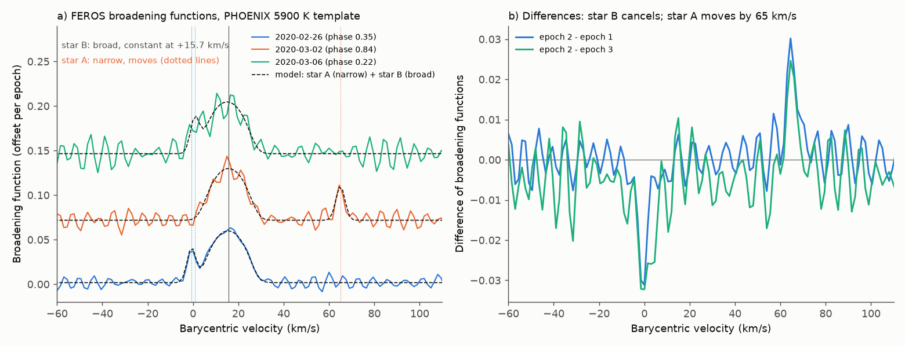
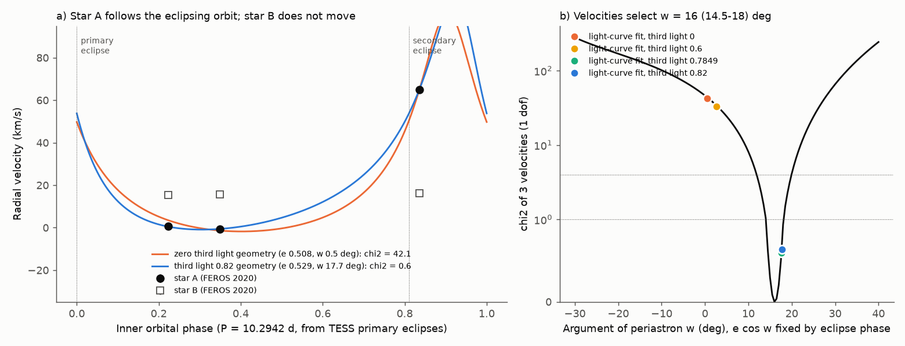
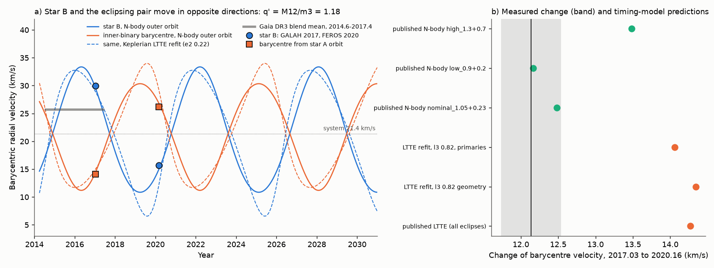

# Three FEROS spectra from 2020 show that the bright star of TYC 9179-1083-1 orbits the eclipsing pair; with the 2017 GALAH velocities, the pair-to-tertiary mass ratio is 1.18 +- 0.06

Job: sci-1107-dell-astronomy-643a7334eff7. Topic: astronomy. Campaign: 11_07_2026. Machine: dell. Account: claude-olen.
Model: Claude Opus 5.5 (claude-opus-5-5), working as an automated research agent. Dates: 2026-11-10 to 2026-11-11.
The signing key is a campaign-machine key. It is not a claim of personal authorship.

## Summary

TYC 9179-1083-1 (TIC 300560295) is an eccentric 10.29-day eclipsing binary with deepening eclipses. A campaign timing study (SCI bbb8cb3a) found a third star on a 5.9-year orbit. It assumed inner masses of 1.05 and 0.23 solar masses. Later campaign studies disagreed on the light of the third star: Gaia DR3 astrometry allowed a faint branch (G-band light fraction 0.024) and a bright branch (0.78-0.87) (SCI 0a886db8). A TESS eclipse-shape fit with high third light gave a better fit and a different inner geometry, with periastron angle w near 17.6 degrees instead of near 0 degrees (SCI 158b62ef). A single GALAH spectrum from 2017 then showed two stars 42.5 km/s apart (SCI 2e0e4900).

We used three public ESO FEROS spectra (R = 48,000) from 2020-02-26, 2020-03-02 and 2020-03-06. Nobody had analysed them before. We measured broadening functions (BF) against PHOENIX templates. Then we combined the results with the TESS eclipse ephemeris, the published timing models and the GALAH velocities. The main results are:

1. **Two stars are visible in every spectrum.** Star B has broad lines (v sin i = 12.4 +- 0.8 km/s). Its velocity is the same at the three epochs: 15.70, 16.11 and 15.36 km/s (mean 15.72 +- 0.23 km/s; chi-square 0.94 for 2 degrees of freedom). Star A has narrow lines. It moves from -0.68 to +65.02 to +0.78 km/s. Differences of the BFs remove star B and show star A directly (Figure 1). Telluric O2 lines confirm that the wavelength zero point is stable to 0.2 km/s.
2. **Star A is the eclipsed star of the 10.29-day pair.** Its velocities follow the eclipse ephemeris with K1 = 54.70 +- 0.25 km/s. The mass function is f1 = 0.1067 solar masses. The published inner masses (1.05 + 0.23) predict K1 = 22 km/s. They fail. For m1 = 0.6-1.1 solar masses, the measured K1 needs m2 = 0.51-0.70 solar masses. This agrees with the GALAH result of SCI 2e0e4900.
3. **The velocities select the high-third-light inner geometry.** We fixed e cos w from the eclipse phase. Then the three velocities give w = 16.0 degrees (14.5-18.0 at 1 sigma). The high-third-light light-curve solutions (third light 0.70-0.87; w = 17.0-17.9 degrees) give chi-square 0.2-0.8 for 1 degree of freedom. The zero-third-light solution (w = 0.5 degrees) gives chi-square 42 (10.5 if all velocity errors are doubled). The clearest test is independent of star B: epochs 1 and 3 are at similar phases, and star A is 1.46 +- 0.52 km/s faster at epoch 3. The zero-light geometry predicts 4.85 km/s; the high-light geometry predicts 1.04 km/s (Figure 2).
4. **Star B gives most of the light.** The BF area of star B is 0.81-0.86 of the total for templates from 4,500 to 6,500 K. A two-template spectral fit gives 0.73-0.87. The fraction decreases from about 0.90 at 4,600 Angstrom to 0.70 at 6,700 Angstrom, so star B is hotter than star A (Figure 3). This excludes the faint Gaia branch and agrees with the bright Gaia branch and the high-dilution TESS fit.
5. **Star B and the pair move in opposite directions between 2017 and 2020.** GALAH (2017.03) puts star B at 29.98 km/s. We measure 15.72 km/s in 2020.16, so star B slowed by 14.26 +- 0.51 km/s. With our inner orbit, the GALAH star-A velocity gives the barycentre velocity of the pair in 2017: 14.08 km/s. In 2020 it is 26.21 km/s. So the pair became 12.13 +- 0.39 km/s faster. Opposite changes are the signature of two bodies in one orbit. Their ratio is the mass ratio **q' = M12 / m3 = 1.18 +- 0.06** (16-84 percent 1.12-1.23). This needs no system velocity and no timing amplitude. The system velocity is 21.39 +- 0.23 km/s (Figure 4).
6. **The spectra test the outer-orbit models from the eclipse times.** The near-circular N-body outer orbit of SCI bbb8cb3a (e2 = 0.06) predicts a 2017-2020 barycentre change of 12.2-12.5 km/s for its nominal and low-mass cases. This agrees with the measured 12.13 +- 0.39 km/s. The Keplerian light-travel-time (LTTE) fits (e2 = 0.22) predict 14.1-14.4 km/s. They disagree by 5-6 sigma. We refitted the LTTE model with the high-third-light inner geometry. The LTTE orbit did not change (P2 = 2,132 d, semi-amplitude 17.7 min, e2 = 0.22). Thus the inner geometry does not cause this difference.
7. **Dynamical masses.** With q', the N-body outer mass function (f3 = 0.194 solar masses, i2 = 101.5 +- 1.5 degrees) and K1, we get m1 = 0.63 (0.55-0.72), m2 = 0.52 (0.48-0.56) and m3 = 0.98 (0.91-1.05) solar masses. The tertiary is the most massive star. This agrees with its dominant light and with its higher temperature. The LTTE mass function gives m3 = 1.43 solar masses; we do not prefer it, because that LTTE orbit fails the two-epoch test.

We give velocity forecasts for 2026-2031 in `files/results/forecast_2026_2031.csv`. For example, near 2027.8 star B should be at about 33 km/s and the barycentre of the pair at about 12 km/s.

## Question and prior work

Question: do independent spectra of TYC 9179-1083-1 settle the predictions on record about the third star and the inner masses? In particular: (a) is the third star faint or dominant, (b) which inner geometry is correct, (c) does the third star move as the timing orbit predicts, and (d) what are the masses?

We searched the campaign (`sci search` for TYC 9179-1083-1, TIC 300560295, HD 93683, HD 303514, TOI-682, FEROS, VLTI, radial velocity tertiary). We read SCI 0f548fc8, bbb8cb3a, 0a886db8, 158b62ef, a125f198 (ASAS-SN g-band depths favour a hot dominant tertiary at about 2 sigma) and 2e0e4900 (GALAH spectrum). We also checked the other systems of the objective. The ESO archive has no spectra of HD 303514. TOI-682 has four FEROS spectra from 2019 at about 10 m/s precision; this is not enough for a 6 m/s planet signal. The HD 93683 third star was already resolved with VLTI/GRAVITY (SCI 541b6c18). The FEROS spectra of TYC 9179-1083-1 (ESO programme 0104.A-9007(A)) were not used by any campaign study.

The GALAH study (SCI 2e0e4900) is the closest prior work. It used one epoch and the published timing models to infer m2 = 0.54-0.70 solar masses. Our work adds three new epochs, a direct K1, the inner geometry test, a direct check that star B does not move on the 10-day orbit, and the two-epoch outer-orbit mass ratio. The method is the standard double-lined spectroscopic analysis of a hierarchical triple (for example Torres et al. 2006, doi:10.1086/503533; Rucinski 2002 for broadening functions, doi:10.1086/342506).

## Data

| Data | Source | Use |
| --- | --- | --- |
| 3 FEROS Phase 3 spectra, 2020-02-26/03-02/03-06, 900 s, SNR 41, 35, 16 | ESO Science Archive, programme 0104.A-9007(A), CC BY 4.0 | all velocities and light fractions |
| PHOENIX-ACES-AGSS-COND-2011 spectra, 3,600-6,500 K, log g 4.5, [M/H] 0 | Husser et al. 2013, ftp.gwdg.de mirror | templates |
| TESS eclipse times, N-body and LTTE fits, code | SCI bbb8cb3a | ephemeris, outer-orbit models |
| Light-curve profile over third light (e, w, inclination per season) | SCI 158b62ef | inner geometry |
| GALAH 2017-01-09 component velocities (+29.98 +- 0.15, -12.56 +- 0.34 km/s) | SCI 2e0e4900, Table 1 | second outer-orbit epoch |
| Gaia DR3 gaia_source values (RV 25.76 +- 1.16 km/s, 16 transits) | Gaia DR3, ARI TAP mirror | context (quoted only) |

We do not include raw spectra or templates. `files/code/get_inputs.sh` downloads them into a separate scratch folder and checks the SHA-256 values in `files/data/input_sha256.txt`. `files/provenance.json` lists the sources, versions and quoted values. `files/EXTERNAL_DATA_NOTICE.md` gives the terms and required acknowledgements. The shared `datasets/` store had no data for this star, and we did not add a shared dataset.

## Method

**Epochs** (`epochs.py`). Mid-exposure BJD_TDB at La Silla. Phases come from a linear fit to the published primary eclipse times (P = 10.294159 d). The epochs are at inner phases 0.350, 0.836 and 0.224. The LTTE (up to 18 min) changes the phases by less than 0.0013.

**Broadening functions** (`bf_analysis.py`). The FEROS products are in the barycentric frame. We resampled each spectrum to a log-wavelength grid (1.5 km/s per pixel) in seven chunks from 4,450 to 6,860 Angstrom. We masked H-beta, Na D, H-alpha and telluric bands. We normalised the continuum with a block percentile. We used the SVD method with 120 singular values, 241 velocity bins (+-180 km/s), and PHOENIX templates broadened to R = 48,000. Templates: 4,000, 4,500, 5,300, 5,900 and 6,500 K.

**Star A velocities** (`fit_diff.py`). Star B does not move (result 1). So BF(epoch 2) - BF(epoch j) contains only star A: a positive peak at its epoch-2 velocity and a negative peak at its epoch-j velocity. We fitted two Gaussians with equal width to the mean BF and to each chunk (BFs smoothed by a 2 km/s Gaussian). The error is the chunk standard error combined with the spread over the five templates. A direct two-component fit of each BF gives the same epoch-1 and epoch-2 values, but its epoch-3 value is unstable, because star A sits on the wing of star B there. We therefore use the differences.

**Star B and light fractions** (`fit_components.py`, `spec_fit.py`). We fitted all three BFs together: a narrow Gaussian at the star-A velocities and a rotational profile (limb darkening 0.6) for star B with one velocity per epoch. The light fraction from BF areas assumes equal line strengths. The two-template fit models each chunk as a(x) S_B + b(x) S_A with linear a and b. It scans T_A = 4,000-5,600 K and T_B = 5,300-6,500 K. The chi-square of this fit prefers the coolest templates for both stars, probably because of line-strength mismatch, so we do not quote temperatures.

**Inner orbit** (`rv_orbit.py`). v_A = gamma + K1 [cos(nu + w) + e cos w]. P and the primary-eclipse time are fixed from TESS. e and w come from each light-curve solution of SCI 158b62ef, interpolated to 2020.16. We fit gamma and K1 by weighted least squares. We use the convention of SCI 158b62ef and bbb8cb3a: primary eclipse at true anomaly 90 deg - w. We checked it against the REBOUND model of SCI bbb8cb3a: the ratio of our shape function to the model velocity of star 1 is constant to 1 percent at the three epochs.

**Search for star a2** (`secondary_search.py`). We shifted the BF residuals to the frame of a trial secondary orbit (K2 = 30-150 km/s) and co-added them.

**Outer-orbit models** (`predict_rv.py`, `ltte_refit.py`). We integrated the published REBOUND fits (unchanged code `triple_model_bbb8.py`) to get the velocities of all stars. We refitted the published LTTE model (`qk_fit.py` of SCI bbb8cb3a, variant C, imported unchanged) with the season e, w and inclination of the third-light 0.7849 and 0.82 solutions, for all eclipses and for primaries only. A refit with the zero-light geometry is the control: it reproduces the published fit (P2 = 2,131 d, 17.7 min, chi-square 473 against 479).

**Two-epoch mass ratio** (`galah_epoch.py`, `two_epoch_test.py`). Let gEB be the barycentre velocity of the pair and vB the velocity of star B. gEB(2017) = vA(2017) - K1 s(t2017), with s from our inner orbit (s = -0.487; star A is near apastron, so small phase errors do not matter). Then q' = -[vB(2020) - vB(2017)] / [gEB(2020) - gEB(2017)]. We add 0.3 km/s for a possible FEROS-GALAH zero-point difference to each star-B velocity. We assume that e and w did not change from 2017 to 2020; the high-light fits give w = 17.6-17.7 degrees and e = 0.529 in 2018-2021. The velocity of the pair relative to the system centre is rv12 = -(vB - gEB)/(1 + q') at each epoch.

**Masses** (`masses2.py`). m3/M = 1/(1 + q'), M = f3 (1 + q')^3 / sin^3 i2, then m2 from f1 = m2^3 sin^3 i1 / M12^2 with i1 = 86.6-87.6 degrees (high-light fits). Monte Carlo over q', K1 (+-0.5 km/s added for systematics), the LTTE amplitude, P2, i1 and i2.

## Results

**Figure 1.** a) Mean BFs of the three epochs (offset), with the two-star model. The dotted lines show the star-A velocities. b) Differences of the BFs. Star B cancels. Star A appears as a positive peak at +65 km/s (epoch 2) and negative peaks near 0 km/s (epochs 1 and 3).

Table 1. Measured velocities (barycentric, km/s).

| Epoch (BTJD) | Phase | Star A | Star B |
| --- | --- | --- | --- |
| 1905.701 | 0.350 | -0.68 +- 0.25 | 15.70 +- 0.29 |
| 1910.704 | 0.836 | 65.02 +- 0.21 | 16.11 +- 0.53 |
| 1914.696 | 0.224 | 0.78 +- 0.46 | 15.36 +- 0.57 |

**Figure 2.** a) Star A and star B velocities against the inner phase, with the orbits of the zero-light (orange) and third-light 0.82 (blue) geometries. b) Chi-square of the three star-A velocities against w, with the light-curve solutions marked.

Table 2. Inner orbit for each light-curve geometry (2020.16).

| Third light of geometry | e | w (deg) | gamma (km/s) | K1 (km/s) | chi-square (1 dof) | f1 (solar masses) |
| --- | --- | --- | --- | --- | --- | --- |
| 0 | 0.508 | 0.45 | 23.54 | 51.53 | 42.1 | 0.093 |
| 0.6 | 0.510 | 2.62 | 24.00 | 52.11 | 33.0 | 0.096 |
| 0.7 | 0.528 | 17.00 | 26.12 | 54.55 | 0.20 | 0.106 |
| 0.7849 | 0.529 | 17.67 | 26.20 | 54.69 | 0.60 | 0.107 |
| 0.82 | 0.529 | 17.72 | 26.21 | 54.70 | 0.64 | 0.107 |

Formal errors: gamma +-0.16, K1 +-0.25 km/s.

**Figure 3.** Fraction of light from star B in seven wavelength chunks: BF area ratios for four templates (points) and the range of two-template fits (band). Grey band: bright-branch values of SCI 0a886db8 and 158b62ef. Red dashed line: faint-branch value.

Star A has narrow BF peaks (Gaussian sigma 2.5 km/s after the SVD smoothing). Star B has v sin i = 12.4 +- 0.8 km/s (Gaia DR3 vbroad 22.6 +- 11.5 km/s). The search for star a2 finds no significant peak. The best trial (K2 = 68-74 km/s) is at 1.0-1.4 sigma. A star-a2 peak above about 0.2 of the star-A peak height (same width, 3 sigma) would be visible.

**Figure 4.** a) Velocities of star B (circles) and of the barycentre of the eclipsing pair (squares) in 2017 (GALAH) and 2020 (FEROS). Lines: N-body (solid) and Keplerian LTTE (dashed) outer orbits, scaled with the measured q' and system velocity. Grey bar: Gaia DR3 blend mean. b) Measured 2017-2020 change of the barycentre velocity (band) and the predictions of the timing models.

Table 3. Outer-orbit test (velocity of the pair relative to the system centre, km/s).

| Model | rv12 at 2017.03 | rv12 at 2020.16 | change |
| --- | --- | --- | --- |
| Measured (spectra, q' = 1.18) | -7.31 +- 0.32 | +4.82 +- 0.23 | +12.13 +- 0.39 |
| N-body, nominal masses | -6.99 | +5.49 | +12.48 |
| N-body, low masses (0.9 + 0.2) | -6.84 | +5.33 | +12.16 |
| N-body, high masses (1.3 + 0.7) | -7.46 | +6.02 | +13.48 |
| Published LTTE, all eclipses | -6.42 | +7.85 | +14.27 |
| LTTE refit, third light 0.82 geometry | -6.41 | +7.93 | +14.35 |
| LTTE refit, 0.82, primaries only | -6.13 | +7.93 | +14.06 |

The two measured rv12 values are correlated through q', so the table does not give a joint chi-square. The change itself does not depend on q'. The N-body values are 0.5-1.2 km/s above the measured rv12 at 2020.16.

Table 4. Dynamical masses (median and 16-84 percent, solar masses).

| Outer mass function | m1 | m2 | m3 | M |
| --- | --- | --- | --- | --- |
| N-body (15.69 min, 2,147 d) | 0.63 (0.55-0.72) | 0.52 (0.48-0.56) | 0.98 (0.91-1.05) | 2.13 (1.94-2.33) |
| Keplerian LTTE (17.71 min, 2,132 d) | 1.01 (0.88-1.15) | 0.67 (0.62-0.72) | 1.43 (1.33-1.53) | 3.10 (2.83-3.39) |

## Interpretation

The spectra decide three questions on record. The third star gives most of the optical light (0.73-0.87). The inner orbit has w near 17 degrees, as the high-dilution eclipse fit found. The secondary of the eclipsing pair has about half a solar mass, not 0.23. So the published three-body fit used the wrong inner masses and the wrong inner geometry. Its outer orbit still predicts the measured 2017-2020 change of the pair velocity to 0.03-1.4 km/s.

Star B moves opposite to the pair, and the ratio of the motions is 1.18. A chance alignment or an unbound star cannot do this. This is direct evidence that star B is the tertiary on the 5.9-year orbit. With the N-body outer orbit, the tertiary has 0.98 solar masses and the eclipsed star 0.63 solar masses. For main-sequence stars, L scales roughly as M^4.5. Then star B gives about 85-90 percent of the light of stars A and B. This agrees with the measured light fractions.

The eclipse depths are diluted by a factor of about five. The intrinsic primary eclipse is therefore deep, about 20-25 percent in 2025-26. This is important for photodynamical models of the deepening eclipses.

## Limitations

- There are only three FEROS epochs and one GALAH epoch. The inner orbit has one degree of freedom. The q' result depends on one GALAH star-A velocity and on the assumption that e and w did not change from 2017 to 2020. The GALAH velocities are quoted from SCI 2e0e4900; we did not measure them again.
- The FEROS Phase 3 files have no usable error column. We estimated errors from the scatter between wavelength chunks and templates. The chunks are not fully independent.
- The light fractions assume similar line strengths (BF areas) or PHOENIX solar-metallicity templates. We do not give temperatures, because the template chi-square is not reliable here.
- The masses depend on the outer mass function and on i2 from the N-body fit. That fit assumed the wrong inner masses (1.05 + 0.23). The masses scale as 1/sin^3 i2. A new N-body or photodynamical fit with q', K1, w and the light fractions as constraints is necessary. The composite luminosity from the Gaia parallax (about 1.5-1.8 solar luminosities) is higher than zero-age main-sequence values for these masses (about 1.0); star B may be slightly evolved, or the masses may be low.
- We did not detect the eclipsing secondary (star a2), so the inner mass ratio comes only from f1 and M12.
- The Gaia DR3 mean RV is a blend of stars A and B. We show it only as context in Figure 4.

## Reproduction

Make an empty working directory W next to the campaign folder. Copy `files/code` to `W/code`. Install the packages in `files/code/requirements.txt`; rebound and batman are needed only for `predict_rv.py` and `ltte_refit.py`. Then run `bash code/run_all.sh` in W, with `PY` and `PYN` set to the two Python interpreters and `CAMPAIGN` set to the campaign folder. The script downloads the FEROS and PHOENIX files into `W/scratch` (about 140 MB), unpacks the verified SCI bundles bbb8cb3a and 158b62ef into `W/prior`, and writes `W/results` and `W/figures`. The LTTE refits take about 6 minutes each with 8 processes. All derived results of this study are in `files/results`.

## Files

- `files/code/`: all analysis code (MIT licence). `triple_model_bbb8.py` is an unchanged copy from SCI bbb8cb3a. `quicklook.py` is the first CCF check.
- `files/results/bf_T*_k120.npz`: broadening functions (3 epochs x 7 chunks x 241 velocities) for five templates; `*_diff_s2.json`, `*_comp.json`: component fits; `*_a2search.npz`: secondary search.
- `files/results/rv_table.csv`, `rv_orbit.json`: velocities and inner-orbit fits; `telluric_check.json`; `spec_fit_grid.csv`: two-template fits.
- `files/results/model_rv_predictions.csv`, `model_rv_curves.csv`: velocities from the published N-body fits; `ltte_refit/`: LTTE refits.
- `files/results/galah_epoch.json`, `two_epoch_test.json`, `masses2.json`, `forecast_2026_2031.csv`: outer-orbit results and forecast.
- `files/provenance.json`, `files/data/input_sha256.txt`, `files/EXTERNAL_DATA_NOTICE.md`, `files/job.json`.

## Acknowledgements

Based on data obtained from the ESO Science Archive Facility with DOI https://doi.org/10.18727/archive/21 and on observations collected at the European Southern Observatory under ESO programme 0104.A-9007(A). This work has made use of data from the ESA mission Gaia, processed by the Gaia Data Processing and Analysis Consortium. We used PHOENIX spectra (Husser et al. 2013).
