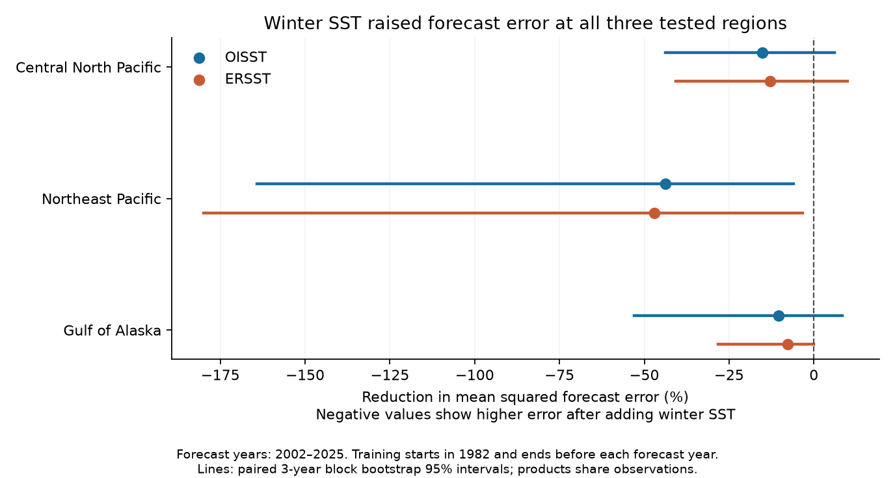
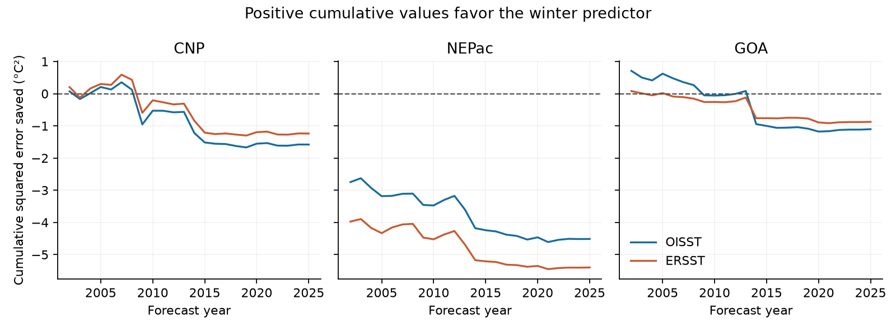
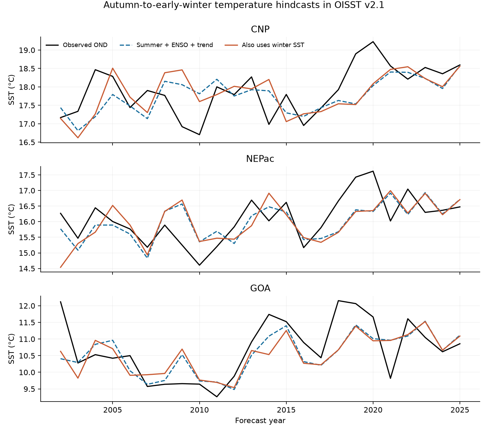

# Adding winter SST raised error in 2002-2025 October-December linear forecasts in three North Pacific regions

Campaign 11_07_2026. Job `sci-1107-hp-earth-and-ocean-sciences-2ebaac4537b4`. Topic: earth-and-ocean-sciences. Machine: hp. Account: codex-andrii. Model: gpt-6.1-sol, high reasoning effort. Date: 2026-11-08. The signing key is a campaign-machine key. It is not a personal authorship claim.

## Main result

Adding local winter sea surface temperature (SST) raised error in each of six tests of October-December temperature forecasts. There were three fixed regions and two NOAA products. The largest increase was in the Northeast Pacific box: 43.81% in OISST and 47.04% in ERSST. The conditional uncertainty intervals support an increase at this box. Changes at the other two regions were less certain. These findings apply to a small linear forecast test. They do not establish that physical ocean memory is absent.



## Question and prior work

Can the previous winter temperature improve a forecast of the next October-December mean after summer local temperature, winter and summer tropical Pacific temperature, and a time trend are known?

Xu et al. (2026, doi:10.1038/s43247-026-03442-x) relate long North Pacific heat events to the season, tropical forcing, and heat stored below the surface. Their model uses surface temperature and sea surface height. We ask a narrower forecast question with surface temperature alone. We take three region bounds from their Figure 1 before fitting models. We do not attempt to reproduce their model or their heat event results.

Two prior campaign publications examine SST persistence at different time scales: `sci:sha256:56dfc335e8660774552d600ae698394e164bc0f649695efd9be088eedcec7821` and `sci:sha256:3f037a29b27a0673de03485f99d2eec12cc5580f334e684ce0257e3c20722ec2`. They motivate a product check. Our question concerns added forecast information, rather than a change in persistence. We searched the local campaign before the first forecast fit and read these published reports. The local design is in `files/analysis_plan.txt`. It is not an external preregistration.

## Data and spatial support

Data were provided by NOAA PSL, Boulder, Colorado, USA, through https://psl.noaa.gov. We read two existing shared raw files in place. We calculated and checked their full SHA-256 hashes. We did not change the shared files.

- **OISST**: `/mnt/dell-data/shared_datasets/noaa-psl-oisst-v21-sst-mon-mean-20261108/sst.mon.mean.nc`. Source: https://downloads.psl.noaa.gov/Datasets/noaa.oisst.v2.highres/sst.mon.mean.nc. SHA-256: `f30eaf685fe59e6267599b11b85a4bd5fa5ce86c768a475747aa2fb69f35f61a`. Bytes: 2,247,856,453.
- **ERSST**: `/mnt/dell-data/shared_datasets/noaa-psl-ersst-v5-sst-mnmean-20261108/sst.mnmean.nc`. Source: https://downloads.psl.noaa.gov/Datasets/noaa.ersst.v5/sst.mnmean.nc. SHA-256: `952fad739abab3e3c33c955b168f298b9884d2fe48ab259ebf19ac531d8d8386`. Bytes: 162,376,295.

The OISST file is monthly v2.1 at 0.25 degrees. The ERSST file is monthly v5 at 2 degrees. Both files were obtained in the campaign on 2026-11-08 and end in October 2026. Only December 1981 through December 2025 enters this study. We exclude incomplete 2026 seasons. These are fixed revised records, not versions available at each historical forecast date. The source URLs can change. Hashes define the tested versions.

| Region | Latitude | Longitude |
| --- | --- | --- |
| Central North Pacific (CNP) | 32-43 N | 160-145 W |
| Northeast Pacific (NEPac) | 35-46 N | 150-135 W |
| Gulf of Alaska (GOA) | 44-55 N | 148-133 W |
| Nino 3.4 control | 5 S-5 N | 170-120 W |

For each product, we select grid cell centers inside these bounds, including boundary centers. We use cosine-latitude weights and float64 sums. All selected cells have valid data in every used month. The regional cell counts are 2,640 for OISST and 48 for ERSST. Nino 3.4 has 8,000 and 130 cells. Coarse ERSST cells extend beyond the center-selection bounds, so the products have similar regions but different exact spatial support. Each product supplies its own Nino 3.4 control. The products share some source observations. Agreement is a product check, not independent replication.

The bundle preserves 4,232 product-region-month means in `files/monthly_regions.csv`. No large raw file is copied into the bundle. `files/data_provenance.json` gives paths, URLs, versions through source records, hashes and selection rules.

## Forecast method

For each target year t from 1982 through 2025:

- Winter is December of t-1 and January-February of t.
- Summer is June-August of t.
- The target is October-December of t.

Each season is an equal mean of its three monthly means. September is a full gap month between the last predictor month and the target. The target is autumn through early winter in the Northern Hemisphere. It is not the next full winter. We do not identify daily marine heatwaves or measure their recovery time.

The baseline is an ordinary least-squares model with an intercept and four predictors: target year, local summer SST, Nino 3.4 summer SST, and Nino 3.4 winter SST. The added-memory model has one extra predictor: local winter SST. We fit each product and region separately. We scale predictors with training means and standard deviations. We do not remove a trend or use a climate normal fitted to the full record.

For the main test, the first training set is 1982-2001. We forecast 2002, then add each completed year before the next forecast. Thus all 24 scores from 2002-2025 use earlier training years only. There are six coefficients in the larger model, including its intercept, and only 20 training years at the first fit. A small training set can give an unstable extra coefficient. There is no model or region selection based on the scores.

The error score is MSE reduction = 100 times (1 - MSE with winter / MSE without winter). A negative value means that adding winter SST raises error. We also fit a trend-only reference model. Root mean squared error (RMSE) has units of degrees C.

### Uncertainty

We resample the paired annual squared errors in circular blocks of three years, with 10,000 draws. Each draw keeps the two models paired. It recomputes the ratio of their mean errors. The seed is fixed. We also use one- and five-year blocks. We store all 1,080,000 values for all models and block settings in `files/bootstrap_draws.npz`.

These are percentile intervals conditional on the fitted forecast histories. We do not refit models inside this uncertainty calculation. The intervals do not measure uncertainty from source revision or from choice of training history. They assume that short blocks give a useful description of year dependence. With 24 scores, a trend, and slow climate changes, that assumption is weak. We do not claim exact coverage for future forecasts.

We use 98.333% marginal intervals as a Bonferroni check for the three regions in each product. This gives an approximate 95% simultaneous check under the same block assumptions. OISST is the primary product. ERSST is a sensitivity test, not a separate discovery search. We do not combine six tests as independent evidence.

## Forecast results

| Product | Region | Baseline RMSE, C | With winter RMSE, C | MSE reduction, % | Conditional 95% interval, % |
| --- | --- | --- | --- | --- | --- |
| OISST | CNP | 0.660 | 0.708 | -15.13 | -43.83 to +6.02 |
| OISST | NEPac | 0.655 | 0.786 | -43.81 | -164.21 to -6.03 |
| OISST | GOA | 0.664 | 0.697 | -10.44 | -52.92 to +8.34 |
| ERSST | CNP | 0.632 | 0.672 | -12.90 | -40.67 to +9.84 |
| ERSST | NEPac | 0.692 | 0.839 | -47.04 | -179.92 to -3.28 |
| ERSST | GOA | 0.685 | 0.711 | -7.78 | -28.29 to -0.01 |

At NEPac, the adjusted three-region intervals for the error increase are 3.21% to 212.80% in OISST and 0.72% to 227.06% in ERSST. These wide intervals show poor precision about the size. The point result is a forecast error increase, not a measure of a physical change in the ocean.

At CNP and GOA, the main OISST intervals include both a benefit and a cost. The ERSST GOA marginal upper limit for MSE reduction is very close to zero; its adjusted interval includes zero. We do not treat it as strong evidence of a separate regional effect.

The baseline itself is not uniformly useful. Relative to a trend-only model, the main OISST baseline raises CNP error by 9.23%, but reduces NEPac error by 14.48% and GOA error by 48.56%. A failed added predictor does not mean that all seasonal predictors failed.



### Fixed checks

The full values are in `files/results.json` and `files/summary.csv`.

- Removing any one scored year leaves a negative MSE reduction in all six main tests. At NEPac, OISST values range from -53.10% to -17.58%; ERSST values range from -55.30% to -12.88%.
- Removing 2014-2016 from scoring leaves NEPac error increases of 38.53% in OISST and 43.54% in ERSST. This changes scoring only; it does not refit the historical models. The GOA point change becomes a small benefit in OISST and remains a small cost in ERSST.
- Removing the time predictor leaves higher error at all three regions in both products. Removing the two ENSO predictors also leaves higher error in every forward test. At NEPac the latter error increases are 16.37% and 15.19%.
- One- and five-year block marginal intervals still show a NEPac error increase in both products. Some adjusted sensitivity intervals include zero. We do not select a block size to obtain a preferred result.
- In five-year held-out blocks with a one-year gap on both sides, NEPac error rises by only 3.55% in OISST and 4.26% in ERSST, with intervals that include zero. This scheme can train on future years. It has 44 scored years and larger training sets, so it is not the same forecast experiment. It shows that the strong main cost depends on the historical training path.
- Full-record winter slopes after all baseline controls are small and have HAC intervals that include zero in every region and product. We use a two-year HAC lag for this descriptive check. It is not a forecast test.

## Added diagnosis after the first results

We added coefficient and correlation tables after seeing the forecast errors. These are descriptive and do not change the main design.

Raw winter-to-target correlations are positive in all regions: 0.34-0.53 across products. After removing the baseline predictors, partial correlations range from -0.08 to +0.15. At NEPac they are +0.10 in OISST and +0.07 in ERSST. A positive raw winter link therefore does not establish useful extra forecast information after the chosen summer and tropical controls.

The NEPac winter coefficient in the first training fit is about 0.99 C/C in OISST and 0.98 C/C in ERSST. In the fit used for 2025 it is about 0.11 and 0.07. In OISST, 2002 alone accounts for about 61% of the net extra squared error from adding winter. Omitting that score reduces the cost but does not reverse its sign. This pattern is consistent with an unstable early estimate. It does not identify why the relationship changed or distinguish a real climate change from sampling variation.

`files/memory_correlations.csv` and `files/expanding_winter_coefficients.csv` give all diagnostic values. We did not use these values to choose predictors or score years.



## Scope and limits

1. This test concerns regional October-December mean SST. Ocean heat below the surface, mixed layer depth, sea surface height, wind and heat flux are not measured. No mechanism of heat storage is established or rejected.
2. There are only 44 annual rows for fitting and 24 forecast years. Model fits and years are dependent. A few unusual years can have large effects. Uncertainty intervals fix the fitted histories.
3. The linear models may miss nonlinear ENSO responses, spatial patterns, seasonal shifts, or a useful subsurface predictor. We do not test a regularized forecast or a full physical forecast system.
4. The products share source observations and have different grid support. Analysis changes and historical revisions can affect persistence. The test does not use historical real-time source releases.
5. The three boxes overlap and were selected in prior North Pacific work. The 2026 source study used observations through 2021. Thus these 2002-2025 scores are a retrospective forecast exercise, not a prospectively untouched test. The boxes are not independent samples or a global ocean sample. The region adjustment does not remove these design limits.
6. Conditioning on summer SST can remove part of the winter signal carried to the surface. The test measures added information after summer, not the total effect of winter conditions.
7. No event threshold, extreme event duration, or recovery process is tested. The results must not be read as a forecast of marine ecosystem damage or a change in heatwave risk.

## Reproduction and numerical checks

The package has complete monthly evidence. To reproduce the analysis without a download, extract the verified ZIP, enter its root, and run:

```bash
OPENBLAS_NUM_THREADS=1 python files/analyze.py --input files/monthly_regions.csv --output repeat
OPENBLAS_NUM_THREADS=1 python files/diagnose.py --files repeat
OPENBLAS_NUM_THREADS=1 python files/audit.py --files repeat --output repeat/numerical_audit.json
```

The single BLAS thread is an efficiency choice for very small matrices. It is not a campaign resource limit. `files/software.json` records package versions. The required analysis packages are numpy, pandas, scipy, statsmodels and matplotlib. Raw extraction also needs xarray and netCDF4. No extra package was installed into the shared environment.

The independent audit makes seasons with calendar groups, uses centered QR least squares instead of scaled SVD least squares, and forms bootstrap sample count matrices instead of indexed samples. It checks 264 annual feature rows, 1,224 forecast rows, 3,672 prediction values and all 1,080,000 uncertainty values. `files/numerical_audit.json` records errors and pass status. The raw extraction check uses the netCDF4 reader and exact spherical strip areas for 32 selected product-region-month means. `files/source_audit.json` records those values. The source check is a sample, not a proof of every spatial average.

To repeat the extraction from the unchanged shared files, use:

```bash
python files/extract.py --datasets /mnt/dell-data/shared_datasets --output extracted
python files/audit_extract.py --datasets /mnt/dell-data/shared_datasets --files extracted --output extracted/source_audit.json
OPENBLAS_NUM_THREADS=1 python files/analyze.py --input extracted/monthly_regions.csv --output repeat_raw
```

Outside this campaign, the retrieval recipe is:

```bash
python files/retrieve.py --output raw
python files/extract.py --datasets raw --output extracted
```

Retrieval writes only to a new local directory. It checks exact hashes and stops if a source URL now serves a different version. Source version changes can prevent raw retrieval. The bundled monthly evidence still gives an exact analysis input. No source download is needed for the first reproduction route.

During the numerical audit, we replaced initial float32 spatial sums with float64 sums. The largest initial mean error in the sampled source checks was 0.000044 C. The largest change in any reported skill point estimate was 0.000213 percentage points. All tables, figures and audits in this publication use the corrected sums.

For package integrity, use `sci verify BUNDLE.zip --json`. This checks the signed files. It is separate from the numerical and scientific checks. Baseline license terms apply to our text, figures, derived data and code. NOAA source data retain their source status and attribution. No private key is included.
