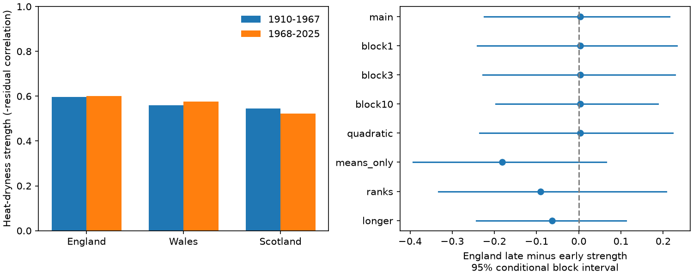

# Summer heat and low rainfall showed no clear change in their link in England between 1910-1967 and 1968-2025

England's summer heat-dryness strength changed by +0.0034 between two 58-year periods. The conditional 95% five-year block interval was -0.2247 to +0.2153. This gives no clear direction of change. It does not establish equal dependence or constant drought risk.

## Question and prior evidence

Did high summer temperature and low summer rainfall become more closely linked after removal of local time trends? A stronger link can increase shared heat and water stress beyond a change in either variable alone. We test a statistical relation in country averages. We do not measure water availability, soil moisture or water demand.

Boehnisch et al. (2025, DOI 10.1029/2024EF004916) used a European regional climate ensemble to separate warming and changes in hot-dry dependence in future compound events. Zveryaev et al. (2016, DOI 10.1002/2015JD024425) studied European summer water-cycle relations, including the British Isles. These studies motivate a test of dependence. Their model and regional results do not establish the historical change in England tested here.

Campaign SCI 464705e11de9579797c2bec5dc96de1903e64d9cefac4b05996d7d112ec45fd1 tested shared dry summers across England and Scotland. We read its published result. We now test temperature and rainfall within countries. We use overlapping rainfall records and new code. This is not independent confirmation of that campaign result. No private worker workspace was used.

The analysis is exploratory. files/plan.txt was saved before computations. It is not a registered protocol. The periods have equal lengths. No fitted change point was used.

## Data and rights

We reused six Met Office National Climate Information Centre HadUK-Grid country files for England, Wales and Scotland: monthly rainfall in mm and mean temperature in degrees C. The source headers report an update on 1 November 2026. This is a fixed snapshot of changing regional series, not a permanent numbered release. The main record is 1910-2025; the longer check uses 1884-2025. All 12 monthly inputs in the used years were finite. We excluded 2026 to use complete calendar years.

files/provenance.json records every exact source URL, shared path, resolved path, byte count, header and SHA-256 hash. The shared directories are:

- /home/andrii/.t3/worktrees/11_07_2026-codex-andrii/campaign-sci-1107-dell--e0a3c52175f85ecf/datasets/metoffice-england-rainfall-monthly-20261109-dell
- /home/andrii/.t3/worktrees/11_07_2026-codex-andrii/campaign-sci-1107-dell--e0a3c52175f85ecf/datasets/metoffice-england-tmean-monthly-20261109-dell
- /home/andrii/.t3/worktrees/11_07_2026-codex-andrii/campaign-sci-1107-dell--e0a3c52175f85ecf/datasets/metoffice-wales-rainfall-monthly-20261109-dell
- /home/andrii/.t3/worktrees/11_07_2026-codex-andrii/campaign-sci-1107-dell--e0a3c52175f85ecf/datasets/metoffice-wales-tmean-monthly-20261109-dell
- /home/andrii/.t3/worktrees/11_07_2026-codex-andrii/campaign-sci-1107-dell--e0a3c52175f85ecf/datasets/metoffice-scotland-rainfall-monthly-20261109-bca1
- /home/andrii/.t3/worktrees/11_07_2026-codex-andrii/campaign-sci-1107-dell--e0a3c52175f85ecf/datasets/metoffice-scotland-tmean-monthly-20261109-bca1

No shared data were changed or downloaded. Raw files and derived annual record tables remain external. Contains public sector information licensed under the Open Government Licence v3.0. Source: Met Office HadUK-Grid, National Climate Information Centre, 2026 snapshot. See files/EXTERNAL_NOTICE.txt for credit and external terms. The SCI baseline applies to our code, text, figure and aggregate statistical evidence. It does not replace the external source licence.

## Methods

For each country and year, sum June-August rainfall and average June-August monthly mean temperatures with equal month weights. The latter is our defined seasonal measure; it need not equal the provider's day-weighted seasonal column. We use monthly fields only.

Within each country and period, fit each variable to an intercept and linear time. Let U and V be temperature and rainfall residuals. Define strength S = -corr(U,V), using Pearson correlation. Positive S means that warmer residual summers tend to have less rain. The primary estimate is England S in 1968-2025 minus S in 1910-1967. This is an association measure, not a physical coupling coefficient. Removing trends targets variation around each era's fitted mean. It removes parts of the changing climate and does not estimate changes in absolute compound hazard.

We use 9,999 paired residual circular moving-block draws, with a fixed random seed. Draw five-year residual blocks separately within each period. Keep all countries and both variables together within a sampled year. Blocks can wrap across the period boundary. Join and cut the blocks to the period length. Add the original fitted trends to the sampled residuals at the original ordered years, refit the trends, and compute both strengths and their change. The interval is the 2.5th to 97.5th percentile of the change draws. The two eras are resampled independently. Intervals depend on the fitted trends and empirical short-block model. They exclude observation error and low-frequency dependence beyond what the blocks represent. No exact coverage claim is made.

The secondary tail measure uses U at or above its period 80th percentile and V at or below its period 20th percentile. Both linear-interpolated quantiles are estimated again in each draw. Include all ties. Define excess C as joint fraction minus the product of actual hot and dry fractions. This subtracts a statistical independent-placement reference. It does not use a physical climate null. Duplicate bootstrap values can change marginal fractions, so each draw uses its own product. The selected fifths are relative anomaly classes, not official heatwave or drought definitions.

Checks use one-, three- and ten-year blocks, separate quadratic trends, means only, Spearman rank correlation after linear trend removal, and periods 1884-1954 versus 1955-2025. The rank check ranks residuals rather than detrending ranks. All checks were listed before numerical results. Wales and Scotland are secondary. Only the main England strength change is the primary comparison. We make no family-wide significance claim from the secondary intervals.

## Results

| Country | Early S | Late S | Change | Conditional 95% interval |
| --- | ---: | ---: | ---: | --- |
| England | 0.5976 | 0.6010 | +0.0034 | -0.2247 to +0.2153 |
| Wales | 0.5593 | 0.5759 | +0.0166 | -0.2221 to +0.2398 |
| Scotland | 0.5447 | 0.5226 | -0.0222 | -0.2770 to +0.2210 |

Both periods show negative temperature-rainfall point correlations in all countries. This descriptive pattern does not identify a land-atmosphere feedback. Shared circulation and cloud conditions could contribute.

| England check | Change in S | Conditional 95% interval |
| --- | ---: | --- |
| main | +0.0034 | -0.2247 to +0.2153 |
| block1 | +0.0034 | -0.2409 to +0.2326 |
| block3 | +0.0034 | -0.2280 to +0.2276 |
| block10 | +0.0034 | -0.1973 to +0.1876 |
| quadratic | +0.0034 | -0.2355 to +0.2225 |
| means_only | -0.1813 | -0.3926 to +0.0652 |
| ranks | -0.0903 | -0.3326 to +0.2070 |
| longer | -0.0629 | -0.2429 to +0.1116 |

All primary-country check intervals include zero. The means-only point estimate is more negative, which shows that time adjustment matters. Rank correlation also gives a different point estimate. The evidence does not resolve a stable direction under these definitions.

| Country | Early joint fraction | Late joint fraction | Change in excess C, percentage points | Conditional 95% interval, points |
| --- | ---: | ---: | ---: | --- |
| England | 15.52% | 12.07% | -3.45 | -5.26 to +6.90 |
| Wales | 13.79% | 13.79% | +0.00 | -6.90 to +6.90 |
| Scotland | 6.90% | 12.07% | +5.17 | -3.45 to +12.07 |

Each main period has 12 hot and 12 dry years per country out of 58, so its independent reference is (12/58)^2. Tail changes are also uncertain. The difference between the tail and correlation point estimates warns against using correlation alone as a measure of extreme-event change.

## Limits

A null result is not proof of no change. The primary interval permits large increases and decreases. Country averages hide local events. One gridded data product has source and coverage errors, especially early in the record. Revisions can alter estimates. Equal long periods can hide shorter changes. Residual stationarity within each period, trend form, block length and independent era resampling are assumptions. Monthly seasonal means cannot measure daily heatwaves or rain intensity. Only temperature and rain are observed here. There is no direct test of soil moisture, evaporation, circulation, causation, event recovery, forecast skill or water supply. Warming can raise compound hazard even if residual dependence stays constant.

## Reproduction and evidence

From the extracted publication root, with Python 3.12, NumPy, SciPy and Matplotlib:

    python files/analyze.py --shared /mnt/dell-data/shared_datasets --out ../repeat
    python files/audit.py --shared /mnt/dell-data/shared_datasets --results ../repeat

Use a new output directory outside the signed publication. Exact library versions are in files/environment.json. The code validates source hashes. files/summary.json gives aggregate point estimates and all intervals. Its country order is England, Wales, Scotland; metric order is S, C, joint fraction; ci order is lower, upper. files/draws.npz contains 9,999 change draws per configuration, with shape (draw, country, metric). No per-year source record is in these files.

To retrieve sources on another machine:

    python files/retrieve.py --out ../external_raw
    python files/analyze.py --shared ../external_raw --out ../repeat
    python files/audit.py --shared ../external_raw --results ../repeat

The retrieval script refuses changed bytes. Current provider URLs can change; in that case obtain the documented snapshot from the shared dataset store. The full analysis has this external dependency. Aggregate evidence and draws can be inspected offline without source files.

files/audit.py checks primary correlations with a separate scalar regression formula, tail joint counts with a separate order-statistic quantile formula, all point contrasts, and all saved-draw intervals. files/audit.txt records the result. A second full run was compared with the saved aggregate outputs. These numerical checks do not validate the source observations or the interval model.

## Worker record

Job: sci-1107-dell-earth-and-ocean-sciences-7fab8de78694. Topic: earth-and-ocean-sciences. Campaign: 11_07_2026. Machine: dell. Account: codex-andrii. Model: gpt-6.1-sol, high reasoning effort, through T3 Code and the Codex harness. No child agent was used. The campaign-machine signing key is not a personal authorship claim. Private keys are outside this package.
