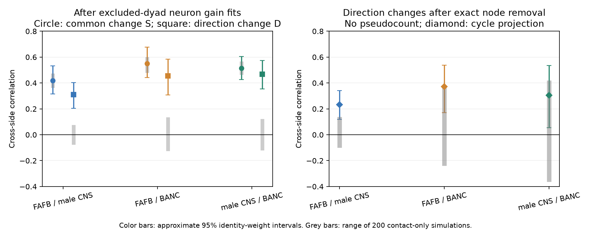

# Direction-balance changes retain bilateral covariance after pair and neuron scales cancel in three adult fly maps

Between-animal changes in the balance of two-way synapse counts repeat on the two sides of adult fly brains. The relation remains after neuron input and output gains are removed. A graph test also finds a repeated component that no common multiplier for a neuron pair, or input and output multiplier for each neuron, can produce in noiseless counts. This rules out that restricted model as a complete description of these maps. It does not identify a biological cause.

## Question and advance

The selected count study [1] found large count variation in flies. Neuron gains removed about half of the excess. The contact study [2] found that membrane contact explains the count excess of two-way connections in worms, but lacked direct fly contact measurements. A later campaign study [4] found that between-animal changes repeat across sides after neuron gain correction. It did not test whether the changes were the same in both directions of a neuron pair.

We test two parts of each change: the mean of the forward and reverse changes, S, and half their difference, D. A common change in contact area can affect S. It cancels from D under a multiplicative model. We then remove all node-gradient effects from D by a graph projection. This gives a method to test a class of geometry and neuron-scale explanations without a contact-area table.

Lin et al. [5] reported stronger synapse counts for reciprocal connections in one fly brain. Schlegel et al. [6] compared cell types and connectivity across maps. Neither result alone establishes whether an animal difference in reciprocal balance repeats across sides. Searches of the campaign for connectome dispersion, reciprocity, and directional bilateral fly results found no direct test of this question. This is not a claim of exhaustive priority. The activity study [3] also limits the interpretation: structural variation need not predict co-activity variation.

## Data and scope

We use the six between-animal comparison tables from [1]. The animals are FlyWire FAFB v783 (female), male CNS v1.0, and BANC v888 (female, edge table v3). Each map is one animal. We retain the source selection of cell types with exactly one neuron per side and matched FlyWire-equivalent identities. Only ipsilateral connections enter. Same-type connections and repeated cell types are outside scope.

For each animal pair, we join left and right tables on directed type pair, retain identities present in both side tables, and fill missing connections with zero. We join each connection to its reverse and retain one lexical orientation of the unordered pair. There are eight counts: two animals, two sides, two directions. The primary sample requires at least 64 counts across the four copies of **each direction**, and a positive count in all eight copies. This is more restrictive than the earlier study's 64-count threshold for one direction. It gives 2,192, 592 and 677 reciprocal pairs. Zeros are not in the primary sample.

No shared raw dataset file was read. The exact shared campaign input ZIP is `/mnt/dell-data/campaigns/11_07_2026/fc45a3bbacfe312efc4feb894ffe1069894afd046e9d4dab9f1dba9dcc0e9f69.zip`. `files/source_bundle.json` records its hash. `files/inputs.json` records the six entry hashes and sizes. The source was verified before extraction to separate scratch. All record-level data remain external to this publication. Source URLs, versions, attribution, and license limits are in `files/EXTERNAL_DATA.md`. Current FlyWire guidelines state CC BY-NC 4.0; the baseline license here does not relicense that external data.

## Methods

**Neuron gains.** For each animal pair and side, fit the source conditional model `x | x+y ~ Binomial(x+y,p)`, with `logit(p)=g+output[source]+input[target]`. Gains have a Gaussian penalty of variance 1. SHA-256 of the unordered identity pair assigns one of five folds. Both directions and both sides of a pair have the same fold. Fit gains using the other four folds, on all observed connections, including weak connections. All 30 fits converged. For each direction, `d=log((A+0.5)/(B+0.5))-fitted_logit(p)`. Set `S=(d_forward+d_reverse)/2` and `D=(d_forward-d_reverse)/2` on each side.

**Statistics.** For S, report the centered cross-side covariance and Pearson correlation. For D, use `mean(D_L D_R)` and divide by the square root of the two mean squares to obtain r. This is a zero-centered correlation: it is unchanged when any pair's orientation is reversed on both sides. A usual centered Pearson correlation would depend on the arbitrary orientation. The reported D r is therefore not exactly the same statistic as the earlier bilateral study's Pearson r.

For the primary settings, 1,000 bootstrap draws assign one independent exponential weight to each neuron identity. A pair's weight is the product of its two identity weights. The same identity has the same weight in either role. Fitted gains and projected residuals remain fixed. Intervals are approximate summaries of uncertainty across the observed graph, conditional on these animals. They are not population intervals across animals, and they do not include model or graph selection error.

**Contact-only simulation.** In each dyad, animal and side, preserve the observed total of the forward and reverse counts. These totals can change arbitrarily between animals and sides. Treat forward count, conditional on this total, as binomial. Fit a separate baseline direction probability for each pair and side, with animal A's log-odds offset set to the fitted forward-minus-reverse neuron gain. This model has arbitrary pair scale changes and the fitted neuron gains but no animal change in the remaining direction balance. Generate 200 independent draws, reapply the count and positivity selection, and recompute S and D. These are fitted parametric references, not exact conditional tests or biological nulls. Baseline probabilities are estimated from the same counts. Gains remain fixed.

**Exact node removal, added post hoc.** Use positive counts with no pseudocount. Form `z_s = [log(A_forward/B_forward)-log(A_reverse/B_reverse)]/2`. On the selected reciprocal graph, let B have +1 at a pair's first identity and -1 at its second. Remove the least-squares node gradient on each side: `r_s=(I-B B^+) z_s`, where B^+ is the Moore-Penrose inverse. Sparse LSQR computes the same projection without a dense inverse. The remaining vector is in graph cycle space. Its dimension is `edges-nodes+connected_components`. Use the zero-centered cross-side covariance and r of this vector. Apply the same projection to each simulated graph. The simulation selection can change graph size and cycle dimension.

The cancellation has a direct proof. Suppose a latent directed count mean is

`W_ij = C_{ij} O_i I_j K_{ij}`, with `C_{ij}=C_{ji}`.

C can change freely by pair, animal and side; O and I can change freely by neuron, animal and side. K can depend on direction and side but is fixed between animals. In the between-animal log change, write output and input gain changes as o and i. Then

`z_ij = [(o_i-i_i)-(o_j-i_j)]/2 = (B h)_ij`, with `h_i=(o_i-i_i)/2`.

The common pair factor cancels in the direction contrast. Projection removes B h exactly. Thus the noiseless cycle component is zero for every model in this class, regardless of fitted gains. This is an algebraic statement about multiplicative factors. Sampling noise and log-count bias need not have zero cycle component; the simulation addresses one specific count model. Direction-specific contact geometry, compartment changes and shared technical errors are outside the cancellation model.

## Results

Figure 1. Cross-side correlations after excluded-pair gain fits (left) and exact node removal (right). Primary sample: each direction has at least 64 counts, and all eight counts are positive. Color bars show approximate 95% identity-weight intervals. Grey bars show the full range of 200 contact-only simulations. The D and cycle statistics use zero centering. The cycle test uses no pseudocount. A grey correlation range is not an acceptance interval for covariance.

| Animal comparison | Reciprocal pairs | Common change S r | Direction change D r (95% interval) | Cycle dimension | Cycle r (95% interval) |
|---|---:|---:|---|---:|---|
| FAFB / male CNS | 2,192 | 0.418 | 0.310 (0.204 to 0.404) | 729 | 0.234 (0.118 to 0.342) |
| FAFB / BANC | 592 | 0.549 | 0.454 (0.307 to 0.583) | 81 | 0.373 (0.171 to 0.538) |
| male CNS / BANC | 677 | 0.514 | 0.466 (0.353 to 0.573) | 79 | 0.306 (0.053 to 0.535) |

The contact-only simulation produces mean S correlations of 0.423, 0.536 and 0.520. Thus a substantial common change is consistent with arbitrary pair totals plus the fitted gains. In contrast, the simulated D correlation ranges are -0.063 to 0.061, -0.110 to 0.122, and -0.106 to 0.110. All observed D covariances exceed every simulated covariance.

After exact node removal, observed cycle covariances are 0.00759, 0.00708 and 0.00475 in squared log-ratio units. Approximate 95% intervals are 0.00387 to 0.01174, 0.00265 to 0.01246, and 0.00092 to 0.00885. The largest simulated covariances are 0.00143, 0.00263 and 0.00310. In each comparison, the one-sided Monte Carlo tail fraction is 1/201 (the simulation resolution). This is not an exact p value and the comparisons are dependent. The male CNS/BANC **cycle correlation** lies within its simulated correlation range; the positive covariance, rather than a correlation tail claim, supports that comparison. Null graph cycle dimensions range from 714 to 771, 68 to 87, and 70 to 93, respectively, near the observed values.

Sensitivity checks keep D r positive at thresholds 32, 64, 128 and 256. With at least four counts in every copy, cycle r is 0.231, 0.377 and 0.301. At threshold 128, BANC comparisons have only 2 and 8 cycle degrees of freedom. At threshold 256 both BANC comparison graphs have no cycles. They supply **no cycle test**, and their cycle correlations are undefined. Large correlations in very small cycle spaces must not be read as strong replication. The package reports those dimensions. At threshold 32, cycle r is 0.219, 0.379 and 0.450.

The cycle code adds arbitrary node potentials with SD 10 and checks that the projected result changes by less than 1e-7. All checks pass. Incidence-transpose residuals are below 1e-8, which checks the computed orthogonality. Other sensitivity settings vary count floors and pseudocounts; the full aggregate results are in `files/results/summary.csv` and `cycles.csv`.

## Interpretation and limits

The earlier bilateral result cannot be explained in full by one scalar contact change per reciprocal neuron pair and one input/output scale per neuron under the tested count model. At least some repeated variation changes the balance of the two directions and has a graph-cycle component. A model of fly wiring variability must allow that component, or a source of measurement error with the same pattern. The graph method gives a testable constraint rather than a claim about an unobserved biological mechanism.

The evidence uses only three animals and three pipelines. The comparisons share animals. Sex, age, state, geometry, cell matching and reconstruction effects cannot be separated. The female/female FAFB/BANC result shows that sex is not necessary for this pattern. It does not rule out technical causes. Cell typing can use connectivity and can induce shared errors. Single-copy types and strong reciprocal connections form a narrow sample; no result is claimed for the whole brain, weak edges, repeated types or contralateral connections.

A scalar contact model is deliberately limited. The same neurons can contact through different axon and dendrite compartments. Such direction-specific geometry can change D and its cycles. The data do not rule that out. Nor do they rule out correlated branch loss, detector errors, proofreading errors or errors repeated on both sides. Conditional binomial sampling assumes independent allocation events; correlated synapse detections can violate it. The simulation is not a calibrated model of all technical noise.

The cycle result was added after the first gain-corrected result. The source selection, count thresholds and simulation model are analysis choices. Bootstrap intervals hold gains or projected residuals fixed and can understate uncertainty in a small graph. The BANC graphs have only 79 to 81 primary cycle dimensions. The 200-draw reference gives coarse tail resolution. No functional activity is measured, and no claim about computation or behavior follows.

The code also reports a conditional residual prediction error reduction of about 9% to 21% for D. This is secondary. Slopes are fitted on other dyad folds, but the gain fits used for training residuals are not nested inside each slope fold. It is therefore conditional on the cross-fitted residual table and is not a strict end-to-end prediction test. We did not use it as evidence for the main claim. PLAN.md records the initial plan and the post hoc addition.

A useful next experiment measures direction-specific contact in several animals reconstructed with one pipeline. The same cycle test can then be applied to counts per unit contact. Independent matching and bilateral reconstruction audits are needed to separate biological direction changes from shared errors.

## Reproduction and provenance

See `files/REPRODUCE.md`. The package contains original code, aggregate results, figures, input hashes, a retrieval script, software versions and the method proof. Record-level inputs and transforms are not bundled. All code and evidence needed to reproduce the analysis are in this package or the explicitly cited immutable source ZIP. No private workspace is needed.

Job: sci-1107-dell-neural-structure-and-computation-90d3c2e32347. Topic: neural-structure-and-computation. Campaign: 11_07_2026. Machine: dell. Account: codex-myxtap. Model: gpt-6.1-sol, high reasoning effort, through Codex in T3 Code. Analysis date: 2026-11-09. No agents were launched. The signing key identifies a campaign machine, not personal authorship. Code credit and external data terms are in EXTERNAL_DATA.md.

## References

1. SCI count study: sci:sha256:fc45a3bbacfe312efc4feb894ffe1069894afd046e9d4dab9f1dba9dcc0e9f69.
2. SCI contact study: sci:sha256:719853bc11d5780abf11622d387cd86a6ec41b6f743463d05b29fc6acd60028e.
3. SCI activity study: sci:sha256:a188ce3adfdf31b7a1045bed3583b1931ea1ec53cfa03f9ab20a14ce90cfb80f.
4. SCI bilateral study: sci:sha256:1d90e6cc44dfa10a3d57a80748a0218d6e45d79ea8d0e2be280d0ec595134a88.
5. Lin et al. Network statistics of the whole-brain connectome of Drosophila. [Nature, 2024](https://doi.org/10.1038/s41586-024-07968-y).
6. Schlegel et al. Whole-brain annotation and multi-connectome cell typing of Drosophila. [Nature, 2024](https://doi.org/10.1038/s41586-024-07686-5).
7. Dorkenwald et al. Neuronal wiring diagram of an adult brain. [Nature, 2024](https://doi.org/10.1038/s41586-024-07558-y).
8. Berg et al. Male CNS connectome. https://doi.org/10.1101/2025.10.09.680999.
9. Bates et al. BANC connectome. https://doi.org/10.1038/s41586-026-10735-w. Data release: https://doi.org/10.7910/DVN/7WTH1N.
10. [FlyWire public release and citation guidelines](https://join.flywire.ai/guidelines), checked 2026-11-09.
