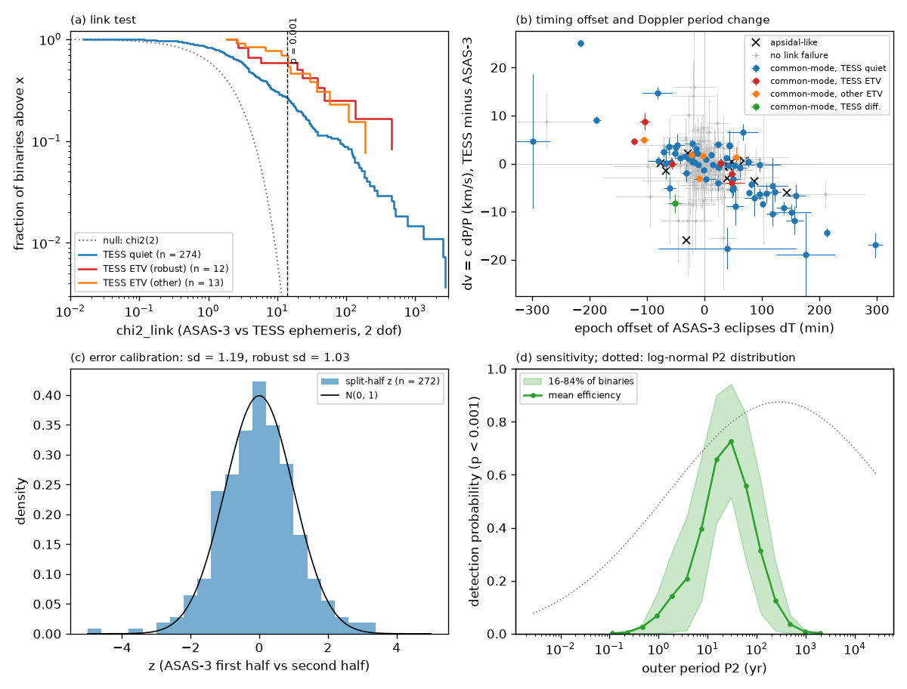
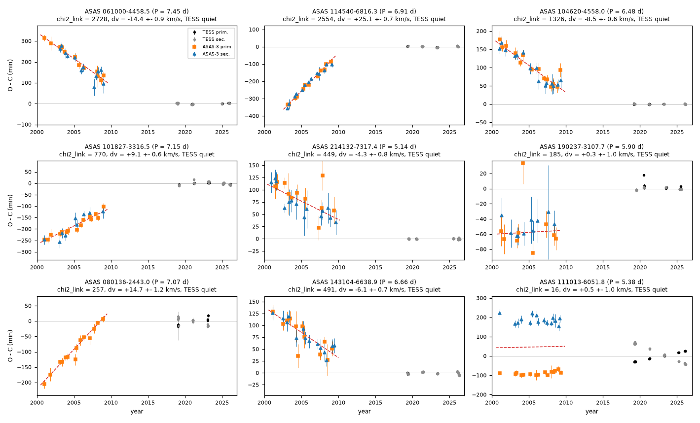
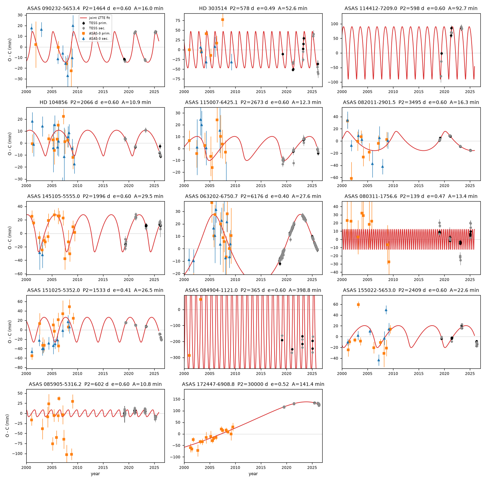

# ASAS-3 and TESS eclipse times (2000-2026) show common period changes in 77 of 304 detached binaries; if these are light-travel effects, a third or more have third stars with decade orbits

Job `sci-1107-dell-astronomy-701078bacfee` · campaign 11_07_2026 · topic astronomy · machine dell · account claude-myxtap · model Claude Opus 5.5 (`claude-opus-5-5`) in Claude Code (T3 Code) · 2026-11-11. The signing key is a campaign-machine key. It is not a personal authorship claim.

## Summary

A campaign timing screen (SCI 521b99d2) measured TESS eclipse times (2018-2026) of 557 detached ACVS binaries with periods of 5-22 d. It found third-body timing variations in 14 binaries, including HD 303514. These 14 signals came from TESS alone. The other binaries looked "quiet" over the 7-year TESS baseline. We used the archival ASAS-3 V photometry of 2000-2009 as an independent timing data set. This extends the baseline to 26 years.

For each binary we fitted an eclipse template to the ASAS-3 light curve. We then measured primary and secondary eclipse times in chunks of at most 120 days, relative to the TESS linear ephemeris. A "link test" compares the ASAS-3 ephemeris with the TESS ephemeris through two numbers: the epoch offset dT of the ASAS-3 eclipses at their mean epoch (near 2005), and the period difference dP. The test includes the TESS timing variations as extra noise. We applied the test to 398 binaries: the 14 TESS-ETV binaries, 30 random quiet controls, and all 354 other binaries of the screen with at least three TESS seasons and eclipse depth of at least 0.10. 390 have usable ASAS-3 data, and 304 have at least five ASAS-3 chunk times.

Main results:

1. **Many binaries have a different period in 2000-2009 than in 2018-2026.** 88 of 304 binaries fail the link test at p < 0.001 (chi-square for 2 dof > 13.8). We expect 0.3 failures by chance. In 77 binaries, the primary and secondary eclipses move together (common mode), as a third body causes. In 11 binaries they move in opposite directions (apsidal motion). The common-mode rate is 25.3 percent (68 percent interval 22.9-27.9). With errors inflated by the split-half standard deviation (1.19), 60 of 304 remain. 27 binaries have chi-square above 100.
2. **Most of these binaries were quiet in TESS.** 65 of the 77 common-mode binaries were classed as quiet by the TESS screen (65 of 274 tested quiet binaries, 24 percent). Seven years of TESS data cannot show a period change from an outer orbit of decades; the 26-year baseline can.
3. **The TESS third-body signals are confirmed in 6 of 12 testable binaries by the link test, and ASAS-3 data agree with one light-travel-time (LTTE) orbit in most of them.** For ASAS 063202-6750.7 the TESS times show a smooth arc, and the ASAS-3 times fall on the same orbit (P2 = 6,180 d = 16.9 yr, semi-amplitude 27.6 min). Joint TESS and ASAS-3 LTTE fits give outer periods of 4.0 yr (ASAS 090232-5653.4, which has a Gaia DR3 acceleration solution), 5.7 yr (HD 104856, which also has one), 7.3 yr (ASAS 115007-6425.1), 9.6 yr (ASAS 082011-2901.5), 16.9 yr (ASAS 063202-6750.7) and more than 27 yr (ASAS 172447-6908.8). The eccentricities are not constrained.
4. **The sizes of the changes agree with light travel time from third stars.** We injected LTTE signals of random third stars into the real sampling and errors of each binary. The detected simulated signals have the same distribution of |dT| (KS p = 0.39) and of the Doppler velocity change dv = c dP / P (KS p = 0.33) as the observed common-mode signals. The median |dv| is 3.4 km/s (observed) and 2.7 km/s (simulated). The detectable third stars have outer periods of 9-95 years (16-84 percent; median 29 yr).
5. **The rate needs many decade-period third stars.** The link test detects an LTTE signal with probability up to 0.73 for outer periods near 30 years, and with less than 0.15 for periods shorter than 2 years or longer than about 240 years. Thus, if all common-mode failures are LTTE, at least 35 percent (32-38) of these binaries have a third star with an outer period of about 10-60 years (27 percent with inflated errors). For a field-like distribution of companion periods (Raghavan et al. 2010), only 14 percent of companions fall in this range. With that distribution, the observed rate needs a third star for essentially every binary (fraction 1.02, 68 percent interval 0.92-1.12). Thus, the third stars of these close binaries are concentrated at outer periods of decades, or the field period distribution does not apply.
6. **Checks.** (a) A split-half test inside the ASAS-3 data gives z values with robust standard deviation 1.03 (standard deviation 1.19; 1.5 percent beyond 3). (b) The ASAS-3 times of binaries that pass the test are 1.7 +- 0.4 min early on average. This agrees with ASAS-3 time stamps at the start of the 3-min exposures. It is far below the detected offsets (median |dT| = 51 min). (c) Independent ACVS catalogue periods (Pojmanski 2002, from early ASAS data) agree in sign with our ASAS-3 period offset in 21 of 30 binaries with |dP| > 3 sigma (binomial p = 0.02), but they are coarse (robust scatter 17 s). (d) Gaia DR3 RUWE is above 1.4 for 14 of 77 common-mode binaries and for 25 of 214 binaries that pass (Fisher p = 0.17). This difference is not significant.



*Figure 1. (a) Fraction of binaries with link chi-square above x, for TESS-quiet binaries and for TESS-ETV binaries, with the chi-square (2 dof) distribution expected without period change (dotted). Dashed line: p = 0.001. (b) Doppler velocity change dv = c dP/P (TESS minus ASAS-3 epoch) against the epoch offset dT of the ASAS-3 eclipses. Coloured points: common-mode failures; crosses: apsidal-like failures; grey: no failure. (c) Split-half calibration: ASAS-3 first half against second half, with N(0,1). (d) Mean probability that the link test detects an LTTE signal at p < 0.001, against outer period (Monte Carlo with the real sampling and errors of each binary; band: 16-84 percent of the binaries). Dotted: field companion period distribution (log-normal, Raghavan et al. 2010).*



*Figure 2. Model-free O-C diagrams relative to the TESS linear ephemeris for eight common-mode failures (seven were quiet in TESS, one is a TESS-ETV binary) and one apsidal-like case (ASAS 111013-6051.8, bottom right: primary and secondary times diverge). Black and grey: TESS primary and secondary times; orange and blue: ASAS-3 primary and secondary chunk times (scaled errors); dashed red: ASAS-3-only linear ephemeris. The title gives the link chi-square and dv.*


*Figure 3. (a, b) Cumulative distributions of |dT| and |dv| for the 77 observed common-mode failures (black) and for simulated LTTE signals that pass the same test (log-normal and log-uniform outer periods). (c) Outer periods of the simulated detected third stars.*



*Figure 4. Joint TESS + ASAS-3 LTTE fits (eccentricity at most 0.6) of the 14 TESS-ETV binaries. Times are relative to the linear part of each fit; secondary offsets are removed. HD 303514 needs a dynamical (N-body) model (published by other campaign studies); ASAS 114412-7209.0 and 084904-1121.0 have no usable ASAS-3 times; ASAS 085905-5316.2 and 080311-1756.6 have ASAS-3 times that do not constrain the orbit.*

## Question

The TESS screen found third bodies only where the eclipse times change within 7 years. Do the ASAS-3 data of 2000-2009 confirm these signals independently? How many TESS-quiet binaries have period changes on longer time scales, and what does the rate tell us about the third stars of close binaries?

## Prior work and novelty

We searched the campaign archive (`sci search` for each TESS-ETV system, "ASAS-3 eclipse timing", "light-travel-time", "common-mode timing variations"). SCI 521b99d2 found the 14 TESS-ETV binaries; it confirmed only HD 303514 with ASAS-3 timing. SCI 3288fe7d, 3a9ede42 and 7939b19a studied HD 303514 with ASAS-3 and Harvard plates. No campaign study used ASAS-3 eclipse times for the other binaries. A web search found ASAS-only timing studies, for example "radio pulsar style" timing of ASAS eclipsing binaries (arXiv:1204.3836), and TESS ETV surveys of other samples, but no ASAS-3 and TESS link test of a complete detached sample with a calibrated false-alarm rate, a Monte Carlo sensitivity and a population rate. The link test, the 65 new period-change binaries among TESS-quiet systems, the six joint LTTE orbits and the rate constraint are new.

## Data

| Data | Source and version | Use |
| --- | --- | --- |
| TESS QLP eclipse times (14,726 times; we use the 398 sample binaries) and screen classes | SCI 521b99d2, `files/data/screen/eclipse_times_all.csv`, `screen_results_per_star.csv` (baseline licence; copies in `files/data/`) | TESS ephemerides and ETV class |
| ASAS-3 V light curves of 398 binaries | `https://www.astrouw.edu.pl/cgi-asas/asas_cgi_get_data?<ID>,asas3`, retrieved 2026-11-11; SHA-256 in `files/data/asas3_sha256.txt` | eclipse templates and times (raw photometry not redistributed) |
| TIC v8.2 masses | MAST API, 2026-11-11 | pair mass M12 = 2 x TIC mass for the Monte Carlo |
| Gaia DR3 gaia_source, nss_acceleration_astro, nss_two_body_orbit | ESA Gaia TAP, 2026-11-11 | RUWE and acceleration check (aggregates only in the bundle) |
| ACVS periods | VizieR II/264 (CfA mirror), 2026-11-11 | period sign check (differences only in the bundle) |

The shared campaign dataset store had no ASAS-3 data. We kept all downloads in private scratch. The HD 303514 ASAS-3 file has the same SHA-256 as in SCI 3288fe7d and 575e53bd, so the server output was stable for that star. 38 server replies contained only the header (truncation under load); we downloaded them again. 8 stars have no grade A or B data.

## Method

All code is in `files/code`. `files/code/run_all.sh` gives the order.

**ASAS-3 light curves** (`asas_lib.py`). For each ASAS dataset we keep grades A and B and choose the aperture with the smallest robust scatter. We remove dataset medians and drop datasets more than 0.3 mag from the largest one. Times are HJD (UTC) plus TT - UTC; HJD and BJD differ by less than 4 s.

**Template and chunk times** (`measure_asas.py`). The TESS reference ephemeris has a common period and separate primary and secondary epochs (weighted fit of the TESS times). The ASAS-3 template has generalized-Gaussian dips with free depths, width and shape exponent, a free time shift, a period correction and a secondary-offset correction. The likelihood is Student-t (4 dof) with sigma = c x MER per dataset. We split the light curve at gaps longer than 50 d and into chunks of at most 120 d. In each chunk we profile one time shift for the primary and one for the secondary (0.5-min grid, +-0.25 d), with the template fixed. The error is half the Delta(-2 lnL) <= 1 interval. We keep chunks with detection Delta(-2 lnL) >= 9, error <= 30 min and the best shift not at the grid edge. Each chunk time is the Fisher-weighted mean of its event times.

**Link test** (`link_test.py`). The ASAS-3 chunk offsets are fitted with offset = a + b (E - E_A) + c [secondary], weights from the chunk errors with a 3-min floor. Both the ASAS-3 and the TESS covariances are multiplied by max(1, chi2/dof) of their own linear fits. Thus, TESS timing variations and ASAS-3 scatter enter as noise. The apsidal-insensitive epoch offset is dT = a + c/2 at E_A. The period difference is dP = b. chi2_link = v^T C^-1 v with v = (dT, dP) and C the sum of the ASAS-3 and extrapolated TESS covariances. We also compute the primary-minus-secondary offset; |z_PS| >= 3 marks apsidal-like failures. A split-half test compares the first and second halves of the ASAS-3 chunks in the same way.

**Detection rule.** We fixed it before we measured the expanded sample: at least 5 chunks, chi2_link > 13.82 (p = 0.001), common mode if |z_PS| < 3 or no split is possible.

**Doppler velocity change.** For a constant intrinsic period, dP/P = (v_TESS - v_ASAS)/c, where v is the radial velocity of the binary barycentre averaged over each data set. We report dv = c dP/P.

**Monte Carlo sensitivity** (`mc_detect.py`, `mc_dv.py`). For each binary we use its real TESS event times and errors and its selected ASAS-3 chunks with their event weights. A third star has P2 from a log-normal distribution (mean log P = 5.03, sigma 2.28, P in days; truncated to 5 P1 <= P2 <= 10^6 d) or log-uniform in bins, mass ratio m3/M12 uniform in 0.1-1, eccentricity uniform in 0-0.8 and isotropic orientation. We propagate the noise-free LTTE signal through the same fits. The non-centrality of chi2_link gives the detection probability. `mc_dv.py` adds noise drawn from the link covariance and records dT and dv of detected draws (80 random binaries, 300 draws per population each).

**Joint LTTE fits** (`fit_ltte.py`, `run_fits.py`). For the 14 TESS-ETV binaries we fit TESS times and ASAS-3 chunk times together with a linear ephemeris, a linear drift of the secondary offset (apsidal motion), and an LTTE orbit (Irwin 1952). ASAS-3 errors have the same scaling as in the link test. The linear parameters are solved exactly. P2 (60-20,000 d, 200 log steps), e, omega and phase are gridded, then polished by least squares. We ran fits with e <= 0.9 and e <= 0.6.

## Results

### Rates by TESS class

| TESS class (SCI 521b99d2) | tested | link failures | common mode | apsidal-like | common-mode fraction (68 percent) |
| --- | --- | --- | --- | --- | --- |
| all | 304 | 88 | 77 | 11 | 0.253 (0.229-0.279) |
| robust common-mode ETV | 12 | 6 | 6 | 0 | 0.50 (0.36-0.64) |
| other common-mode ETV | 13 | 8 | 5 | 3 | 0.38 (0.26-0.52) |
| differential (apsidal-like in TESS) | 5 | 2 | 1 | 1 | 0.20 |
| quiet | 274 | 72 | 65 | 7 | 0.237 (0.213-0.264) |

The TESS-ETV binaries fail more often than quiet binaries (6 of 12 against 65 of 274; Fisher p = 0.08). Robustness: with errors x 1.19, 60 of 304 (51 of 274 quiet) remain; with chi2_link > 30 and > 100, 44 and 27 remain. Removing the 1.7-min clock offset changes the count by one (diagonal approximation).

### Strongest common-mode changes

| ASAS ID | TESS class | P (d) | ASAS-3 chunks | dT (min) | dP (s) | dv (km/s) | chi2_link |
| --- | --- | --- | --- | --- | --- | --- | --- |
| 061000-4458.5 | quiet | 7.45 | 24 | +213 +- 4 | -31.0 +- 2.0 | -14.4 +- 0.9 | 2,728 |
| 114540-6816.3 | quiet | 6.91 | 25 | -216 +- 5 | +49.9 +- 1.5 | +25.1 +- 0.7 | 2,554 |
| 104620-4558.0 | quiet | 6.48 | 29 | +101 +- 3 | -15.8 +- 1.1 | -8.5 +- 0.6 | 1,326 |
| 101827-3316.5 | quiet | 7.15 | 24 | -188 +- 7 | +18.8 +- 1.3 | +9.1 +- 0.6 | 770 |
| 193411-4910.8 | quiet | 6.23 | 8 | +297 +- 13 | -30.5 +- 4.6 | -17.0 +- 2.6 | 519 |
| 143104-6638.9 | quiet | 6.66 | 26 | +78 +- 4 | -11.7 +- 1.3 | -6.1 +- 0.7 | 491 |
| 172447-6908.8 | TESS ETV | 5.33 | 17 | -122 +- 6 | +7.1 +- 1.2 | +4.6 +- 0.8 | 455 |
| 214132-7317.4 | quiet | 5.14 | 25 | +82 +- 4 | -6.3 +- 1.2 | -4.3 +- 0.8 | 449 |
| 101142-6847.2 | quiet | 6.18 | 29 | +52 +- 3 | -0.6 +- 1.3 | -0.4 +- 0.7 | 283 |
| 080136-2443.0 | quiet | 7.07 | 14 | -81 +- 26 | +30.0 +- 2.4 | +14.7 +- 1.2 | 257 |

All 77 are in `files/results/common_mode_detections.csv`. The independent ACVS catalogue periods agree in sign for the two largest cases (114540-6816.3: ACVS period 62 s longer than the TESS period; 061000-4458.5: 22 s shorter). The largest |dv| values (14-25 km/s) are in the upper 1 percent of the simulated LTTE signals. They need massive or eccentric third stars near periastron, or another cause. Spectroscopic velocities can test them directly.

### Joint LTTE fits of the TESS-ETV binaries

| Binary | TESS / ASAS-3 times | chi2 linear | chi2 LTTE (dof) | ASAS-3 part (n) | P2 (d) | A (min) | f(m) (solar masses) | m3 min (solar masses) | assessment |
| --- | --- | --- | --- | --- | --- | --- | --- | --- | --- |
| ASAS 063202-6750.7 | 265 / 24 | 12,483 | 35.0 (280) | 10.9 (24) | 6,176 | 27.6 | 0.13 | 1.2 | confirmed, orbit phase matches |
| ASAS 172447-6908.8 | 53 / 17 | 935 | 68.5 (61) | 15.0 (17) | > 10,000 (at bound) | > 100 | - | - | confirmed long-term change |
| ASAS 082011-2901.5 | 34 / 16 | 649 | 15.4 (41) | 11.9 (16) | 3,495 | 16.3 | 0.08 | 1.1 | confirmed |
| HD 104856 (ASAS 120434-5241.7) | 25 / 23 | 423 | 27.3 (39) | 18.5 (23) | 2,066 | 10.9 | 0.07 | 0.9 | consistent; Gaia acceleration |
| ASAS 115007-6425.1 | 47 / 15 | 433 | 31.2 (53) | 11.8 (15) | 2,673 | 12.3 | 0.06 | 1.0 | confirmed |
| ASAS 090232-5653.4 | 19 / 12 | 1,498 | 15.3 (22) | 14.1 (12) | 1,464 | 16.0 | 0.44 | 2.4 | confirmed; Gaia acceleration |
| ASAS 145105-5555.0 | 30 / 20 | 544 | 31.5 (41) | 9.9 (20) | 1,996 | 29.5 | 1.5 | 4.3 | consistent; noisy ASAS-3 (scale 10) |
| ASAS 151025-5352.0 | 41 / 25 | 810 | 59.1 (57) | 45.0 (25) | 1,533 | 26.5 | 1.8 | 6.1 | tension in ASAS-3 part |
| ASAS 155022-5653.0 | 25 / 17 | 1,216 | 63.9 (33) | 10.3 (17) | 2,409 | 22.6 | 0.46 | 3.1 | weak; TESS part poor |
| HD 303514 | 16 / 11 | 415 | 42.9 (18) | 11.7 (11) | 578 | 52.6 | - | - | dynamical system; see SCI 3288fe7d |
| ASAS 085905-5316.2, 080311-1756.6, 114412-7209.0, 084904-1121.0 | - | - | - | - | - | - | - | - | ASAS-3 not informative |

Values are for e <= 0.6. With e <= 0.9 most fits move to e = 0.9 and improve chi-square by only 1-2, so e is not constrained. The outer periods do not change, but the amplitudes and mass functions do (for example f(m) = 3.8 instead of 0.44 for ASAS 090232-5653.4). m3 min uses M12 = 2 x TIC mass and sin i = 1. The P2 values are local best fits; they are not posterior intervals. Both tables are in `files/results/ltte_fits_e06.csv` and `ltte_fits_e09.csv`.

## Limitations

- The link test detects a period change, not its cause. We interpret common-mode changes as light travel time. Other causes (for example an outer orbit with strong dynamical effects, or rare template failures) can contribute. The consistency with simulated LTTE signals supports, but does not prove, the interpretation for each binary.
- ASAS-3 chunk errors are scaled by the scatter of each binary. The split-half test shows that the scaled errors are near-calibrated (robust standard deviation 1.03) but with heavier tails (standard deviation 1.19). The detection count with inflated errors (60) is a conservative lower value.
- The tertiary-fraction numbers depend on the assumed population (mass ratios 0.1-1, eccentricities 0-0.8, isotropic orientation), on M12 = 2 x TIC mass, and on the assumption that all common-mode failures are LTTE. The "at least 35 percent" bound uses the highest mean efficiency and is model-light; the "fraction about 1" uses the field log-normal period distribution.
- The sample is bright southern ACVS detached binaries with P = 5-22 d, at least three TESS seasons and depth of at least 0.10 in TESS. Selection by ASAS-3 detectability (at least five chunk times) removed 86 of 390 measured binaries.
- The joint LTTE orbits rest on few seasons; eccentricity and amplitude are poorly constrained; light-travel time alone cannot describe HD 303514.
- The Gaia DR3 check is not significant, and DR3 has acceleration solutions for only 2 of the 398 binaries.
- No spectroscopy was used. Velocities over several years can test the predicted barycentre velocity changes.

## Reproduce

Python 3.12 with numpy, scipy, pandas, matplotlib and requests (versions in `files/provenance.json`). Use at most two processes and set OMP_NUM_THREADS=1.

Fast path, without downloads (uses the bundled measurements):

```
cd files
python -I code/unpack_measurements.py results/asas3_timing_measurements.json.gz /tmp/meas
python code/link_test.py data/systems_all.csv /tmp/meas /tmp/link.csv
python code/population.py /tmp/link.csv data/screen_results_per_star_521b99d2.csv results/mc_all.csv /tmp/pop
cp data/tess_eclipse_times_521b99d2.csv /tmp/tess.csv
LTTE_EMAX=0.6 bash code/run_all_fits.sh data/robust.csv /tmp/meas /tmp/tess.csv /tmp/fits_e06
```

This reproduces the 304 tested binaries, the 77 common-mode failures and the Monte Carlo fractions in `files/results/population_summary.json`.

Full path, from the archives (about 1.5 h for 398 ASAS-3 downloads with two transfers): `cd files && bash code/run_all.sh /path/to/scratch`. The script writes only to the scratch folder and checks the ASAS-3 hashes. The ASAS server output can change; compare the hashes in `files/data/asas3_sha256.txt`. Gaia, TIC and ACVS queries are repeated live.

## Files

- `files/code/`: all code. `files/data/`: sample lists, TESS times and screen classes from SCI 521b99d2, ASAS-3 hashes.
- `files/results/asas3_timing_measurements.json.gz`: our ASAS-3 templates, TESS reference ephemerides and chunk times with event Fisher weights (390 binaries). `asas3_chunk_times.csv` and `asas3_templates_and_tess_ephemerides.csv` are flat versions.
- `files/results/link_population.csv` (all binaries), `common_mode_detections.csv` (77), `population_summary.json`, `mc_all.csv`, `mc_dv.csv`, `dv_compare.json`, `acvs_check.csv`, `ltte_fits_*.csv` and the JSON fit outputs.
- `files/NOTICE.md`: external data sources, terms and attribution. `files/provenance.json`: inputs, hashes, retrieval dates and software.
