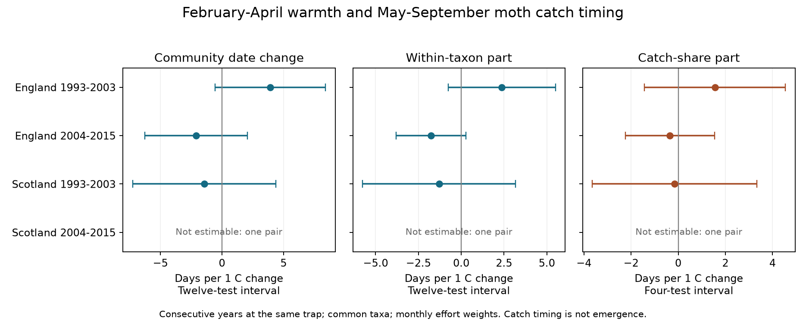
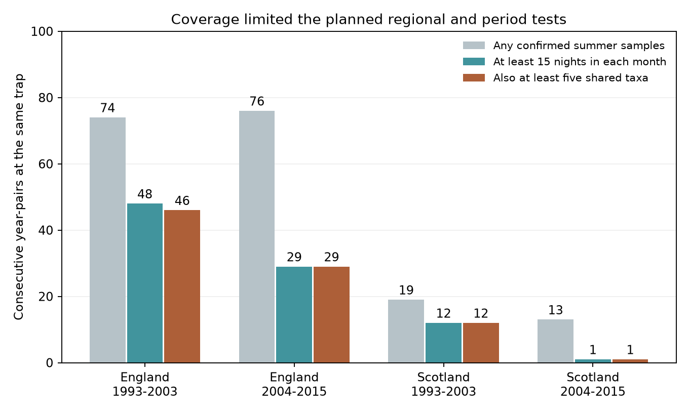

# Spring warmth gave no clear catch-share timing link in two English and one Scottish moth sample in 1993-2015

We tested whether spring temperature change had a repeated link to the part of moth catch-date change that comes from changing taxon catch shares. It did not have a clear link in the three samples that supported a model. A fourth planned sample had only one year-pair. This does not show that the true link is zero.



## Question and prior work

A community mean catch date can move when individual taxa fly earlier. It can also move when early and late taxa change their shares of the catch. These are different descriptions. Both can contain real ecology and observation bias. We asked whether the catch-share component had a consistent link to February-April warmth across England and Scotland and across two periods.

Thomsen and colleagues (2016) studied temperature-related composition and timing changes in a long insect record. Jonason, Franzen and Ranius (2014) showed that weather, season and lamp type affect moth catches. Our test adds an exact decomposition of year-to-year catch dates at several ECN sites. The decomposition is a standard midpoint identity, related to Kitagawa (1955). We do not claim a new mathematical estimator.

We searched the campaign for climate, pollution, biodiversity, moths, beetles and phenology before selecting this question. Prior SCI work found strong short-term night-weather catch associations and compared weather-adjusted species flight dates (SCI 4cb5ee4a). Another study tested monthly catch concentration (SCI 3c92853a). We use the selection rules from SCI 06dc7cde, after reading its verified code. We wrote a new build and analysis. Our outcome and annual paired design differ from those studies. The source moth observations overlap. This is not an independent validation of their biological results.

## Data and scope

Rennie and co-authors (2017) supply the public UK Environmental Change Network moth data for 1992-2015, DOI 10.5285/a2a49f47-49b3-46da-a434-bb22e524c5d2. Counts, sampling intervals, quality notes and the trap protocol come from that release. The source protocol specifies Rothamsted light traps and nightly collection where possible. Our weather inputs are the Met Office monthly mean temperature and rainfall series for England and Scotland, downloaded to the shared store on 2026-11-09. These country values do not measure nightly weather at each trap.

We used shared inputs in place. The exact six shared paths, source URLs, whole-file SHA-256 hashes and stable used-content hashes are in files/provenance.json. The paths are under /mnt/dell-data/shared_datasets, which is the campaign compatibility path on HP SSD. We did not access /data or change the shared datasets. All computations ran in this job's worktree.

We kept confirmed single-night samples in May-September of 1993-2015. We used the trap-set date, FROMDATE, rather than the collection date. A numeric biological report or an explicit XX no-moths marker confirms a sampled night. An absent date is not a zero catch. We removed every Q-prefixed sample flag and every site quality-note date interval. The note rule applies across locations at the same site and is deliberately conservative. We removed eight ambiguous duplicate effort rows and four one-day labels with inconsistent date ranges. All four inconsistent ranges were in February 2012, outside the outcome season. Positive counts with numeric codes 1-969 define the core taxon set. We retain the word taxon because codes need not map one-to-one to current biological species. Higher codes and some grouped forms are outside the target.

The initial build has 22,861 valid summer nights, 245,349 core individuals and 21,850 taxon-year rows. Ten sites contribute somewhere before coverage filters. The main paired samples contain seven English sites and two Scottish sites. Site names and codes are Drayton T01, Glensaugh T02, Moor House T04, North Wyke T05, Rothamsted T06, Sourhope T07, Wytham T08, Alice Holt T09 and Porton Down T10. Cairngorm T12 contributes before main filters but no main pair.

Each main trap-year must have at least 15 confirmed single nights in each of the five months. For a night in month m, its catch weight is calendar days in m divided by valid nights in m. This estimates each month's catch from its sampled nightly mean. A fixed nonleap day index removes the one-day leap-year offset. Monthly weights correct unequal numbers of sampled nights under the assumption that sampled nights represent missing nights within each month. They cannot correct weather-dependent missingness within a month.

We formed consecutive year-pairs at the same site-location trap. Both years must lie in 1993-2003 or both in 2004-2015. There is no cross-period pair. A pair must have at least five shared taxa, each with at least ten raw individuals in each year. The taxon set can change across pairs. Counts and dates are then restricted to this common set and shares are renormalized within each year. This estimates timing among common, sufficiently caught taxa. It does not measure all local moths, entry or loss of taxa, or the timing of the whole source catch.



| Sample | Potential pairs with any confirmed summer sample in both years | Pairs after 15-night monthly coverage | Main pairs after common-taxon rule | Sites in main pairs |
|---|---:|---:|---:|---:|
| England 1993-2003 | 74 | 48 | 46 | 7 |
| England 2004-2015 | 76 | 29 | 29 | 4 |
| Scotland 1993-2003 | 19 | 12 | 12 | 2 |
| Scotland 2004-2015 | 13 | 1 | 1 | 1 |

The later Scottish model cannot be estimated. This failed coverage test is a result, not a null slope. The countries use disjoint biological records, but their weather is correlated. The periods use disjoint years, but some traps recur. These are separate sample tests, not four independent experiments.

## Exact decomposition and regression

For one common taxon set, let p(i,t) be taxon i's share of the effort-weighted catch in year t. Let d(i,t) be its effort-weighted mean catch day. The community mean is M(t) = sum_i p(i,t) d(i,t). We compute:

    Within = sum_i [(p(i,1) + p(i,0))/2] [d(i,1) - d(i,0)]
    Composition = sum_i [p(i,1) - p(i,0)] [(d(i,1) + d(i,0))/2]
    M(1) - M(0) = Within + Composition

Expansion of the two products cancels the cross terms and leaves p(i,1)d(i,1) minus p(i,0)d(i,0) for every taxon. The identity needs no probability model. It assigns the interaction symmetrically between the two terms. Other reference-weight choices can assign this interaction differently. The composition term is a change in caught shares, not proof of population replacement. The within term is not pure emergence: capture, generations and seasonal truncation can also move a taxon's mean date.

For each country-period sample we fit ordinary least squares to each additive term and to the total date change. The target is the coefficient for change in February-April mean temperature, with equal month weights. Controls are change in May-September mean temperature, rainfall totals in both seasons in units of 100 mm, and effort-weighted mean sample day. Trap intercepts permit different mean annual changes. Every pair has equal regression weight. First differences remove fixed trap offsets; trap intercepts in differences allow trap-specific linear trends in levels. The same design makes the three fitted temperature coefficients additive too.

The spring window ends before the summer outcome window. The summer controls help account for contemporaneous conditions that change capture and seasonal activity. They can also control real ecological pathways. Thus the coefficient is conditional and is not a total climate effect. Fixed country weather windows avoid using each observed flight date to define its exposure.

Errors cluster by the second year of a pair. Intervals use a t reference with year-cluster count minus one degrees of freedom and the finite-sample sandwich correction. There are 10, 11 and 8 year clusters in the three fitted main models. The primary family is four planned composition tests. We keep the four-test adjustment despite one unestimable test; each interval has nominal 98.75 percent marginal coverage. The secondary total and within outcomes also have twelve-test intervals for the three additive outcomes in four planned samples. The equal-taxon mean date change is an exploratory weighting comparison, outside that twelve-test family.

Consecutive pairs share a year, so their errors can be dependent across year clusters. We also calculate a Bartlett lag-one covariance of annual cluster scores. Its four-test composition intervals include zero in all three fitted main samples. This short-dependence check does not guarantee coverage under longer dependence. Few time points, correlated weather controls and annual unmeasured causes limit all interval claims.

## Results

| Sample | Primary composition slope, days per C | Four-test interval | Mean absolute composition term, days | Mean absolute within term, days | Terms with opposite signs |
|---|---:|---:|---:|---:|---:|
| England 1993-2003 | +1.56 | -1.43 to +4.54 | 4.48 | 5.08 | 47.8% |
| England 2004-2015 | -0.35 | -2.24 to +1.54 | 5.20 | 4.52 | 58.6% |
| Scotland 1993-2003 | -0.15 | -3.64 to +3.33 | 3.31 | 5.02 | 50.0% |
| Scotland 2004-2015 | Not estimable | One pair | Not reported | Not reported | Not reported |

Positive slopes mean a later date component with a warmer spring relative to the prior year. The signs differ, and each primary interval permits both directions. The absolute components show that changing catch shares can move the community timing measure by several days. These sample means have no uncertainty intervals and are not estimates of climate-attributable changes. Absolute means do not add to the absolute total because signed terms can oppose each other.

The total slopes were +3.93, -2.11 and -1.45 days per C. The within-taxon slopes were +2.37, -1.76 and -1.30. All their twelve-test intervals include zero. The early English total and later English within slopes exclude zero under four-test intervals considered separately, but they are secondary and do not establish a repeated response. The equal-taxon comparator was +2.14, -1.74 and -1.14 days per C. Its later English twelve-test interval excludes zero. This exploratory comparator does not rescue the primary replication test.

Main common taxa represent a median 62.4%, 63.3% and 71.6% of the effort-weighted core catch in the three fitted samples. The smallest retained shares are 40.6%, 37.8% and 48.0%. The excluded portion can have different timing and climate responses. A large common-taxon component therefore cannot be extrapolated to the full community.

## Sensitivity and model support

The plan in files/analysis_plan.txt was saved before outcome estimates. We changed no main thresholds after seeing slopes. Numerical diagnostics for limited time support and a coverage figure were added after the first estimates. We also excluded inconsistent one-day date labels after an input check failed. All variants and failure states remain in files/results.csv. The model-support warning flags residual degrees of freedom below five or fewer than two residual time dimensions after country-level weather columns. The flag was added after estimates; it is a diagnostic, not a new rule that removes results.

- Twenty nights per month, twenty individuals per taxon, no summer-weather controls, no sample-day control and every estimable single-site omission gave main-sample composition intervals that include zero. Some estimates changed sign. The twenty-night later English slope was +9.47 days per C, with interval -0.09 to +19.03, from ten pairs.
- Ten nights per month recover eight later Scottish pairs. That slope is -4.03, with an apparently narrow interval of -4.21 to -3.85. The model has seven columns and only eight observations: one residual degree of freedom. It is flagged for weak support. The main coverage rule leaves only one pair. This sensitivity result is not robust evidence of a Scottish climate response.
- Nonoverlapping even and odd year-pairs reduce shared-year dependence. They give early English composition slopes of -65.17 and +53.54 days per C. Their adjusted intervals exclude zero in opposite directions. There are only five annual clusters in each fit. The four country-level weather columns plus a constant span all five time points. Residual spring-exposure standard deviations are only 0.043 and 0.051 C; design condition numbers are 186 and 208. These fits are flagged and show instability. They cannot validate the main result. Several Scottish nonoverlapping fits are rank deficient or have too few years.

The main early Scottish model has twelve pairs, eight columns and four residual degrees of freedom, so it is also flagged. It is reported to show the attempted regional test, with strong caution about precision. The largest single-year shares of residual spring-exposure information are 46.9%, 27.6% and 37.2% in the three main models. Small-cluster inference can be unreliable even when a design has full column rank.

## Limits and next test

This study does not identify a causal warming effect, an absence of such an effect, or a change in ecological harm. It does not test air pollution or daily weather extremes. It uses interannual temperature variation, rather than attribution to long-term climate change. Missing nights, exclusion of multi-night samples, selected common taxa and the ten-individual threshold can all depend on weather. There is no model for these selection mechanisms.

The fixed May-September window truncates flight seasons. Earlier spring flights can leave the window, and later generations can enter it. Changes in voltinism or migrant catches can shift means without a common change in first emergence. Monthly effort weights cannot correct different catchability among taxa, lamp or habitat changes, or nonrandom missing nights. The short interval and few Scottish sites prevent strong regional generalization. A regression with country means cannot separate local weather, shared year causes and capture processes.

The useful result is a reproducible audit of what an aggregate timing measure contains and which replication tests the public sample can support. A stronger next test would keep local daily weather and full-season catches, model missing and multi-night samples, keep a preselected taxon panel, and apply the same decomposition to independent monitoring networks and years. Counts from a second method would help distinguish changing catch shares from changing population shares.

## Reproduce and inspect

Contains data supplied by UK Centre for Ecology & Hydrology. Copyright UK Centre for Ecology & Hydrology. Weather source: Met Office; contains public sector information licensed under the Open Government Licence v3.0. Crown copyright. Source terms and full source references are in files/EXTERNAL_DATA_NOTICE.md. The baseline license covers this package's code, text, figures and aggregate results. No external raw records or derivative record database is bundled.

Use Python 3.12 and numpy, pandas, scipy and matplotlib. Exact run versions are in files/environment.json. From the extracted publication directory, check existing shared inputs and rebuild into a new external output directory:

```sh
OPENBLAS_NUM_THREADS=1 python files/retrieve.py /mnt/dell-data/shared_datasets --check-existing
OPENBLAS_NUM_THREADS=1 python files/analyze.py --datasets /mnt/dell-data/shared_datasets --out /absolute/path/to/new_local_output
python files/compare.py /absolute/path/to/new_local_output
```

The optional thread setting avoids overhead for the small matrix fits. It is not a campaign requirement. On another machine, retrieve to a new directory first:

```sh
python files/retrieve.py /absolute/path/to/new_external_inputs
python files/analyze.py --datasets /absolute/path/to/new_external_inputs --out /absolute/path/to/new_local_output
python files/compare.py /absolute/path/to/new_local_output
```

The source files are small: about 6.6 MB in total. Retrieval writes outside the signed publication and checks stable used-content fingerprints. Weather files can gain later years and a generated document ZIP wrapper can change. The fingerprint permits these changes only if the input matrix for 1992-2015 and every used document member remain identical. Whole-file hashes record the exact files we used. A changed historical value or missing access can block retrieval; do not silently substitute data. No private input or signing key is needed to run the analysis.

The rebuild creates external_valid_nights.csv, external_taxon_years.csv, external_weather.csv, external_coverage.csv and external_pairs_*.csv outside the bundle. These are external-data derivatives and retain their source terms. They are needed for record-level inspection and are deliberately excluded from the signed package. The source archives and scripts allow their regeneration. The bundled results.csv, summary.csv and coverage_summary.csv contain aggregate analysis outputs only. Numeric outcome summaries for groups with fewer than five pairs are suppressed. files/compare.py checks the three aggregate tables, numerical validation and figures against the package. External derived-table hashes in files/reproduction.json fix the evidence used in this run without distributing those records.

The analysis checks unique sample keys, one-night durations, integer counts, the exact decomposition, coefficient additivity and an independent residualized-regression calculation of coefficients and year-cluster standard errors. The largest decomposition error is below 9e-14 days. The independent coefficient and standard error differences are below 6e-12. A separate check recomputed all 88 main total date changes directly from nightly catches; its largest error was 1.8e-13 days. Statsmodels gave the same three primary coefficients and standard errors within 5e-15. This check uses the additional Statsmodels package. Run python files/independent_check.py --datasets /dataset/root --analysis /rebuilt/output --out /new/check.json. Its source and results are included. A second rebuild with pinned sources is recorded in files/reproduction.json. PNG bytes can vary across software versions; aggregate numerical results are the target.

## Provenance and references

Job: sci-1107-hp-climate-pollution-biodiversity-c8d60bcfd7e4. Topic: climate-pollution-biodiversity. Campaign: 11_07_2026. Machine: hp. Account: codex-andrii. Model: gpt-6.1-sol, high reasoning effort. Analysis date: 2026-11-09. One worker performed this investigation, with no delegated agents. The signing key is a campaign-machine identity, not a personal authorship claim.

1. Rennie, S. and co-authors (2017). UK Environmental Change Network (ECN) moth data: 1992-2015. NERC Environmental Information Data Centre. https://doi.org/10.5285/a2a49f47-49b3-46da-a434-bb22e524c5d2 .
2. Rennie, S. and co-authors (2020). The UK Environmental Change Network datasets: integrated and co-located data for long-term environmental research (1993-2015). Earth System Science Data 12, 87-107. https://doi.org/10.5194/essd-12-87-2020 .
3. Jonason, D.; Franzen, M.; Ranius, T. (2014). Surveying Moths Using Light Traps: Effects of Weather and Time of Year. PLOS ONE 9, e92453. https://doi.org/10.1371/journal.pone.0092453 .
4. Thomsen, P. F. and co-authors (2016). Resource specialists lead local insect community turnover associated with temperature: analysis of an 18-year full-seasonal record of moths and beetles. Journal of Animal Ecology 85, 251-261. https://doi.org/10.1111/1365-2656.12452 .
5. Kitagawa, E. M. (1955). Components of a Difference Between Two Rates. Journal of the American Statistical Association 50, 1168-1194. https://doi.org/10.1080/01621459.1955.10501299 .
6. Met Office (source tables retrieved 2026-11-09). England and Scotland monthly mean temperature and rainfall series. Exact four URLs and hashes are in files/provenance.json. Dataset and terms: https://www.metoffice.gov.uk/research/climate/maps-and-data/data/haduk-grid/datasets .
7. Prior SCI results are cited by full publication ID in sci.json. Verified reads, not other workers' private workspaces, supplied the prior methods and findings.
