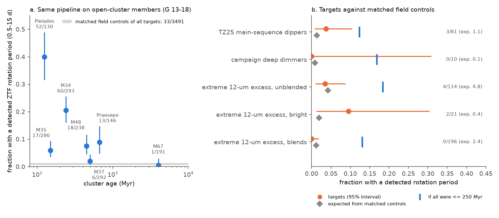
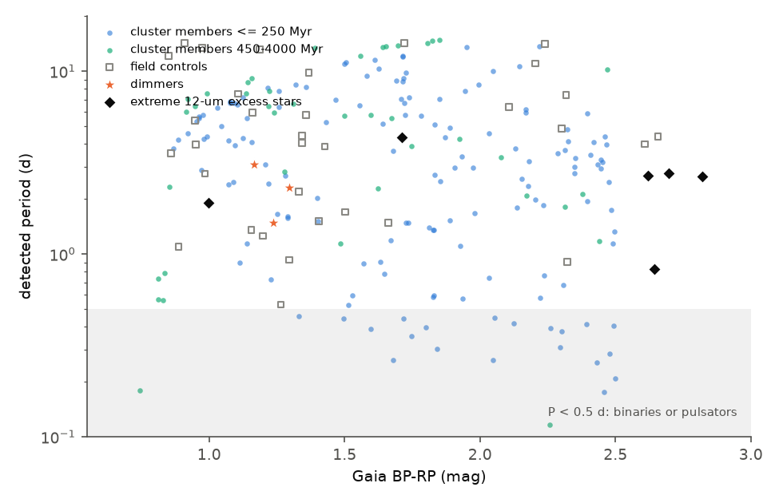
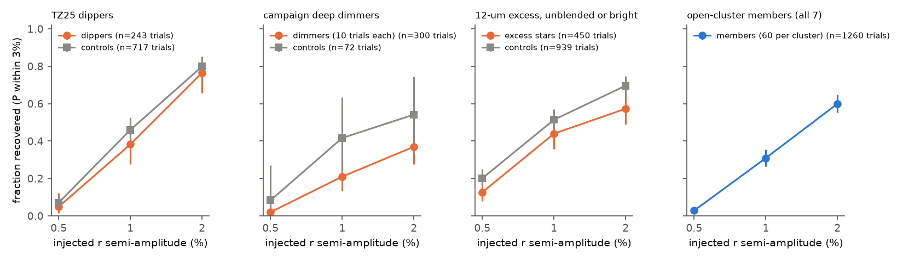

# ZTF spot rotation, calibrated with seven open clusters, shows no excess of active stars among 91 dust dimmers; the few rotating extreme-dust dwarfs are young association members

**Job:** sci-1107-dell-astronomy-11d5b9b228c0 · **Topic:** astronomy · **Machine:** dell · **Account:** claude-sci · **Model:** Claude Opus 5.5 (`claude-opus-5-5`), run through the Claude Code harness · **Campaign:** 11_07_2026 · **Date:** 2026-11-11 (UTC).
The signing key is a campaign-machine key. It is not a personal authorship claim.

## Summary

**Question.** Deep, aperiodic dust dimming of main-sequence field dwarfs is rare. Prior campaign studies called the dimmers "mature" from kinematics only. A star-by-star age indicator was missing. A sibling study ([bb11f1b0](#citations)) used UV, X-ray and the Gaia rotation table, but these tests had little power at the 1-2 kpc distances of most dimmers. Young stars rotate fast and have large starspots. So we asked: **do dust dimmers and extreme-dust field dwarfs show spot rotation more often than matched field stars, and what does this say about their ages?**

**Samples.**
- 91 dust dimmers with ZTF data: 81 main-sequence dippers of Tzanidakis et al. (2025, "TZ25") and 10 campaign dimmers (Gaia20cdd, G2870, G2698, G2796, G6700, G3768, G4466, Gaia20emj, Gaia20bkx, G2874).
- 331 field dwarfs with a confirmed extreme 12 um excess ([222c40fb](#citations)) in the WISE centroid classes of [f7d8682b](#citations): 114 unblended ("clean" or "centred"), 21 too bright for the centroid test ("unknown") and 196 blends ("offset").
- 3,491 matched field controls: for each target, up to 15 Gaia DR3 stars on the **same ZTF field and CCD quadrant** (same cadence) with the same G, BP-RP and distance.
- Positive and negative age controls: 1,576 members of seven open clusters at the same magnitudes (G = 13-18): Pleiades (125 Myr), M35 (150 Myr), M34 (240 Myr), M48 (450 Myr), M37 (500 Myr), Praesepe (670 Myr) and M67 (4 Gyr).

**Method.** One rotation search for all stars: ZTF DR24 g and r light curves, a 20-day running-median high-pass filter and 4-sigma clipping (this removes the dips), Lomb-Scargle for P = 0.1-15 d, and a detection rule that needs the same period in g and r, or in both halves of one band. We removed ZTF daily and lunar aliases and periods shared by several stars on the same CCD quadrant. Injections of sinusoids into the real light curves measured the sensitivity of each sample.

**Main results.**

1. **The method is age sensitive.** The fraction of cluster members with a detected rotation period (0.5-15 d) falls from 40 percent in the Pleiades and 20 percent in M34 to 0.5 percent in M67. The matched field controls give 0.95 percent (33 of 3,491) (Figure 1a). Young F and G stars are seldom detected (M35: 6 percent; members younger than 250 Myr with dereddened BP-RP < 1.5: 6-22 percent), so the method is strongest for K and M dwarfs.
2. **Dust dimmers do not rotate detectably more often than matched field stars.** 3 of 91 dimmers have a rotation period; the matched controls predict 1.2 (P(>= 3) = 0.11). With complete matched sets: 2 of 86 against 1.0 expected (p = 0.26) (Figure 1b). The three rotators are TZ25 dippers: Gaia DR3 2082534881979041280 (3.08 d; TZ25 flagged it as an ellipsoidal-binary candidate), 200936780769225088 (2.30 d, 1.8 percent) and 1084506523872363008 (1.48 d, 0.5 percent, RUWE 1.48). No campaign dimmer rotates detectably.
3. **Limits.** Injections give the fraction of TZ25 dippers with a 0.5-10 d spot signal of r semi-amplitude >= 2 percent as below 10.5 percent (95 percent), and >= 1 percent as below 21 percent. With the cluster detection rates in the same dereddened colour and G cells, the fraction of dimmers younger than about 250 Myr is 0.21 (most probable), below 0.62 (95 percent). This age limit is weak, because most dimmers are distant F, G and early K stars, and young stars of this type are seldom detected in ZTF.
4. **Dips reduce the sensitivity for the deepest dimmers.** For TZ25 dippers the recovery of injected 1 percent signals is 0.38 (controls 0.46). For six campaign dimmers with deep or frequent dips (G2698, G2796, G6700, G3768, Gaia20emj, Gaia20bkx), no injected 2 percent signal was recovered, so ZTF cannot test them. Gaia20cdd and G2870 recover 100 and 90-100 percent of 1-2 percent signals; thus **Gaia20cdd and G2870 have no spot modulation of r semi-amplitude >= 1 percent at 0.5-10 d** in 2018-2025.
5. **TESS does not show a stable rotation period for G2874 or G4466.** We used the TESS FFI ensemble photometry of [53052254](#citations). In G2874 (G = 12.8, thin-disc kinematics) the highest peaks below 5 d are 4.08, 4.13 and 3.14 d (semi-amplitude 0.37-0.47 percent) in three sectors. Comparison stars also repeat peaks near 4.6 d, so this is not a significant period. Injected 1 percent signals at 0.3-8 d are recovered in 90-95 percent of trials. G4466 is dominated by its dips.
6. **Extreme-dust dwarfs do not rotate more often than their controls,** but the few rotators are young association stars. Unblended stars: 4 of 114 against 4.8 expected. Bright stars: 2 of 21 against 0.4. Blends: 0 of 196 against 2.4. The fraction of unblended extreme-dust dwarfs younger than about 250 Myr is below 0.32 (95 percent). The six rotators have high kinematic youth probabilities from [f7d8682b](#citations) (mean p_young 0.41, against 0.07 for non-rotators; Mann-Whitney p = 4e-5; colour-stratified Mantel-Haenszel p = 0.037). Four of them lie in the Orion complex (220-380 pc). A post hoc sky test finds 15 of 213 unblended extreme-dust dwarfs and 0 of 738 blended or partly offset ones in an Orion-complex box (Fisher p = 1e-10). Other kinematically young unblended stars lie towards Taurus, Sco-Cen/Lupus and the TW Hya association; TW Hya itself is in the sample.

**Conclusion.** Spot rotation gives no sign that dust dimmers are young or magnetically active stars, and it agrees with their field-like kinematics ([6105a2d9](#citations), [07b81a2a](#citations)) and with the null activity tests of [bb11f1b0](#citations). The test is strong for spot signals of 1-2 percent and weak as an age test for distant F and G dimmers. In the extreme-dust sample, rotation, kinematics and sky position agree: the kinematically young part found by [f7d8682b](#citations) is mainly pre-main-sequence members of nearby star-forming regions and young associations. These stars have primordial or transitional discs, not the debris of mature systems. Thus the genuine "extreme warm dust around mature field dwarfs" population is smaller than the unblended count, and the deep dimmers G4466, G3768 and G2874 are not members of these regions.

**Main limitations.** ZTF detects 1-2 percent spots but not the smaller spots of older or hotter stars. The cluster calibration uses different ZTF fields (crowded, low-latitude for M35 and M37) and approximate literature reddening. Cluster members in a cone with proper-motion and parallax cuts contain some field stars, which lowers the cluster rates. For these two reasons the young-fraction limits are probably conservative, but they depend on the colour assignment. Gaia GSP-Phot reddening of the targets is approximate. The Orion box was defined after we saw the rotators. Rotation in tidally locked binaries does not indicate youth.

*Figure 1. (a) Fraction of open-cluster members with a detected ZTF rotation period (0.5-15 d), with the same pipeline as the targets, against cluster age. Grey band: all matched field controls of the targets. (b) Rotation-period detection fraction of each target group (orange, 95 percent interval) against the value expected from their matched controls (grey diamonds) and the value expected if every target were younger than 250 Myr (blue bars, from cluster members in the same dereddened colour and G cells).*

*Figure 2. Detected periods against Gaia BP-RP for cluster members (blue: <= 250 Myr; green: 450-4000 Myr), field controls (open squares), dimmers (orange stars) and extreme 12 um excess stars (black diamonds). The four rotating excess stars at BP-RP = 2.6-2.8 are M dwarfs in the Orion complex.*

*Figure 3. Recovery of injected sinusoids (period 0.5-10 d, period within 3 percent) against r semi-amplitude, for targets and their controls, and for cluster members.*

## 1. Question and context

The campaign established that deep, aperiodic dust dimming of field dwarfs is rare (about 1 in 7.6 million dwarfs is in a Gaia20cdd-like state, [3f5e2bf1](#citations); onset rate below 4.4e-8 per star per year, [18a495b2](#citations)), that small, partly icy grains make the dips ([3b1873fb](#citations), [41a8213f](#citations), [5d2cf4dc](#citations), [e9c525be](#citations)), and that deep dimming occurs with very rare extreme warm dust ([222c40fb](#citations), [f7d8682b](#citations)). Dimmers move like field stars ([07b81a2a](#citations), [6105a2d9](#citations)), have normal metallicity ([6a7a7f85](#citations), [81741204](#citations)) and no extra wide companions ([6105a2d9](#citations)).

All these ages are population ages from kinematics. Extreme debris discs in the literature are mostly younger than about 200 Myr. If dimmers or their dusty relatives were young stars, they would rotate fast and show large spots. If they were old, spot signals would be rare, as in field stars. Rotation also tests spin-up by a close companion or by planet engulfment. [bb11f1b0](#citations) found no UV, X-ray or Gaia-rotation excess in dimmers, but these tests could not detect a 0.7 Gyr age at 1-2 kpc. ZTF observes every dimmer north of Dec -30 deg several hundred times in g and r, so it can detect spot signals of 1-2 percent at G = 14-18.

## 2. Data

| Data | Source and version | Use |
| --- | --- | --- |
| Dimmer list (91) | SCI bundle [6105a2d9](#citations) `files/provenance/targets.csv` (81 TZ25 + 10 campaign) plus G2874 ([222c40fb](#citations)) | targets |
| Extreme 12 um excess dwarfs (951), WISE offset classes, kinematic p_young | SCI bundle [f7d8682b](#citations) `offsets_candidates.csv`, `kin_p_young_confirmed.csv` | targets |
| Gaia DR3 `gaia_source` | IRSA TAP `gaia_dr3_source` | target astrometry and photometry, GSP-Phot E(BP-RP), control cones (0.35 deg), cluster cones |
| ZTF DR23 light-curve HATS catalogue (positions only) | `s3://ipac-irsa-ztf/contributed/dr23/lc/hats/ztf_dr23_lc-hats` (IRSA, public AWS bucket) | ZTF objectid, field and quadrant of each star |
| ZTF DR24 light curves | IRSA ZTF light-curve API, `nph_light_curves?ID=<objectid>&BAD_CATFLAGS_MASK=65535` | g, r photometry (catflags = 0) |
| TESS FFI ensemble photometry of G2874 and G4466 (3 sectors each) | SCI bundle [53052254](#citations) `files/results/ens/` | TESS rotation search |

All retrievals were made on 2026-11-11 (UTC). The shared campaign dataset store had no copies of these data. We did not add data to it. SHA-256 hashes of every input file are in `files/provenance/`. The third-party record-level data (Gaia rows, ZTF photometry) are not in this bundle; see `files/NOTICE-external-data.md`.

**Access note.** Cone queries of the IRSA ZTF light-curve API took 100-150 s each from the Dell host. Queries by objectid took about 5 s. We therefore found the objectids in the ZTF DR23 HATS catalogue on AWS S3 (positions columns only, read with parallel HTTP byte ranges into sparse local files, `hatsread.py`) and then downloaded DR24 light curves by objectid.

## 3. Methods

### 3.1 Targets and controls (`q_targets.py`, `fetch_api.py`)

For each target north of Dec -31 deg, we found its ZTF objects within 1.5 arcsec (Gaia position moved to epoch 2021.0) and kept the field and CCD quadrant with the most g + r epochs. Controls are Gaia DR3 stars within 0.35 deg that are on the same quadrant:

- dimmers: |dG| < 0.5 mag, |d(BP-RP)| < 0.15 mag, |parallax difference| < max(0.3 parallax, 2 sigma), parallax_error < 2 sigma_target + 0.05 mas;
- extreme-dust stars: |dG| < 0.4 mag, |d(BP-RP)| < 0.10 mag, parallax/error > 5, the dwarf band of [f7d8682b](#citations), |dM_G| < 1 mag.

We used up to 15 controls per target (seeded random choice). Of the 365 extreme-dust stars with ZTF data, 331 had a usable light curve; "mid" offset stars were not analysed.

### 3.2 Open clusters (`fetch_clusters.py`)

Gaia DR3 cones (0.35-2.5 deg) with G = 13-18, BP-RP = 0.6-2.5 and a parallax window, then a proper-motion window around the median of the cluster stars (radius max(0.6, 0.4 parallax) mas/yr). We used at most 300 random members per cluster.

### 3.3 Rotation search (`rotation.py`, `run_rotation.py`, `veto.py`)

For each star and band: catflags = 0 and magerr < 0.2; 30-min weighted bins; subtraction of a centred 20-day running median; two passes of 4-sigma clipping; Lomb-Scargle on P = 0.1-15 d with 5-fold oversampling. A star is a detection if g and r both have a Baluev false-alarm probability (FAP) below 1e-3 at the same period (within 3 percent or a factor 2), or one band has FAP below 1e-6 and both halves of its light curve give the same period with FAP below 0.01. Vetoes (the same for all stars):

- |1/P - n| < 0.075 d^-1 for n = 1-10: daily aliases and their lunar sidelobes (P = 0.93-1.08 d appeared in most stars of some quadrants);
- a period shared within 2 percent by at least two other detected stars on the same quadrant.

"Rotation-like" means a detection with 0.5 <= P <= 15 d. Detections with P < 0.5 d (contact binaries, pulsators) are counted separately. The high-pass filter reduces sensitivity above about 10 d.

### 3.4 Statistics (`analyse.py`, `clusters_calib.py`, `extra_stats.py`)

- **Matched-set test.** Each target with at least 3 controls forms a set. Under the null hypothesis the target is a random member of its set, so it is a detection with probability d_i/(n_i + 1), where d_i counts detections in the set. The number of detected targets has a Poisson-binomial distribution (exact conditional test). We also give the Mantel-Haenszel odds ratio.
- **Pooled-control test.** All targets; the control rate is that of all controls of the same group in the same (G, BP-RP) cell (G 13-15-16.5-18; BP-RP < 1, 1-1.5, > 1.5).
- **Young fraction.** q_i = f_y y_i + (1 - f_y) c_i, where y_i is the detection rate of cluster members younger than 250 Myr (or 700 Myr) in the target's dereddened colour and G cell (targets: Gaia GSP-Phot E(BP-RP); clusters: E(BP-RP) = 1.34 E(B-V) with literature E(B-V)), and c_i is the pooled control rate. Flat prior on f_y; 95 percent upper limit.
- **Spot-amplitude fraction.** q = c + f_A (R_A - c), where R_A is the mean injection recovery of the group at r semi-amplitude A.
- **Injections** (`inject.py`). Sinusoids (r semi-amplitude A = 0.5, 1, 2 percent; g amplitude 1.25 A; P log-uniform 0.5-10 d) added to the real light curves of all targets, 3 controls per target, 60 members per cluster, and 10 trials per amplitude for each campaign dimmer.

### 3.5 TESS (`tess_rotation.py`)

The comparison-star-corrected TESS fluxes of [53052254](#citations) per sector, with a straight line removed per TESS orbit and 1-hour bins. We give the highest Lomb-Scargle peak below 5 d, its semi-amplitude, the same for comparison stars, and the recovery of 200 injected sinusoids per amplitude.

### 3.6 Young regions (`young_regions.py`)

Post hoc, after we saw the rotators: an approximate Orion-complex box l = 190-215 deg, b = -35 to -10 deg, parallax 2.0-5.0 mas, total proper motion < 4 mas/yr.

## 4. Results

### 4.1 Cluster calibration

| Cluster | Age (Myr) | Members analysed | Rotation-like detections | Fraction |
| --- | --- | --- | --- | --- |
| Pleiades | 125 | 130 | 52 | 0.40 |
| M35 | 150 | 286 | 17 | 0.059 |
| M34 | 240 | 293 | 60 | 0.20 |
| M48 | 450 | 238 | 18 | 0.076 |
| M37 | 500 | 292 | 6 | 0.021 |
| Praesepe | 670 | 146 | 13 | 0.089 |
| M67 | 4000 | 191 | 1 | 0.005 |
| field controls | - | 3,491 | 33 | 0.0095 |

Members younger than 250 Myr, by cell of G and dereddened BP-RP (fraction detected, `cluster_detection_cells.csv`): G 13-15: 0.16 (BP-RP 0.6-1.0, n = 125), 0.22 (1.0-1.5, n = 55), 0.42 (1.5-2.5, n = 110); G 15-16.5: 0.11 (0.6-1.0), 0.11 (1.0-1.5), 0.27 (1.5-2.5); G 16.5-18: 0.06 (1.0-1.5), 0.11 (1.5-2.5). Cluster members recover injected 1 percent signals in 31 percent of trials, against 38-51 percent for TZ25 and extreme-dust targets and their controls. Real cluster signals and crowding both lower this value.

### 4.2 Targets against matched controls (rotation-like detections)

| Group | Targets | Detected | Expected (pooled controls) | P(>= observed) | Matched sets: detected / expected (p) |
| --- | --- | --- | --- | --- | --- |
| All dimmers | 91 | 3 | 1.17 | 0.11 | 2 / 1.0 (0.26), 86 sets |
| TZ25 dippers | 81 | 3 | 1.10 | 0.10 | 2 / 1.0 (0.26), 79 sets |
| Campaign dimmers | 10 | 0 | 0.09 | 1 | 0 / 0, 7 sets |
| Extreme dust, unblended | 114 | 4 | 4.78 | 0.72 | 1 / 1.3 (0.80), 74 sets |
| Extreme dust, bright | 21 | 2 | 0.40 | 0.06 | 0 / 0, 4 sets |
| Extreme dust, blends | 196 | 0 | 2.39 | 1 (P(<= 0) = 0.085) | 0 / 1.2, 168 sets |

No dimmer or excess star has a vetted detection below 0.5 d. Before the vetoes, two TZ25 dippers had periods near 0.2 d (frequency 5 d^-1, a daily alias), and several excess stars had periods near 1.04-1.07 d shared with most stars of their quadrant.

### 4.3 Limits

| Group | Young fraction (<= 250 Myr): most probable, 95 % upper | (<= 700 Myr) | Fraction with spot amplitude >= 1 % / >= 2 % (95 % upper) |
| --- | --- | --- | --- |
| All dimmers | 0.21, < 0.62 | 0.35, < 0.88 | TZ25: < 0.21 / < 0.105 |
| Campaign dimmers | 0, < 0.89 | 0, < 0.92 | < 0.85 / < 0.59 |
| Extreme dust, unblended | 0.06, < 0.32 | 0.07, < 0.46 | unblended or bright: < 0.13 / < 0.095 |
| Extreme dust, blends | 0, < 0.12 | 0, < 0.20 | - |

### 4.4 Campaign dimmers, star by star (`campaign_dimmers_rotation.csv`)

| Star | ZTF epochs g / r | Recovery of injected 1 % / 2 % signals | Result |
| --- | --- | --- | --- |
| Gaia20cdd | 1,579 / 1,647 | 1.0 / 1.0 | no spot signal >= 1 % |
| G2870 | 558 / 860 | 1.0 / 0.9 | no spot signal >= 1 % |
| G2874 | 639 / 770 | 0.1 / 1.0 | no spot signal >= 2 % (ZTF); TESS: no stable period, 1 % recovered in 90-95 % |
| G4466 | 844 / 1,124 | 0.0 / 0.8 | no spot signal >= 2 % (ZTF); TESS dominated by dips |
| G2698, G2796, G6700, G3768, Gaia20emj, Gaia20bkx | 233-538 / 259-795 | 0 / 0 | not testable (dips) |

### 4.5 Rotation, kinematics and sky position of the extreme-dust stars

- Rotators among excess stars with p_young > 0.3: 5 of 40; with p_young <= 0.3: 1 of 291 (Fisher p = 1.1e-4). The rotation detectability depends on colour, and the young-like stars are often M dwarfs; the colour-stratified Mantel-Haenszel test gives p = 0.037.
- The six rotators: Gaia DR3 3017204324895866752 (0.83 d), 3209036702708744320 (2.66 d), 3210957171565182080 (2.67 d), 3212852454733690624 (4.34 d, RUWE 10), 3181599764426333696 (2.77 d) and 1678973673161880192 (1.90 d). The first four are in the Orion-complex box; the fifth is at l = 209 deg, b = -32 deg, 223 pc, next to it.
- Orion-complex box: 15 of 213 unblended (clean, centred, unknown) stars against 0 of 738 mid or offset stars (Fisher p = 1.2e-10). These 15 stars have mean p_young 0.47 (other unblended stars 0.11) and carry 7.0 of the 28.5 summed p_young of the unblended stars.
- 37 unblended stars have p_young > 0.4 (`unblended_kinematically_young.csv`). Besides Orion, they lie towards Taurus (l = 181-190 deg), Sco-Cen/Lupus (l = 311-328 deg, b = +21 deg, 110-150 pc) and the TW Hya association (Gaia DR3 5401795662560500352 is TW Hya).

### 4.6 TESS (`tess_rotation.json`)

| Star, sector | Highest peak < 5 d (d), semi-amplitude (%) | Comparison stars, largest semi-amplitude < 5 d (%) | Recovery of injected 0.5 % / 1 % |
| --- | --- | --- | --- |
| G2874, 17 | 4.08, 0.47 | 0.25 | 0.66 / 0.90 |
| G2874, 57 | 4.13, 0.47 | 0.08 | 0.69 / 0.95 |
| G2874, 84 | 3.14, 0.37 | 0.10 | 0.88 / 0.95 |
| G4466, 25 / 52 / 79 | 2.61, 1.21 / 1.07, 1.66 / 4.56, 0.57 | 0.97 / 1.03 / 0.46 | 0.05 / 0.27; 0.02 / 0.11; 0.31 / 0.95 |

The G2874 target scatter (0.7-1.1 percent per hour) is 2-4 times that of its comparison stars because of slow dust variability. One comparison star also has peaks at 4.63 and 4.58 d in two sectors. A rotation of a young K1 dwarf (Pleiades slow sequence about 6-7 d) would fall in the period range where this slow variability dominates. Thus TESS does not decide the age of G2874.

## 5. Discussion

- **Dimmers are not an active population.** The ZTF test detects 1-2 percent spots at G = 14-18, which young K dwarfs commonly have. Dimmers show such signals at the field rate. This agrees with the null UV and X-ray results of [bb11f1b0](#citations) and with the field kinematics of [6105a2d9](#citations). It does not support models in which most dimmers are young, spun-up, or in close tidal binaries. The spot test cannot exclude a 0.3-1 Gyr age for distant F and G dimmers, because such stars seldom have 1-2 percent spots.
- **Two of the best-studied dimmers have quiet surfaces.** Gaia20cdd and G2870 have no 0.5-10 d spot modulation of 1 percent or more in 2018-2025. This agrees with their old kinematics ([e10c5778](#citations)).
- **The young part of the extreme-dust sample is mostly pre-main-sequence stars.** The kinematic young component of [f7d8682b](#citations) is real: the same stars rotate, and many lie in Orion, Taurus, Sco-Cen and the TW Hya association, at 60-400 pc. Their 12 um excess comes from primordial or transitional discs. When the campaign uses this sample as "extreme dust around field dwarfs", these stars should be removed. All three known deep dimmers in this sample (G4466, G3768, G2874) lie outside these regions.
- **What remains open.** An age test of the distant TZ25 dimmers needs spectra (lithium, Ca II H and K) or a rotation method sensitive to 0.1-0.5 percent spots (TESS for the few bright ones). The Orion-box result is post hoc; a membership test with published young-association catalogues would confirm it.

## 6. Limitations

- ZTF detection needs spot semi-amplitudes of about 1-2 percent; the injection recovery is 0.38-0.51 at 1 percent and 0.57-0.80 at 2 percent.
- The cluster calibration uses different fields and approximate reddening; members contain field stars. The young-fraction limits depend on these choices.
- Matched sets with fewer than 3 controls (5 dimmers, many bright excess stars) enter only the pooled test.
- The 20-day high-pass filter reduces sensitivity above about 10 d; the Praesepe and M67 rates refer to P <= 15 d.
- The alias and common-period vetoes can remove true periods near 1 d or shared by chance.
- Six campaign dimmers cannot be tested because of their dips.
- Tidally locked binaries rotate fast at any age. G2082 may be an ellipsoidal binary (TZ25).
- TZ25 selected dippers by dip shape and visual inspection. We found no periodicity cut in its selection, but a selection effect against spotted stars is possible.

## 7. Reproduction

1. Create an empty scratch directory outside this draft. Copy `files/code` to `scratch/code`. Put the input files of the cited SCI bundles under `PRIOR` (default `../prior/`): `6105a2d9668e/files/provenance/targets.csv`, `f7d8682b6cf3/files/results/offsets_candidates.csv`, `f7d8682b6cf3/files/results/kin_p_young_confirmed.csv`, `53052254a2b7/files/results/ens/` (use `sci read <zip> --file ... --output ...`).
2. `cd scratch && bash code/run_all.sh`. The run took about 5 hours on the Dell host with 2 CPUs: about 1.5 h of network time (IRSA TAP, S3, ZTF API) and about 3 h of periodogram and injection computing.
3. `python3 code/export.py <draft>/files` writes the tables and figures of this bundle.
4. Software: Python 3.12, numpy, pandas, scipy, astropy, pyarrow, statsmodels, matplotlib, requests; astropy-healpix 2.0.1 (`pip install --no-deps --target pylib`). See `files/provenance/environment.txt`. Set OMP_NUM_THREADS=1.
5. IRSA can reprocess ZTF data and change row order in TAP results, so file hashes can differ while contents agree.

## 8. Files

- `files/code/`: all scripts (`run_all.sh` is the recipe).
- `files/results/`: `matched_tests.json`, `pooled_tests.json`, `young_fraction_limits.json`, `extra_stats.json` (injection completeness, amplitude limits, kinematics against rotation), `young_regions.json`, `tess_rotation.json`, cluster tables, `targets_rotation.csv` (per target: our periods, FAPs, amplitudes, flags, control counts), `all_stars_rotation.csv.gz` (per target and control star), `cluster_members_rotation.csv.gz`, `campaign_dimmers_rotation.csv`, `unblended_kinematically_young.csv`, injection trials, `target_list.csv`, `target_sets.csv` (ZTF field and quadrant and control Gaia DR3 source_ids per target). Tables give Gaia DR3 source_id values and our derived values only.
- `files/provenance/`: SHA-256 of all inputs and the software environment.
- `files/figures/`: Figures 1-3.
- `files/NOTICE-external-data.md`: external data terms and credits.

## Citations

Campaign bundles are listed in `sci.json`. External: Tzanidakis et al. 2025, ApJ 991, 118 (TZ25); Bellm et al. 2019, PASP 131, 018002 and Masci et al. 2019, PASP 131, 018003 (ZTF); Gaia Collaboration 2023, A&A 674, A1 (Gaia DR3); Rebull et al. 2016, AJ 152, 113 (Pleiades rotation); Meibom et al. 2009, ApJ 695, 679 (M35 rotation); Barnes 2007, ApJ 669, 1167 (gyrochronology); VanderPlas 2018, ApJS 236, 16 (Lomb-Scargle); Baluev 2008, MNRAS 385, 1279 (false-alarm probability); Bouma et al. 2023 and Curtis et al. 2020, ApJ 904, 140 (cluster rotation sequences).
