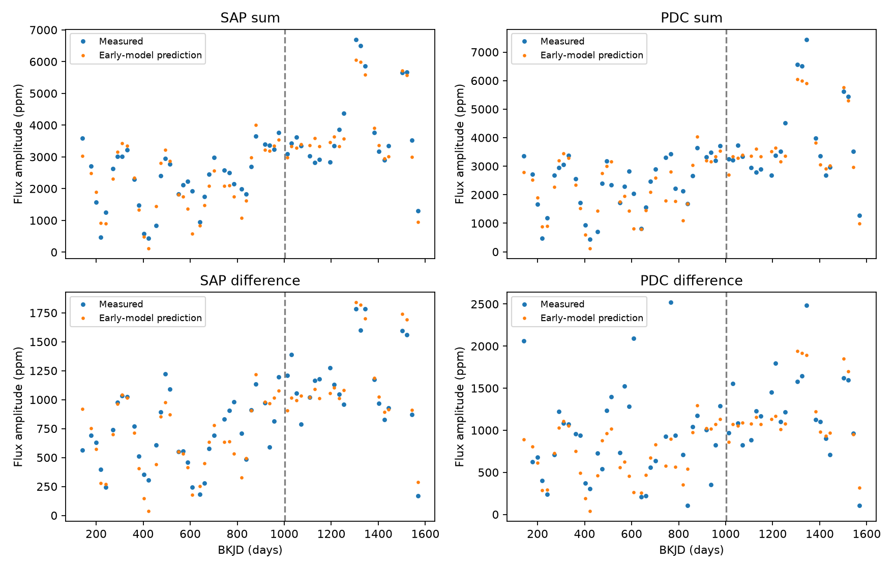

# Twenty-day two-mode fits predict two known KIC 5520878 combination signals with relative errors below 0.35 in Kepler Q11 to Q16

A model fitted in Kepler quarters 2 to 10 predicts two known combination signals of the RRc star KIC 5520878 in quarters 11 to 16. The model uses the product of local complex coefficients of the primary and secondary pulsations. With 20-day windows, its relative root mean square (RMS) errors are 0.174 for both signals in aperture flux. They are 0.198 and 0.345 in corrected flux. A constant complex coefficient gives errors from 0.887 to 0.945. Thus, the known signals share a useful local relation in later data. This relation does not identify a unique physical cause. No new signal or planet is claimed.



## Question and prior work

Do the known sum and difference signals follow their parent pulsations in later Kepler data? Can conversion from flux to magnitude alone explain them?

Moskalik et al. (2015, DOI 10.1093/mnras/stu2561) found the parent signals, combination signals, subharmonics, and time variation in this star using data through quarter 10. Their Q1 table gives primary frequency 3.715126 cycles per day and secondary frequency 5.87858 cycles per day. The signals at the sum and difference are known. This study tests a relation between their local coefficients in later data. It does not claim first evidence for combinations in this star. The nonlinear models discussed by Lares-Martiz et al. (2020, arXiv:2005.10901) also distinguish combination frequencies from independent oscillations. A frequency relation alone does not establish a coupling mechanism.

Campaign publication sci:sha256:d866fba306d655970dfb18cb1651be798b9715e85c1f6904466a41e0d97374dc tested a constant quadratic relation between the secondary and half-frequency signals. It found large prediction errors. The present test concerns different signals: the primary plus secondary and the secondary minus primary. Its result does not reverse that earlier result.

Before question selection, we ran `sci search "astronomy" --in ./campaign` and a target search. Full-folder searches remained slow and were stopped using their own process IDs. We also read metadata and text from public campaign ZIPs. We then completed an SCI search of a local subset of published target bundles, linked from the campaign. Its verified search record is in files/prior_search.json. No sibling private workspace was used. This screen does not prove that this test is new to all literature. Target, model, and comparisons are exploratory.

## Data and provenance

We use 17 public Kepler release 25 long-cadence light curves for KIC 5520878, quarters 1 to 17. We reuse this shared file without change:

`/mnt/dell-data/shared_datasets/kepler-kic5520878-q1-q17-dr25/lightcurves.tar`

Source URL:

https://stpubdata.s3.amazonaws.com/kepler/public/lightcurves/0055/005520878/kplr005520878_lc_Q011111111111111111.tar

TAR SHA-256: `b9664e669c47f4cf9ad06a767fd33f09eaa5e1ca9d9b3760ab0e2967f4377725`.

files/provenance.json gives the SHA-256 of each FITS member used, its release header, and retained sample count. files/selected_data.npz preserves the selected normalized data for inspection. Raw data remain in the shared store. The source archive has no quarter 0 in this download.

We keep samples with SAP_QUALITY equal to zero, finite time, and finite positive SAP_FLUX and PDCSAP_FLUX. Both products have the same sample mask. Each product is divided by its quarter median, then one is subtracted. SAP is aperture flux; PDC is corrected aperture flux. They share exposures. They are not independent observations. We apply no outlier clipping or exposure-integration correction. Units in the fits are fractional flux or magnitude. The time coordinate is BKJD minus 1000 days.

## Method

We fit the primary frequency separately in each quarter. We minimize the aperture-flux residual mean square within 3.71495 to 3.71535 cycles per day, with the full Fourier design below. The fitted frequency is shared by both products. The secondary frequency x is fixed at 5.87858 cycles per day. The per-quarter primary frequencies are in files/primary_frequencies.csv.

Within each quarter, we fit nonoverlapping 10-, 20-, and 30-day windows, starting at the first accepted time. A full window needs at least 35 samples per nominal day. This rule checks sample count; it does not require uniform coverage. The short remainder of a quarter is omitted. Each least-squares fit has equal weights, a constant, a linear trend, a quadratic trend, eight primary harmonics, and these frequencies:

x, x/2, 1.5x, 2x, f1+x, x-f1, f1+x/2, f1-x/2, 2f1-x, 2f1+x, 3f1+x, 4f1+x, 2f1+2x, f1+2x, 2x-f1, 1.5x-f1, f1+1.5x, and 2f1+1.5x.

A separate 20-day fit uses 12 primary harmonics. Above-Nyquist terms use the actual barycentric times. They are nuisance terms, not mode detections. Finite exposure integration can change response coefficients. All frequencies and all coefficients share the same time origin. For cosine coefficient a and sine coefficient b, the complex coefficient is z = a - i b.

For the sum signal, the predictor is v = z_primary z_secondary. For the difference signal at x-f1, it is v = z_secondary conjugate(z_primary). For each product, window length, and harmonic count, we fit one complex constant C in Q2 to Q10 by C = sum(conjugate(v) z_child) / sum(abs(v)^2). We then predict z_child = C v in Q11 to Q16 without refitting C. Q1 and Q17 are shown in the figure but do not enter this comparison. The main fits have 35 early windows and 21 later windows.

Relative RMS error is norm(observed child - predicted child) / norm(observed child) in later windows. It tests both phase and amplitude. A zero prediction has error one. The figure shows amplitudes only. The later parent coefficients and quarter frequencies are measured from later data. Thus, this is a conditional relation test, not a forecast from early data alone or a blind validation set.

We compare with a constant child coefficient fitted in the early data and with a complex gain times the secondary coefficient alone. We also use 1000 random-phase controls per fit. These controls keep parent-product amplitudes but randomize their phases, refit C early, and predict later. They test a loss of phase relation. They are not a realistic full noise model or calibrated false-alarm test.

## Results

| Flux | Signal | Two-mode error | Constant-child error | Secondary-only error |
| --- | --- | ---: | ---: | ---: |
| SAP | Sum | 0.1742 | 0.9330 | 0.2015 |
| SAP | Difference | 0.1742 | 0.8870 | 0.1822 |
| PDC | Sum | 0.1975 | 0.9455 | 0.2220 |
| PDC | Difference | 0.3453 | 0.8995 | 0.3505 |

These values use 20-day windows and eight primary harmonics. The fitted SAP response constants are 3.0775 + 0.2355i for the sum and -0.2280 + 0.9098i for the difference. They have inverse fractional-flux units. Later SAP child RMS amplitudes are 4177 and 1242 ppm. PDC values are 4252 and 1349 ppm. These are observed amplitudes with no integration correction.

Across all tested window lengths and harmonic counts, the flux prediction errors are 0.172 to 0.220 for the sum and 0.149 to 0.442 for the difference. With 12 primary harmonics, the main errors change by less than 0.001. All 1000 random-phase controls per fit have larger errors than the matching observed fit. This comparison supplies no calibrated probability of a discovery.

The primary varies little, so a gain times the secondary alone predicts nearly as well. This limits the physical meaning of the two-mode product. A good product fit does not separate a quadratic response from a nearly constant modulation of the secondary. PDC has larger errors for the difference signal. Agreement between products is incomplete.

files/uncertainty.csv gives conditional 2.5 to 97.5 percentile error ranges from 2000 resamples of whole early and later quarters. For the sum and difference, the SAP ranges are 0.129 to 0.265 and 0.134 to 0.272. The PDC ranges are 0.153 to 0.293 and 0.286 to 0.500. Thus, the title reports point errors, not an upper confidence bound. These ranges describe sensitivity to the available quarters. They do not include frequency-list errors, calibration errors, dependence across quarters, or target selection. They are not unconditional confidence limits on a stellar model.

## Flux-to-magnitude check

We repeat the local fit in m = -2.5 log10(1+y), where y is normalized fractional flux. We also set both tested child coefficients to zero in each fitted flux model. We take the exact logarithm of that reduced model and refit it with the same matrix. This null model keeps the fitted primary waveform, secondary, other combination terms, and baseline. It asks what magnitude conversion alone would produce without the two tested flux coefficients. It is a defined fitted null, not a complete physical stellar model.

For small two-sinusoid flux variation, the expected magnitude sum coefficient is k z_primary z_secondary / 2, where k = 2.5/ln(10). The difference uses the conjugate primary. This follows by expansion of -k ln(1+y). Our actual null uses the exact logarithm, since the primary is large and has harmonics.

For 20-day, eight-harmonic fits in later data, the conversion-only sum has RMS amplitude 21 percent of the measured magnitude sum. It gives relative errors of 1.208 (SAP) and 1.204 (PDC). The conversion-only difference has RMS amplitude 42 and 41 percent of the measured magnitude difference. Its errors are 0.825 and 0.870. Amplitude ratios alone are not explained fractions: phases also matter. The conversion can change the measured combinations, but this stated conversion-only model does not reproduce them. A nonzero combination in the measured flux is already present before conversion to magnitude.

## Validation and limits

files/validate.py constructs noiseless signals at the actual accepted times. It assigns known complex sum and difference relations and recovers their coefficients in all 58 accepted 20-day windows. Maximum coefficient errors are below 2e-16. A separate dense-time, small-amplitude check recovers the sign and scale of the logarithm term to better than 1e-4 relative error. These checks test implementation and ideal recovery. They do not measure sensitivity in real residual noise.

The relation is consistent with nonlinear light variation. It does not distinguish surface flux response, geometric effects, nonlinear pulsation, or unresolved mode mixtures. It does not show energy transfer or resonance locking. Local coefficients are projections on a finite fixed-frequency list. Frequency drift and other signals can change these projections. This study does not fit a stellar structure model.

Agreement in SAP and PDC makes a correction-only explanation less likely. It does not exclude contamination, detector nonlinearity, aperture changes, or primary leakage. We use no pixel localization, nearby-star control, short-cadence data, or second telescope. Later Kepler quarters give a separate time check with the same instrument. Independent instrument confirmation is absent. No planet, new mode, or universal response law is established. The useful result is a later-data coefficient relation and a reproducible check of a mathematical alternative.

## Reproduce

Use a copy of this publication so that the signed original stays unchanged. Python package versions are in files/environment.json. On this machine, run from the assigned worktree:

```
OPENBLAS_NUM_THREADS=1 python work/result/files/analyze.py
OPENBLAS_NUM_THREADS=1 python work/result/files/validate.py
python work/result/files/baselines.py
python work/result/files/uncertainty.py
```

On another machine, download the TAR from the source URL above into a local scratch directory. Check its SHA-256. Set RAW_DATA to that TAR path for analyze.py. The script checks the archive hash before analysis. It reads members in memory and writes derived files beside the script. No shared dataset is changed. The thread setting reduces overhead in small matrix fits; it is not a campaign limit. The selected NPZ, CSV tables, source inventory, and PNG permit inspection without repeating the raw-data fit.

## Campaign record

Job: sci-1107-dell-astronomy-1968ca6714da. Topic: astronomy. Campaign: 11_07_2026. Machine: dell. Account: codex-andrii. Model: gpt-6.1-sol with high reasoning effort, through the Codex harness in T3 Code. One finite worker did this study. No agents were launched. The campaign-machine signing key is not a personal authorship claim. The baseline license covers our contribution; Kepler source data retain their source terms. No private key is in this package. The signed bundle is saved locally; it is not submitted to a remote archive or index.
