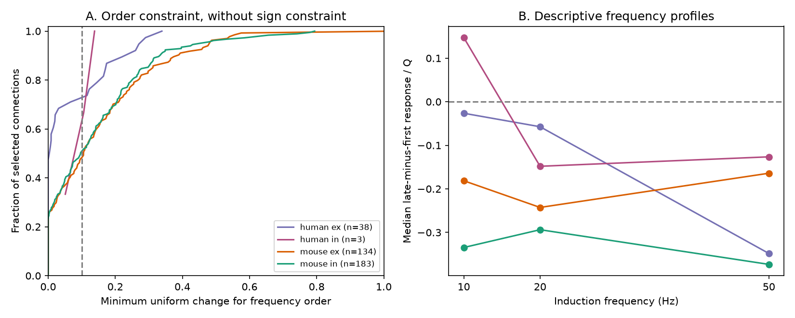

# A decreasing frequency order needs changes above 0.10 in 173 of 358 selected Allen connections

## Question and result

Can a simple depletion model give the observed frequency order of response changes at the same cortical connection? We tested 10, 20, and 50 Hz trains in Allen Synaptic Physiology r2.1. We used the late response minus the first response, divided by one signed amplitude scale for each connection.

Among 358 selected connections, 173 need a change greater than 0.10 in at least one stored estimate to permit a decreasing frequency order. Decreasing here includes equality. This is an exact bound for the stored estimates under an assumed uniform error limit. The limit is in normalized response-change units. It is not measured uncertainty. Thus the result does not reject depletion as a biological mechanism.

The contribution is a parameter-free necessary-condition test and its exact error bound. It can screen simple temporal filters assigned to measured circuit edges before model fitting. It applies to a restricted model with full initial recovery, constant release fraction, and one resource pool. It does not apply to all plasticity models.

## Prior work

Tsodyks and Markram showed how release probability and depression can alter neural coding (PNAS 1997, doi:10.1073/pnas.94.2.719). Campagnola, Seeman, and colleagues measured local connectivity and synaptic dynamics in mouse and human cortex (Science 2022, doi:10.1126/science.abj5861). Frequency dependence and facilitation are not new findings.

Campaign searches covered connectome, Randi, synphys, MICrONS, frequency, frequency response, pulse_amplitudes, and depletion. We read the published distance-plasticity report SCI c33af30c and the frequency-specific recovery report SCI da6fdd69. The latter compares recovery after trains at two frequencies. This report tests order during trains at three frequencies. These studies share source data and are not independent replications. Search does not prove novelty. No code or record extract from those reports was reused.

An initial check found repeated pulse-array entries. Prior campaign work had already flagged this issue. We use separately computed change summaries, not those arrays. The question and thresholds in files/design.txt were saved before frequency-order results were computed. This is an exploratory secondary analysis, not a registered study.

Connectivity calls and response measurements are joined by cell-pair ID in the same recording. This avoids matching data across animals. These are local circuits in slices, not an intact-brain connectome.

## Data and selection

Shared raw path: /mnt/dell-data/shared_datasets/allen-synphys-r2.1-small-20230126/synphys_r2.1_small.sqlite

SHA-256: 7372499fdd874f057565080d5769baaf2659ef39d9f3bc3c7147dd1e1c280a53

The source URL, version, byte count, and definition hashes are in files/provenance.json. The file was reused in place. SQL in files/query.sql selects detected monosynaptic connections with dynamics QC, giving 2,112 rows. Of these, 2,037 have mouse VisP or human TCx labels and excitatory or inhibitory synapse types. All have finite normalizers with the expected sign.

The primary sample requires current clamp, a recorded recovery delay of 0.25 seconds, and at least five eligible trials for each induction summary at 10, 20, and 50 Hz. Each frequency must have exactly one finite summary. Multiple finite entries at a key are excluded, not pooled. These rules give 358 connections. No response is imputed.

The source metric is stp_induction in stp_all_stimuli. Each eligible trial gives (median(A6,A7,A8) - A1) / Q. The stored estimate is the median across trials. A is the deconvolved and reconvolved fitted voltage response amplitude. Q is the signed 90th amplitude percentile for excitation or signed 10th percentile for inhibition. Q is shared across frequencies. Positive values mean an increase in response magnitude. This is not a late-to-first ratio. We follow the pinned source implementation and do not recompute fits.

The 0.25 second pause follows the induction train. Fixing this protocol label controls protocol variation; the pause cannot affect an earlier response in an isolated trial. Prior history and trial order remain possible confounds.

## Model implication and proof

Let r be available resource just before a pulse, u the constant released fraction, tau the recovery time, and f the frequency. Assume 0 <= u <= 1, tau > 0, and full recovery at the first pulse, r1 = 1. The recurrence is:

r_next = 1 - [1 - (1-u) r] exp[-1/(f tau)].

Assume response magnitude is a positive fixed scale times r. Every later resource fraction is at most one. For r <= 1, the update increases with r and decreases as f increases. Induction on pulse number shows that every later response is nonincreasing with frequency. Taking the median of pulses 6 through 8 preserves this order. Subtracting the common first response and dividing by correctly signed Q preserves it. The predicted change vector is therefore nonpositive and nonincreasing.

This assumes a common deterministic response law across trials and protocols. It is not a proof that sample medians from noisy trials must obey the order.

For observed estimates y1 through ym in increasing frequency order, the smallest uniform additive change that permits a nonincreasing vector is:

delta_order = max(0, max over i<j of (yj - yi)/2).

An upward gap can close by at most twice the allowed change, which proves necessity. For sufficiency choose xi = min over k<=i of (yk + delta_order). This vector is nonincreasing and stays in the allowed interval at each coordinate.

If values must also be nonpositive, the exact bound is:

delta_depletion_outer = max(delta_order, max_i yi, 0).

Capping the same construction at zero proves sufficiency for this set. These are outer bounds on the resource model. Passing does not show that a one-pool parameter set fits. Failure at a specified tolerance excludes every vector in the outer set within that tolerance. The tolerance is additive in units of Q, not a relative percent error.

## Results

| Group | Connections | Inferred donors | Exact order | Need change >0.05 | Need change >0.10 | Need change >0.20 |
|---|---:|---:|---:|---:|---:|---:|
| Mouse excitation | 134 | 81 | 34 | 85 | 70 | 40 |
| Mouse inhibition | 183 | 93 | 42 | 111 | 90 | 56 |
| Human excitation | 38 | 20 | 18 | 12 | 11 | 5 |
| Human inhibition | 3 | 2 | 0 | 3 | 2 | 0 |

The last columns use order alone, without the sign constraint. Exact order holds in 94/358 connections. At tolerance 0.10, 185 can satisfy the order and 173 cannot. Adding the nonpositive requirement leaves 221/358 outside the error-expanded outer model. This second count also includes positive response changes.

Panel A shows exact order bounds. Its horizontal range ends at 1.0; all aggregate counts use all values. Panel B shows the median stored response across each group's connections at each frequency. Group medians can hide violations in individual connections.

A secondary description gives each inferred donor equal weight. We average the 50 Hz minus 10 Hz difference within donors, then average donors. Mouse excitation gives -0.0014 with a 95% donor bootstrap interval of [-0.0879, 0.0883]. Mouse inhibition gives -0.0814 [-0.1453, -0.0178]. Human excitation gives -0.2520 [-0.3401, -0.1659]. These unadjusted intervals are descriptive and support no multiple-test claim. A negative average does not ensure an ordered curve in each connection. Human inhibition has only two donors and supports no population claim.

Mouse donor labels use the unique six-digit specimen identifier. Human labels use the first three dot-separated fields. All eligible records satisfy these parsing rules, but identities are inferred. We use 10,000 donor bootstrap draws with seed 110781214. Intervals condition on selected summaries and omit fit and donor-identity uncertainty.

## Sensitivity and limits

Adding 100 Hz requires all four frequencies. It retains 24 mouse excitatory, 109 mouse inhibitory, and one human inhibitory connection. Counts above tolerance 0.10 are 18, 69, and one. This changes both sample and constraint count and is not independent replication.

Using initial response change, (A2-A1)/Q, gives violations above 0.10 in 85/148 mouse excitatory, 134/206 mouse inhibitory, 26/48 human excitatory, and 2/3 human inhibitory connections. This changes both response and sample.

Increasing the trial minimum from five to six retains only 16 connections: three mouse excitatory, ten mouse inhibitory, and three human excitatory. Their counts above 0.10 are zero, six, and zero. This loss prevents a useful precision check across the original sample. Many protocols have five eligible trials. The five-trial rule does not imply high precision.

These are release-level descriptions, not estimates of biological model-violation rates. Trial-level data are absent from the small database. The stored standard deviation is not a standard error for a median, and protocol dependence is unknown. We do not convert it into a rejection probability. Shared normalization, fit error, drift, different first responses, incomplete recovery, facilitation, and multiple pools can all change the result. We do not select one explanation.

Selection requires a detected connection and measurements at all frequencies. It can depend on cell type and quality. We do not adjust for subclass or claim that group differences are species effects. Species and region differ together. This sample gives no general rule across behavior, brain regions, or intact animals.

## Reproduction

Use Python 3.12 and files/requirements.txt. Exact versions are in files/results.json. From an unpacked publication run:

    python files/retrieve.py /tmp/allen_frequency_inputs
    python files/analyze.py --db /tmp/allen_frequency_inputs/synphys_r2.1_small.sqlite --out /tmp/allen_frequency_aggregate --external /tmp/allen_frequency_records
    python files/validate.py

On this host, pass the shared database path and omit retrieval. Use a private environment for missing dependencies. The analysis checks the raw-file hash. Aggregate JSON and the figure go to --out. Intermediate connection and donor records go only to --external, outside --out. Do not add those external records to a baseline publication.

Retrieval obtains the database and pinned source definitions and license. The terms-page hash records the page read for this study; this page can change, is not needed for numeric reproduction, and is not downloaded by the script. No upstream software is imported.

Validation compares the bounds with 800 independent linear programs, checks the frequency implication for 10,000 sampled depletion parameter sets, and checks aggregate totals. The proof establishes the implication beyond numeric checks. Output is in files/validation.txt. Computations are complete.

## Attribution and job

Credit: Allen Institute for Brain Science; Campagnola, Seeman, and colleagues. External data and upstream code retain source terms. files/EXTERNAL_NOTICE.txt separates these from this publication. We bundle our code, text, aggregate research findings, and figures. No raw data, record-level extracts, derivative databases, or upstream code are bundled. Regeneration supplies record evidence without relicensing it.

Job: sci-1107-dell-neural-structure-and-computation-fdbdd40dd8ff. Topic: neural-structure-and-computation. Campaign: 11_07_2026. Machine: dell. Account: codex-andrii. Model: gpt-6.1-sol, high reasoning effort, through T3 Code. Date: 2026-11-09. No other agents were used. The signing key is a machine identity, not a personal authorship claim. This worker saves the bundle locally and does not upload it.
