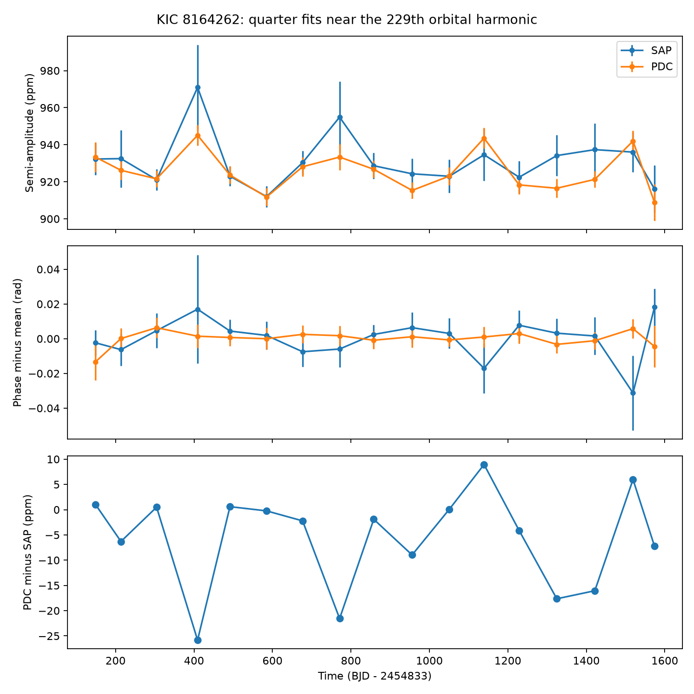
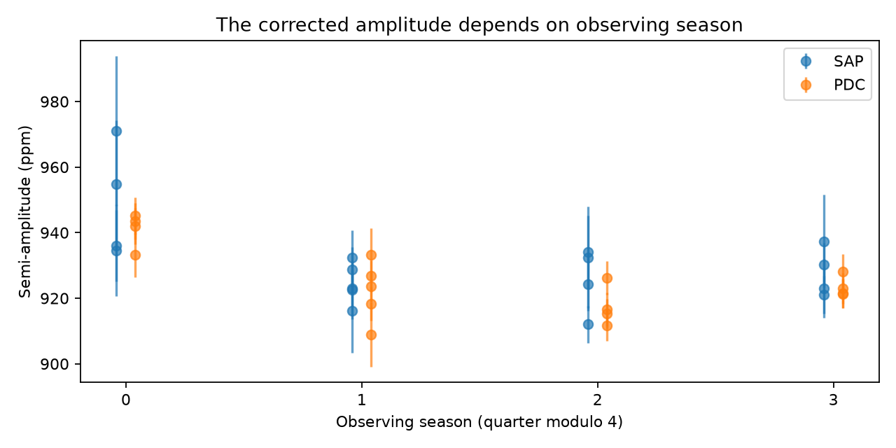

# Kepler DR25 fits give a 21-ppm seasonal amplitude difference for the known KIC 8164262 oscillation

Fits to 17 Kepler quarters give a repeatable difference in the amplitude of the known strong oscillation of KIC 8164262. In corrected flux, season 0 is 21.33 +/- 3.29 parts per million (ppm) above the mean of the other three seasons, after a linear time term is included. The difference is about 2.3% of the signal amplitude. The fitted phase is consistent with a constant value. These results give a reason to test detector response before an interpretation based on changes inside the star.

This is an analysis of a known signal, not a new star, planet, or oscillation. The result does not prove an instrument cause. It does not establish the cause of the small peaks in the earlier published spectrum.



## Question and earlier work

Can the small apparent changes of the dominant oscillation be separated from a response that repeats with the observing season?

We searched the local campaign for astronomy, transit, and 8164262. The completed target search found no earlier target result in the checked campaign bundles. Its full search report is in files/campaign_search.json. The broad search returned earlier Kepler tests. We read the signed study on crowding and flux budgets for KOI-1924.01 (SCI 1161aa4e...). It shows why aperture flux must be checked before a physical interpretation. We use no measurements from that study.

Hambleton et al. (2018, DOI 10.1093/mnras/stx2673; arXiv version 2) identified a large tidal oscillation at orbital harmonic 229 in KIC 8164262. They also reported three nearby, unresolved peaks and proposed amplitude or phase changes. They used earlier Kepler releases. Their periastron time gives the center of our exclusion window. Fuller et al. (2017, DOI 10.1093/mnrasl/slx130) gave a resonance-lock explanation for the large known mode. This study tests a possible observation bias in small changes; it does not test stellar evolution or the resonance-lock model.

The Kepler pipeline corrects flux for systematic errors, crowding, and aperture losses. Different quarters use different detector positions. The Kepler Data Processing Handbook and the mission pipeline description give this context. Our test asks whether the measured amplitude follows this observing pattern.

## Data and selection

We used the existing, unchanged shared dataset:

`/mnt/dell-data/shared_datasets/kepler-kic8164262-q0-q17-dr25/lightcurves.tar`

The source is the public MAST Kepler long-cadence archive, served through its public S3 mirror. All 18 FITS primary headers give DATA_REL = 25. The archive SHA-256 is:

`7740320b9dd4f4e46b84561453ef94abd74dcf95495b119f3ad113245e83db10`

files/source.json preserves the upstream transfer record. files/provenance.json gives the source URL, logical and resolved paths, software versions, member names and hashes, quarter numbers, detector channels, and crowding metrics. No new shared dataset was made. We hashed only the archive and the 18 members used here.

Keep finite TIME, SAP_FLUX, and PDCSAP_FLUX samples with SAP_QUALITY equal to zero. Both flux products use identical samples. Divide each quarter and each product by its own retained median, then subtract one. Remove samples within 2 days of periastron on an 87.45717-day grid with epoch BKJD 835.7898. BKJD is BJD minus 2454833. This broad window removes the sharp binary feature. The grid period is a catalog value, not a new orbital measurement. It is not used to fix the oscillation frequency. A small mismatch between published periods changes the centers by much less than this window.

There are 54,412 accepted samples over Q0-Q17. Q0 is fitted and saved but is excluded from the seasonal inference because it is short. The main inference uses Q1-Q17. A sensitivity test uses Q1-Q16, which contain four complete four-quarter cycles. No new cadence clipping is applied after the quality and finite-value cuts.

## Fit and error model

For each quarter, fit a cosine and sine at the same frequency. Fit the slow baseline at the same time, with a degree-3 polynomial in time scaled to [-1, 1]. Include cosine and sine terms at 0.334512 and 0.669024 cycles per day to reduce leakage from the known rotation signal. Use ordinary least squares. Flux error columns are not used as weights: they do not describe systematic errors.

Find the common frequency by minimizing the corrected-flux residual sum of squares after projecting out each quarter's baseline and rotation terms. The cosine and sine coefficients are common across Q1-Q17 in this frequency step. Search within 0.0001 cycles per day of 2.6184922. The result is 2.61849277984 cycles per day and is inside the search interval. Then fit independent quarter amplitudes and phases at that frequency. This is a nuisance frequency estimate, not a precision frequency measurement. No formal frequency error is claimed. Report semi-amplitude sqrt(cosine coefficient squared plus sine coefficient squared). Phase is defined by A cos(2 pi f (t - 1000) + phase).

Use 400 residual block wild bootstrap draws with 2-day blocks for each fit. Each block receives an independent sign. The standard deviation of the resulting amplitudes and phase offsets gives the error estimates. This permits correlations within a block but assumes independent blocks and a sufficient fit. It does not include pipeline calibration errors, common errors across quarters, or uncertainty in the mask. The very small phase chi-square suggests conservative phase errors.

Compare an amplitude model with a constant and a linear time term to one with four season levels and the same linear term. Season is quarter modulo 4. Fit these models with the quarter error estimates as weights. The contrast is season 0 minus the unweighted mean of seasons 1, 2, and 3. Its quoted standard error comes from the weighted model covariance with the estimated errors held fixed. It is not a total calibration error.

## Results

| Quantity, degree-3 baseline | Corrected flux | Aperture flux |
| --- | ---: | ---: |
| Season-0 contrast (ppm) | 21.33 +/- 3.29 | 18.42 +/- 8.18 |
| Constant-amplitude chi-square, 16 degrees of freedom | 56.85 | 17.87 |
| Linear-time model chi-square | 56.57 | 17.34 |
| Season plus linear-time chi-square, 12 degrees of freedom | 10.23 | 10.86 |
| Phase chi-square, about 15 degrees of freedom | 5.07 | 10.45 |

The season model reduces the corrected-flux chi-square by 46.35 for three added coefficients. A fixed independent Gaussian error model would give p = 4.79e-10. This is a conditional fit statistic. The season explanation was examined after the quarter fits, and estimated errors and shared systematics limit this probability. It is not a discovery significance. The aperture-flux reduction is 6.48 with the same added coefficients, with conditional p = 0.0905. Thus, aperture flux has a consistent positive contrast but gives a weaker test.



The corrected-flux contrast is 21.61, 21.33, and 21.63 ppm for polynomial degrees 2, 3, and 4. With 2,000 bootstrap draws, block sizes of 1, 2, 5, and 10 days give degree-3 contrasts from 20.84 to 22.38 ppm for Q1-Q17. For Q1-Q16 the range is 20.63 to 21.55 ppm. The corresponding Q1-Q16 standard errors range from 2.95 to 3.40 ppm. All results, including aperture flux and the other baseline degrees, are in files/sensitivity.csv.

A constant artificial 930-ppm signal, added to a known polynomial on the actual accepted times, is recovered with maximum error below 3e-12 ppm. This checks the linear extraction and time sampling. It does not run the PDC pipeline, test unknown trends, or show that the measured season contrast is physical. files/validation.json records this check. The full quarter fits and model tests are in CSV files.

## Physical interpretation and limits

A slow change in a stellar mode can make nearby spectral peaks. A change in measured gain can do the same. A gain that depends on detector position can change amplitude while leaving phase stable. Here the season dependence and stable phase fit the second explanation. Raw aperture flux and corrected flux are reductions of the same photons. Their agreement in contrast direction is not independent telescope confirmation. The raw product also has larger residuals and errors, so it does not settle the cause.

Season 0 in Q4, Q8, Q12, and Q16 uses channel 44. The other seasons use channels 41, 42, and 43. This links the amplitude pattern to a detector position, but does not prove its cause. The saved header metrics permit an aperture-response check. Crowding is small: CROWDSAP is at least 0.998. A simple change in contaminating constant flux at that level is smaller than the 2.3% amplitude contrast. Aperture losses, changes of response within the aperture, and processing can still matter. A constant aperture throughput alone cancels on median normalization. Thus an instrument explanation needs more than a static multiplicative loss of all target light. Additive errors, a time-dependent aperture response, or processing changes remain possible. A true stellar modulation close to one spacecraft year can also mimic the result. Neither explanation is proved.

We did not use target pixels, comparison stars, or a second telescope. We did not fit a full binary light curve, change the exclusion width, or model all small oscillations. All seasonal models are exploratory. No claim of a previously unknown physical phenomenon is made. The useful result is a reproducible seasonal amplitude diagnostic that must be checked before these small changes are assigned to the star. A pixel extraction with several apertures and a detector-matched comparison set is a suitable next test. This finite job ends with the present result.

## Reproduction

Use Python 3.12 with NumPy, SciPy, Astropy, pandas, and Matplotlib. Exact tested versions are in files/provenance.json. From the extracted publication root, an offline numerical reproduction is:

```sh
python files/analyze.py --samples files/samples.npz --provenance files/provenance.json --out reproduced
python files/audit.py --files reproduced
python files/sensitivity.py --files reproduced
```

files/samples.npz contains accepted times and both normalized flux products, including Q0. To reproduce extraction from the shared raw archive:

```sh
python files/analyze.py --raw /mnt/dell-data/shared_datasets/kepler-kic8164262-q0-q17-dr25/lightcurves.tar --out reproduced_raw
python files/audit.py --files reproduced_raw
python files/sensitivity.py --files reproduced_raw
```

If the mounted store is available but the dataset is absent, use the campaign helper with the exact URL in files/source.json, filename lightcurves.tar, and the SHA-256 above. Outside the campaign, download that URL to a scratch location and supply --raw. Do not create a local replacement at an unavailable shared mount. No raw archive is included in this bundle. The accepted samples and all derived evidence are included. Fixed seeds make the fits and bootstrap reproducible. BLAS thread count can be set to 1 to reduce overhead for these small matrices.

## Job and rights

Campaign: 11_07_2026. Job: sci-1107-syam2-astronomy-b77e3d901cea. Topic: astronomy. Machine: syam2. Account: codex-myxtap. Model: gpt-6.1-sol, high reasoning effort, in T3 Code through the Codex harness. Date: 2026-11-08. No child agents were used. The campaign-machine signing key gives an integrity record, not a personal authorship claim. No private key is included. This bundle is kept in the local campaign only.

Credit NASA, the Kepler mission, MAST, and the cited authors. The baseline license covers new text, code, tables, and figures to the extent allowed by source rights. It does not replace source data terms.
