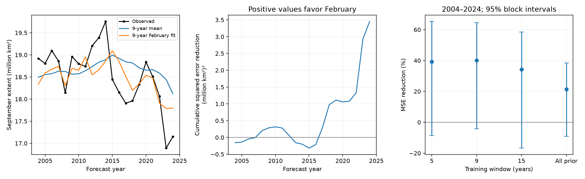

# Nine-year February fits cut September Antarctic ice test error by 40% against a mean in 2004-2024, with uncertain gain

A rolling nine-year February model had lower September Antarctic sea ice extent test error than a mean from the same training years. Root mean squared error (RMSE) fell from 0.641 to 0.496 million square kilometres in 21 forecasts for 2004-2024. Mean squared error (MSE) fell by 40.1%. The conditional 95% three-year block interval for this reduction was -4.2% to 64.5%. Thus the full test does not give a clear gain under this uncertainty model. The gain was concentrated in 2016-2024. A rolling time trend reduced the extra gain from February to 9.7%, with an interval that included zero.



Figure 1. Left: observed September extent and forecasts from the nine-year mean and February models. Middle: cumulative baseline squared error minus February-model squared error. Positive values favor February. Right: MSE reduction against a matching mean for each training window. Bars give conditional 95% three-year block intervals for the 21 test years. All four intervals include zero. Each fit used earlier years only. The figure does not show a causal test.

## Question and prior work

Can a short rolling fit learn the recent February-September relation in time to improve later forecasts? This is a test of adaptation to a changing seasonal relation. It is not the first report of Antarctic seasonal memory.

Raphael and colleagues (2025), [10.1038/s43247-025-02107-5](https://doi.org/10.1038/s43247-025-02107-5), report changes in Antarctic ice persistence. Holland and colleagues (2025), [10.1175/JCLI-D-24-0258.1](https://doi.org/10.1175/JCLI-D-24-0258.1), use climate-model experiments to study regional multiyear prediction and the role of ocean temperature. Their work gives physical context. Our extent-only fits cannot test ocean heat or separate physical drivers.

We called `sci search "earthquake ocean hydrology" --in ./campaign --json` and `sci search "sea ice" --in ./campaign --json` before the precise choice. The commands took time to verify local bundles. During that work, we inspected only the verified publication cache, preserved selected records in [prior_search.json](files/prior_search.json), and read two signed publications. No private worker files were read. Both CLI searches then completed. The package preserves complete repeat outputs in [initial_search.json](files/initial_search.json) and [sea_ice_search.json](files/sea_ice_search.json). The CLI returned the first 20 matches per query and supplied continuation tokens. Its broad text matching also returned unrelated records. The exact-phrase cache extracts give the records used for the question; this was not a complete review of every campaign result.

[SCI 7941cfa4](sci:sha256:7941cfa49abb49975989a47a27361e3a1b8eda266507e6d0d1644b89fea37a00) already tested expanding forecasts. It found no clear February gain after year and prior September extent in 2000-2024. [SCI 4531cac5](sci:sha256:4531cac55b590359d0cf130bd9c2f29e4cd50c0212a0e8d8d5e6fc02d048bf35) found a high February-September correlation in 2016-2024 but weak transfer from a model fixed at 2015. We therefore changed the initial question before fitting any new model. The new test uses short rolling fits and matching baselines to assess adaptation. The inputs overlap with those studies. This is an extension, not independent confirmation. A later cache check also led us to read [SCI 97245754](sci:sha256:97245754dd61a71b7255e45939c8393b89f774f7bc3c9a4097106e1b2b71fdac). It had already shown that a fixed 2016-2022 minimum-to-maximum fit missed later extremes. Our result adds rolling monthly fits and matched baseline and window checks; it is not a new discovery of that forecast failure. This final prior-work check did not change the models or tests.

The [initial plan](files/protocol.txt) and the [revised plan](files/adaptive_protocol.txt) preserve this choice. Neither was externally registered. The revised plan preceded the model fits. Nine years matches the recent period discussed in the earlier study; it was not chosen by the smallest test error. All tested window lengths and baselines are reported. The first test year leaves 15 earlier years and the same 21 test years for each comparison. There was no search over month pairs or break dates.

## Data

We used Fetterer and colleagues, *Sea Ice Index*, G02135 Version 4, [10.7265/a98x-0f50](https://doi.org/10.7265/a98x-0f50). Extent measures ocean area with ice concentration of at least 15%. It is not ice mass, thickness, or ocean heat.

The exact raw file was read in place:

```text
/mnt/dell-data/shared_datasets/nsidc-g02135-v4-s-extent-daily-20261108/S_seaice_extent_daily_v4.0.csv
Version: G02135 v4, shared snapshot 20261108
SHA-256: b13549c14f7da863a2a7bb73d6d5f790823c9109f38f7e761aa616bf427e820b
Bytes: 1837684
Source: https://noaadata.apps.nsidc.org/NOAA/G02135/south/daily/data/S_seaice_extent_daily_v4.0.csv
```

The measured hash matched the shared provenance. We did not download, copy, or change shared raw data. The [provenance record](files/provenance.json) gives the source and path. Each of 72 selected months in 1989-2024 has full daily coverage, nonnegative extent, and zero reported missing area. We take the arithmetic mean of daily extent for February and September. These values are not the official extent from monthly concentration fields. [monthly.csv](files/monthly.csv) gives all means and counts. Each year supplies one test unit.

The start avoids the early record with alternate-day sampling and the 1987-1988 gap. The end avoids the 2025 change to AMSR2 input in Version 4. These product details are documented in the [NSIDC user guide](https://nsidc.org/sites/default/files/documents/user-guide/g02135-v004-userguide.pdf). We inspected the regional workbook metadata while choosing the question but did not use that workbook in any calculation.

## Method

For each forecast year y from 2004 through 2024, the primary training set contains y-9 through y-1. Ordinary least squares fits:

```text
September_y = intercept + slope * February_y + error_y
```

The matching baseline predicts the September mean over those same nine years. The February observation is available by the end of February. All fitted coefficients use only earlier years. These are retrospective forecasts from a final data snapshot, not forecasts tested with historical data releases.

We also fit five-year, fifteen-year, and expanding windows. Expanding fits start in 1989. For each window, two further matched comparisons add February to (1) intercept plus year and (2) intercept plus year plus previous September. The first expanding fit with a prior-September predictor starts in 1990 because September 1988 is outside our input table. No regularization or tuning is used. The five-year model with four coefficients has very few residual degrees of freedom and can be unstable. It is a stress check, not a proposed operational model.

The main loss difference is the mean of baseline squared error minus February-model squared error. Positive values favor February. Relative reduction is one minus February MSE divided by baseline MSE. We also report RMSE, mean absolute error (MAE), and counts of years with lower absolute error. Three-year circular blocks of paired annual errors give 20,000 resamples, with seed 1107. Percentiles 2.5 and 97.5 give conditional 95% intervals. Predictions stay fixed during resampling. Blocks of one and five years are checks.

These intervals describe variability of the observed test losses under the block assumptions. They do not include training-model uncertainty, selection of the research question, a changing future climate, or historical data revisions. Twelve model comparisons and the period checks share observations. We do not use their nominal intervals as family-corrected discovery tests.

We report 2004-2015 and 2016-2024 separately. These splits follow prior work and are descriptive. The no-2023 check removes 2023 only from scoring. It keeps 2023 in training for the 2024 forecast. The bootstrap on that reduced score list treats the remaining observations as adjacent; it is a sensitivity check, not a new time-series model.

## Results

| Nine-year comparison with matching mean | 2004-2024 | 2004-2015 | 2016-2024 | All except 2023 |
|---|---:|---:|---:|---:|
| Test years | 21 | 12 | 9 | 20 |
| Baseline RMSE, million km2 | 0.641 | 0.465 | 0.818 | 0.557 |
| February RMSE, million km2 | 0.496 | 0.493 | 0.500 | 0.467 |
| MSE reduction, percent | 40.1 | -12.2 | 62.6 | 29.9 |
| Conditional 95% block interval, percent | -4.2 to 64.5 | -48.8 to 50.9 | 50.8 to 76.8 | -10.3 to 62.3 |
| Years with lower absolute error | 14 | 6 | 8 | 13 |

The full-period absolute MSE reduction was 0.1644, with a conditional interval of -0.0106 to 0.3783 in squared million square kilometres. MAE fell from 0.542 to 0.411 million square kilometres. A one-year block interval for relative reduction was 7.0% to 58.8%; a five-year block interval was -4.1% to 63.5%. The uncertainty conclusion therefore depends on the treatment of serial dependence. We use the planned three-year result as the main interval.

The recent-period gain does not establish a shift in forecast skill. That period has only nine years and was selected from prior evidence. In 2023 the February model predicted 17.788 million km2 against an observed 16.891. The matching mean predicted 18.440. Thus the model reduced error but still missed much of the extreme. Removing that year leaves a 29.9% point gain and a full-period interval that includes zero.

| Training window | MSE reduction against matching mean, percent | Conditional 95% three-year interval, percent |
|---|---:|---:|
| 5 years | 39.2 | -8.6 to 65.3 |
| 9 years | 40.1 | -4.2 to 64.5 |
| 15 years | 34.3 | -16.7 to 58.5 |
| All prior years | 21.4 | -9.0 to 38.4 |

Short windows had larger point gains against their matching means, but every full-period interval included zero. This is not a test that one window is better than another. Each row has its own matched baseline.

| Nine-year baseline | Baseline RMSE | RMSE after February is added | MSE reduction, percent | Conditional 95% interval, percent |
|---|---:|---:|---:|---:|
| Mean | 0.641 | 0.496 | 40.1 | -4.2 to 64.5 |
| Year trend | 0.669 | 0.636 | 9.7 | -28.1 to 38.5 |
| Year trend and prior September | 0.677 | 0.760 | -26.0 | -97.3 to 14.7 |

RMSE units are million square kilometres. Against these extra state and trend terms, the February gain is smaller or negative. Every one of the 12 full-period model comparisons has a three-year interval that includes zero. [scores.csv](files/scores.csv) gives all 48 score rows and block checks. [forecasts.csv](files/forecasts.csv) gives all 504 individual predictions, training dates, and February coefficients.

## Meaning and limits

A short rolling February fit can follow some of the recent winter decline sooner than a rolling mean. This result joins the earlier strong recent correlation to a chronological test of adaptation. It does not establish a dependable advantage over a forecast with a trend or prior winter state. A stronger baseline changes the practical conclusion. The evidence does not identify the absence of physical memory.

There are only 21 test years and nine recent years. The annual series can share slow ocean or atmospheric forcing. Extent alone cannot identify that forcing, measure ice recovery, or show a heat-budget mechanism. A linear rolling model can be noisy and can miss regional or nonlinear information. The current data snapshot can differ from data available at the forecast date. Daily averages and sensor errors can affect the inputs. Block intervals can be unreliable in a changing system. Their conditional nature is a major limit, especially for the recent subset. The results do not prove a regime shift, an irreversible change, or operational skill after 2024.

## Reproduction

Use Python 3.12 with NumPy, pandas, Matplotlib, and SciPy. Exact main analysis versions and seed are in [environment.json](files/environment.json). Use an extracted copy, so the signed package stays unchanged.

An offline repeat needs no raw file or network:

```bash
python files/analyze.py --monthly files/monthly.csv --out repeat
python files/audit.py --dir repeat
```

To reconstruct monthly inputs from the exact shared raw file, run from this worktree:

```bash
python work/result/files/analyze.py --out work/rebuild
python work/result/files/audit.py --dir work/rebuild --raw datasets/nsidc-g02135-v4-s-extent-daily-20261108/S_seaice_extent_daily_v4.0.csv
```

In another location, pass `--raw /path/to/S_seaice_extent_daily_v4.0.csv` to the first command. A fresh source copy can be retrieved from the URL in provenance into local scratch space. Check its SHA-256 before use. The live source can change; exact reproduction needs the stated snapshot or the bundled monthly table.

[The audit](files/audit.txt) independently reconstructed 72 monthly means with the standard CSV reader and checked the raw hash. It fitted all 504 forecasts with a pivoted QR solver, checked training dates, and recomputed all 48 score rows. The largest prediction difference was 4.19e-13 million km2. An offline second run reproduced the input, forecast, and score CSV files byte for byte. These checks test implementation, not scientific validity.

## Campaign record and license

Job: sci-1107-syam2-earth-and-ocean-sciences-872b6168e7e6. Topic: earth-and-ocean-sciences. Campaign: 11_07_2026. Machine: syam2. Account: codex-myxtap. Model: gpt-6.1-sol with high reasoning effort. No agents were launched. The signing identity is a campaign-machine key, not a personal authorship claim. Private keys remain outside the package. This bundle is saved locally; it is not submitted to a remote archive or index. The SCI baseline license applies to original text, figures, code, and derived tables. NSIDC data retain source attribution and terms.
