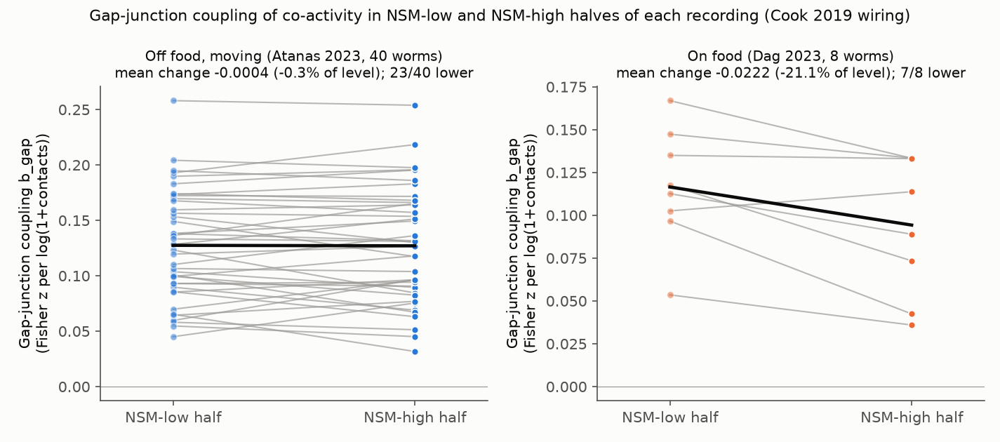
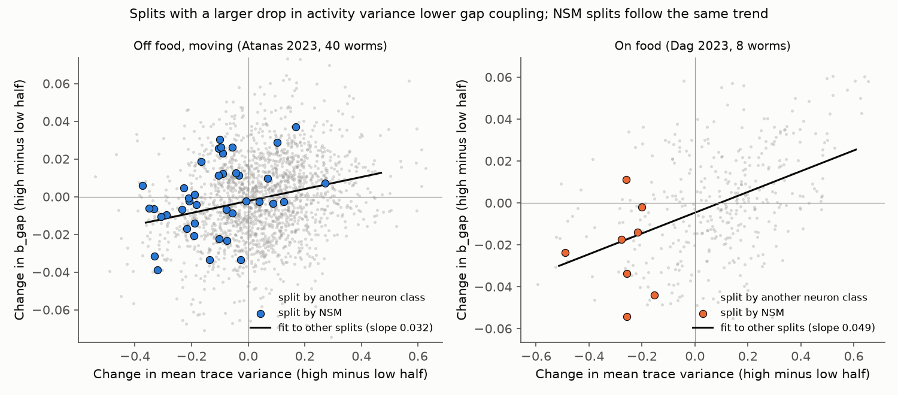
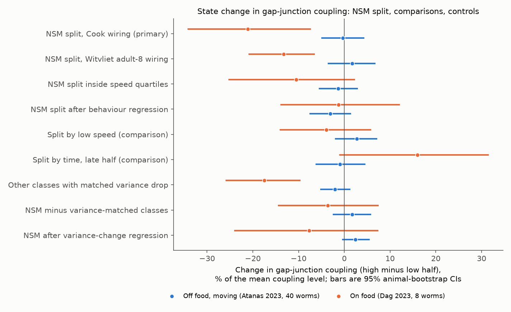

# NSM serotonergic state did not change wiring coupling of co-activity in 40 off-food C. elegans; an on-food decrease in 8 worms matched a drop in activity variance

## Summary

**Question.** Neuromodulators can change how a circuit uses its wiring. A frequent hypothesis (Bargmann 2012, BioEssays, doi:10.1002/bies.201100185) is that a neuromodulated state makes activity follow the anatomical connectome less closely. We tested this hypothesis for serotonin in *C. elegans*. The serotonergic neuron NSM is active when the worm slows and dwells. We asked: in the frames of a whole-brain recording when NSM is high, does the connectome predict pairwise co-activity more weakly or more strongly than in the frames when NSM is low?

**Approach.** We used NeuroPAL-identified whole-brain GCaMP recordings from two public data sets: Atanas et al. 2023 (40 worms, off food, moving) and Dag et al. 2023 (8 worms, on food). In each recording we divided the frames into an NSM-high half and an NSM-low half (median of the smoothed NSM trace). In each half we calculated the correlation of every pair of identified neurons. We fitted the Fisher-z correlations with a pair model that has one fixed effect per neuron, plus log(1 + gap-junction contacts), log(1 + chemical synapses) and a same-class term (Cook et al. 2019 hermaphrodite wiring). The test value is the change of the gap-junction coefficient (b_gap) from the NSM-low half to the NSM-high half. We compared it with the same change for splits by every other identified neuron class, circular shifts of the NSM trace, speed and time.

**Main results.**

1. **Off food (40 worms): NSM state did not change wiring coupling.** Mean change of b_gap = −0.0004 (95% animal-bootstrap CI −0.0062 to +0.0054). This is −0.3% of the mean coupling level (0.127), and the CI excludes changes larger than 5% of the level. Chemical coupling also did not change (−0.0000, CI −0.0033 to +0.0035; level 0.023). The NSM split was at the median of the other-class splits (mean percentile 0.51) and of the circular-shift splits (0.49).
2. **On food (8 worms): gap coupling was 21% lower in NSM-high halves.** Mean change = −0.022 (CI −0.037 to −0.008; 7 of 8 worms lower; t-test p = 0.022). The decrease was also present with Witvliet adult-8 wiring (−0.027, 8 of 8 lower) and with 1-frame or 30-frame smoothing (−0.019 and −0.018).
3. **The on-food decrease is not specific to NSM. It follows a drop in activity variance.** In NSM-high halves on food, the mean trace variance was 0.26 lower (8 of 8 worms). Only 7% of the other-class splits had a larger drop. Over all splits, a larger variance drop gave a larger decrease of b_gap. Other-class splits with at least half of the NSM variance drop gave a similar decrease (−0.018, CI −0.027 to −0.010). The NSM value minus this matched value was −0.004 (CI −0.015 to +0.008). After a regression on the variance change of the other-class splits, the NSM value was −0.008 (CI −0.025 to +0.008). After removal of behaviour from the traces, the NSM value was −0.001 (CI −0.014 to +0.012).
4. **No clear receptor specificity.** The change in gap coupling was not clearly different for pairs that include a neuron with a serotonin-receptor reporter (Dag et al. 2023 table). For mod-1 or ser-4 pairs on food, the interaction change was −0.030 (bootstrap CI −0.059 to −0.002, but t-test p = 0.10, 6 of 8 worms lower). Off food it was +0.001 (CI −0.014 to +0.014).

**Interpretation.** In these data, the NSM serotonergic state did not change how strongly gap junctions or chemical synapses predict co-activity in freely moving worms off food. In on-food worms, the NSM-high state is a quiet state with lower activity variance, and any split with such a variance drop gives weaker gap coupling. Thus the observed state change is a general property of low-variance epochs, not evidence for a serotonin-specific change in how the network uses its wiring. This result does not exclude serotonin effects on single neurons (Dag et al. 2023 report such effects), and it does not test causal serotonin manipulations.

**Main limitations.** The NSM state is observed, not manipulated. No serotonin mutant or NSM-ablated animals were analyzed. The on-food data set has only 8 worms and 800 frames per worm. Food condition and data set are confounded. The NSM halves differ in speed (mean correlation of NSM with speed: −0.20 off food and −0.47 on food). Correlations come from nuclear GCaMP at 0.6 s per frame. The connectomes come from other animals. Gap-junction pairs are few (median 104 and 133 per worm). The variance adjustments are descriptive and depend on the other-class splits as a reference.



## Data

All recordings and wiring tables are public. We used the campaign shared copies in place. `files/provenance/data_sources.csv` gives the shared path, source URL, byte count and SHA-256 of each input file. `files/provenance/atanas_h5_sha256.csv` and `dag_h5_sha256.csv` list the SHA-256 of each HDF5 recording in the archives. We checked all extracted recordings against these lists (0 mismatches). The publication does not include raw or record-level third-party data. See `files/EXTERNAL_DATA_NOTICE.md`.

| Data | Source | Use |
|---|---|---|
| Atanas et al. 2023 processed HDF5 and NeuroPAL labels | Zenodo record 19388374 | 40 labelled worms off food; 1,600–1,615 frames (0.6 s); for the 19 recordings with a heat stimulus, only the 801–803 frames before the stimulus |
| Dag et al. 2023 processed HDF5 and NeuroPAL labels | Zenodo record 19414639 (re-release of record 7830052) | 8 labelled worms on food (strain SWF702); 800 frames |
| Cook et al. 2019 SI 5 adjacency, corrected July 2020 | OpenWorm ConnectomeToolbox commit ffe5702 | hermaphrodite chemical and symmetric gap-junction counts (primary wiring) |
| Witvliet et al. 2021 adult 8 | wormneuroatlas commit b2e13d8 | independent nerve-ring wiring (replication) |
| Dag et al. 2023 serotonin-receptor reporter table | flavell-lab/NSM_5HTR_analysis commit 47bc370, `5htr_expression_dv_final.csv` | receptor test only |

## Methods

**Neurons.** We used NeuroPAL labels with confidence ≥ 3 and without "?" in the label. If two ROIs had the same label, we kept the one with the higher confidence. We used neurons that are present in the wiring table. NSM neurons were used only as the state signal and not in the pairs. Per worm: median 85 (off food) and 93 (on food) neurons, median 3,403 and 4,097 pairs. In total, 3,361 and 725 neuron recordings.

**State signal and split.** The NSM signal is the mean of the identified NSM traces (`gcamp/trace_array`), smoothed with a centered 10-frame (6 s) moving average. Frames above the median are the NSM-high half. Frames at or below the median are the NSM-low half.

**Pair model.** In each half, we z-scored each trace over the frames of the half and calculated Pearson correlations r. With z = arctanh(r) (clipped at |r| ≤ 0.999), we fitted by least squares

z_ij = a_i + a_j + b_gap·log(1 + gap_ij) + b_chem·log(1 + chem_ij) + b_hom·[same class] + e_ij,

where a_i is a fixed effect for each neuron, gap_ij is the symmetric gap-junction count and chem_ij is the sum of chemical synapse counts in both directions. The neuron fixed effects absorb changes in the mean correlation of each neuron. The state effect is Δb = b(high half) − b(low half).

**Comparison splits (same model, same worm).**
- *Other classes:* the smoothed mean trace of each other identified class (median 47–48 classes per worm). The pairs exclude that class and NSM.
- *Circular shifts:* 200 random circular shifts of the NSM signal (shift 10–90% of the recording). These keep the autocorrelation of the signal.
- *Low speed:* smoothed absolute velocity; the slow half is coded as "high" to match the sign of NSM.
- *Late half:* second half of the frames minus the first half.
- *NSM inside speed quartiles:* NSM median split inside each quartile of smoothed speed, so both halves have the same speed distribution.

**Controls.** (a) Behaviour regression: we removed from each trace a least-squares fit on 17 behaviour features (velocity, head angle, angular velocity, body curvature and pumping, each raw and smoothed over 10 and 50 frames, and absolute velocity raw and smoothed). (b) Variance matching: for each split we recorded the change of mean trace variance and of the spread of z. Across the other-class splits of a worm, we regressed Δb on these two changes and calculated the NSM residual. We also averaged Δb over the other-class splits whose variance drop was at least half of the NSM drop.

**Receptor test.** We added the terms R, g·R and c·R to the pair model, where R = 1 if either neuron has a reporter for the receptor set ("any" of ser-1, ser-4, ser-5, ser-7, lgc-50, mod-1; or mod-1/ser-4). Class names were matched with the dorsal/ventral suffix where the table has one.

**Statistics.** Worms are the units. We report the mean over worms, a 95% bootstrap CI over worms (5,000 resamples), a one-sample t-test, a Wilcoxon test and the count of positive values. The primary tests were the NSM Δb_gap in each cohort with Cook wiring. All others are secondary and not corrected for multiple comparisons. Seed 20261109.

## Results tables

Gap-junction coefficient (Cook wiring). Level is the mean of b_gap over the two halves.

| Quantity | Off food (40) mean [95% CI] | n lower | On food (8) mean [95% CI] | n lower |
|---|---|---|---|---|
| level of b_gap | 0.127 [0.113, 0.142] | | 0.105 [0.081, 0.128] | |
| Δb_gap, NSM split (primary) | −0.0004 [−0.0062, +0.0054] | 23 | −0.0222 [−0.0369, −0.0084] | 7 |
| Δb_gap, Witvliet adult-8 wiring | +0.0048 [−0.0090, +0.0186] | 16 | −0.0274 [−0.0434, −0.0136] | 8 |
| Δb_gap, smoothing 1 frame | −0.0006 [−0.0058, +0.0047] | 23 | −0.0185 [−0.0325, −0.0053] | 7 |
| Δb_gap, smoothing 30 frames | −0.0006 [−0.0065, +0.0053] | 21 | −0.0183 [−0.0316, −0.0051] | 7 |
| Δb_gap, NSM inside speed quartiles | −0.0017 [−0.0069, +0.0036] | 22 | −0.0110 [−0.0271, +0.0025] | 4 |
| Δb_gap, behaviour-regressed traces | −0.0031 [−0.0078, +0.0013] | 20 | −0.0012 [−0.0136, +0.0119] | 4 |
| Δb_gap, low-speed split | +0.0034 [−0.0024, +0.0090] | 16 | −0.0041 [−0.0152, +0.0059] | 4 |
| Δb_gap, late-half split | −0.0012 [−0.0078, +0.0057] | 23 | +0.0168 [−0.0014, +0.0330] | 2 |
| Δb_gap, mean of all other-class splits | −0.0011 [−0.0033, +0.0008] | 21 | +0.0002 [−0.0064, +0.0081] | 5 |
| Δb_gap, other classes with matched variance drop | −0.0026 [−0.0065, +0.0015] | 26 | −0.0184 [−0.0272, −0.0103] | 8 |
| NSM minus variance-matched classes | +0.0021 [−0.0030, +0.0073] | 16 | −0.0038 [−0.0151, +0.0078] | 4 |
| NSM residual after variance regression | +0.0031 [−0.0005, +0.0068] | 12 | −0.0081 [−0.0246, +0.0079] | 5 |
| change of mean trace variance, NSM split | −0.117 [−0.162, −0.071] | 33 | −0.264 [−0.337, −0.209] | 8 |
| change of mean Fisher z, NSM split | +0.0009 [−0.0102, +0.0110] | 19 | −0.0206 [−0.0493, +0.0105] | 6 |

Chemical coefficient (Cook wiring): level 0.023 off food and 0.022 on food. NSM Δb_chem = +0.0000 [−0.0033, +0.0035] off food and −0.0063 [−0.0152, +0.0016] on food (t-test p = 0.20).

Percentile of the NSM Δb_gap in each worm (mean over worms): among other-class splits 0.51 off food and 0.31 on food; among circular shifts 0.49 and 0.25. The mean z-score against the circular shifts was −0.05 off food and −1.06 on food (t-test p = 0.04). The circular shifts keep the NSM autocorrelation but not its relation to the quiet state, so they do not control for the variance drop.

Receptor test (Δ of the interaction coefficient g·R, NSM high minus low).

| Receptor set | Off food mean [CI] | On food mean [CI] | On food t-test p |
|---|---|---|---|
| any 5-HT receptor (55 of 82 neurons per worm off food) | +0.003 [−0.011, +0.018] | −0.025 [−0.058, +0.009] | 0.21 |
| mod-1 or ser-4 (32 of 82 neurons) | +0.001 [−0.014, +0.014] | −0.030 [−0.059, −0.002] | 0.10 |

Off food, the chemical interaction c·R for the "any" set changed by −0.011 (CI −0.022 to −0.002, p = 0.03). This is one of many uncorrected secondary tests, and the matching main term changed by +0.011, so we do not interpret it.





## Relation to prior work

Dag et al. 2023 showed that many neurons correlate with NSM and that receptor expression and synaptic inputs from NSM-correlated neurons relate to this. Our question is different: whether the wiring-to-co-activity relation of the whole network changes with NSM state. Earlier campaign publications showed that gap junctions predict co-activity in these worms (cited below). One of them found electrical-link associations within reversal and non-reversal bouts. A mouse publication found that task engagement decreased the wiring slope of inter-regional co-variation as part of a proportional decrease of coupling. Our on-food result has a similar form: the change follows a general change in the activity, not a specific change of the wiring rule.

## Reproduction

Requirements: Python 3.12 with numpy, scipy, pandas, h5py, openpyxl and matplotlib.

```
bash files/code/run_all.sh /path/to/scratch [/path/to/shared_datasets]
```

`get_data.sh` uses the shared campaign files if a datasets folder is given, otherwise it downloads the files. It checks all SHA-256 values and writes only into the scratch folder. `run_all.sh` then runs `state_coupling.py` (five variants), `receptor_interaction.py`, `aggregate.py`, `receptor_summary.py` and `figures.py`. On the campaign host each variant took about 15–25 minutes with one thread per process. `figures.py` uses only `files/results`, so the figures can be remade without the raw data.

Files:
- `files/code/`: all analysis code (`wormload.py` loader, `connectome.py` wiring tables, `state_coupling.py` main analysis, `receptor_interaction.py`, `aggregate.py`, `receptor_summary.py`, `figures.py`, `get_data.sh`, `run_all.sh`).
- `files/results/summary.csv`: all cohort-level estimates. Variants: `cook` (primary), `cook_behreg`, `witvliet8`, `cook_sm1`, `cook_sm30`.
- `files/results/per_animal_<variant>_<cohort>.csv`: per-worm coefficients for each split and control.
- `files/results/splits_long_<variant>_<cohort>.csv`: Δ coefficients and variance changes for every split of every worm, and percentiles of the circular-shift null.
- `files/results/by_split_class_<variant>_<cohort>.csv`: mean Δ per splitting class over worms.
- `files/results/receptor_*.csv`: per-worm receptor-test coefficients and their summary.

## Provenance

- Campaign 11_07_2026, job sci-1107-hp-neural-structure-and-computation-6ea4fb0b668c, topic neural-structure-and-computation, machine hp.
- Analysis and text by the AI model Claude Opus 5.5 (claude-opus-5-5), run through Claude Code on account claude-olen. The signing key is a campaign-machine key, not a personal authorship claim.
- Date of analysis: 2026-11-09.
