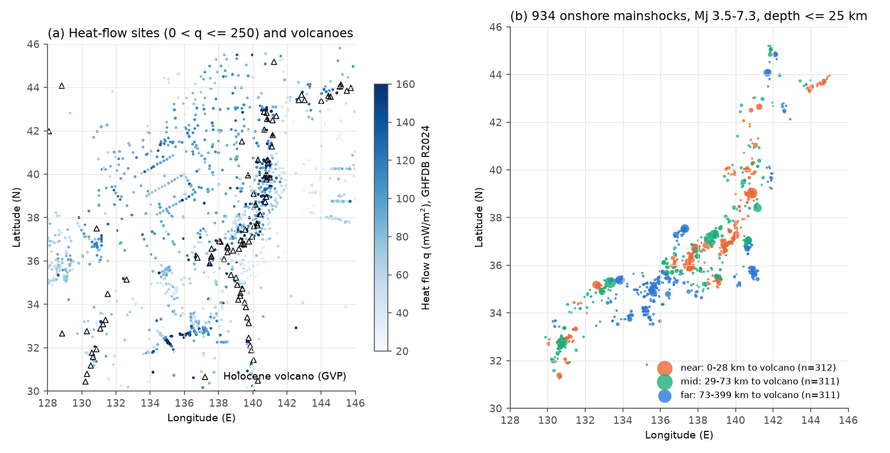
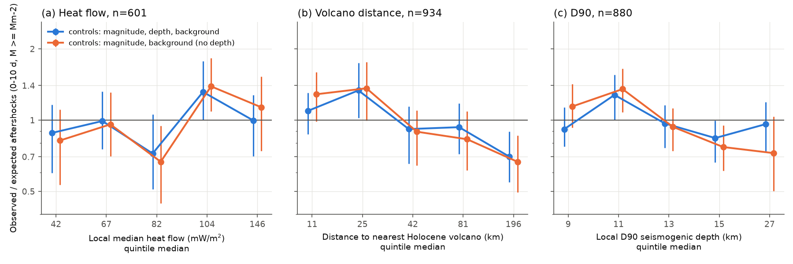
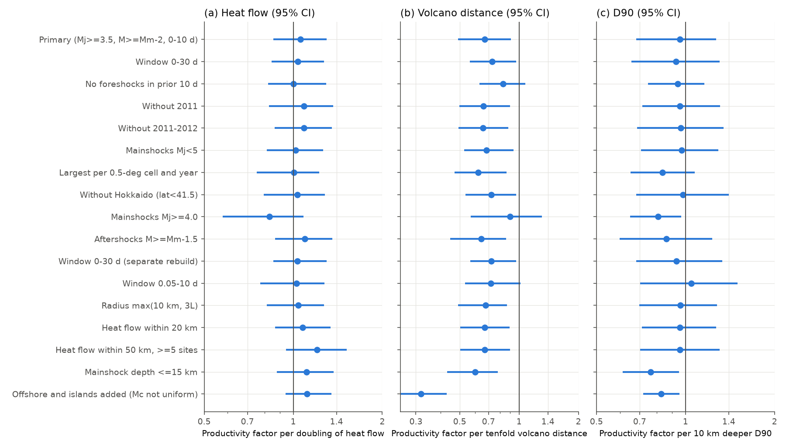

# Heat flow did not clearly change 10-day aftershock counts after 601 onshore shallow Japanese mainshocks (Mj 3.5-7.3, 1999-2024)

Job: sci-1107-hp-earth-and-ocean-sciences-e64dacb43fb5. Topic: earth-and-ocean-sciences. Machine: hp. Model: Claude Opus 5.5 (claude-opus-5-5) in Claude Code. Campaign: 11_07_2026. The signature uses a campaign-machine key. It is not a personal authorship claim.

## 1. Question

A damage rheology model (Ben-Zion and Lyakhovsky, 2006) predicts that hot crust makes fewer aftershocks. Hot crust relaxes stress by viscous flow, so less stress is available for brittle failure. In southern California, stacked aftershock productivity decreased with surface heat flow (Yang and Ben-Zion, 2009). High heat flow also went with more swarm-like activity (Enescu et al., 2009). A test of 18 Japanese sequences of Mj 5.5 or more found no significant link (Enescu and Furuya, JpGU 2022 and 2023 abstracts). That test has low power.

We asked: **in the JMA catalog, do onshore shallow mainshocks in hotter crust have fewer aftershocks after we control for magnitude, depth and background rate?** We used about 50 times more sequences than the 18-sequence test. We used three different thermal proxies.

## 2. Data

All inputs are public. We read them in place from the shared campaign dataset store. `files/provenance/provenance.json` gives the paths and the SHA-256 hashes.

- **JMA unified hypocenter catalog**, annual files h1998.zip to h2024.zip from https://www.data.jma.go.jp/eqev/data/bulletin/data/hypo/. We parsed 4,774,387 hypocenters in the 96-column format. We used only events with the subsidiary flag "natural earthquake" (flag 1). Low-frequency events (flag 5) were not used. The 27 archive hashes agree with the recorded provenance (`files/provenance/jma_zip_sha256.txt`).
- **IHFC Global Heat Flow Database, Release 2024, version 2026.03** (doi:10.5880/fidgeo.2024.014). There are 3,350 sites in the box 24-46.5 N, 122-149 E. We kept sites with 0 < q <= 250 mW/m2. This removes clear hydrothermal outliers. The subset is in `files/data/ghfdb_japan_box.csv` (CC BY 4.0).
- **Smithsonian GVP Volcanoes of the World, Holocene volcanoes**, WFS CSV export retrieved on 2026-11-09.

## 3. Method

**Mainshocks (primary design, fixed before we fitted any proxy model).** The criteria are:

- Mj of 3.5 to 7.5.
- Depth of 25 km or less.
- Origin time from 1999-01-01 to 30 days before the end of the catalog.
- Onshore region. We used the JMA region name and removed names with OFF, SEA, BAY, ISLAND, NADA, STRAIT, COAST and similar words. This removes offshore, island and strait events, where the detection threshold changes.

An event is not a mainshock if one of these is true:

- An earlier event of equal or larger magnitude occurred in the prior 365 days within max(10 km, 1.5 L). Here L = 10^(0.5 M - 1.8) km is an approximate rupture length for the earlier event.
- A larger event followed within 30 days and within the count radius.

This gives 934 mainshocks, Mj 3.5-7.3 (median 3.9), in 163 cells of 0.5 degrees.

**Aftershock count N.** N is the number of natural events with M >= Mm - 2 within the radius r = max(5 km, 1.5 L(Mm)), from 0 to 10 days after the mainshock, at depth 40 km or less. In total, N = 2,096, and 63% of sequences have N >= 1. The cut for the smallest mainshock is M 1.5, so we assume that the onshore detection threshold is 1.5 or less.

**Controls.** Each model includes these controls:

- Mainshock magnitude.
- Mainshock depth.
- log10 of the background count rate. We counted events with the same magnitude cut and radius from 365 to 30 days before the mainshock, scaled to 10 days.

**Thermal proxies.**

1. q: the median heat flow of GHFDB sites within 30 km. We needed 3 or more sites. This gives 601 mainshocks, with a median of 7 sites and q from 22 to 226 mW/m2.
2. The distance to the nearest Holocene volcano. We used log10(d + 1).
3. D90: the 90th percentile depth of all JMA events of M 1.0 or more within 15 km. We needed 200 or more events. This gives 880 mainshocks.

The proxies agree with each other. The Spearman rho of q with volcano distance is -0.62, and with D90 it is -0.50. So all three measure one thermal signal.

**Models.** We used a negative binomial GLM for N. For uncertainty, we used a cluster bootstrap that resamples 0.5-degree cells (300 to 500 draws). Each draw refits the model. All intervals below are 95% percentile intervals.

**Added tests.**

- 2-degree region fixed effects. These test a gradient inside regions.
- The 10-day foreshock count as an outcome. This is a measure of swarm-like behaviour.
- Aftershock b-values (Aki-Utsu, relative magnitudes of Mm-2 or more), and the local background b-value as a control.
- The late share of aftershocks (day 1-10 out of day 0-10). This is a measure of decay.
- 16 changes to the design (Figure 3).
- A catalog-period indicator (after April 2016).

## 4. Results

**Figure 1.** (a) GHFDB heat-flow sites and Holocene volcanoes. (b) The 934 onshore mainshocks, coloured by tercile of distance to the nearest volcano.

**Figure 2.** Observed divided by expected aftershock counts in proxy quintiles. Blue: expected counts include magnitude, depth and background. Orange: expected counts do not include depth. The bars show 95% cluster bootstrap intervals.

**Figure 3.** The proxy effects as productivity factors, for the primary design and 16 changes to the design.

| Result (primary design) | Estimate | 95% interval |
| --- | --- | --- |
| Heat flow: productivity factor per doubling of q (n=601) | 1.06 | 0.86 to 1.30 |
| Heat flow: factor from 42 to 146 mW/m2 (quintile 1 to 5 medians) | 1.10 | 0.76 to 1.59 |
| Heat flow inside 2-degree regions: factor per doubling (n=578, 15 regions) | 0.81 | 0.56 to 1.12 |
| Volcano distance: factor per tenfold distance (n=934) | 0.67 | 0.49 to 0.91 |
| Volcano distance inside 2-degree regions: factor per tenfold distance (n=915) | 0.91 | 0.57 to 1.39 |
| Volcano distance with no foreshocks in the prior 10 days (n=670) | 0.83 | 0.63 to 1.08 |
| Foreshock count: factor per tenfold volcano distance | 0.39 | 0.21 to 0.98 |
| D90 with depth control: factor per 10 km deeper (n=880) | 0.96 | 0.68 to 1.27 |
| Mainshock depth: factor per 10 km shallower (no proxy) | 1.79 | 1.40 to 2.32 |

1. **Heat flow did not clearly change aftershock productivity.** The pooled estimate has the opposite sign to the prediction, and its interval includes no change. All 16 changes to the design gave intervals that include 1 (Figure 3a). Under the primary model, the data exclude a decrease to less than 0.86 per doubling of q. Inside 2-degree regions, the point estimate has the predicted sign (0.81 per doubling). But that interval is wide (0.56 to 1.12), so the data do not exclude a moderate local effect.
2. **More aftershocks occurred near volcanoes, but this was a difference between regions and went with swarm-like sequences.** The pooled factor of 0.67 per tenfold distance has the opposite sign to the damage-model prediction for hot crust. The effect went near zero inside 2-degree regions (0.91). It became unclear when we removed sequences with foreshocks (0.83, 0.63 to 1.08) and for mainshocks of Mj 4.0 or more. Foreshock counts were about 2.6 times higher per tenfold decrease in distance (factor 0.39). Thus the excess near volcanoes agrees with swarm-like activity, not with a smooth thermal control. This agrees with the swarm result of Enescu et al. (2009). The distant group is mostly in southwest Japan (Kinki, Chugoku and Shikoku), so other regional properties can also cause the contrast.
3. **Mainshock depth was the clearest control.** Mainshocks that were 10 km shallower had 1.79 times more aftershocks. Hot areas have shallower mainshocks (rho(q, depth) = -0.40; rho(D90, depth) = 0.71). Without depth control, D90 predicts fewer aftershocks for a deeper seismogenic layer (orange in Figure 2c). With depth control, this link goes away. A study that does not control depth can therefore find a false thermal effect.
4. **b-values and decay did not explain the result.** Pooled aftershock b-values were 0.79 to 0.88 in all proxy terciles, and the intervals overlap. Adding the local background b-value did not change the proxy coefficients. The late share of aftershocks (day 1-10 out of day 0-10) had no clear link to any proxy. Thus we found no clear support for faster decay in hotter crust in this window. A catalog-period indicator (after April 2016) did not change any coefficient.
5. **When we added offshore and island events (s_all), the volcano and D90 effects became large.** We do not interpret this result. The detection threshold and the location quality change strongly offshore.

## 5. Limitations

- Surface heat flow is sparse and of mixed quality. Groundwater flow, topography and sedimentation can bias it. A 30 km median smooths local contrasts. We did not use the GHFDB quality scores to filter sites.
- JMA Mj is not Mw. We did not have focal mechanisms, so we could not control fault type. Dascher-Cousineau et al. (2020) found that productivity depends on fault geometry and on other properties.
- The mainshock rules are simple space-time windows, not a stochastic declustering. Counts with a fixed magnitude difference combine the effects of productivity and b-value. We checked b-values, but their intervals are about 0.1 wide.
- We assumed a detection threshold of 1.5 or less onshore, but we did not map it for each site. Mainshocks of Mj 4.0 or more (cut M 2.0) gave the same heat-flow conclusion.
- We tested 3 proxies under many design changes and did not correct for multiple tests. The 0.5-degree cluster bootstrap does not remove all spatial correlation.
- The onshore filter uses JMA region names. This removes the Izu islands and other volcanic islands.
- The primary result is a null result with a bound. It does not show that thermal state has no effect at other depths, magnitudes or time windows.

## 6. Reproduction

1. Make a work directory that has `../datasets` linked to the shared campaign datasets.
2. Copy `files/code` to `work/code`.
3. Run `bash code/run_all.sh` from `work/`.

The scripts unpack the JMA and GHFDB archives into `raw/`, write `derived/`, and draw `figures/`. Use one BLAS thread (the script sets this). The `derived/jma_1998_2024.parquet` table (82 MB) is not in this package. `code/01_parse.py` rebuilds it, and its hash is in `provenance.json`. `files/data` has all the sequence tables (`sequences_<variant>.csv` with `_params.json`), the model outputs, the quintile ratios and the GHFDB subset. You can use these files to check every number above without the raw catalog. Software: Python 3.12.15, numpy 2.5.4, pandas 3.1.1, scipy 1.18.1, statsmodels 0.15.0, matplotlib 3.11.2, pyarrow 26.0.1. The bootstrap seeds are in the code.

## References

- Ben-Zion, Y., Lyakhovsky, V. (2006). Geophys. J. Int. 165, 197-210. doi:10.1111/j.1365-246X.2006.02878.x
- Yang, W., Ben-Zion, Y. (2009). Geophys. J. Int. 177, 481-491. doi:10.1111/j.1365-246X.2009.04145.x
- Enescu, B., Hainzl, S., Ben-Zion, Y. (2009). Bull. Seismol. Soc. Am. 99, 3114-3123. doi:10.1785/0120080038
- Enescu, B., Furuya, K. JpGU 2022 (SSS05-P01) and JpGU 2023 (SSS03-07) abstracts.
- Dascher-Cousineau, K. et al. (2020). J. Geophys. Res. Solid Earth. doi:10.1029/2019JB018111
- Wells, D. L., Coppersmith, K. J. (1994). Bull. Seismol. Soc. Am. 84, 974-1002. doi:10.1785/BSSA0840040974
- Global Heat Flow Data Assessment Group et al. (2024). GHFDB Release 2024, v. 2026.03. doi:10.5880/fidgeo.2024.014
