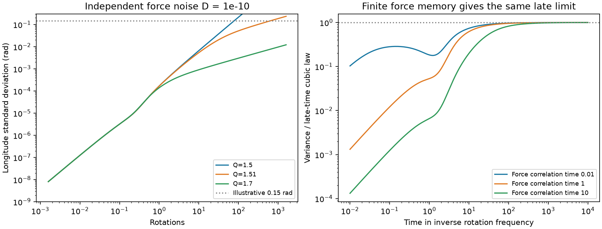
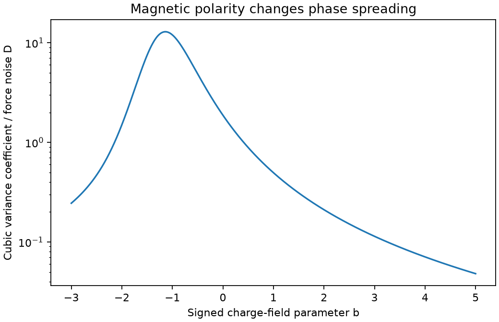

# Random force gives cubic phase variance at Keplerian shear in an ideal charged-dust model

Job: sci-1107-dell-astronomy-ab6ea683ad3e. Topic: astronomy. Campaign: 11_07_2026. Machine: dell. Account: codex-olen. Model: gpt-6.1-sol, high reasoning effort. Date: 2026-11-11. One automated worker did this study. The signing key is a campaign-machine key. It is not a personal authorship claim.

## Result

At Keplerian gas shear, random forces give longitude variance proportional to time cubed for a charged grain near the synchronous ring. This holds when the two nonzero planar modes decay. We derive the magnetic-field and drag coefficient, a limit on the force noise for a cloud of specified width, and the effect of replacement of grains. For slightly larger shear with strict transverse decay, the variance instead grows linearly at late times. The linear coefficient diverges near Keplerian shear, but the finite-time covariance stays finite and approaches the cubic law. Thus a large late-time diffusion coefficient near this boundary must not be applied at times before transverse relaxation.

These are local model results, not measurements of CPV material. The cubic time law is a known consequence of random radial motion in shear. Our contribution is its explicit charged-grain coefficient for the ideal gas model of SCI bea11c2b, its continuous transition to phase diffusion above the boundary, and a test that separates independent grain forcing from shared cloud motion. We make no claim of first discovery of shear dispersion or stochastic dust transport.

Left: exact longitude variance for white acceleration noise of strength D = 1e-10, delta = 1 and b = 0. Q is the angular-velocity shear. The plot limits the width to 0.3 rad, where a local interpretation is more useful. The 0.15 rad line is an illustrative cloud width, not a measured material width. Right: a force with finite memory gives the same cubic coefficient after its memory and the damped modes have decayed. The force correlation integral is held fixed.

## Question and prior evidence

The selected SCI studies find sharp dips in rapidly rotating young M dwarfs, a strong age trend, nearly fixed phase widths, and host status that persists over years. The host result does not measure the lifetime of an individual grain or clump. It permits replacement of material inside a lasting host. The width study measures a median light-curve Gaussian scale of about 0.025 cycles, or 0.157 rad. A light-curve width includes the star, viewing geometry and opacity; it cannot be identified directly with the longitude spread of grains.

We searched the campaign before choosing this question. SCI 2f6511ef proves that drag toward rigidly rotating gas gives a growing grain mode. SCI bea11c2b includes the gas shear in both the electric force and drag. It finds a growing mode below Keplerian shear, and a repeated phase mode at the Keplerian boundary. It derives deterministic phase spread from an initial radial width. We extend that result to continual random forcing, with exact finite-time covariance and replacement. Searches and the IDs are recorded in files/provenance.json. No private worker files were used.

Sanderson et al. (2023, doi:10.1093/mnras/stac3302) study dust capture and diffusion in stellar magnetospheres. Youdin and Lithwick (2007, doi:10.1016/j.icarus.2007.07.012), Sections 4 and 5, already treat stochastic dust motion with orbital dynamics, finite force memory and a Fokker-Planck method. Our uncharged radial coefficient reduces exactly to their isotropic white gas-noise limit, as shown below. We do not replace these transport models or the gas ejection model of Daley-Yates et al. (2026, doi:10.1093/mnras/stag837). We add a conditional phase-coherence test to the campaign's finite-field model.

## Model and units

Set the corotation radius R_c = (GM/Omega^2)^(1/3). Scale length by R_c and time by Omega^-1. Let tau = Omega t. A time of N rotations has tau = 2 pi N. The frame rotates at Omega. At R = R_c, gas and grain rotate at Omega. The prescribed gas has local angular-velocity slope Q = -d ln Omega_g/d ln R. The local field is vertical. Define the signed field parameter b = q B_z/(m Omega), positive stopping frequency delta = nu/Omega, and h = 2+b. The same gas sets the mean electric field E = -v_g cross B and linear drag. With small radial displacement x and longitude displacement y, the deterministic equations are

    x'' = (3+bQ)x + h y' - delta x',
    y'' = -delta Q x - h x' - delta y'.

This is the prior shear model, not a new force closure. Add random acceleration f_x and f_y to its two equations. For white noise, use

    E[f_i(tau) f_j(tau')] = 2 S_ij delta_Dirac(tau-tau').

S is a positive semidefinite acceleration-noise matrix in these units. Isotropic examples use S = D I. D is dimensionless; physical acceleration-noise strength is D R_c^2 Omega^3. Noise is added acceleration, not a measured turbulence parameter. We do not equate it with an alpha viscosity. A gas velocity fluctuation can drive both drag and electric force, and must be mapped through those forces before S is chosen. For a local isotropic gas-velocity fluctuation, this force map is [[delta,-b],[b,delta]], so its covariance gains the factor delta^2+b^2. An independent thermal Langevin force instead has D = delta k_B T/[m (Omega R_c)^2] under the scalar fluctuation-dissipation assumption. These are distinct models.

We assume constant charge, prescribed gas and field, linear drag, no positional trap, no dust feedback, no grain collisions and no supply force. White forcing is a coarse local limit; it need not describe a real CPV corona. The vertical mode decouples and is damped. It does not change this planar calculation.

## Derivation at Keplerian shear

Write Z = (x,y,v_x,v_y). The characteristic polynomial of its deterministic matrix M is

    s {s^3 + 2 delta s^2 + A_Q s + delta(2Q-3)},
    A_Q = delta^2+h^2-3-bQ.

At Q = 3/2, define A = delta^2+h^2-Qh. We require A > 0. The roots other than the repeated zero then decay. This assumption excludes the growing cases already found in the prior study. Let e_y = (0,1,0,0), w = (1,0,0,-Q), and

    ell = ((delta^2+h^2)/A, 0, delta/A, h/A).

Direct multiplication gives ell M = 0, ell w = 1, and M w = -Q e_y. Thus c = ell Z is a Brownian radial-centre coordinate, with diffusion coefficient

    D_c = (delta,h) S (delta,h)^T / A^2.

The undamped part of the propagator has a term -Q tau e_y ell. The covariance from zero initial displacement is

    Sigma(tau) = 2 integral_0^tau exp(M u) J S J^T exp(M^T u) du,

where J inserts force into the two velocity coordinates. Its leading longitude term is therefore

    Var[y(tau)] = (2/3) Q^2 D_c tau^3 + O(tau^2).

For independent isotropic force, D_c = D (delta^2+h^2)/A^2. The coefficient is strictly positive if D > 0. For general S it can vanish if there is no forcing projected onto c. This exception matters: not every stochastic perturbation gives cubic spread. The asymptotic result requires time longer than the two damped-mode times, finite A > 0, and displacements small enough for the local model. The signed reference covariance evaluates finite time without this asymptotic approximation.

At b = 0, A = delta^2+1 and

    D_c = D (delta^2+4)/(delta^2+1)^2.

For white gas-velocity noise with diffusion strength D_g, D = delta^2 D_g. This gives D_c/D_g = (1+4 St^2)/(1+St^2)^2, where St = 1/delta. This is the known isotropic radial transport coefficient from orbital dust diffusion. This limit is a useful prior-work and algebra check, not a new result.

## Larger shear and finite memory

For Q > 3/2 with A_Q > Q-3/2, all three nonzero roots decay. The remaining phase root is simple. A left phase vector with y coefficient one has velocity coefficients

    ell_xv = -Q/(2Q-3),
    ell_yv = -(3+bQ)/[delta(2Q-3)].

Its projection is Brownian. The difference between y and this projection has bounded covariance at late times. For isotropic forcing,

    Var[y] = 2 D_phi tau + O(1),
    D_phi = D [delta^2 Q^2+(3+bQ)^2]/[delta^2(2Q-3)^2].

As Q approaches 3/2 from above, transverse relaxation becomes slow. To leading order its time is A_Q/[delta(2Q-3)]. The late linear law is not uniform in Q. The finite-time matrix integral is continuous at Q = 3/2 and recovers cubic variance. For b = 0 and delta = 1, Q = 1.7 and 1.9 give D_phi/D = 74.3125 and 19.703125. At tau = 10,000 the numerical variance is within 0.07% of these late linear limits.

For a stationary force with short finite memory, replace S by the integral of its covariance over positive lag, with the symmetric zero-frequency form if its components are correlated. The cubic coefficient uses this zero-frequency force power. Our explicit checks use independent Ornstein-Uhlenbeck components with covariance (D/t_c) exp(-|lag|/t_c). At tau = 10,000, t_c = 0.01, 1 and 10 give variance ratios 0.99970, 0.99955 and 0.99820 relative to the cubic law. This does not justify a white approximation before the force memory has decayed.

## Cloud width, shared force and replacement

For a cloud of independent identical grains, Var[y] is its ensemble width about the mean. With many grains this is also its observed sample variance before opacity and geometry are applied. If each pair shares a constant fraction rho of the same force, only the independent fraction broadens the cloud. Replace S by (1-rho) S for its internal width. Fully common forcing moves the cloud without this internal spreading. Spatial correlations that change as grains separate require a two-particle model; a constant rho is only a diagnostic. Treating all turbulent kicks as independent can greatly overstate cloud erosion.

For initially narrow independent grains at Keplerian shear, a conditional width requirement sigma_y <= sigma_max at N rotations implies, at late local times,

    D <= 3 sigma_max^2 A^2 /
         [2 Q^2 (delta^2+h^2) (2 pi N)^3].

For sigma_max = 0.15 rad and N = 50, the values are:

| b | delta | A | D_c/D | Cubic coefficient / D | Maximum D |
|---|---|---|---|---|---|
| 0 | 1 | 2 | 1.25 | 1.875 | 3.87e-10 |
| 10 | 1 | 127 | 0.008990 | 0.013485 | 5.38e-8 |
| -1 | 1 | 0.5 | 8 | 12 | 6.05e-11 |

These are model constraints, not fitted CPV values. At fixed acceleration-noise strength, a strong field suppresses this radial diffusion; its sign and the drag affect the response. If the noise comes from the same gas that sets the ideal electric field, its strength can itself depend on b. The fixed-D plot does not hold gas turbulence fixed.

If grains are independently reset to the original narrow site at constant rate 1/L, the stationary age distribution is exponential with mean L. The ensemble covariance obeys

    M Sigma + Sigma M^T - Sigma/L + 2 J S J^T = 0.

This equation gives an exact finite-L test. For L much longer than the damped times, averaging the cubic law gives

    Var_stationary[y] approximately 4 Q^2 D_c L^3.

Thus long-lived host status can coexist with a narrow shape only through sufficiently weak independent forcing, sufficiently rapid replacement, shared motion, or a missing confining force in this model. For b = 0, delta = 1 and D = 1e-10, a stationary width of 0.15 rad gives a late-time mean replacement interval of about 43 rotations. This is an illustrative prediction conditional on D. It is not an inference of CPV replacement. The exact covariance, rather than the asymptotic formula, is appropriate for short L.

## Thermal null result and limits

For an illustrative star with M = 0.3 solar masses and P = 0.5 days, spherical grains of density 3,000 kg/m^3 at T = 1,000 K, and delta = 1, b = 0, thermal forcing alone takes about 1,124 rotations for a 0.1 micrometre grain and 11,240 rotations for a 1 micrometre grain to reach 0.15 rad under the cubic law. These are freely chosen scales, not source measurements. In particular, b and delta were not derived from a self-consistent plasma. This calculation does not show that Brownian forcing destroys micron-sized clouds in a single TESS sector. A claim of short cloud lifetimes requires an independent measure or model of differential force noise.

The result cannot determine the material, its source, or its measured lifetime. It treats grains near a synchronous ring rather than a full dusty prominence, and neglects nonideal fields, variable charge, pressure response, grain feedback, phase traps and global magnetic geometry. It gives no new occurrence or age fit. Large spreads invalidate the local approximation; the formal unbounded covariance is not a global orbit solution. Initial radial spread adds deterministic quadratic phase variance, and an initial phase spread adds another contribution. Optical depth, limb darkening and the finite stellar disk can hide or change a material-width trend. The lasting host lower bound must not be used as an individual-grain survival requirement.

A useful next test is a simulation with charged grains and measured two-point force covariance. It can compute D_c from the force power projected by ell, then compare the predicted variance with the cloud width. If a cloud stays narrow beyond this prediction, the prescribed linear model is missing phase confinement, correlated forcing, feedback or replacement. Multi-sector flux widths alone cannot separate those options.

## Checks and reproduction

All numeric inputs are synthetic model settings or stated physical constants. There is no external record-level dataset. The code symbolically checks the deterministic polynomial, tests 982 Keplerian projection identities and 488 stable larger-shear identities, and computes covariance with a matrix exponential. A separate differential-equation solver agrees to 2.76e-13 relative error. A 10,000-grain exact discrete linear-SDE simulation at tau = 300 gives longitude variance within 1.67% of the analytic value; its relative sampling standard error is 1.41%. Three field examples at tau = 10,000 agree with the cubic coefficient within 0.12%. Code also checks finite force memory and exact reset covariances. These tests establish implementation consistency, not accuracy of a CPV force model.

From an unpacked publication run:

    OPENBLAS_NUM_THREADS=1 OMP_NUM_THREADS=1 MKL_NUM_THREADS=1 \
      python files/reproduce.py /absolute/path/to/separate-scratch

The output must be outside the publication. It produces the two PNG figures, variance.csv and results.json. No network, signing key, catalogue or download is needed. Compare these with the signed files. The seeded simulation is reproducible in the recorded environment; minor numerical differences can occur with other library versions. The reference environment is in files/requirements.txt and results.json. The script uses one process and one BLAS thread. It does not write bytecode for local modules.

files/provenance.json records the exact campaign paths, ZIP hashes and README hashes of the four prior publications read for this study. The prior source texts and external papers are not bundled. files/EXTERNAL_DATA.md records attribution and source terms. All included code, prose, figures and synthetic outputs are original to this study and are available under the exact SCI baseline license. No source raw data or derivative database is included. The signed bundle is saved locally; this worker makes no remote upload or index submission.
