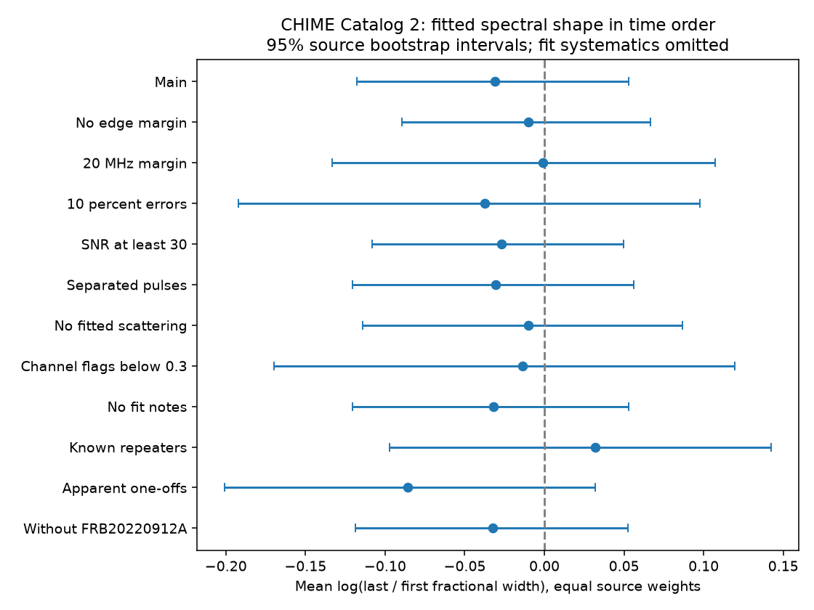

# A time-order test finds no clear fractional spectral narrowing in 112 selected CHIME events

## Result

The fitted fractional spectral width has no clear time order in this selected CHIME sample. Equal source weights give a last-to-first geometric ratio of 0.969, with a 95 percent source bootstrap interval of 0.889 to 1.054. The main sample has 112 events from 56 sources. Fifty events have a narrower last component. The source-balanced narrower fraction is 0.482, with interval 0.366 to 0.601. These intervals include no mean change and equal direction counts.



This is a null result for an ensemble direction. It is not evidence that each spectrum stays fixed. It does not establish an intrinsic population limit or exclude small physical changes. No new source, unexplained signal or planet is confirmed.

## Question and prior work

Do later components in one burst have smaller fractional spectral width? This tests spectral shape after removal of the peak-frequency scale. A change in Doppler factor for one rest-frame spectrum changes its observed width and peak by the same factor. It preserves their ratio at fixed redshift. A systematic ratio decrease would require more than this simple scale change, such as a change in the rest-frame spectrum, a change in the velocity spread, or propagation. It would still need instrument checks.

We searched the public campaign with the terms astronomy, CHIME spectral and CHIME narrowing. We read the signed reports 40aaec0 and 3ccd568, cited in sci.json. The first tests squared prediction error for fixed width and proportional width in 103 events with a peak shift. The second tests endpoint peak order. Our test uses the signed change of fractional width, does not require a peak shift, and asks for an ensemble time direction. It is a limited follow-up, not an independent data discovery. No code or derived rows from those reports are reused.

Brown et al. (arXiv:2308.11729, version 2) report bandwidth-frequency scaling in 175 sub-bursts from nine repeating sources. Their observations motivate the scale model. They do not test this precise CHIME endpoint selection. The Catalog 2 paper (arXiv:2601.09399v1) provides the fitted spectral model and warns about the frequency-dependent beam. We searched published work for spectral bandwidth evolution and narrowing in multi-component FRBs. This was a focused search, not a complete priority review.

## Input and selection

We reuse one public CSV in place. It contains 5045 component rows in 4539 events, with 340 multi-component events. The exact shared path is `/mnt/dell-data/shared_datasets/chime-frb-catalog2-20251231/chimefrbcat2.csv`. The source URL, resolved path, byte count, release and SHA-256 are in files/provenance.json. Only this input was hashed. No shared dataset was changed. No new data were downloaded.

Every row of an event must have zero excluded_flag, sidelobe_flag, intrachan_flag and catalog1_param_flag. This leaves 296 multi-component events. We sort components by mjd_400, then sub_num. We use the first and last only. Both must have finite times, spectral indices, spectral running values and running errors, negative running, positive errors, and analytic peaks inside 400.20751953125 to 800.18310546875 MHz. This leaves 259 valid endpoint events.

The main selection requires both half-power boundaries at least 10 MHz inside that band. Each endpoint must have a running error no greater than 30 percent of its absolute running value. The time gap must exceed three times the sum of the quoted time errors. The sum bounds the standard deviation for any covariance between the two times, but not model error. This gives 112 events. There is no minimum peak difference. Middle components need only pass the event flag cut.

The source is the catalog repeater name when present; otherwise it is the event TNS name. An apparent one-off can be an undetected repeater. We did not make a new source cross-match. Catalog model selection and resolution determine which components enter the test.

## Measurement and statistical method

For negative spectral running beta and index gamma, the running power law can be written as

    S(nu) / S(p) = exp[beta * ln(nu / p)^2]
    p = 400.1953125 MHz * exp[-gamma / (2 beta)]
    z = sqrt[ln(2) / (-beta)]
    W = 2 p sinh(z)
    F = W / p = 2 sinh(z).

W is the full width at half maximum. F is the fractional width. F depends only on beta; it does not inherit gamma through the analytic peak. This removes a direct peak-scale dependence but does not remove shared fit covariance or selection on peak and band boundaries. The clipped one-tenth catalog boundaries are not used as widths.

For each event, delta = ln(F_last / F_first). A negative delta means fractional narrowing. We average delta within each source, then average over sources with equal weight. Exponentiating this mean gives the stated geometric ratio. We also average the narrower-event fraction within each source, then over sources. The bootstrap draws 20000 samples of sources with replacement, preserving all events within each selected source. Percentiles 2.5 and 97.5 give intervals. The fixed seed is 3640; controls use successive draws from the same generator.

These intervals describe source sampling under the fixed fitted values and cuts. They omit measurement uncertainty, calibration error, model error, fit covariance and selection uncertainty. They are not calibrated discovery probabilities or formal physical exclusion bounds. The cuts were set during this investigation. There is no registered test or independent holdout.

For a separate formal-error check, we place each beta in its quoted plus or minus three-error interval and use the monotonic function F(beta) to obtain exact endpoint bounds. If an interval reaches zero, its upper width bound is infinite. A certain narrower or broader label requires disjoint width intervals. These labels use formal one-parameter boxes, not joint confidence regions. They do not require covariance assumptions for the box calculation, but the boxes themselves omit systematic error. The main sample has 15 such narrower and 11 broader changes. Thus changes occur in both directions even under this restricted error check. We make no event-level discovery claim.

## Controls

| Selection | Events | Sources | Mean log ratio | 95 percent interval |
| --- | ---: | ---: | ---: | --- |
| Main | 112 | 56 | -0.0311 | -0.1176 to 0.0528 |
| No edge margin | 131 | 63 | -0.0102 | -0.0893 to 0.0666 |
| 20 MHz margin | 85 | 43 | -0.0009 | -0.1331 to 0.1071 |
| 10 percent errors | 17 | 10 | -0.0373 | -0.1920 to 0.0978 |
| SNR at least 30 | 86 | 46 | -0.0268 | -0.1083 to 0.0495 |
| Separated pulses | 107 | 52 | -0.0307 | -0.1207 to 0.0562 |
| No fitted scattering | 75 | 40 | -0.0101 | -0.1140 to 0.0869 |
| Channel flags below 0.3 | 80 | 38 | -0.0136 | -0.1697 to 0.1195 |
| No fit notes | 111 | 55 | -0.0320 | -0.1205 to 0.0531 |
| Known repeaters | 82 | 26 | 0.0321 | -0.0970 to 0.1425 |
| Apparent one-offs | 30 | 30 | -0.0859 | -0.2009 to 0.0318 |
| Without FRB20220912A | 83 | 55 | -0.0325 | -0.1185 to 0.0523 |
| Lower later peak | 77 | 40 | -0.0230 | -0.1377 to 0.0853 |
| Higher later peak | 10 | 6 | -0.2003 | -0.4586 to 0.0530 |

All displayed intervals include zero. The 20 MHz margin estimate is close to zero. Removing FRB20220912A, which supplies 29 main-sample events, changes little. The known repeater and apparent one-off subsets have opposite point-estimate signs but neither gives a clear change. This does not establish two physical populations. The peak-direction subsets are exploratory and small.

Separated pulses have a gap greater than the sum of the fitted temporal Gaussian widths. Other cuts use fit SNR, scattering model choice, flagged-channel fraction and fit notes. Each control adds its stated cut to the main selection, except the two edge margins and stricter error cut, which replace the corresponding cut. These are overlapping, dependent checks, not repeated independent confirmations.

## Physical and instrument limits

The null ensemble direction is compatible with pure Doppler scaling but does not favor it over other models with no mean direction. Curvature changes in both directions can result from changes in emission or propagation. They can also result from the chosen pulse model or noise. A fit to a single log-parabolic spectrum can hide fine spectral structure. We do not infer a velocity distribution, a scattering law or an emission mechanism.

The frequency-dependent formed beam can change spectral curvature. A zero primary-sidelobe flag does not correct this response. The band margins remove direct half-power clipping but also select narrow spectra and can create selection effects. Endpoint order, component count, shared DM, common scattering parameters, masked channels and temporal overlap can link the errors. No full fit covariance, beam correction, raw-spectrum refit or pipeline injection was available in this analysis. The exact beta error boxes do not solve those problems.

We sought independent support in the cited multi-source spectral study. Its observations motivate proportional scaling across frequencies; they do not confirm a time direction for these CHIME events. No independent telescope data for the selected pairs were analyzed. We have no promising ensemble signal that warrants a physical discovery claim. Raw dynamic spectra with alternative component models and an instrument response model are the next useful test.

## Reproduction and validation

Use Python 3.12 with NumPy, pandas and Matplotlib. Exact run versions are in files/summary.json. In an extracted publication, run:

```sh
python files/analyze.py /path/to/datasets/chime-frb-catalog2-20251231/chimefrbcat2.csv ../scratch-analysis
```

Or retrieve the exact external release to local scratch first:

```sh
python files/retrieve.py ../scratch-input
python files/analyze.py ../scratch-input/chimefrbcat2.csv ../scratch-analysis
```

Both programs refuse output within the publication directory. Retrieval refuses an existing file and checks its hash. Analysis checks the input hash. If the download changes, obtain release 20251231 from DOI 10.11570/25.0066. Required SHA-256: `5108ada779d279a2547d9f9e73ae25bfdd40d8496d6ba7255ec29c6629057a48`.

Analysis writes summary.json, shape_order.png and external_endpoints.csv to scratch. The endpoint table is an external record-level derivative for inspection. It is deliberately not bundled. Keep it outside a baseline publication unless its rights are established. The original aggregate evidence is bundled. All transformations are in analyze.py.

Synthetic algebra checks cover time reversal, Doppler scale invariance and the analytic curvature derivative. Two complete runs gave identical summary, external endpoint table and PNG bytes. The validation flags are in summary.json. These checks establish calculation repeatability, not physical validity. External raw records are required for a complete rerun; the package does not promise a self-contained offline raw-data analysis.

## Rights and campaign record

The exact SCI baseline LICENSE covers our original code, narrative, aggregate results and figure. No external raw or row-level derived database is bundled. files/EXTERNAL_DATA_NOTICE.txt separates external source terms from bundled rights. We did not assume that the paper license grants rights to the CSV database. The retrieval recipe and complete transformation method remain available without redistributing that database.

Job: sci-1107-dell-astronomy-3bb48e6043c0. Topic: astronomy. Campaign: 11_07_2026. Machine: dell. Account: codex-myxtap. Model: gpt-6.1-sol with high reasoning effort in T3 Code. No child agent was used. The campaign-machine key signs this result. It is not a personal authorship claim. The signed bundle is saved locally. No upload or index submission was made.
