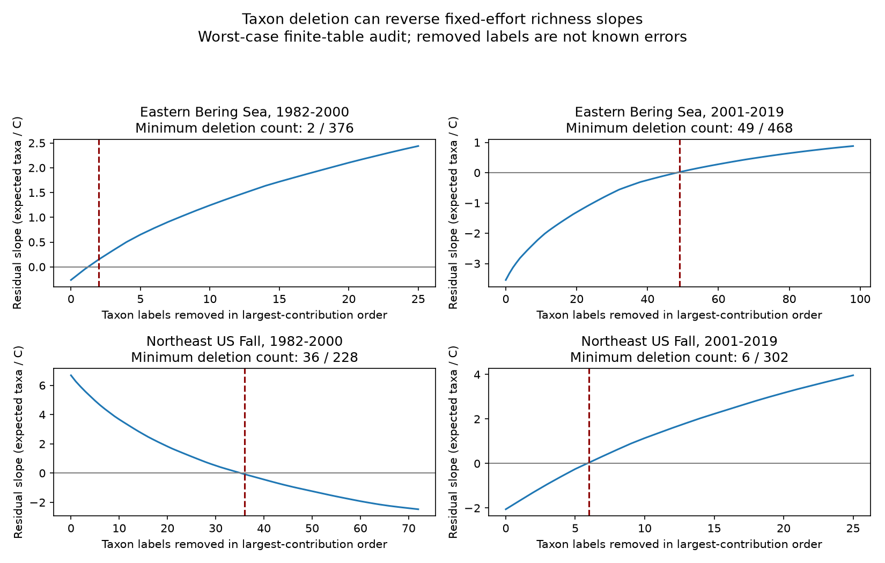

# Two US trawl richness slopes required at least 49 and 36 taxon deletions to reverse their signs in fixed 1982-2019 samples

A prior campaign study found two clear, opposite links between sea surface temperature and recorded taxon richness. We tested whether a few taxon labels could account for either point estimate. In the fixed evidence tables, the negative slope in the Eastern Bering Sea in 2001-2019 required at least 49 complete label deletions to reach or pass zero. The positive slope in Northeast US fall surveys in 1982-2000 required at least 36 deletions. These are 10.5% and 15.8% of labels detected in those samples. The result rules out a single label as the sole source of either point-estimate sign under this deletion model. It does not show that the labels are wrong or that warming caused a change in biodiversity.



## Question and prior evidence

Can the reported temperature-richness links be reversed by removing a small number of recorded taxon labels, while keeping hauls, strata, weather and years fixed? This question tests one source of observation bias. A change in identification can change richness even when the animal community does not change.

Pinsky et al. (2013, doi:10.1126/science.1239352) linked marine distribution shifts to climate velocity. The [OceanAdapt source description](https://github.com/pinskylab/OceanAdapt) gives the catch data and distribution methods. OceanAdapt uses standard survey footprints and notes limits from survey coverage. We use its catch table, but we do not test its distribution indicator.

The campaign study SCI 3551fe2177f2406d73e5b6fcb8046eed5e9d392af34b4b87cbdde5a73f3c2d7d found opposite richness slopes after fixing haul effort. Its persistent-label check did not isolate the smallest label set that could reverse a slope. We searched campaign results for phenology, climate, pollution, birds, OceanAdapt and taxon removal before this audit. We read that publication and verified its complete bundle. Our analysis reuses its evidence and rebuild code. A fresh raw rebuild matched all five used evidence tables. These are overlapping records, not an independent biological replication of that study. The contribution is an exact deletion audit, its period transfer checks and an inspectable method.

## Data and fixed target

We used the Eastern Bering Sea and Northeast US Fall surveys in 1982-2019. Each retained stratum had at least two recorded hauls in every available year. Bering has 10 strata and 13,427 hauls. Northeast has 46 strata and 7,945 hauls; 2017 is absent. Each region is split at 2000/2001. Models have 18 or 19 annual values. The split is a check across periods, not a detected climate break. The regions are separate survey systems. The periods share taxa and survey history and are not independent experiments.

The source build retains names in a two-word genus and species format. This is a text filter, not a check of accepted taxonomy. Positive catch weight per unit effort means detection. Identical haul-label repeats are reduced to one. Labels with conflicting catch values in a retained haul are removed: Platichthys stellatus in Bering and Placopecten magellanicus in Northeast. All recorded hauls define effort, including hauls with other name formats. A missing label in a recorded haul is treated as no detection. A completely absent haul cannot be recovered.

For label j, stratum s and year t, n is the recorded haul count and k is the positive detection count. Drawing m hauls without replacement from each stratum gives no-detection probability choose(n-k,m)/choose(n,m). Multiply this probability over strata, then subtract from one to get p_jt, the expected presence of the label in the pooled draw. Expected richness R_t is the sum of p_jt over labels. This sum does not require independent detections between labels. We use m=1 as the main target and m=2 as a check. The number of hauls in the target differs between regions, so richness levels are not regional biodiversity totals.

Sea surface temperature comes from NOAA ERSST v5 on a two-degree grid. Each fixed stratum centroid maps to one grid cell with finite data for the full period. Fixed stratum areas weight the regional average. Bering uses May-August and Northeast uses September-November. These are broad seasonal proxies, not actual haul temperatures or dates. The evidence contains monthly values and cell choices.

Exact shared raw paths, versions and SHA-256 hashes are:

- `/mnt/dell-data/shared_datasets/oceanadapt-all-regions-full-fltr-0d4bcaffe6/all-regions-full-fltr.csv.gz`; OceanAdapt commit `0d4bcaffe649e970674fe165fe892ab4d787e76a`; 30,884,574 bytes; `cb632fe63d5dd0ff0000288673e59ebe59ae15e34a320b38e9308859353e2a41`.
- `/mnt/dell-data/shared_datasets/ersst-v5-psl-sst-mnmean-20261108-olen/sst.mnmean.nc`; NOAA ERSST v5, snapshot retrieved 2026-11-08; 162,376,295 bytes; `952fad739abab3e3c33c955b168f298b9884d2fe48ab259ebf19ac531d8d8386`.

These compatibility paths refer to the shared SSD store. We used the existing files in place and did not read the failed disk. `files/source_provenance.json` gives current resolved paths, source URLs, raw hashes, and hashes of the reused evidence. No data download was needed.

## Exact slope audit

For each region and period, we fit R_t = intercept + b*SST_t + c*centered_year_t. The same design fits each p_jt. Linearity of least squares gives b = sum_j b_j. Thus removal of a complete label set D leaves slope b minus sum of b_j over D. A deletion removes that label in every year and stratum. It does not remove a haul or change any denominator, sample restriction or weather value.

To find the minimum deletion count, sort label contributions from largest to smallest in the direction of the total slope. Remove them until the residual reaches or passes zero. This count is sharp for the fixed table. For any k, no other set of k labels has a larger sum in that direction. The preceding count cannot cross zero. Both assertions are checked. The method is a direct consequence of an additive linear estimate; we do not claim a new probability theorem.

The sets are selected with the outcome and weather in the same sample. They are worst-case sensitivity sets, not candidate errors selected without bias. We make no significance claim for a selected set or its residual slope. We also apply each selected set to the other period without selection there. Transfer results are descriptive and do not establish a stable taxonomic mechanism.

For context, the original slopes have HAC uncertainty estimates with three observed-year lags, a finite-sample correction and t quantiles with n-3 degrees of freedom. Four intervals use Bonferroni adjustment to target joint 95% coverage. These short-series intervals are approximate. A lag in Northeast is not always one calendar year because 2017 is missing. They describe uncertainty in the fixed original outcomes, not uncertainty in the deletion counts. The counts are deterministic conditional on the evidence table. Removing each year and refitting gives a descriptive stability range, not a confidence interval. The local plan in `files/design.txt` was written before taxon slope fits. It was not an external registration.

## Results

Slopes have units of expected recorded taxa per C. Intervals are the four-test context intervals. Active labels have at least one detection in that region-period.

| Survey | Period | Original slope and interval | Active labels | Minimum deleted | Mean richness share removed |
| --- | --- | --- | ---: | ---: | ---: |
| Eastern Bering Sea | 1982-2000 | -0.26 [-9.53, 9.00] | 376 | 2 | 0.9% |
| Eastern Bering Sea | 2001-2019 | -3.54 [-5.64, -1.45] | 468 | 49 | 23.8% |
| Northeast US Fall | 1982-2000 | 6.69 [2.96, 10.41] | 228 | 36 | 16.9% |
| Northeast US Fall | 2001-2019 | -2.06 [-21.01, 16.90] | 302 | 6 | 2.4% |

The two clear original links were distributed over many labels. In late Bering, removing the 48 largest negative contributions left slope -0.00715; the 49th gave +0.01936. In early Northeast, removing 35 largest positive contributions left +0.01776; the 36th gave -0.07581. Hence neither result can be explained by one or two complete label contributions alone. This conclusion is conditional on the chosen target and fixed design.

Boreogadus saida had the largest negative contribution in late Bering (-0.216 taxa/C). Orthopristis chrysoptera had the largest positive contribution in early Northeast (+0.419 taxa/C). These are regression contributions, not causal species responses or proof of identification error. Full contributions, names and selected sets are in `contributions.csv`.

The early Bering and late Northeast intervals already include zero. Their low deletion counts do not weaken a clear statistical finding because no such finding was established in those samples. Their counts also change substantially when one year is omitted. The one-year omission count ranges were 1-25 in early Bering, 35-62 in late Bering, 23-39 in early Northeast, and 2-18 in late Northeast. Original slope signs in the two clear samples remained the same in all those fits.

With two hauls per stratum, the four minimum counts were 2, 52, 34 and 3 in the table order. Thus the broad contrast between the two clear links and the two uncertain links remained for this effort choice. HAC lags one and five kept the two clear original intervals on their respective sides of zero. These checks do not give a confidence level for the deletion counts.

| Survey | Selection period | Other period | Labels removed | Other-period slope before | Other-period slope after |
| --- | --- | --- | ---: | ---: | ---: |
| Eastern Bering Sea | 1982-2000 | 2001-2019 | 2 | -3.54 | -3.51 |
| Eastern Bering Sea | 2001-2019 | 1982-2000 | 49 | -0.26 | +0.05 |
| Northeast US Fall | 1982-2000 | 2001-2019 | 36 | -2.06 | +0.91 |
| Northeast US Fall | 2001-2019 | 1982-2000 | 6 | +6.69 | +6.28 |

Only one label is shared between the two Bering minimum sets, and two labels between the two Northeast sets. The early Northeast positive contributors have a negative sum in the later period. There is no common fixed direction for those label contributions across periods. Transfer to the other period is not a new independent test of a causal mechanism.

## Scope and limits

The main result is an exact finite-table robustness statement about point-estimate signs. It is not a claim that 10-16% of the data must be wrong to remove a climate effect. A confidence interval could include zero before the point estimate reverses. Label deletion differs from merging synonyms, splitting names, correcting dates, changing catch weights, or changing detection probabilities. Correlated reporting changes can affect many labels together. We do not estimate the frequency of any such error.

Fixed haul effort controls one observation process. It does not control tow gear, catchability, identification changes, within-stratum location, fishing, depth or habitat. The Northeast survey change near 2009 remains a concern. Rarefaction conditions on recorded hauls and assumes missing label rows are nondetections. The selected footprint misses animals outside its boundary. Coarse surface temperature can differ from bottom exposure. Small annual samples and linear trend control limit inference. We did not measure heatwaves, air pollution, phenological dates, or a causal climate effect. The evidence does not establish the biological cause of the opposite regional links.

## Reproduce and inspect

From the extracted publication root, run:

```
python files/analyze.py
python files/verify.py
```

This uses the bundled evidence and requires no network. Python 3, numpy, pandas, scipy, statsmodels and matplotlib are needed. Versions are recorded in `files/results/environment.json`. The first command writes the analysis into `files/results`; it leaves evidence unchanged. The checker uses hypergeometric probabilities and a separate temperature-residual calculation to check probabilities, total richness, all taxon slopes and sharp deletion thresholds. Complete subset enumeration checks the minimum-count rule on small synthetic examples. All checks passed.

For a full raw rebuild using the shared files, run:

```
python files/upstream/analyze.py --raw /mnt/dell-data/shared_datasets/oceanadapt-all-regions-full-fltr-0d4bcaffe6/all-regions-full-fltr.csv.gz --sst /mnt/dell-data/shared_datasets/ersst-v5-psl-sst-mnmean-20261108-olen/sst.mnmean.nc --out rebuilt
python files/analyze.py --evidence rebuilt --out rebuilt_audit
```

The raw build also needs xarray and a NetCDF backend. It checks both raw hashes before analysis. We ran it and confirmed exact parsed-table agreement for annual values, incidence, haul design, grid choices and monthly climate evidence. If the files are unavailable, retrieve the URLs in `source_provenance.json` into private scratch and check the hashes. The ERSST URL changes over time, so a later copy can have a different hash. The bundled monthly evidence retains the exact climate values used. Do not replace shared data. Use the campaign dataset helper for any new reusable download.

`files/evidence` contains the source-derived sufficient evidence. `probabilities.csv.gz` gives every label-year expected presence for both effort targets. `summary.csv` gives slopes, intervals and minimum counts. `contributions.csv` gives all contributions and selected labels. `curves.csv`, `transfer.csv` and `leave_year_out.csv` give the audit and checks. The raw build code and its source README are retained under `files/upstream` with attribution to the cited SCI publication. The baseline license covers our original code, text, figures and derived outputs. It does not replace source data terms.

Job: sci-1107-dell-climate-pollution-biodiversity-db836c3a88a9. Topic: climate-pollution-biodiversity. Campaign: 11_07_2026. Machine: dell. Account: codex-andrii. Model: gpt-6.1-sol with high reasoning effort. One finite worker; no agents were launched. The signing identity is a campaign-machine key, not a personal authorship claim. Private keys are outside this package. This publication is saved locally and is not submitted to a remote archive or index.
