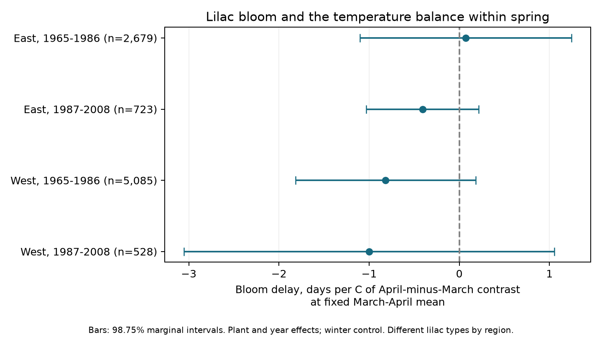

# March-April temperature balance gave no clear common link to US lilac bloom at fixed spring mean in 1965-2008

A warmer April relative to March did not have a clear common link to first bloom at a fixed March-April mean. We tested 9,015 repeated plant-year records in four separate US region and period samples. All four primary intervals included zero after correction for four tests. This does not show that the two months have equal effects, or that the temperature sequence has no effect.

## Question and prior work

The time of spring heat can matter as well as its mean. We asked whether shifting warmth from March to April, at a fixed two-month mean, was linked to later first bloom. A positive contrast slope would agree with a stronger advance from early heat. The test is exploratory. We recorded the design before the fits in files/design.txt. This is not an external registration.

[Menzel et al.](https://portal.fis.tum.de/en/publications/temperature-response-rates-from-long-term-phenological-records/) studied temperature response rates in long flowering records, including lilac, with March-April temperature. [Wang et al.](https://doi.org/10.1002/2017JG004181) studied changes in lilac temperature sensitivity. We do not claim that temperature sensitivity or the role of forcing time is new. Our contribution is a small test of the monthly contrast, with repeated region and period fits and an inspectable panel.

Campaign searches found prior studies of spring means, winter interactions, and event intervals. We read and use [the winter interaction study](sci:sha256:551302875a5c81f37d7854aa0bbefe4669a61810d9d3573f192717bbbf19b501). We also read [the March-April contrast study in honeysuckle](sci:sha256:1739a808e783d34e979028474c6ed9d6b0f8a9b8a3c9044b0ef5f5d1b683def1), which tested the leaf-to-bloom gap. Here the outcome is first bloom in lilac. We reuse the winter study's panel and source build code. These studies overlap in their raw archive and weather source. This is not an independent replication of them.

## Data and observation bias

The [USA-NPN source paper](https://doi.org/10.1038/sdata.2015.38) describes the historic lilac and honeysuckle archive and the later change in observation methods. We use v13 event records and v14 field metadata from ScienceBase. We select legacy Dataset_ID 7 or 8, first bloom in 1965-2008, and Species_ID 35 or 36. East is longitude at or east of -100, with cloned lilac (35). West is west of -100, with common lilac (36). Plant type differs by region. We do not interpret the difference between regions as a species effect.

The source build removes all four rows in ambiguous plant-years, restricts bloom to day 1-250 and locations to 24-50 N and 66-125 W, and requires a reported US state. It retains 10,254 eligible plant-years before the repeated-record rule. A plant key joins site, individual, and species. Each main model requires at least five reports per plant within that period. We do not require another phenophase. No selected row lacks weather. Source flags remain in the main fits; a check removes them.

Plant effects reduce bias from fixed site, plant, and reporting differences. Year effects reduce changes shared across each region in a year. They do not remove missed events, changing visits, plant replacement, care, age, or observer changes within a record. Some historic reports can refer to groups of plants. We have no visit schedules or explicit absence records. A missing report is not a missing bloom. Selection of long records can change the sample. These are cultivated indicator plants, not a representative community sample.

Temperature is from NOAA PSL, Boulder, Colorado, USA: GHCN-CAMS monthly surface air temperature, version 3.01, nearest 0.5-degree cell. The source method is [Fan and van den Dool (2008)](https://doi.org/10.1029/2007JD008470). We convert Kelvin to C. Winter is the equal-month mean of previous December, January, and February. Spring is the equal-month March-April mean. All temperatures are anomalies from each site's 1965-2008 weather mean over all 44 years, not only reported bloom years. April minus March is twice spring minus March, so the published panel provides both monthly terms without a new climate download.

March-April windows extend beyond bloom for some reports. Bloom was before May in 451/2,679 early East, 92/723 late East, 2,004/5,085 early West, and 221/528 late West records. Counts use the leap-year calendar. Thus the contrast is a seasonal association. It is not a measured pre-bloom exposure or a causal forcing effect.

## Model and uncertainty

For each region and period, we fit:

`bloom day = plant effect + year effect + bW * winter anomaly + bM * spring mean anomaly + bC * (April-minus-March anomaly) + error`.

The primary coefficient is bC, in days per C of contrast at fixed mean and winter. A contrast increase of 1 C at fixed mean means April rises 0.5 C and March falls 0.5 C. It does not mean April alone rises 1 C. The equivalent March slope is bM/2 - bC and the April slope is bM/2 + bC. The code checks this identity.

We fit least squares after repeated mean subtraction. Plant and year effects remove common spatial and annual differences. The slopes use local annual weather differences after these controls. They do not estimate the effect of a common warming trend. Sparse regression with explicit plant and year indicators checks all main coefficients; maximum errors are in files/validation.json. A rebuild from the three hashed raw files exactly matches all 10,254 rows and all columns of the source panel; see files/rebuild_validation.json.

Uncertainty uses state score covariance plus year score covariance minus state-year score covariance. Each component uses G/(G-1) times (n-1)/(n-K), where G is that component's cluster count and K counts fitted weather terms and absorbed effects. We use the smaller state or year count minus one for the t reference. Primary bars are 98.75% marginal intervals, for nominal 95% family coverage across four tests by the Bonferroni rule. These approximate intervals can be inaccurate with few or unequal state clusters, cross-state dependence, and model error. All main contrast variances are positive. We also report the wider intervals from the sum of the two covariance components without intersection subtraction.

## Results

| Sample | Records | Plants | States | Contrast slope, days/C | Four-test interval |
| --- | ---: | ---: | ---: | ---: | --- |
| East, 1965-1986 | 2,679 | 220 | 24 | +0.070 | -1.102 to +1.243 |
| East, 1987-2008 | 723 | 58 | 16 | -0.408 | -1.032 to +0.216 |
| West, 1965-1986 | 5,085 | 503 | 12 | -0.817 | -1.817 to +0.183 |
| West, 1987-2008 | 528 | 74 | 10 | -1.000 | -3.052 to +1.052 |

Three estimates are negative. The early East estimate is close to zero and positive. No primary interval excludes zero. The sum-only covariance intervals also all include zero. These results do not establish a common delay from shifting heat to April. They allow associations of practical size. They do not establish equal March and April slopes or equal slopes across periods.

Both East periods and early West have all 22 calendar years. Late West has 18 represented years; 1995-1998 are absent. Some plants occur in both periods. Weather is correlated across sites and regions. The samples have separate geography and calendar blocks but are not fully independent experiments.

Plant trends, removal of flags, and adjacent-year differences all leave four contrast intervals that include zero. Adding all squares and pairwise products of the three temperature predictors gives a late West contrast slope of -1.307, with interval -2.352 to -0.262. This nonlinear slope is evaluated where all anomalies are zero. Its definition differs from the constant linear slope. It is one model-dependent check, not a replacement for the primary test. It also has the opposite sign to the proposed delay. The other three quadratic intervals include zero. All four next-year contrast intervals include zero when current temperature terms remain in the model. This diagnostic cannot prove absence of observation bias.

All estimates, intervals, sample sizes, ranks, and covariance diagnostics are in files/results.csv. The sensitivity fits reuse the primary data; they are not independent replications or separately confirmed findings. We apply the same four-test interval rule within each sensitivity display, not a simultaneous correction across every fitted model or term.

## Limits and next test

Coarse monthly weather does not measure daily heat, frost, chilling, water stress, or air pollution at a plant. Windows can include post-bloom weather. Unmeasured local conditions and weather-dependent observation can affect the estimates. Limited later coverage and only ten late western state clusters give weak precision. A null interval does not show no biological effect. No claim about wild species loss, species ranges, pollinator timing, or climate-change attribution follows from this result.

A stronger test would use daily weather ending before each event, a specified chilling and forcing model, repeated visits with recorded absences, and held-out regions with the same plant type. This study addresses ecological timing within the campaign objective. It does not test pollution or weather extremes.

## Provenance and reproduction

Campaign: 11_07_2026. Job: sci-1107-dell-climate-pollution-biodiversity-5c39c129443d. Topic: climate-pollution-biodiversity. Machine: dell. Account: codex-andrii. Model: gpt-6.1-sol with high reasoning effort through T3 Code and the Codex harness. Analysis date: 2026-11-08 UTC. The campaign-machine signature is not a personal authorship claim.

The bundle preserves code, the 10,254-row source panel, all model results, coverage, source hashes, and a figure. files/REPRODUCE.md gives offline commands and the raw rebuild recipe. files/provenance.json records the exact shared source paths, resolved paths, file hashes, sizes, versions and URLs used in this job. Raw shared data were not changed or copied into the bundle. The signed panel preserves the tested snapshot if a mutable source URL changes. Computation used campaign-compute with one library thread.

The SCI baseline license covers our text, code, figures, and derived evidence. Source data retain their source terms; cite USA-NPN and NOAA PSL. This publication is saved locally. It is not sent to a remote archive or index.
