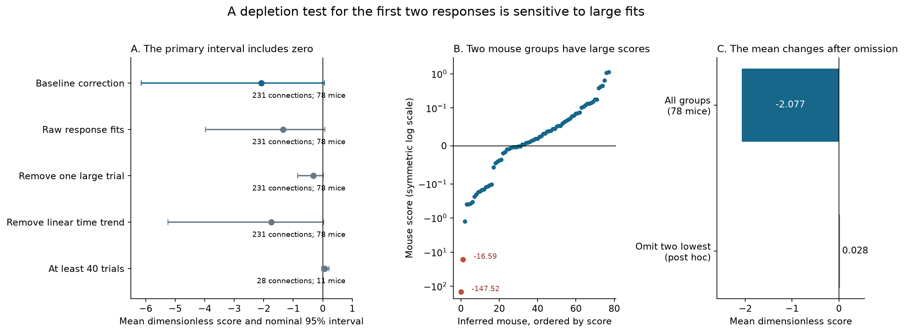

# Two inferred mice gave most of the mean score in a depletion test of 231 selected Allen V1 slice connections

A test of the first two responses did not resolve a nonzero mean departure from a simple vesicle-depletion identity. The main sample had 231 detected connections from 110 source cells and 78 inferred mice. The mean score was -2.07651. Its nominal 95 percent mouse bootstrap interval was [-6.14765, 0.05484]. The score has no units. Two mouse groups contributed -2.10400 to this mean. When we omitted both groups after the analysis, the mean for the other 76 groups was 0.02821. This omission is a diagnostic. It is not a revised primary result.

The data do not establish that the release model is adequate or that it is false. Large fitted responses, incomplete trials, baseline correction, and few trials per connection limit this test. The useful output is a reproducible moment test and a record of its limits in these data. We do not assign a release mechanism to a connection from its sample covariance.



Figure 1. Panel A gives the main score and four checks. Points are means with equal weight for each inferred mouse. Lines are nominal 95 percent intervals. Every interval shown includes zero. Panel B shows the 78 mouse scores. Its vertical scale is linear near zero and logarithmic for larger absolute values. The two red points are the two lowest mouse scores. Panel C compares the primary mean with a post hoc omission. The omitted groups were selected from the same scores. That mean has no confirmatory status. Neither the large scores nor their omission show that the underlying fitted responses are errors.

## Question and prior evidence

Circuit models often use mean synaptic depression to set the reliability of repeated transmission. Mean depression alone does not specify the covariance of two responses unless the release and measurement models are also set. We asked whether one necessary relation between these moments can be resolved in public Allen mouse V1 slice data.

[Campagnola, Seeman and colleagues](https://doi.org/10.1126/science.abj5861) provide the recorded local circuits. A connection and its response fits are linked by the same pair ID. This is a direct structure and activity link. It does not require a cell match across animals or resources. A detected connection can contain several release sites or synapses. These slice samples are not a complete anatomical connectome.

[Scheuss and Neher](https://doi.org/10.1016/S0006-3495(01)75848-1) developed methods that use response means, variances, and covariances to estimate release properties. [Scheuss, Schneggenburger and Neher](https://doi.org/10.1523/JNEUROSCI.22-03-00728.2002) used these ideas to separate contributions to depression at the calyx of Held. These studies provide prior method context. Our voltage fits, cortical cells, and test are different. We do not claim that covariance analysis or binomial depletion is new.

We searched the published campaign before we selected this test. The search record is in `files/prior_search.json`. We read the pulse-position audit [SCI 9515efff](sci:sha256:9515efff73977561babddb9aa1fcff16c45f157dc0ed48f859094136422f6f59) and the local output covariance report [SCI 52163a1d](sci:sha256:52163a1d2dd65f90cbdefa637458a0c9c1d1b490f762f653c689e32f3808ec57). The first supports use of source labels 0 and 1 as the first physical pulse pair. The second documents the trial cache and tests simultaneous changes across different outputs. We reuse the cache. We do not reuse their code or numerical results as independent evidence. The present test concerns a release-model moment within one connection.

## Model and test

Assume N independent release sites. All sites are full before pulse 1. Each full site releases with the same probability p on both pulses. A site that releases fills again before pulse 2 with probability r. Each quantum has fixed amplitude q. Response amplitude is a linear sum. Trials are independent and have the same distribution.

Let mu1 and mu2 be the mean first and second true responses. Let V1 be first-response variance, and C be covariance between responses. The model gives the necessary identity:

```
F = mu1 C + (mu1-mu2) V1 = 0.
```

The proof and estimator are in `files/METHODS.md`. This test does not fit N, p, r, or q. It checks only the equality for F. It does not test every model condition. Independent random event amplitudes expand the equality to F >= 0 under the same homogeneous release assumptions. Errors correlated between pulses can change this relation.

We first subtract paired baseline means, variance, and covariance from the corresponding fitted-response moments. This correction requires matching error moments and error that is independent of the true response. We did not establish those conditions. Baseline snippets do not supply a verified control for errors shared by two nearby pulse fits. The raw-fit check makes no baseline subtraction. It still includes measurement error.

The local analysis plan was written before these scores were computed. It was not an external registration. A product of sample moments can have finite-sample bias. We use an unbiased product estimate that forms products on distinct trial indices. We split time-sorted trials into alternate sets. We evaluate the estimate on one set and use the other set to set a positive amplitude scale. We divide by the cube of the RMS response amplitude, with a 0.020 mV floor, and average both directions. This gives a dimensionless score. Under independent stationary trials, the equality gives expectation zero for this score. The scale rule does not bound its magnitude. A large response in one set can have a small scale in the other set.

We average connection scores in each inferred mouse and then average mice equally. We use 19,999 whole-mouse bootstrap draws. All intervals in this report are nominal 95 percent percentile intervals. Additional checks are exploratory and have no multiple-test correction. A mean near zero cannot show that all connections follow the model. Opposite departures can cancel.

## Data and selection

We used the shared Allen Synaptic Physiology r2.1 medium trial cache at:

`/mnt/dell-data/shared_datasets/allen_synphys_divergent_train_events/r2.1_medium_20230126_v1`

Its `events.csv` contains 63,493 accepted fits from 271 connections and has SHA-256 `1ed349bfcdf427dce8f2a50122eea40f603897dac39363bce045c6cf7046705e`. Its byte count is 13,809,210. The source is the medium SQLite object dated 26 January 2023. Its full size is 11,125,997,568 bytes. Its multipart ETag is `d954cbad0d7c7b0002bf3a2879e40e90-1327`. This ETag is not a full-file checksum. We did not download or hash the complete medium database.

We used the small release for a separate identity and sign check. Its shared path is:

`/mnt/dell-data/shared_datasets/allen_synphys/r2.1_small_2023-01-26/synphys_r2.1_small.sqlite`

Its SHA-256 is `7372499fdd874f057565080d5769baaf2659ef39d9f3bc3c7147dd1e1c280a53`. The file has 176,771,072 bytes. It is schema 22. The exact build commit of this release is unknown. `files/evidence/provenance.json` gives the hashes and paths of every shared file used, the exact source query, and the source version. No shared data were changed.

The cache selects mouse V1 source cells with more than one detected target. Fits are from 50 Hz current-clamp trials, with one source spike and accepted sign-specific response quality checks. Amplitudes are existing deconvolution and reconvolution fits. They are not new raw voltage measurements. We use individual fits, not stored pulse-summary arrays.

We match labels 0 and 1 by pair ID and recording ID. We require finite response and baseline fits on both pulses, at least 8 s before the first source pulse, and at least 24 complete trial pairs per connection. The median retained count is 26 trials per connection. There are 7,026 connection-trial pairs. These are not 7,026 independent animals. The median first-to-second source-spike gap is 20.000 ms. The full checked range is 18.48 to 21.66 ms.

We exclude four sources with mixed excitatory and inhibitory connection labels. This removes ten connections before scores are computed. The remaining 261 cache-selected pair identities, source and target cell IDs, chemical signs, and specimen names all match the small database. The trial rule then leaves 231 connections. A unique six-digit number in each specimen name defines the inferred mouse ID. This rule is an assumption about animal identity. Inhibitory fits are multiplied by -1 so that the expected response has positive sign.

## Results and checks

| Analysis | Connections | Inferred mice | Mean score | Nominal 95 percent interval |
|---|---:|---:|---:|---|
| Main baseline correction | 231 | 78 | -2.07651 | [-6.14765, 0.05484] |
| Raw fitted responses | 231 | 78 | -1.33719 | [-3.97392, 0.07230] |
| Remove one large trial per connection | 231 | 78 | -0.32386 | [-0.84313, 0.02327] |
| Remove a linear time trend | 231 | 78 | -1.74966 | [-5.24554, 0.03679] |
| Require at least 40 trials | 28 | 11 | 0.06415 | [-0.03273, 0.21244] |

All five intervals include zero. The 40-trial result changes both trial support and the connection sample. It is not evidence that more trials alone caused a score change. The trim rule removes the whole trial with the largest absolute first or second response in each connection. It changes the response distribution and is a sensitivity check. Detrending subtracts a fitted linear change while preserving the sample mean. It also changes the estimator's exact null properties.

The excitatory-label subset has 55 connections from 21 inferred mice. Its main score is -0.72623, with interval [-2.38172, 0.18208]. The inhibitory-label subset has 176 connections from 61 inferred mice. Its main score is -2.40231, with interval [-7.27850, 0.06763]. Some mice occur in both groups. These results do not establish a difference between cell classes.

After correction, seven connections have a nonpositive first-response mean. Nine have a nonpositive second-response mean. Forty have a nonpositive first-response variance estimate. Only 186 have all three estimates positive. We did not filter the main sample using these results. A negative corrected variance is an estimate, not a possible true variance. Finite samples, imperfect noise matching, and selection can cause it. These counts limit a direct release interpretation.

The two lowest mouse scores are -147.52459 and -16.58703, for inferred mice 462523 and 409163. Their total contribution to the 78-mouse mean is -2.10400. The other 76 scores have mean 0.02821. Omitting one mouse at a time gives means from -2.11837 to -0.18757. We did not inspect the original voltage traces or establish that the extreme fits are errors. We report the influence instead of treating the post hoc omission as a new model test.

A check on the same three-pulse-complete trials leaves 230 connections and 78 mice. The first-pair score is -0.41998, with interval [-1.07962, 0.03664]. The later-pair score is 0.35650, with interval [0.03072, 0.78767]. The latter does not test the same zero identity. For initial site occupancy f, the model gives F proportional to f p^2 (1-f)(fp-r), which can be nonzero. We identified this limit after the scores were computed and during model validation. We preserve the initial plan and both scores. We make no rejection claim from the later-pair interval.

An independent polynomial expansion reproduced all 2,824 saved fold estimates. The largest absolute F difference was 8.88e-15 mV cubed. Independent CSV parsing checked all 462 primary fold records and 7,026 trial pairs. The largest difference in a moment sum was 1.14e-13. Exact one-site outcome checks, a distinct-index enumeration, and three simulation cases also passed. Their results are in `files/evidence/validation.json`. These checks validate calculations. They do not validate the original response fits or the physical noise correction.

## Limits and use

The selected source cells have several detected outputs. The sample omits undetected connections, lacks intact circuit anatomy, and covers one mouse brain region in slices. Missing and accepted fits can depend on response properties. A full initial pool after 8 s is a model assumption. Voltage integration, variable quantal size, release-site heterogeneity, facilitation, and shared recording error are not separated here. Slow changes break the independent stationary-trial assumption. The score uses third-order products and a scale from only half the trials. It can have high variance and large influence from a few fits. The mouse bootstrap cannot repair these limits.

The data support a narrow conclusion: this specified moment test remains uncertain and is sensitive to two inferred mouse groups. They do not prove equal covariance, independent release, or a rule across animals, regions, species, or behavior. Future use needs more repeated trials and a direct check of errors shared by nearby pulse fits. The package provides sufficient statistics and code to inspect the test before using it in a circuit model.

## Reproduction and credit

Quick inspection uses `python files/check_evidence.py` from the unpacked package root. Full steps, source URLs, the exact query, and an optional retrieval script are in `files/REPRODUCE.md`. Derived moments, fold scores, mouse scores, bootstrap draws, the analysis plan, proof, figure code, and validation code are included. Raw trial fits and source databases stay external under the [Allen Institute terms](https://alleninstitute.org/legal/terms-use/).

Campaign: 11_07_2026. Job: sci-1107-hp-neural-structure-and-computation-2c4b2dd32509. Topic: neural-structure-and-computation. Machine: hp. Account: codex-andrii. Model: gpt-6.1-sol with high reasoning effort. One worker did this study. No agents were launched. The signing identity is a campaign-machine key. It is not a personal authorship claim. Credit the Allen Institute for Brain Science and Campagnola, Seeman, and all coauthors for the source data. The SCI baseline license applies to this original report, code, figures, and derived evidence, subject to source rights.
