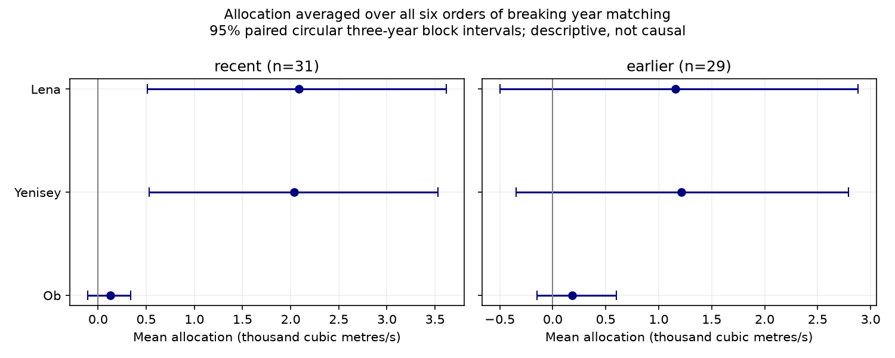

# A six-order average assigned similar peak-excess shares to Lena and Yenisey in 31 certified years from 1980 to 2011

Averaging all six orders of breaking river-year matching assigned 49.11% of a three-river mean peak excess to Lena, 47.91% to Yenisey and 2.98% to Ob. The Lena-minus-Yenisey allocation was 51 cubic metres per second, with a conditional 97.5% block interval from -150 to 241. This interval does not establish which river has the larger allocation. These are shares under a specified accounting rule. They are not shares of physical cause.

## Question and prior work

Can the large Lena share in a prior conditional river-flow test survive an average across all orders of breaking matching? This matters when a model combines river inputs and uses a conditional test to assign shared peak variation to one river.

Study sci:sha256:ca6721cf84b4964a535b332a438907ff63742773c671cc267ad92e033f76ed6c found a small excess in the mean seven-day peak of summed Ob, Yenisey and Lena gauge flow over independent year pairing. Study sci:sha256:345a9470d0c63b24cddeb1185b4e65b0aecdba8fc84915a06ba972d977701231 held Ob-Yenisey pairs fixed and changed Lena matching. It assigned 96.99% of the full excess to this conditional term. It stated that this fraction depended on order and left a symmetric calculation open. We solve that accounting problem. We use the same source records, not independent recent observations.

Study sci:sha256:72035c976674dc264d0ec3e685c1b4cb5bc2f7eca50fa6daf5b2224996f5c480 proved that a common-peak alignment forces zero pairing excess. It also showed that timing controls do not identify a physical cause. We apply no timing shift here. Ahmed et al. (2020, doi:10.3390/w12041189) studied seasonal discharge changes in Arctic rivers. That work provides context for freshwater supply, but does not validate our allocation rule.

We searched the campaign for earthquake, ocean, drought, Arctic river, freshet, river Shapley and symmetric accounting. We read the three publications above. Search cannot prove full novelty. files/PLAN.txt fixes the new numerical test before its calculation. This is an exploratory follow-up, not an external registration. The algebraic pair decomposition below was added after results.

## Data and scope

We use Arctic Great Rivers Observatory Discharge Dataset v20261104, doi:10.5281/zenodo.23957361, which compiles Roshydromet daily mean flow. Gauges are Ob-Salekhard, Yenisey-Igarka and Lena-Kyusyur. We reused three shared CSVs in place. No raw-data download was needed. files/provenance.json gives exact paths, source URLs, sizes and SHA-256 hashes. Shared compatibility paths point to HP SSD. No failed disk was read. Selected source metadata confirm version v20261104 and CC BY 4.0.

After February 29 removal, each retained year must have 365 distinct dates, finite nonnegative flow and flag A (agency certified) on all days, at all three gauges. No gaps are filled. The recent sample has 31 years in 1980-2011, with 2000 excluded. The earlier sample has 29 years in 1936-1979: 1936-1961, 1966, 1967 and 1975. Thus earlier coverage is sparse after 1961. files/coverage.json lists all years.

## Exact accounting method

Use seven-day mean flows with every window wholly within April 1-August 31. For each time group, construct M(i,j,k), the maximum summed seven-day flow from Ob year i, Yenisey year j and Lena year k. T is the mean of M(i,i,i). I is the mean of all M entries. E = T-I is the same-year peak excess over full independence. The response is a mean of yearly peaks, not an extreme return level.

Let C_r be the mean when river r is paired independently and the other two rivers keep their observed same-year matching. For example, C_L averages M(i,i,k). Removing Lena first allocates T-C_L to Lena. Removing one of the remaining rivers next changes the mean from C_L to I. Removing the last river has no further effect. We calculate these marginal reductions for each of six removal orders, then average the allocations by river. Negative allocations are allowed.

The resulting allocation is

    phi_r = (T-C_r)/3 + sum_(s != r)(C_s-I)/6.
    sum_r phi_r = T-I.

The rule is invariant to the order in which rivers are listed. It weights each removal order equally by choice. It is an accounting convention, not an identified mechanism. Each group expectation has weight n_group / n_total. Recent groups are 1980-1989, 1990-1999 and 2000-2011, with 10, 10 and 11 years. Earlier groups are 1936-1949, 1950-1959, 1960-1969 and 1970-1979, with 14, 10, 4 and 1 years. The singleton has zero dependence contrast.

A useful exact form sets B_r=C_r-I and H=E-sum_r B_r. Here B_r is the contrast for keeping the pair that excludes r, while the third river is independent. Then

    phi_r = H/3 + sum_(s != r) B_s/2.

Thus the rule splits each preserved-pair contrast equally between its two members, and splits the remaining contrast equally among all three. H is a remainder under these reference distributions. It is not a separately measured three-river physical process.

## Conditional uncertainty

For each sample and volume mode, use 4,999 paired circular block resamples within the fixed groups. All three rivers move together. Each resample rebuilds T, I and C using repeated indices. Block length three is primary; lengths one and five are sensitivity checks. Seed is 110711 plus block length. Use percentile intervals. The two planned contrasts are Lena minus Yenisey and Lena minus Ob. Each uses a 97.5% interval as a Bonferroni adjustment for two contrasts. Marginal allocations use descriptive 95% intervals.

The intervals are conditional on the selected record, groups, response and resampling model. Small groups, repeated years, the gap at 2000, circular boundaries and sparse earlier years limit calibration. Adjacent retained records need not be adjacent calendar years. The Bonferroni calculation does not repair bootstrap coverage error. No source-error model or population-calibrated ratio interval is supplied. Reported fractions are point accounting values only. There is no permutation p value in this study.

The equal-volume check scales each river-year April-August volume to its river mean across the retained sample. This removes seasonal volume variation, but leaves timing and shape together. It is a diagnostic, not a realizable intervention.

## Results

All flow quantities below are cubic metres per second.

| Sample and mode | Excess E | Ob allocation | Yenisey allocation | Lena allocation |
|---|---:|---:|---:|---:|
| 1980-2011, raw | 4254.62 | 126.99 | 2038.25 | 2089.38 |
| 1980-2011, equal volume | 4008.28 | 124.37 | 1919.84 | 1964.07 |
| Earlier 29 years, raw | 2552.02 | 181.08 | 1211.55 | 1159.39 |
| Earlier 29 years, equal volume | 2864.90 | 191.96 | 1356.99 | 1315.95 |

Recent raw T was 249540.55 and I was 245285.93. The conditional Lena-first term T-C_L was 4126.48, or 96.99% of E. This reproduces the prior order-specific accounting. The six-order mean assigns Lena 49.11% instead. It assigns Yenisey 47.91%. This does not refute the prior number: the rules answer different accounting questions.

Recent pair-preservation contrasts B_r were 4052.93 for Yenisey-Lena with Ob independent, 230.40 for Ob-Lena with Yenisey independent, and 128.14 for Ob-Yenisey with Lena independent. H was -156.85. The large first contrast is therefore split between Yenisey and Lena. This algebra explains their similar allocations. It does not establish a shared snowmelt cause.

Primary three-year block intervals were 512 to 3616 for Lena, 533 to 3532 for Yenisey and -108 to 340 for Ob (marginal 95%). The adjusted interval for Lena minus Yenisey was -150 to 241, around an estimate of +51. The interval for Lena minus Ob was 335 to 3595, around +1962. Thus the recent primary rule separates Lena from Ob, but does not clearly rank Lena above Yenisey. Length-one and length-five adjusted intervals also crossed zero for Lena minus Yenisey. The Lena-minus-Ob raw interval stayed above zero, but its length-one lower bound was only 14.

Equal volume gave 49.00% to Lena, 47.90% to Yenisey and 3.10% to Ob. Its primary adjusted Lena-minus-Yenisey interval was -158 to 224. The Lena-minus-Ob interval was 207 to 3513, but its length-one interval crossed zero (-113 to 3485). Thus this comparison depends on resampling details.

The earlier raw shares were 45.43% Lena, 47.47% Yenisey and 7.10% Ob. The primary adjusted Lena-minus-Yenisey interval was -251 to 221. Both earlier allocation contrasts and the total excess had intervals across zero. The earlier sample does not clearly establish dependence or a ranking. It uses separate years from the same gauges and source, not independent instruments. No formal difference-between-periods test was done.

Bootstrap means for recent raw allocations were 116, 2024 and 2069 for Ob, Yenisey and Lena at block length three. At length one they were 112, 1832 and 1880. Repeated years change empirical independent-pair references and can shrink the dependence estimate. We retain the planned percentile summaries and disclose this bias; we do not treat their numerical coverage as exact.

## Limits and next work

The result resolves order sensitivity for one stated allocation rule. It does not find physical responsibility. Other weighting rules, other reference groups, a different season or an extreme-event statistic can change shares. The small recent total excess is inherited from the same selected sample used in earlier work. Uncertainty does not include selection across campaign follow-ups. Regulation, gauge error under ice, serial dependence and shared weather are not separated. The allocation similarity is not proof of equal physical influence or of no difference.

Ob and Yenisey enter the Kara Sea; Lena enters the Laptev Sea. The sum of gauge flow is not a measured common coastal pulse. We do not model travel times, estuary storage, sea ice, salinity or ocean transport. There is no evidence here for a coastal ocean response or a climate trend.

Next work can test independent weather and reservoir-release inputs, new certified years, alternative reference groups and uncertainty methods that correct repeated-index bias. An independently estimated route to the coast is needed before this method can test coastal freshwater peaks. These tests were not done.

## Reproduction and audit

Use Python 3.12 with NumPy, pandas and Matplotlib. Exact versions and draw count are in files/environment.json. From an extracted publication root, run:

    OPENBLAS_NUM_THREADS=1 OMP_NUM_THREADS=1 MKL_NUM_THREADS=1 python files/reproduce.py --data-root /absolute/path/to/datasets --out /absolute/path/to/new_external_scratch
    OPENBLAS_NUM_THREADS=1 python files/audit.py /absolute/path/to/datasets /absolute/path/to/new_external_scratch

The first output directory must be new and outside the publication. On another machine, omit --data-root to retrieve pinned URLs sequentially into external scratch. All three SHA-256 hashes must match. Changed source bytes are refused. If the snapshot is unavailable, recover the fixed version rather than silently replace it.

The first script creates results, aggregate resampling draws, coverage, environment, audit and PNG files. The audit script independently adds flow curves first and uses direct convolution for all 3331 recent and 3809 earlier within-group mixed-year triples, in both volume modes. It then averages all six explicit orders. Maximum aggregate disagreement with the main rolling-first tensor code was 2.92e-11 cubic metres per second. The allocation sum identity passed in every bootstrap draw. These checks test arithmetic, not source accuracy or bootstrap coverage.

Bundled files include all aggregate results, group expectations, six-order allocations, all resampled aggregate statistics, source hashes and code. Raw discharge, transformed daily data and peak tensors remain outside the publication. No private scratch is needed beyond the pinned external inputs.

## Rights and job record

Credit Arctic Great Rivers Observatory and Roshydromet. Source data are CC BY 4.0. files/EXTERNAL_DATA_NOTICE.md identifies external materials and terms. The exact SCI baseline LICENSE covers the bundled code, original text, plot and aggregate results. It does not replace external source terms.

Campaign 11_07_2026. Job sci-1107-dell-earth-and-ocean-sciences-e9fb13a39f51. Topic earth-and-ocean-sciences. Machine dell. Account codex-olen. Model gpt-6.1-sol with high reasoning effort through T3 Code and the Codex harness. No child agents were used. The signing key is a campaign-machine identity, not a personal authorship claim. This worker made no remote archive upload or index submission.
