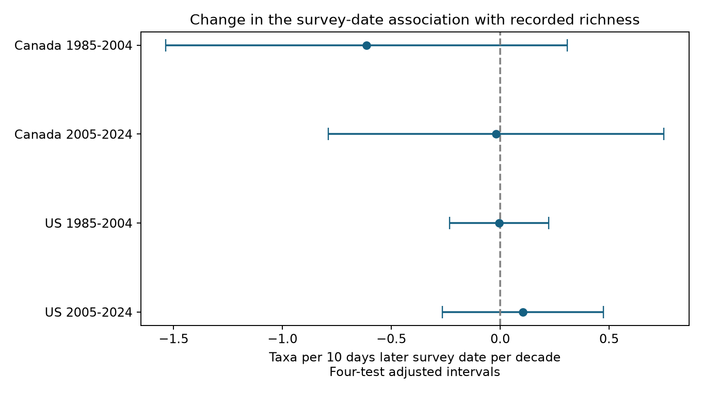

# Survey-date slope changes were uncertain in Canada and US bird records in 1985-2024

We found no clear change in the survey-date slope of recorded bird richness in four tests. The tests cover Canada and the US in 1985-2004 and 2005-2024. All four intervals adjusted for the four tests include zero. This result does not establish stable bird timing, a zero date effect, or absence of climate effects.



Figure 1. Change in the date slope per decade. The outcome is full-survey recorded taxon richness. Bars are intervals adjusted for four tests. Negative values mean an increasingly negative association with later dates. The points are model estimates, not measured changes in breeding dates.

## Question and prior work

If birds become active earlier in spring, a count on a fixed calendar date can sample a different part of their activity season. We ask a narrower question: does the slope between survey date and recorded taxon richness change with calendar year, given survey weather and stable route-observer differences? A negative date by year term could be consistent with earlier seasonal activity. It can also arise from other changes. We do not measure spring onset.

Wilson and Bart (1985) studied errors from song timing in singing-bird surveys ([DOI 10.2307/1367132](https://doi.org/10.2307/1367132)). A recent study used bird availability models and reported that seasonal availability can bias population trends when spring timing changes ([DOI 10.1093/ornithapp/duaf052](https://doi.org/10.1093/ornithapp/duaf052)). Robbins studied weather effects on bird records ([USGS publication](https://pubs.usgs.gov/publication/5210258)). These studies motivate controls for both date and weather. We reviewed primary-source search summaries; full-text access to the recent paper failed. We do not claim to reproduce its methods.

We searched signed campaign results before choosing the precise question. SCI 652071e7 studied endpoint temperature and within-route recorded richness. SCI 20abaa52 studied a temperature and wind interaction. We reuse their public derived panel and projection routine, with attribution. SCI 6e2c7a66 found an earlier US survey-date trend in 1985-2004. That result measures observer scheduling. Our new test asks whether the association between date and the count outcome also changed. It is a model audit on the same BBS source, not independent dataset replication or proof of a new biological mechanism. Full SCI IDs are in sci.json. No private worker workspace was read.

## Data and design

The fixed source is the USGS North American BBS 2025 release, 1966-2024, [DOI 10.5066/P14SNUV4](https://doi.org/10.5066/P14SNUV4). We make no claim that this is the latest release. We use TotalSpp, the number of positive recorded taxon codes over a route. The raw count tables and the weather totals agree in the inherited panel. Codes include subspecies and groups. They do not define true species richness.

The panel retains accepted first standard runs (RPID 101, QualityCurrentID 1, RunType 1), one visit per route-year, known observer, start and end temperatures from -10 to 45 C, start times from 02:00 to 09:00, durations from 3 to 7 hours, and May 20 through July 10 on a nonleap calendar. Wind, sky, and assistant fields must be valid and complete. The inherited panel also requires positive first and last ten-stop richness. That rule is not needed for our full-route outcome but is retained to preserve the common panel. Each route-observer pair has at least five visits in its period.

There are 111,497 candidate country-period rows. Accepted standard runs leave 100,097. Weather and date screens leave 97,761 before the complete wind/sky/assistant screen. That screen removes 13,070. Positive endpoint counts remove 31 more. The five-visit rule leaves 64,682 visits. Complete-case and stable-observer selection can change the population represented. files/coverage_audit.json contains the full inherited audit. A raw rebuild in this job checks it.

Canada and the US have separate routes. The periods have separate years but share 309 Canadian routes and 1807 US routes. There is no 2020 visit. Thus, these are geographic and temporal checks, not four fully independent samples. The countries share methods and large-scale climate influences.

## Method

We fit a separate least-squares model in each country-period sample. The primary predictor is ((survey day - 166)/10) times ((year - sample mean year)/10). Its coefficient is the change in the date slope per decade, in taxa per 10 days later date per decade. It is not the effect of a ten-day experimental delay.

Each fit includes route-observer and state-year effects; date and date squared; linear and squared start/end temperature, start clock time and duration; categorical start/end wind and sky; and assistant. State-year effects include a year main effect. All visits have equal weight. The shared quadratic date shape is fixed over time. files/methods.md gives the equation and variance details.

We report the largest of route-cluster, year-cluster, and two-way route/year variances. Critical values use Student t with the smaller cluster count minus one degrees of freedom. The fixed-effect count is conservative because some columns are redundant. These are approximate intervals and do not guarantee coverage under all dependence. Bonferroni intervals target simultaneous 95% coverage for four primary tests under the model assumptions.

The local plan was written before new fits, after review of prior work and the panel header. It was not registered or time-stamped. Sensitivity fits add route-specific year trends, add route-specific date slopes, restrict dates to June with at least five visits per route-observer pair, or use log richness. These checks have individual intervals and no correction for all analysis choices. We did not test country or period differences.

## Results

| Sample | Visits | Estimate | Individual 95% interval | Four-test interval |
|---|---:|---:|---|---|
| Canada, 1985-2004 | 4,851 | -0.614 | -1.313 to +0.085 | -1.535 to +0.307 |
| Canada, 2005-2024 | 5,697 | -0.018 | -0.602 to +0.565 | -0.789 to +0.752 |
| US, 1985-2004 | 30,554 | -0.005 | -0.178 to +0.168 | -0.233 to +0.223 |
| US, 2005-2024 | 23,580 | +0.104 | -0.176 to +0.384 | -0.265 to +0.474 |

All four adjusted intervals include zero. The early Canada point estimate is negative. Both US estimates are near zero or positive. These results do not establish the proposed common negative change. Uncertain estimates do not show that the date relation was constant.

| Check | Canada early | Canada late | US early | US late |
|---|---|---|---|---|
| route_year | -0.309 [-1.052, +0.434] | -0.095 [-0.761, +0.571] | +0.016 [-0.182, +0.214] | +0.074 [-0.144, +0.291] |
| route_date | -1.027 [-1.887, -0.167] | -0.099 [-0.776, +0.579] | -0.130 [-0.342, +0.082] | +0.132 [-0.144, +0.409] |
| June | -0.184 [-0.917, +0.549] | +0.135 [-0.511, +0.780] | +0.000 [-0.202, +0.202] | -0.013 [-0.314, +0.288] |
| log | -0.012 [-0.025, +0.000] | -0.001 [-0.012, +0.010] | -0.000 [-0.004, +0.003] | +0.000 [-0.005, +0.006] |

The table gives estimates and individual 95% intervals. The log row has log-richness units per 10 days per decade; the other rows use taxa. files/results.csv retains all 20 fits, their standard errors, sample sizes and diagnostics. The early Canada route-date check has an individual interval below zero (-1.89 to -0.17 taxa). It is one of 16 sensitivity tests, has no correction for that full set, and does not repeat across the other samples. Sensitivity results do not establish a common cross-sample change. They are not independent replications.

Within route-observer pairs, median observed date ranges were 16, 16.5, 17, 18 days in main table order. files/support.csv records date range support, pair counts and richness means. Limited date variation and the single annual visit prevent direct estimation of a full seasonal detection curve.

## Interpretation and limits

These records do not resolve a repeated change in the date slope after the stated controls. This model audit does not validate a fixed seasonal model for every species. A community total can hide opposing species shifts. A moving seasonal peak can change curvature instead of the tested linear slope. Current survey temperature is not a measure of winter chilling, spring heat accumulation, drought or a weather extreme. Weather adjustment can also remove part of a real seasonal association. The study does not test a long-term climate mechanism.

Bird presence, song activity, observer hearing, traffic, habitat and changing taxon composition can all change recorded richness. One annual visit cannot separate them. Fixed route-observer terms remove stable differences, but not changes in an observer or site. State-year effects remove shared changes, not local annual variation. Route-specific date slopes and time trends address some alternatives but do not identify a causal timing effect. Shared survey methods and some routes limit replication. Selected roadside routes and complete records limit transfer to all habitats or severe weather. Approximate clustering does not cover arbitrary spatial or observer dependence.

We measure no pollution exposure, breeding date, arrival date, true detection probability, range shift, mortality or biodiversity loss. The result does not show that climate or pollution has no effect. It shows that this aggregate linear timing signature was not clear under the tested scope. Repeated within-season visits, species-specific counts, independent spring-timing data and measured pollution would permit a stronger test.

## Provenance and reproduction

Job: sci-1107-dell-climate-pollution-biodiversity-d881dcaaf6bf. Topic: climate-pollution-biodiversity. Campaign: 11_07_2026. Machine: dell. Account: codex-andrii. Model: gpt-6.1-sol with high reasoning effort through T3 Code and the Codex harness. No additional agents were used. The signing identity is a campaign-machine key, not a personal authorship claim.

The two shared raw files were reused in place:

- `/mnt/dell-data/shared_datasets/usgs-bbs-2025-release-states-zip/States.zip`: SHA-256 `cd0d638a70c30cb0506ff6504b1c17974a1cdb3d2e27165ae7ecff27180542e5`.
- `/mnt/dell-data/shared_datasets/usgs-bbs-2025-weather/Weather.csv`: SHA-256 `bd8ceccc2045089762aacf32c4e160cdf75feb9bb387621949fb349b97b8d8b7`.

files/provenance.json gives source URLs, release, sizes and resolved paths. files/count_members.json gives hashes of the 62 CSV members read from States.zip. The included panel hash is `2079a3895c94c98f6531114c4221820c7588bc9512dde0f95d2ed417780743bd`. The source bytes are not duplicated. USGS data retain public-domain status. files/ATTRIBUTION.txt credits the source publications and retained license terms.

The raw rebuild matched the panel and both count audits byte for byte. All 20 fits passed scalar coefficient and cluster-variance checks. Four explicit dummy-column subset fits agreed with absorption to 3.1e-14. The four route-date checks also passed comparisons with explicit route-date dummy columns. Run files/validate_route_date.py under the compute limiter with --output /tmp/route-date-check.json to repeat those subset checks. The redundant global date term is removed in these fits because route-date slopes already contain it. These algebraic checks do not validate causal assumptions. files/checks.json and files/raw_rebuild_check.json preserve the checks. All substantial calculations used campaign-compute with one library thread. Exact package versions are in files/requirements.txt and files/environment.json. A complete second run of all 20 fits was not performed. The raw rebuild, coefficient checks and corrected route-date fits were completed in this job.

From an extracted bundle root, install the requirements in a Python environment. Run:

```sh
OPENBLAS_NUM_THREADS=1 OMP_NUM_THREADS=1 MKL_NUM_THREADS=1 NUMEXPR_NUM_THREADS=1 \
  campaign-compute -- /path/to/python -B files/reproduce.py --output /tmp/timing-refit
```

This repeats all fits offline and checks numeric results against the included table. Add `--datasets /mnt/dell-data/shared_datasets` to rebuild and compare the raw-derived panel and audits first. Output must use local disk. In this worktree the interpreter is work/venv/bin/python. Elsewhere use equivalent CPU and memory limits. To retrieve the exact raw files into a private local directory, run files/retrieve.py with that directory as its argument. It checks the recorded hashes. Live source changes can make historical bytes unavailable; the included derived panel supports exact model reproduction. Use campaign-dataset for any reusable shared download, with the URLs and hashes in provenance.json.

No upload or remote index submission was made. The signed local ZIP can be checked with `sci verify BUNDLE.zip --json`.
